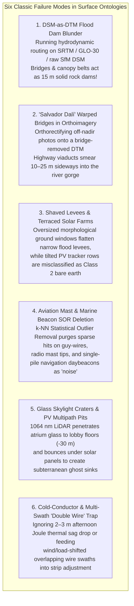

## 20.8 Common Pitfalls and Key Takeaways

Semantic ambiguity in elevation modeling is rarely benign. Feeding a first-return DSM into a flood solver, orthorectifying aerial imagery over a bridge-stripped DTM, letting an automated outlier filter erase a $300\text{ m}$ guy-wired radio mast or offshore channel beacon, or certifying powerline clearance from a cool-morning LiDAR pass without thermal state modeling directly causes infrastructure failures and life-safety hazards.

---

### 20.8.1 Common Pitfalls in Surface Semantics and Object Classification

#### 1. Ingesting a DSM into a Hydraulic Flood Solver (The Phantom Dam Disaster)
Downloading a global or drone-derived "DEM" (such as Copernicus GLO-30, SRTM, or unfiltered SfM photogrammetry) and feeding it directly into a 2D shallow-water flood model (`HEC-RAS 2D`, `ANUGA`, `Delft3D`) treats tree canopies, buildings, stacked port shipping containers, and highway bridge decks as impermeable bedrock. Free-spanning bridges block river channels like concrete arch dams, fabricating meters of false upstream backwater flooding while starving downstream floodplains. Conversely, using a geometric bare-earth DTM *without* culvert breaching impounds phantom lakes behind every road embankment.

#### 2. Orthorectifying Aerial Imagery Over a Bare-Earth DTM ("Salvador Dalí" Bridges)
When bare-earth DTM production properly strips `Class 17` bridge decks, many GIS teams mistakenly reuse that exact same bare-earth DTM to orthorectify aerial or satellite imagery. Off-nadir camera rays passing through an elevated viaduct intersect the riverbed tens of meters further from nadir ($\Delta r = \Delta z_{\text{bridge}}\tan\theta_i$), warping straight concrete highway bridges into surreal, wavy ribbons draped down canyon walls and across river water. **True Orthophoto** production strictly requires restoring 3D bridge-deck and building roof polygons (`DBBM`) onto the terrain surface.

#### 3. Deleting Aviation Obstructions and Marine Beacons with Outlier Filters
Running blind $k$-nearest-neighbor Statistical Outlier Removal (`PDAL filters.outlier`) or aggressive CUBE hypothesis culling across raw point clouds deletes sparse, isolated returns on $12\text{ mm}$ guy-wires, tapered lattice radio spires, crane booms, and single-pile marine navigation beacons—silently erasing the exact vertical hazards that helicopter Terrain Awareness and Warning Systems (TAWS) and nautical charts (IHO S-44 Special/Exclusive Order) exist to protect against.

#### 4. Levee Crest Shaving vs. Solar-Farm Commission Errors
Applying a uniform ground-filter window across engineered landscapes triggers opposite failure modes: a $40\text{ m}$ morphological window (tuned to remove warehouses) truncates $15\text{ m}$-wide flood-control levees down to floodplain grade, whereas $200\text{ m}$-long rows of tilted solar PV trackers with $0.6\text{ m}$ lower-lip clearance fool ground filters into accepting panels as natural terraced hillsides—often compounded by $3\text{–}9\text{ m}$ deep subterranean multipath pits directly underneath the arrays.

#### 5. Glass Atrium Craters and Unscaled BIM-to-GIS Imports
Near-infrared ($1064\text{ nm}$) airborne LiDAR transmits through clean glass skylights ($R_{\text{Fresnel}} \approx 4\%$), striking indoor mezzanines and ground-floor lobbies to punch jagged craters into urban DSMs. When teams patch urban scenes with architectural `.ifc` BIM models without applying the **Combined Scale Factor** ($\text{CSF} = k \frac{R_\oplus}{R_\oplus + h}$) via `IfcMapConversion`, multi-hundred-meter bridges and tunnel portals misalign horizontally by decimeters at their abutments.

#### 6. Evaluating Powerline Clearance from Static Single-Epoch Coordinates (and "Double Wires")
Certifying vegetation clearance from a cool-morning LiDAR flight ignores $2\text{–}3.5\text{ m}$ of afternoon $I^2 R$ Joule thermal sag and meter-scale cross-wind blowout. Furthermore, leaving `Class 13/14` wires inside inter-swath strip-adjustment tie features corrupts IMU boresight calibration whenever conductor sag or wind sway shifts between flight passes 20 minutes apart.

---

### 20.8.2 Key Takeaways

1. **"Ground" Is an Operational Contract, Not a Universal Physical Constant:** Always specify and verify the exact semantic horizon—wavelength-specific **DSM**, breakline-enforced bare-earth **DTM**, culvert-breached **Hydro-DEM**, bridge-inclusive **True-Ortho DBBM**, or unified **TBDEM**—before running any physical or geometric analysis.
2. **Maintain Non-Destructive Classified Layers:** Never bake irreversible semantic choices into a single unattributed raster. Preserve full ASPRS LAS 1.4 (`Classes 0–255`, including `Class 13` Guard Wire, `Class 14` Conductor, `Class 17` Bridge Deck, `Class 40` Bathymetric Bottom, and `Class 44` S-57 Object) alongside vector breaklines and provenance masks so specialized surfaces can be regenerated on demand.
3. **Shield Slender Obstructions and Levees from Automated Filters:** Protect known aviation towers, guy-wire corridors, offshore beacons (`Designated Soundings`), and flood-control levee crests using vector inclusion polygons and eigenvalue linearity features rather than indiscriminate statistical outlier culling.
4. **Model Dynamic Infrastructure Physics Explicitly:** Treat overhead conductors as thermo-elastic catenaries governed by the cubic state-change equation and IEEE Std 738 heat balance, and replace kinematically smeared wind-turbine rotors with parametric clearance envelopes.
5. **Enforce Geodetic Rigor Across the Exterior–Innerspace Portal:** Mask architectural glass footprints against NIR laser leakage, anchor subterranean tunnel SLAM trajectories with portal total-station traverses, and apply explicit `IfcMapConversion` + Combined Scale Factor transformations when fusing indoor BIM solids with geodetic DEMs.
