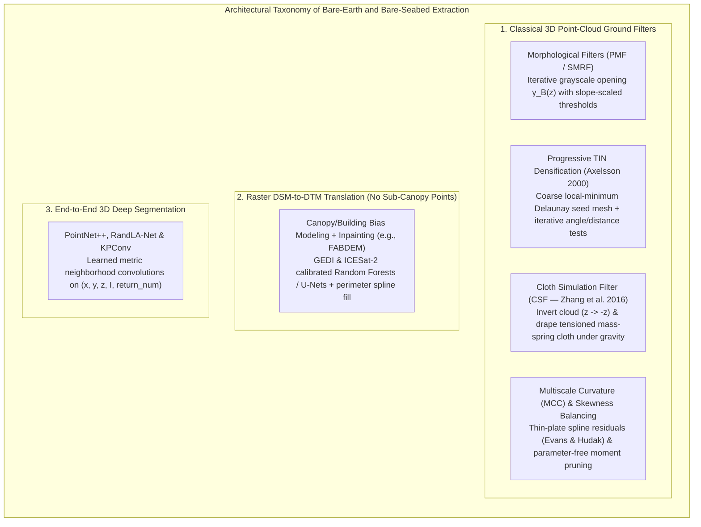
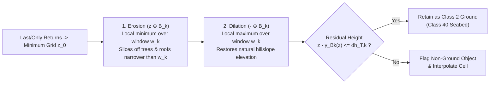

# Chapter 21: Bare-Earth Extraction (DSM to DTM), Data Gaps, Shadows, and Overhangs

*How objects are removed from a DSM to create a DTM, the hidden interpolation uncertainties under removed objects, and how to handle voids and vertical/overhanging geometry.*

Transforming a reflective first-surface **Digital Surface Model (DSM)** or an unclassified 3D point cloud into a bare-earth **Digital Terrain Model (DTM)**—or its submerged equivalent, a bare-seabed **Digital Bathymetric Model (DBM)** stripped of kelp forests, shipwrecks, and fish schools—is fundamentally an ill-posed inverse problem. Remote sensing instruments do not carry a physical "ground detector"; they record electromagnetic or acoustic wave reflections from whatever material boundary intercepts their beam. Separating the solid mineral Earth from multi-tiered rainforest canopies, chaparral brush, parked cars, $300\text{ m}$ logistics warehouses, highway bridges, and benthic macroalgae requires coupling geometric morphology, surface physics, and statistical learning.

Equally critical, whenever an off-terrain object is excised or a sensor line-of-sight is blocked by clouds, radar layover, or acoustic shadows, a **measurement void** remains behind. Reconstructing a continuous grid across that void replaces physical observation with mathematical interpolation—and when topography folds into vertical sea cliffs, natural arches, or undercut riverbanks, single-valued 2.5D rasters break down altogether.

---

## 21.1 Removing Objects from a DSM or Point Cloud to Create a DTM

Bare-earth extraction algorithms fall into three distinct architectural families depending on data representation and prior training data:
1. **3D Point-Cloud Geometric and Physical Filters:** Operate directly on unstructured $(x, y, z)$ laser or sonar soundings using morphological openings, iterative TIN facets, simulated cloth physics, multi-scale spline curvature, or statistical skewness.
2. **2D Raster DSM-to-DTM Bias Subtraction and Inpainting:** Operate on compiled satellite or photogrammetric DSM grids (e.g., Copernicus GLO-30, SRTM) where sub-canopy returns do not exist, leveraging auxiliary land-cover masks and spaceborne laser altimetry (`GEDI`, `ICESat-2`).
3. **3D Point-Based and 2D Convolutional Deep Learning:** Learn multi-scale shape, radiometric, and contextual priors directly from labeled terrain datasets.

---

### 21.1.1 Classical Point-Cloud Ground Filtering Algorithms

#### 1. Progressive Morphological Filtering (`PMF` and `SMRF`)
Introduced in progressive form by **Keqi Zhang et al. (2003)** and streamlined by **Thomas Pingel, Keith Clarke, and William McBride (2013)** as the **Simple Morphological Filter (`SMRF`)**, morphological ground filters rasterize the lowest last-return points in each grid cell of spacing $c = \Delta x$ into an initial minimum surface $z_0(i, j)$ and apply iterative grayscale **morphological opening** $\gamma_{B_k}(z) = (z \ominus B_k) \oplus B_k$:

* **Window Progression vs. Slope Protection:** A small structuring window ($w_1 = 3\text{ m}$) strips cars, boulders, and tree trunks without harming terrain relief, whereas removing a $60\text{ m}$-wide commercial building requires expanding $w_k > 60\text{ m}$. Because a large flat structuring element truncates natural mountain peaks, `PMF` scales the allowable height residual $dh_{T,k} = s(w_k - w_{k-1})c + dh_0$ linearly with maximum terrain slope $s = \tan\alpha_{\max}$ (derived fully in Section 21.5).
* **`SMRF` Improvement:** Rather than jumping geometrically in window size ($w_k = 2 b^k + 1$), `Pingel et al. (2013)` increase window radius linearly by one pixel per step ($r_k = k$ pixels) and inpaint newly flagged object cells at every iteration using a thin-plate spline before computing the final point-to-surface residual—dramatically reducing Type I ridge-clipping while requiring only four intuitive parameters (`cell`, `slope`, `window`, `threshold`).

#### 2. Progressive TIN Densification (`PTD` — Axelsson, 2000)
Published by **Peter Axelsson (2000)** and deployed worldwide in **Terrasolid `TerraScan`** and **`LAStools lasground_new`**, Progressive TIN Densification avoids rasterization altogether by operating directly on an adaptive 3D Constrained Delaunay Triangulation:
1. **Coarse Seed Selection:** Partition the horizontal domain into large blocks of width $L_{\text{seed}}$ (chosen wider than the largest building in the project, e.g., $L_{\text{seed}} = 50\text{–}120\text{ m}$), and select the lowest (noise-screened!) last-return point in each block to construct an initial sparse ground TIN $\mathcal{T}_0$.
2. **Iterative Facet Acceptance Criteria:** For every unclassified point $\mathbf{p} = [x_p, y_p, z_p]^\top$ falling horizontally inside triangle $T_{abc}$ with unit normal $\hat{\mathbf{n}}_T$, compute:
   * The perpendicular signed distance from $\mathbf{p}$ to the facet plane: $d_\perp = \hat{\mathbf{n}}_T \cdot (\mathbf{p} - \mathbf{v}_a)$.
   * The maximum elevation angle from the three triangle vertices $\mathbf{v}_m \in \{\mathbf{v}_a, \mathbf{v}_b, \mathbf{v}_c\}$ to $\mathbf{p}$ relative to the facet plane:
     $$\theta_{\max}(\mathbf{p}) = \max_{m \in \{a,b,c\}} \arcsin\!\left(\frac{|d_\perp|}{\|\mathbf{p} - \mathbf{v}_m\|_2}\right)$$
3. **Mesh Refinement:** Every candidate point satisfying *both* $|d_\perp| \le d_{\max}$ (typically $0.3\text{–}1.0\text{ m}$) and $\theta_{\max}(\mathbf{p}) \le \theta_{\text{thresh}}$ (typically $6^\circ\text{–}12^\circ$) is inserted into $\mathcal{T}_{k+1}$ (mirroring edge-near points across steep breaklines to avoid edge starvation), and iteration repeats until convergence. Because the TIN facets tilt naturally with steep $45^\circ$ canyon walls, `PTD` excels in rugged alpine topography and submarine canyon bathymetry.

#### 3. Cloth Simulation Filter (`CSF` — Zhang et al., 2016)
Formulated by **Wuming Zhang et al. (2016)**, `CSF` flips the point cloud upside-down ($z_{\text{inv}} = -z$) and simulates dropping a physical cloth modeled as a regular $M_x \times M_y$ mass-spring lattice above the inverted cloud:
* At each discrete time step $\Delta t$, particle elevations evolve under virtual gravity via explicit Störmer–Verlet integration (or its velocity-damped form):
  $$z_{\text{cloth}}(t + \Delta t) = 2 z_{\text{cloth}}(t) - z_{\text{cloth}}(t - \Delta t) - g_{\text{virt}}\,\Delta t^2$$
* Whenever a cloth node drops below the inverted ground surface ($z_{\text{cloth},i} < z_{\text{inv},i}$), it is pinned as *unmovable* at $z_{\text{inv},i}$, while *movable* nodes suspended over inverted building/tree cavities are pulled upward by internal spring-displacement iterations parameterized by a single integer **cloth rigidness** (`rigidness` $\in \{1, 2, 3\}$ for steep mountains, terraced hills, and flat cities, plus optional post-processing slope smoothing). Points within vertical distance $h_{\text{cc}}$ (typically $0.5\text{ m}$) of the final upright cloth are labeled `Class 2` Ground.

#### 4. Multiscale Curvature Classification (`MCC`) and Skewness Balancing
Two complementary classical paradigms specifically target dense forested terrain and parameter-free separation:
* **Multiscale Curvature Classification (`MCC` — Evans & Hudak, 2007):** Designed specifically for forested watersheds where shrubs and canopy understory confound morphological windows, `MCC` fits thin-plate regularized splines $s_\ell(x, y)$ across three progressive scale domains ($\ell \in \{0.5\Delta s, 1.0\Delta s, 1.5\Delta s\}$) and iteratively discards points exhibiting positive upward surface curvature residuals $z_i - s_\ell(x_i, y_i) > t_\ell$ until fewer than $0.1\%$ of points change class.
* **Skewness Balancing (`Bartels & Wei, 2010`):** Observes that elevation residuals on bare undulating terrain follow a symmetric zero-skewness Gaussian distribution ($\gamma_1 = \frac{\mu_3}{\sigma^3} \approx 0$), whereas positive off-terrain objects (trees, roofs, boulders) induce strong positive third-moment skewness ($\gamma_1 > 0$). Iteratively removing the highest point in local detrended tiles until sample skewness crosses $\gamma_1 \le 0$ yields a threshold-free ground classifier on flat-to-moderate relief—and is equally effective for stripping submerged boulders and kelp plumes from acoustic seabed swaths!

---

### 21.1.2 Raster DSM-to-DTM Conversion When Point Clouds Are Unavailable

Across $>75\%$ of Earth's landmass, open airborne LiDAR point clouds do not yet exist; practitioners possess only spaceborne InSAR or optical stereo DSM rasters (**Copernicus GLO-30**, **SRTM**, **ALOS AW3D30**) in which sub-canopy ground was never directly imaged. Converting a raster DSM to a bare-earth DTM requires **external bias estimation + spatial inpainting**:

$$\hat{z}_{\text{DTM}}(x, y) = \begin{cases} z_{\text{DSM}}(x, y) - \hat{h}_{\text{canopy}}(x, y; \mathbf{\Theta}_{\text{ML}}), & (x, y) \in \Omega_{\text{forest}} \\ \mathcal{I}_{\text{spline}}\!\big(\{z_{\text{DTM}}|_{\partial\Omega_{\text{bldg}}}\}\big)(x, y), & (x, y) \in \Omega_{\text{bldg}} \end{cases}$$

In the landmark **FABDEM** global $30\text{ m}$ bare-earth product (**Hawker et al., 2022**), separate Random Forest regressors were trained for forest height bias and urban building height bias using millions of spaceborne **NASA GEDI** full-waveform ground-elevation footprints (`elev_lowestmode`) and **ICESat-2** (`ATL08`) terrain photons alongside Sentinel-2 optical indices, nightlights, OSM/WorldSettlement footprints, and canopy height predictors, followed by morphological edge filtering and directional interpolation across building footprints. Higher-resolution regional workflows ($1\text{–}5\text{ m}$ satellite stereo DSMs) increasingly deploy **2D U-Net** and Swin-Transformer encoder-decoder architectures trained against overlapping 3DEP LiDAR DTMs to predict pixel-wise $\Delta\hat{z}_{\text{obj}} = z_{\text{DSM}} - z_{\text{DTM}}$ while enforcing smooth zero-gradient terrain continuity beneath occluded urban blocks.

---

### 21.1.3 3D Deep Learning Point-Cloud Segmentation (`PointNet++`, `RandLA-Net`, `KPConv`)

Rather than hand-crafting slope or window thresholds, modern 3D deep learning architectures operate directly on raw point clouds $\mathcal{P} = \{(\mathbf{x}_i, I_i, r_i, n_{r,i})\}_{i=1}^N$ (3D coordinates, radiometric intensity, return number, total returns):
* **`PointNet++` (Qi et al., 2017):** Applies nested farthest-point sampling, ball-query metric neighborhoods, and shared MLPs to capture multi-scale geometric structure, though farthest-point sampling scales as $\mathcal{O}(N^2)$ on large tiles.
* **`RandLA-Net` (Hu et al., 2020):** Replaces costly farthest-point sampling with $\mathcal{O}(N)$ uniform random decimation paired with attentive **Local Feature Aggregation** (dilated $k$-NN relative positional encoding), segmenting $10^6$ airborne LiDAR points per pass in seconds.
* **`KPConv` (Kernel Point Convolution — Thomas et al., 2019):** Defines continuous 3D spatial convolution weights carried by rigid or deformable Euclidean kernel points inside spherical metric neighborhoods (avoiding voxelization aliasing), achieving state-of-the-art accuracy separating low coastal shrubs, bridge decks (`Class 17`), and riprap levees from `Class 2` mineral ground—provided training tiles span diverse geomorphic provinces to prevent domain-shift hallucinations.
