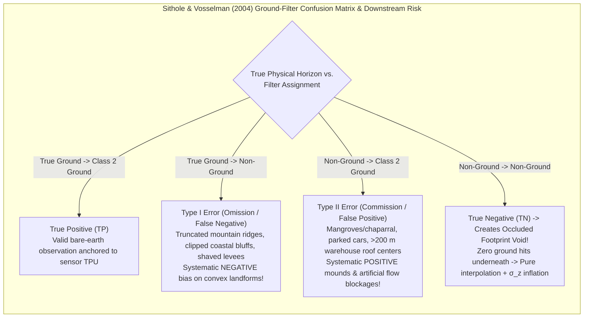
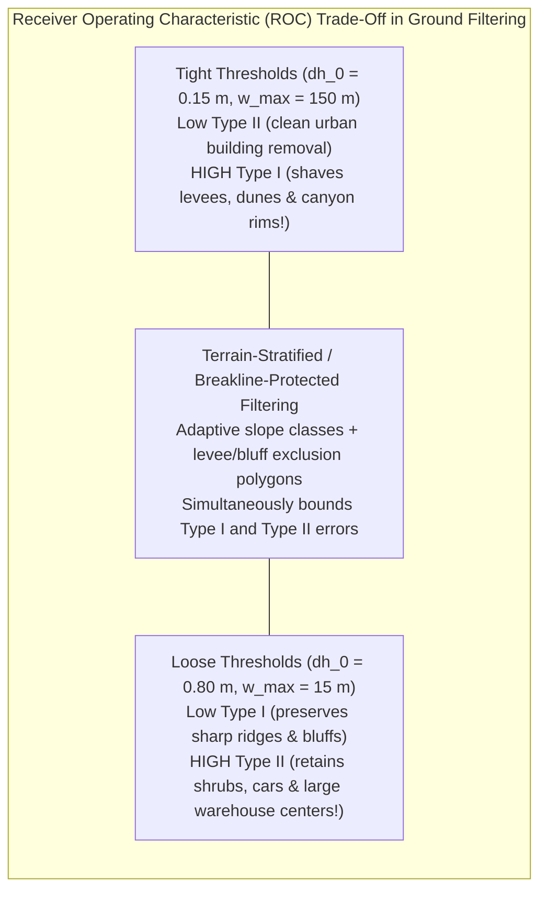

## 21.2 Errors and Unknowns When Removing Objects ($\text{DSM} \to \text{DTM}$)

Every bare-earth or bare-seabed filter solves an ambiguous classification problem under incomplete information: does a $1.8\text{ m}$ sharp elevation step represent an off-terrain concrete loading dock (which must be removed), or a natural fault scarp / flood-control levee (which must be preserved)? In the foundational ISPRS Working Group III/3 filter benchmark, **George Sithole and George Vosselman (2004)** formalized ground-extraction accuracy using **Type I (Omission)** and **Type II (Commission)** error matrices across eight canonical urban and rural landscapes.

Yet classification mistakes are only half of the error budget. Even when an algorithm achieves *perfect* $0\%$ Type I and $0\%$ Type II classification on a warehouse or closed rainforest canopy, removing those non-ground points exposes a **zero-observation void** whose interior DTM elevation is pure mathematical interpolation—an unmeasured surface whose vertical uncertainty inflates by an order of magnitude while commercial metadata routinely reports a uniform $\pm 10\text{ cm}$ accuracy!

---

### 21.2.1 Type I vs. Type II Classification Errors Across Land and Sea

Let $N_G = \text{TP} + \text{FN}$ denote the total number of true bare-earth points and $N_O = \text{TN} + \text{FP}$ denote the total number of true off-terrain object points evaluated against manually audited reference cross-sections. Following **Sithole and Vosselman (2004)**, the **Type I error rate** ($e_{\text{I}}$), **Type II error rate** ($e_{\text{II}}$), and **Total Error** ($e_{\text{tot}}$) are:

$$e_{\text{I}} = \frac{\text{FN}}{N_G}, \qquad e_{\text{II}} = \frac{\text{FP}}{N_O}, \qquad e_{\text{tot}} = \frac{\text{FN} + \text{FP}}{N_G + N_O}, \qquad \kappa_{\text{Cohen}} = \frac{p_o - p_e}{1 - p_e}$$

where Cohen's kappa $\kappa_{\text{Cohen}}$ guards against misleadingly low $e_{\text{tot}}$ in open desert or abyssal scenes where $99\%$ of points are trivially ground ($N_G \gg N_O$).

#### 1. Type I Errors (Omission — Rejecting True Ground or True Shoals)
Type I errors occur wherever natural bare topography exhibits high positive local curvature ($\nabla^2 z \ll 0$) or abrupt breakline discontinuities that exceed the filter's slope/angle envelope:
* **Terrestrial Landforms:** Knife-edge alpine arêtes, barchan sand-dune crests, terraced agricultural paddy walls, deeply incised badland gullies, coastal bluff rims, and narrow earthen flood levees. Because erosion/TIN filters interpolate smoothly underneath rejected crest points, Type I errors systematically **bevel and lower topographic highs** by $0.3\text{–}4.0\text{ m}$.
* **Hydrographic Equivalent (Shoal Beveling):** When automated bathymetric cleaning (`CUBE` or surface spline despiking) misclassifies the sharp apex of a granite rock pinnacle or coral bommie as an acoustic outlier flier, it truncates the shoalest depth $d_{\min}$ downward—creating an immediate vessel-grounding hazard!

#### 2. Type II Errors (Commission — Accepting Non-Ground Objects into the DTM)
Type II errors arise when off-terrain objects either prevent any sensor energy from reaching the mineral substrate or mimic continuous bare terrain at the scale of the filter window:
* **Impenetrable Low Vegetation ("The Shrub/Marsh Bias"):** In dense California *chaparral*, Arctic *Eriophorum* tussock tundra, salt-marsh *Spartina alterniflora*, coastal *Rhizophora* mangrove prop roots, and dense subaqueous *Posidonia* seagrass beds, $100\%$ of laser or $200\text{ kHz}$ sonar pulses scatter within the $0.4\text{–}2.0\text{ m}$ vegetative mat. Because zero physical returns exist on the mud or soil below, every geometric point-cloud filter locks onto the lowest stem hits, baking a **persistent $+0.3\text{ to }+1.8\text{ m}$ positive vertical bias** into coastal DTMs (which directly causes sea-level-rise models to underestimate marsh drowning!). Confirming USGS **Vegetated Vertical Accuracy ($\text{VVA}$ at $95\text{th}$ percentile)** via field RTK-GNSS survey rods pushed physically to mineral soil is the *only* way to detect and calibrate this bias.
* **Mega-Warehouses and Tiered Buildings Connected to Hillslopes:** Distribution centers ($250\text{ m} \times 400\text{ m}$ flat roofs), airport terminals, and buildings built flush into hillsides (where an upslope driveway transitions continuously onto a rooftop parking deck without a vertical step!) defeat both window-limited morphological filters ($w_{\max} < D_{\text{bldg}}$) and TIN facet-angle tests—leaving massive flat-topped mesas inside the "bare-earth" DTM.
* **Low Compact Objects:** Guardrails, jersey barriers, hay bales, Riprap armor blocks, low retaining walls, and tightly packed parking-lot vehicles.

---

### 21.2.2 The Unquantified Interpolation Void Underneath Removed Objects

Consider what physically remains in a `Class 2` point cloud after a $120\text{ m} \times 120\text{ m}$ industrial facility on a $6^\circ$ hillside—or a $1\text{ ha}$ patch of closed-canopy tropical forest with zero ground penetration—is cleanly removed: **an empty $14\,400\text{ m}^2$ polygon containing zero measurements**. When that filtered point cloud is gridded into a $1.0\text{ m}$ GeoTIFF DTM via TIN, spline, IDW, or Kriging interpolation, all $14\,400$ interior pixels receive crisp floating-point numbers (e.g., `142.384 m`) visually indistinguishable from open-field pixels carrying $12\text{ pts}\cdot\text{m}^{-2}$.

#### Total DTM Error Decomposition Inside an Occluded Footprint
At any grid node $\mathbf{x}_0$, the true bare-earth elevation $z_{\text{true}}(\mathbf{x}_0)$ differs from the interpolated DTM value $\hat{z}_{\text{DTM}}(\mathbf{x}_0)$ by three independent error mechanisms:

$$\sigma_{z,\text{DTM}}^2(\mathbf{x}_0) = \underbrace{\sigma_{\text{sensor}}^2}_{\text{GNSS/IMU/Range TPU}} + \underbrace{\sigma_{\text{interp}}^2\big(d_{\min}(\mathbf{x}_0), r_{\text{var}}\big)}_{\text{Geostatistical Void Variance}} + \underbrace{b_{\text{unmodeled}}^2(\mathbf{x}_0)}_{\text{Excavated Basement / Grading Bias}}$$

1. **Geostatistical Variance Growth ($\sigma_{\text{interp}}^2$):** As derived rigorously in Section 21.5.3, as the Euclidean distance $d_{\min}(\mathbf{x}_0)$ to the nearest true `Class 2` ground return grows from $0.3\text{ m}$ (open meadow) toward the correlation range $r_{\text{var}}$ of local topographic roughness ($20\text{–}60\text{ m}$), interpolation error grows from $\approx 0.08\text{ m}$ to the **full regional terrain roughness sill $\sigma_{\text{sill}} \approx 1.0\text{–}3.5\text{ m}$**!
2. **Deterministic Sub-Structure Bias ($b_{\text{unmodeled}}$):** Beneath a real building, the mineral earth is almost *never* a smooth spline continuation of the surrounding sidewalks! Commercial towers sit over $4\text{–}20\text{ m}$-deep excavated concrete basements, sunken loading docks, or raised structural fill pads; beneath dense forest canopies, unmapped $2\text{–}5\text{ m}$-deep incised headwater stream channels and landslide scarps snake between perimeter clearings. Smooth perimeter-to-perimeter interpolation erases incised channels and fabricates non-existent soil volumes.

---

### 21.2.3 Operational Validation & Spatial Metadata Remedies (`DNGP` & Low-Confidence Masks)

Both **ASPRS Positional Accuracy Standards (2015/2023)** and **USGS 3DEP Lidar Base Specification** address this blind spot by distinguishing **Non-Vegetated Vertical Accuracy ($\text{NVA}$)** ($\text{LE95} = 1.9600\,\text{RMSE}_z$ on open, bare surfaces) from **Vegetated Vertical Accuracy ($\text{VVA}$)** ($95\text{th}$ percentile $|e|_{0.95}$ across forest/shrub strata, where non-Gaussian positive canopy/shrub tails invalidate $1.96\,\text{RMSE}_z$) and mandating explicit **Low-Confidence Polygons**.

Every engineering-grade DTM or DBM should distribute two companion per-pixel diagnostic bands:
1. **Distance-to-Nearest-Ground-Point (`DNGP`) Raster:** Exact 2D Euclidean distance $d_{\min}(\mathbf{x}) = \min_{\mathbf{p}_j \in \mathcal{P}_{\text{Class 2}}} \|\mathbf{x} - \mathbf{p}_{j,xy}\|_2$ ($\text{m}$), computed in $\mathcal{O}(N_{\text{pixels}})$ time via the exact Felzenszwalb-Huttenlocher Euclidean Distance Transform (`scipy.ndimage.distance_transform_edt`). Any pixel with $d_{\min}(\mathbf{x}) > 2\,\Delta x$ immediately alerts downstream flood, earthwork, and geotechnical users that the cell is interpolated across a building, water body, or dense-canopy void!
2. **Spatially Varying Standard Error Band ($\sigma_{z,\text{DTM}}(x, y)$):** Combining point-level sensor $\text{TVU}$ with distance-dependent variogram variance (shown here with an exponential approximation reaching $95\%$ sill at effective range $r_{\text{var}}$; Sections 21.5.3 and 21.6.1 implement the exact compact-support spherical model):
   $$\hat{\sigma}_{z,\text{DTM}}(\mathbf{x}) = \sqrt{\sigma_{z,0}^2 + c_s \left[1 - \exp\!\left(-\frac{3\,d_{\min}(\mathbf{x})}{r_{\text{var}}}\right)\right]}$$
   ensuring volumetric cut-and-fill integrals and probabilistic inundation ensembles automatically down-weight unmeasured voids.

---

### 21.2.4 Worked Numerical Example: Volumetric Excavation Risk Under an Inpainted Factory Void

To appreciate why reporting a uniform $\text{RMSE}_z = 0.08\text{ m}$ across removed object footprints creates severe civil-engineering liability, consider a brownfield industrial redevelopment site where a demolished $100.0\text{ m} \times 80.0\text{ m}$ ($A_v = 8000\text{ m}^2$) steel warehouse was stripped from an airborne LiDAR point cloud (`Class 6` removed) and interpolated smoothly from surrounding perimeter pavement at $\hat{z}_{\text{DTM}} = 45.20\text{ m}$.

1. **Apparent Uncorrelated Sensor Budget (Naive White-Noise Assumption):**
   If a site engineer assumes each $1.0\text{ m} \times 1.0\text{ m}$ pixel ($N_{\text{px}} = 8000$) carries independent sensor error $\sigma_{z,0} = 0.08\text{ m}$, naive uncorrelated error propagation predicts a tiny volumetric cut-and-fill standard deviation:
   $$\sigma_{V,\text{naive}} = \Delta x\,\Delta y \sqrt{N_{\text{px}}}\,\sigma_{z,0} = 1.0\text{ m}^2 \times \sqrt{8000} \times 0.08\text{ m} = \mathbf{7.16\text{ m}^3} \quad (\pm 14.0\text{ m}^3 \text{ at } 95\%)$$
2. **True Geostatistical Correlated Void Budget:**
   In reality, zero laser pulses struck the ground inside the $8000\text{ m}^2$ footprint. With terrain correlation range $r_{\text{var}} = 35.0\text{ m}$ and interior mean interpolation standard deviation $\bar{\sigma}_{\text{interp}} = 1.15\text{ m}$, errors across the spline-inpainted void are spatially correlated across $N_{\text{eff}} \approx \frac{A_v}{\pi (r_{\text{var}}/2)^2} \approx \frac{8000}{962.1} = 8.32$ effective independent cells (Front Matter, Section 6.3):
   $$\sigma_{V,\text{void}} = \frac{A_v \, \bar{\sigma}_{\text{interp}}}{\sqrt{N_{\text{eff}}}} = \frac{8000\text{ m}^2 \times 1.15\text{ m}}{\sqrt{8.32}} = \mathbf{3189\text{ m}^3} \quad (\pm 6250\text{ m}^3 \text{ at } 95\%!)$$
3. **Subsurface Structural Bias ($b_{\text{unmodeled}}$):**
   If the demolished warehouse also concealed an unbackfilled $2.5\text{ m}$-deep concrete machine pit across $30\%$ of its footprint ($2400\text{ m}^2$), the spline-inpainted DTM overestimates fill volume by an additional deterministic bias of **$6000\text{ m}^3$** ($\approx 500$ dump-truck loads of imported structural fill)—nearly **a thousand times larger** than the naive $\pm 7.2\text{ m}^3$ estimate! Consulting the companion `DNGP` band ($d_{\min} = 40.0\text{ m}$ at building center) immediately flags all $8000\text{ m}^2$ as an unmeasured void requiring ground-penetrating radar (GPR) or geotechnical test pits prior to earthwork bidding.
