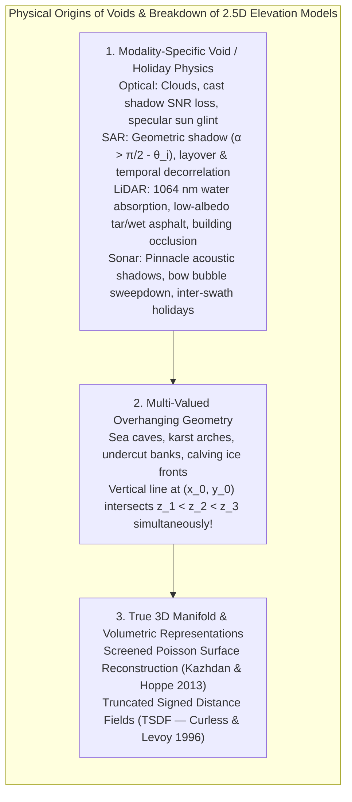
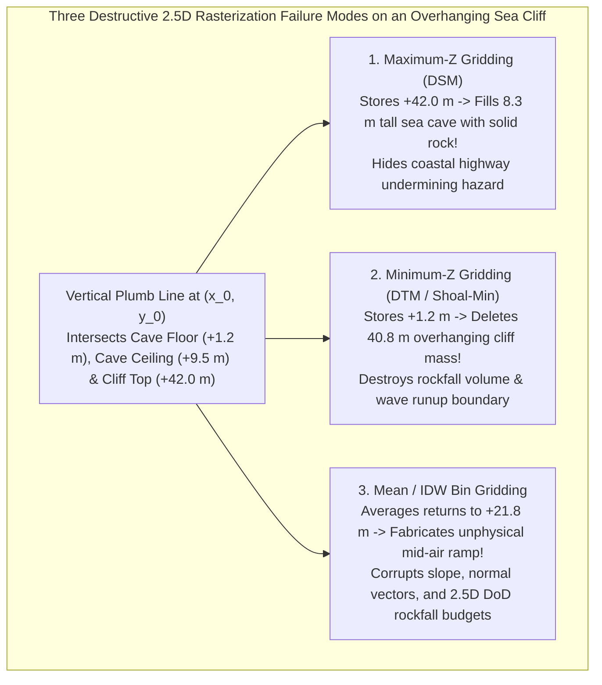

## 21.3 Data Gaps, Shadows, Overlapping, and Overhanging Situations

Even before a single point is removed by a semantic filter, physical wave propagation guarantees that raw elevation datasets contain **data gaps** (*voids* in terrestrial mapping; *holidays* in hydrographic surveying). Whenever clouds block sunlight, steep mountain back-slopes cast radar shadows, dark asphalt or clear water absorbs $1064\text{ nm}$ laser pulses, or ship hull bubbles attenuate multibeam sonar pings, zero valid surface measurements exist. Worse still, where geomorphic erosion or civil architecture folds the surface past $90^\circ$ vertical—in coastal sea caves, natural sandstone arches, undercut meandering riverbanks, overhanging glacier calving fronts, and cantilevered structures—the single-valued 2.5D function $z = f(x, y)$ suffers a mathematical singularity, requiring true 3D volumetric or manifold representations.

---

### 21.3.1 Physical Mechanisms Producing Data Gaps Across Sensor Modalities

Practitioners must distinguish **sensor-dropout voids** (where terrain exists, e.g., under a cloud or behind a boulder, and may be cautiously interpolated with inflated uncertainty) from **domain-boundary voids** (e.g., deep turbid water in a $532\text{ nm}$ bathy-LiDAR survey [`ASPRS Class 45`], which must *never* be spline-filled across an ocean basin!).

| Modality | Governing Geometric / Radiometric Dropout Mechanism | Exact Geometric Shadow / Extinction Criterion | Classic Real-World Void Signature |
| :--- | :--- | :--- | :--- |
| **Optical Stereo / SfM** | Opaque cloud/haze obscuration; deep cast shadows dropping local contrast below SGM matching SNR; textureless fresh snow or specular water glint | Back-slope shadowed from Sun when terrain slope along solar azimuth satisfies $\tan\alpha_{\text{az}} > \cot\theta_z$ (solar zenith $\theta_z$); stereo occlusion when $\tan\alpha > H_{\text{agl}}/B$ | Jagged NoData holes or wild stereo blunder spikes inside north-facing alpine cirques and urban street canyons. |
| **InSAR (X/C/L-Band)** | **Radar Shadow** (no microwave illumination on far slope), **Radar Layover** (summit echoes arrive *before* base echoes, folding phase), and water/wet-snow decorrelation ($\gamma_{\text{coh}} < 0.25$) | **Shadow:** away-facing slope $\alpha_{\text{away}} > \frac{\pi}{2} - \theta_i$ **Layover:** toward-facing slope $\alpha_{\text{toward}} > \theta_i$ | The $800\,000\text{ km}^2$ of SRTM voids across the Himalayas, Andes, Karakorum, and hyper-arid dune sand seas. |
| **Topo / Bathy LiDAR** | Pure water absorption at $\lambda = 1064\text{ nm}$ ($K_d > 12\text{ m}^{-1}$) + mirror reflection away from receiver off calm water or wet freshly paved asphalt; turbidity extinction in $532\text{ nm}$ ALB | ALB optical extinction when $d > d_{\max} \approx \frac{2.5\text{ to }3.0}{K_d(532\text{ nm})}$; scan shadow behind tall buildings of height $H_b$ of width $W_{\text{void}} = H_b \tan\theta_{\text{scan}}$ | Black empty river/lake polygons in NIR LiDAR; sharp wedge-shaped building shadows at swath edges ($\theta_{\text{scan}} = 20^\circ$). |
| **Multibeam / Sidescan Sonar** | **Acoustic Shadow** behind proud shipwrecks, coral bommies, and fault scarps; rough-sea **bubble sweepdown** under hull transducers; outer-beam refraction dropouts | Obstacle of proud height $h_p$ at horizontal range $x_s$ from sonar at altitude $H_s$ above flat bed casts acoustic shadow length $L_{\text{shadow}} = \frac{x_s h_p}{H_s - h_p}$ | Unmapped "holiday" ribbons between parallel vessel lines on shoals (where swath width $W = 2 d \tan\theta_{\max}$ narrows unexpectedly!). |

#### Worked Numerical Example: Acoustic Shadow Length Behind a Reef Pinnacle
An AUV flies at altitude $H_s = 15.0\text{ m}$ above a flat $d = 80.0\text{ m}$ continental shelf seabed, operating a $400\text{ kHz}$ multibeam sonar out to $65^\circ$ off-nadir. At across-track ground distance $x_s = 22.0\text{ m}$ ($\theta = \arctan\frac{22}{15} = 55.7^\circ$), a steep $h_p = 4.5\text{ m}$-tall rocky reef pinnacle rises from the bed. All acoustic rays aimed beyond the pinnacle apex up to grazing intersection are blocked over an across-track **acoustic shadow zone** of width:

$$L_{\text{shadow}} = \frac{x_s \, h_p}{H_s - h_p} = \frac{22.0\text{ m} \times 4.5\text{ m}}{15.0\text{ m} - 4.5\text{ m}} = \frac{99.0}{10.5} = 9.43\text{ m}$$

Any hazardous pipeline span, boulder, or mine lying within that $9.43\text{ m}$ leeward shadow is $100\%$ invisible unless ensonified from an opposing parallel or orthogonal survey line (Chapter 13)!

---

### 21.3.2 Overlapping and Overhanging Situations: Why 2.5D Rasters Fail

A standard raster DEM, TIN, or Monge patch $z = f(x, y)$ assumes that every horizontal coordinate $(x_0, y_0) \in \Omega \subset \mathbb{R}^2$ maps to **at most one scalar elevation**. On vertical cliffs ($\|\nabla z\|_2 \to \infty$) and overhanging or cavernous landforms—wave-notched sea cliffs, sea caves, sandstone arches (e.g., Landscape Arch), undercut outer bends of meandering rivers, overhanging glacier calving fronts, coral reef spur-and-groove overhangs, and cantilevered bridges—a vertical plumb line at $(x_0, y_0)$ pierces **multiple physical interfaces** $z_1 < z_2 < z_3$ (for example, sandy cave floor at $z_1 = +1.2\text{ m}$, cave ceiling at $z_2 = +9.5\text{ m}$, and cliff-top coastal highway at $z_3 = +42.0\text{ m}$).

Attempting to compute coastal cliff retreat or riverbank erosion across overhangs by differencing two 2.5D GeoTIFFs ($\Delta z = z_{t_2} - z_{t_1}$) produces nonsensical sediment budgets: when a $5\text{ m}$-deep basal wave notch erodes beneath an intact $40\text{ m}$ overhang, $\Delta z_{\text{DSM}}(x, y) \equiv 0.00\text{ m}$ (detecting *zero* erosion until the entire highway collapses!), whereas when the upper overhang finally calves onto the beach below, a minimum-Z DTM registers cliff *collapse* as positive beach *uplift*!

---

### 21.3.3 True 3D Representations: Screened Poisson Meshes, TSDFs, and Multi-Chart Atlases

Preserving overhangs, caves, and vertical walls requires moving from explicit heightfields $z = f(x, y)$ to **implicit volumetric surfaces** $\{\mathbf{x} \in \mathbb{R}^3 : F(\mathbf{x}) = 0\}$ or **oriented 2-manifold triangle meshes** $\mathcal{M} = (\mathcal{V}, \mathcal{F})$:

#### 1. Screened Poisson Surface Reconstruction (`Kazhdan & Hoppe, 2013`)
Given an oriented 3D point cloud $\mathcal{S} = \{(\mathbf{p}_i, \hat{\mathbf{n}}_i)\}_{i=1}^N$ (where consistent outward/inward surface normals $\hat{\mathbf{n}}_i$ are known from sensor scanner-origin sightlines $\mathbf{p}_{\text{sensor}}(t_i) - \mathbf{p}_i$ so cave ceilings point downward and cave floors point upward!), **Michael Kazhdan and Hugues Hoppe (2013)** reconstruct a smooth 3D solid indicator scalar field $\chi: \mathbb{R}^3 \to \mathbb{R}$ ($\chi = +1/2$ inside solid rock, $\chi = -1/2$ in air/water, $\chi = 0$ on the terrain boundary). Because $\nabla\chi$ vanishes everywhere except across the boundary where it aligns with the inward normal vector field $\mathbf{V}(\mathbf{x})$, **Screened Poisson Surface Reconstruction** minimizes the variational energy combining gradient alignment with an explicit point-screening fidelity penalty $\alpha_{\text{screen}} > 0$:

$$\min_{\chi} \left( \iiint_{\Omega_3} \|\nabla\chi(\mathbf{x}) - \mathbf{V}(\mathbf{x})\|_2^2 \, d\mathbf{x} + \frac{\alpha_{\text{screen}} \, \text{Area}(\mathcal{S})}{\sum_{i=1}^N w_i} \sum_{i=1}^N w_i \,\big|\chi(\mathbf{p}_i)\big|^2 \right)$$

Discretizing this functional over an **adaptive B-spline octree** (fine octree leaves of $2^{-D}$ only near observed points, coarse leaves across empty air and solid interior) yields a sparse symmetric positive-definite linear system solved in $\mathcal{O}(N)$ multigrid time, followed by adaptive Marching Cubes extraction of the watertight $\chi(\mathbf{x}) = 0$ isosurface. Notice two crucial engineering caveats:
* **Unscreened (`α = 0`, Kazhdan et al., 2006) vs. Screened (`α = 4`, Kazhdan & Hoppe, 2013):** Setting `--pointWeight 0` solves the pure Poisson PDE $\nabla^2 \chi = \nabla \cdot \mathbf{V}$, which overly rounds sharp cliff edges; `--pointWeight 4.0` pins the zero-isosurface tightly through surveyed laser points.
* **Trimming Unobserved Extrapolation Bubbles:** Because Poisson reconstruction guarantees a *closed watertight solid*, it smoothly balloons "soap-bubble" caps across open terrain tile borders or deep unmapped cave backs. Production pipelines always pass `--density` to output local octree sampling density and run Kazhdan's companion `SurfaceTrimmer` to excise low-density extrapolated triangles while flagging open void rims!

#### 2. Truncated Signed Distance Fields (`TSDF` — Curless & Levoy, 1996)
Pioneered by **Brian Curless and Marc Levoy (1996)** and ubiquitous in real-time mobile LiDAR/ROV mapping (`OpenVDB`, ` Voxblox`, `nvblox`), a **Truncated Signed Distance Field** stores within a sparse hashed 3D voxel grid (avoiding dense $\mathcal{O}(N^3)$ RAM blowup) the running weighted average of the signed ray distance $D_k(\mathbf{x}) = \operatorname{clip}\!\big(\|\mathbf{p}_k - \mathbf{c}_k\|_2 - \|\mathbf{x} - \mathbf{c}_k\|_2,\, -\tau_{\text{trunc}},\, +\tau_{\text{trunc}}\big)$ from sensor optical/acoustic center $\mathbf{c}_k$ through measured surface hit $\mathbf{p}_k$:

$$D^{(K)}(\mathbf{x}) = \frac{W^{(K-1)}(\mathbf{x}) D^{(K-1)}(\mathbf{x}) + w_k(\mathbf{x}) D_k(\mathbf{x})}{W^{(K-1)}(\mathbf{x}) + w_k(\mathbf{x})}, \qquad W^{(K)}(\mathbf{x}) = W^{(K-1)}(\mathbf{x}) + w_k(\mathbf{x})$$

TSDFs inherently encode **free-space carving** ($D > 0$ along every unobstructed laser/sonar ray entering a sea cave or underpass), fuse multi-angle terrestrial, drone, and boat scans incrementally with optimal inverse-variance weighting $w_k \propto \sigma_{r,k}^{-2}$, and track voxel-level observation confidence $W(\mathbf{x})$ so unilluminated shadow zones remain explicitly marked as unobserved ($W = 0$).
