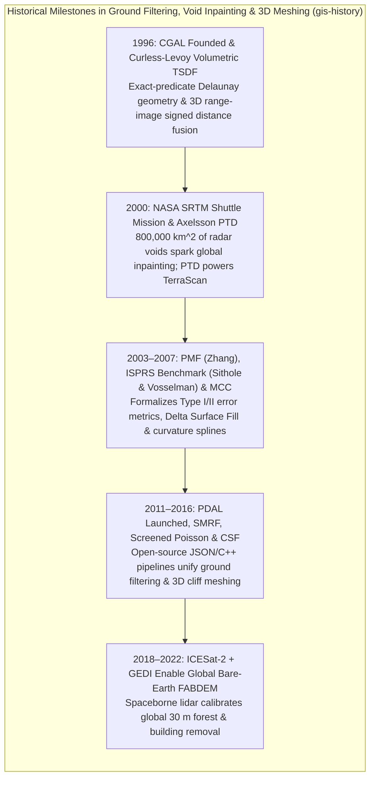
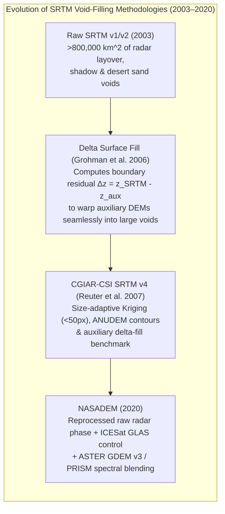

## 21.4 Historical Evolution of Bare-Earth Extraction and Void-Filling

The algorithmic separation of bare mineral earth from surface clutter—and the statistically principled reconstruction of terrain across occluded sensor voids—evolved over three decades alongside exact computational geometry, spaceborne radar interferometry, open-source C++ pipelines, and global spaceborne laser altimetry, as anchored in the [`gis-history`](https://github.com/schwehr/gis-history) timeline.

---

### 21.4.1 Exact Computational Geometry and the Airborne LiDAR Boom (1996–2000)

#### 1996: `CGAL` and Volumetric Signed Distance Reconstruction
Two foundational computational geometry milestones arrived in **1996**:
* **The Computational Geometry Algorithms Library (`CGAL`, 1996 in `gis-history`):** Founded by a European research consortium (INRIA Sophia Antipolis, MPI Informatik, Utrecht University, ETH Zürich, Tel Aviv University, FU Berlin), `CGAL` solved the numerical instability that caused early TIN-based ground filters to crash or loop infinitely when collinear scan-line points triggered IEEE-754 floating-point `InCircle` sign flips (Chapter 17). By providing exact-predicate, filtered-kernel 2D/3D Delaunay triangulations, alpha shapes, and surface mesh data structures, `CGAL` became the geometric backbone of modern open-source terrain processing.
* **Curless & Levoy's Volumetric Range Integration (`SIGGRAPH 1996`):** Working on Stanford's Digital Michelangelo / Cyberware laser scans, **Brian Curless and Marc Levoy (1996)** introduced the weighted **Truncated Signed Distance Field (TSDF)**—demonstrating how noisy multi-view 3D range scans with overhangs, self-occlusions, and unmeasured holes could be fused incrementally into watertight meshes with explicit free-space carving.

#### 2000: Peter Axelsson's Progressive TIN Densification (`PTD`)
As commercial airborne laser scanning (ALS) expanded in the late 1990s, early raster kernel filters struggled violently wherever flat urban floodplains met steep mountain scarps. At the **2000** XIX ISPRS Congress in Amsterdam, Swedish researcher **Peter Axelsson (2000)** presented *DEM Generation from Airborne Laser Scanner Data Using Triangulated Irregular Networks*. By seeding a coarse Delaunay TIN from block-minimum points and iteratively inserting returns governed by local facet-plane angle and distance thresholds, Axelsson allowed the reference surface itself to conform to arbitrary 3D terrain slopes. Integrated by Arttu Soininen into **Terrasolid `TerraScan`**, `PTD` became the industrial workhorse behind national LiDAR bare-earth mapping programs across Europe and North America.

---

### 21.4.2 The 2000 SRTM Void Crisis and the ISPRS Filter Benchmark (2000–2008)

#### February 2000: Space Shuttle *Endeavour* (`SRTM`) and $800\,000\text{ km}^2$ of Missing Earth
During an 11-day mission in **February 2000** (`gis-history`), Space Shuttle *Endeavour* (STS-99) deployed a $60\text{ m}$ outboard mast to acquire single-pass C-band and X-band bistatic InSAR between $60^\circ\text{N}$ and $56^\circ\text{S}$. When unedited SRTM tiles were released beginning in 2003, users discovered a sobering physical reality: **over $800\,000\text{ km}^2$ of land surface consisted of `NoData = -32768` voids**!
* Steep alpine cordilleras (the Himalayas, Karakoram, Andes, Alps, and Alaska / Coast Mountains) suffered severe **radar shadow** and **layover** phase-unwrapping failures; hyper-arid dune fields in the Sahara, Rub' al Khali, and Namib suffered low microwave backscatter SNR; and river gorges and lakes suffered water specular reflection.
* Early naive bilinear or pure-spline fills across $10\text{ km}$-wide Himalayan voids truncated $7000\text{ m}$ peaks by over $800\text{ m}$ or created grotesque overshoot craters.

This planetary void crisis catalyzed a decade of rigorous inpainting research:
1. **The Delta Surface Fill (`DSF`) Method (`Grohman, Kroenung, & Strebeck, 2006`):** Rather than pasting an auxiliary DEM (such as GTOPO30 or digitized topographic contours) directly into an SRTM hole—which creates $20\text{–}100\text{ m}$ vertical cliff seams around the void perimeter due to datum and resolution differences—Grohman et al. computed the difference ("delta") surface $\Delta z = z_{\text{SRTM}} - z_{\text{aux}}$ on valid pixels surrounding the void, interpolated the *smooth low-frequency delta surface* across the interior hole, and added it back to the high-frequency auxiliary DEM ($z_{\text{filled}} = z_{\text{aux}} + \widehat{\Delta z}$)—a direct precursor to modern Remove-Compute-Restore and Poisson composite blending (Chapter 23)!
2. **Multi-Scale Void-Filling Benchmark (`Reuter, Nelson, & Jarvis, 2007`):** Powering the widely adopted CGIAR-CSI SRTM v4 archive, Reuter et al. systematically proved that no single interpolator is optimal across void scales: **Kriging / IDW** excels on tiny pinhole voids ($<5\text{–}15\text{ pixels}$), **spline / ANUDEM** excels on medium valley/ridge voids when aided by contour topology, and **auxiliary Delta Surface Fill** is mandatory once void width exceeds the terrain correlation scale (culminating in **NASADEM [2020]**, which re-unwrapped raw SRTM interferograms using ICESat GLAS elevation control and ASTER/AW3D30 void fusion).

#### 2003–2007: `PMF`, the ISPRS Sithole-Vosselman Benchmark, and `MCC`
Concurrently in airborne LiDAR research:
* **Zhang et al. (2003)** formulated the **Progressive Morphological Filter (`PMF`)**, introducing slope-scaled dynamic height thresholds across expanding erosion-dilation windows.
* **Sithole and Vosselman (2004)** published the landmark **ISPRS Filter Test**, distributing 15 standardized reference sites (`CSite1`–`CSite8`) and establishing the universal Type I / Type II quantitative evaluation protocol still used to benchmark every new ML and geometric ground filter today.
* **Evans and Hudak (2007)** introduced **Multiscale Curvature Classification (`MCC`)** for dense Pacific Northwest conifer canopies, followed by **Bartels and Wei (2010)** formalizing threshold-free **Skewness Balancing**.

---

### 21.4.3 Open-Source Democratization, 3D Cliff Meshing, and Global Bare Earth (2011–Present)

#### 2011–2016: `PDAL`, `PoissonRecon` Screening, `SMRF`, and `CSF`
In **2011** (`gis-history`), Howard Butler and collaborators launched the open-source **Point Data Abstraction Library (`PDAL`)**, bringing reproducible, cloud-scalable C++/JSON pipelines to point-cloud processing. Within five years, three major open-source algorithmic advances converged inside `PDAL`, `WhiteboxTools`, and `CloudCompare`:
* **Kazhdan and Hoppe (2013)** added explicit positional point screening to 2006 Poisson Surface Reconstruction (`PoissonRecon`), enabling millimeter-faithful 3D watertight meshing of overhanging coastal cliffs, sea caves, and karst arches.
* **Pingel, Clarke, and McBride (2013)** published **`SMRF`** (`PDAL filters.smrf`), pairing linear one-pixel window progression with iterative thin-plate spline object inpainting.
* **Wuming Zhang et al. (2016)** published the **Cloth Simulation Filter (`CSF`, `PDAL filters.csf`)**, providing an intuitive physics-based ground extractor requiring minimal parameter tuning across flat cities and rugged mountains alike.

#### 2018–2022: Spaceborne Laser Calibration (`ICESat-2` & `GEDI`) Unlocks `FABDEM`
The launch of **ICESat-2** (`2018-09` in `gis-history`, $532\text{ nm}$ photon-counting ATLAS) and **ISS GEDI** (`2018-12` in `gis-history`, $1064\text{ nm}$ full-waveform sub-canopy ground ranging) finally supplied tens of billions of globally distributed sub-canopy bare-earth elevation control points across tropical rainforests and dense cities. Leveraging this spaceborne laser ground truth, **Laurence Hawker et al. (2022)** released **FABDEM** (*Forest And Buildings removed Copernicus DEM*), reducing global forest median vertical bias in Copernicus GLO-30 from $+5\text{–}18\text{ m}$ down to near-zero and inaugurating a new generation of machine-learning global bare-earth terrain models (including DiluviumDEM and FathomDEM).

---

### 21.4.4 Parallel Evolution in Hydrographic Seabed Filtering and Holiday Standards (2000–Present)

Across the exact same decades, hydrography confronted an analogous twin challenge—separating the true mineral seabed from biological/structural water-column clutter while governing unmapped seafloor "holidays":

* **2000–2006 (`NOAA HSSD`, `CUBE`, and `BAG`):** Beginning with the first **NOAA Hydrographic Surveys Specifications and Deliverables (`HSSD`, 2000 in `gis-history`)** and **Brian Calder's (2003) `CUBE` (Combined Uncertainty and Bathymetry Estimator)**, hydrographic offices replaced manual sounding-by-sounding editing with sequential Bayesian Kalman hypothesis tracking. Rather than blindly taking a minimum or morphological opening (which would either lock onto fish schools and kelp canopies or shave off shipwreck masts!), `CUBE` tracks multiple competing depth hypotheses per grid node and selects the seabed surface via local hypothesis disambiguation, storing both elevation and uncertainty inside **2006 Open Navigation Surface `BAG`** files while preserving verified hazards on an explicit override `Tracking List`.
* **2019–2022 (`IHO S-44` 6th Edition Bathymetric Coverage Rules):** Whereas terrestrial mapping historically tolerated unflagged interpolation across forest canopy voids, **IHO S-44 (6th ed., 2020)** formalized strict quantitative **Bathymetric Coverage** mandates: **Exclusive Order** and **Special Order** require **$100\%$ bathymetric coverage** (and $200\%$ in Exclusive Order high-risk channels) with strict cube-feature detection limits ($0.5\text{ m}$ to $1.0\text{ m}$), explicitly prohibiting unflagged mathematical interpolation across unensonified inter-swath holidays or acoustic shadow zones behind wrecks and reefs.
* **2019–2024 (3D Point-Cloud Deep Learning & `COPC`):** Following `PointNet++` (2017), **`KPConv` (Thomas et al., 2019)**, **`RandLA-Net` (Hu et al., 2020)**, and the **2021 Cloud-Optimized Point Cloud (`COPC`)** octree standard (`gis-history`), national mapping agencies (IGN France *LiDAR HD*, Swisstopo, USGS 3DEP) began transitioning production pipelines from purely geometric TIN/morphological rules to hybrid deep-learning + physical TIN workflows that simultaneously classify ground, bridge decks, vegetation strata, and coastal bathymetry directly on streaming cloud-hosted archives.

| Year / Era | Landmark Algorithm, Mission, or Standard | Primary Mathematical / Algorithmic Mechanism | Operational Impact on Bare-Earth & Void Handling |
| :--- | :--- | :--- | :--- |
| **1996** | `CGAL` & Curless–Levoy `TSDF` | Exact-predicate Delaunay kernels & weighted volumetric signed distance fields | Eliminated TIN floating-point crashes and enabled 3D overhang/cave reconstruction |
| **2000** | NASA `SRTM` & Axelsson `PTD` | $800{,}000\text{ km}^2$ radar void discovery & iterative TIN facet-angle densification | Catalyzed global void-inpainting research and powered industrial `TerraScan` DTMs |
| **2003–2007** | `PMF` (Zhang), ISPRS Benchmark, `DSF` & `MCC` | Slope-scaled morphological opening, Type I/II error metrics, Delta Surface Fill | Standardized ground-filter accuracy evaluation and seamless multi-DEM void warping |
| **2011–2016** | `PDAL`, Screened Poisson, `SMRF` & `CSF` | Point-screened octree PDE (`PoissonRecon`), linear spline-inpainted opening, cloth dynamics | Democratized open-source JSON point-cloud filtering and watertight 3D cliff meshing |
| **2018–2022+** | `ICESat-2`, `GEDI`, `FABDEM`, `KPConv` & `IHO S-44` Ed. 6 | Spaceborne laser sub-canopy calibration, 3D kernel point convolutions, $100\%$ bathy coverage | Enabled global $30\text{ m}$ forest/building removal and strict hydrographic holiday rules |
