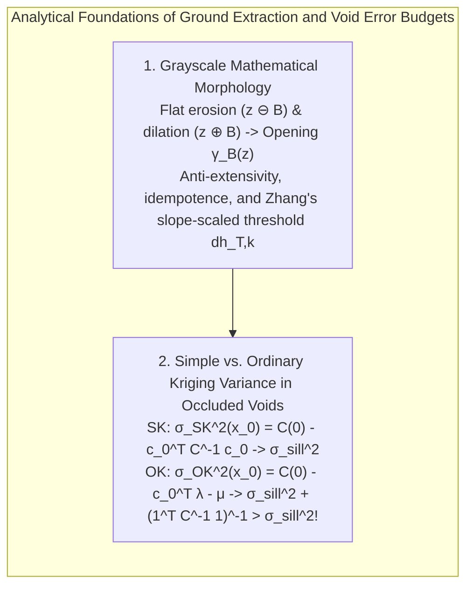

## 21.5 Mathematical Foundations of Morphological Filtering and Spatial Void Uncertainty

Extracting a bare-earth surface from a cluttered point cloud and quantifying how vertical uncertainty behaves inside the resulting object-removal voids rest on two mathematical pillars: **grayscale mathematical morphology on complete lattices** (Serra, 1982; Zhang et al., 2003; Pingel et al., 2013) and **geostatistical Kriging error variance propagation** across unobserved domains. This section derives both frameworks from first principles, corrects a widespread misconception regarding Ordinary vs. Simple Kriging variance at the center of a void, and works step-by-step numerical examples.

---

### 21.5.1 Grayscale Mathematical Morphology on Digital Elevation Surfaces

Let $z: \mathbb{Z}^2 \to \mathbb{R}$ represent a discretized 2D grid of minimum last-return elevations with uniform horizontal pixel spacing $\Delta x = \Delta y = c$ ($\text{m}$), and let $B \subset \mathbb{Z}^2$ be a symmetric flat structuring element ($B = -B$, containing the origin $(0,0)$, such as a discrete square or disk of diameter $w$ pixels, physical width $W = w c$).

#### 1. Flat Grayscale Erosion ($\ominus$) and Dilation ($\oplus$)
* **Grayscale Erosion** replaces each grid node $\mathbf{u} = (i, j)$ with the infimum (minimum) elevation inside the translated window $B_{\mathbf{u}}$:
  $$(z \ominus B)(i, j) = \min_{(p, q) \in B} z(i + p, j + q)$$
* **Grayscale Dilation** replaces each grid node with the supremum (maximum) elevation inside the reflected window:
  $$(z \oplus B)(i, j) = \max_{(p, q) \in B} z(i - p, j - q)$$

Note that erosion and dilation are *not* inverses of one another: if $z$ contains a flat-roofed building of width $L_b < W$ protruding by height $\Delta h$ above flat ground, erosion $(z \ominus B)$ strips the building completely *and* widens valleys/ditches by $W/2$, whereas subsequent dilation $((z \ominus B) \oplus B)$ restores valley walls back to their pre-eroded positions without resurrecting the excised building!

#### 2. Morphological Opening ($\gamma_B$) and Lattice Invariants
Sequential erosion followed by dilation defines the **morphological opening** operator $\gamma_B(z)$ (and its dual, **morphological closing** $\varphi_B(z) = (z \oplus B) \ominus B$, which bridges narrow data-dropout pits):

$$\gamma_B(z) = (z \ominus B) \oplus B$$

Geometrically, $\gamma_B(z)(\mathbf{u})$ equals the highest elevation attained at $\mathbf{u}$ by sliding a flat horizontal plate of footprint $B$ **from underneath** the surface $z$ without ever piercing above $z$. For any symmetric flat structuring element $B$, $\gamma_B$ satisfies three exact algebraic axioms:
1. **Anti-Extensivity (Upper-Bound Guarantee):**
   $$\gamma_B(z)(i, j) \le z(i, j) \qquad \forall (i, j) \in \mathbb{Z}^2$$
   *Proof:* Since $(0,0) \in B$, for every $(p, q) \in B$ we have $(z \ominus B)(i - p, j - q) = \min_{(u,v)\in B} z(i - p + u, j - q + v) \le z(i, j)$ (taking $u=p, v=q$). Taking the maximum over $(p, q) \in B$ yields $\gamma_B(z)(i, j) \le z(i, j)$. Physically, opening can **never** invent false elevation spikes above the measured surface.
2. **Monotonicity (Order Preservation):** If $z_1 \le z_2$ pointwise, then $\gamma_B(z_1) \le \gamma_B(z_2)$.
3. **Idempotence (Scale Stability):**
   $$\gamma_B\big(\gamma_B(z)\big) = \gamma_B(z)$$
   Once all positive protrusions narrower than $B$ have been removed, repeating $\gamma_B$ leaves the surface strictly invariant.

---

### 21.5.2 Progressive Window Expansion and Slope-Dependent Thresholding

Why does a single large opening $\gamma_{B_{\max}}(z)$ fail on natural landscapes? Consider a symmetric conical mountain peak or triangular ridge with uniform side-slope $s = \tan\alpha > 0$ ($z(x) = z_{\text{crest}} - s|x|$). Sliding a flat plate of physical width $W_k = w_k c$ beneath the ridge stops at distance $W_k / 2$ below the apex, truncating the true bare-earth crest by:

$$\Delta z_{\text{ridge-clip}}(W_k) = z(0) - \gamma_{B_k}(z)(0) = \frac{1}{2} s W_k = \frac{1}{2} s w_k c$$

For a $30\%$ hillside ridge ($s = 0.30$) and a warehouse-sized $W_k = 80\text{ m}$ window, a naive small threshold ($0.3\text{ m}$) would slice **$12.0\text{ m}$** vertically off the natural mountain summit!

To separate abrupt vertical walls ($s_{\text{wall}} \to \infty$) from sloped terrain ($s$), **Zhang et al. (2003)** expand window widths across iterations $k = 1, \dots, M$ ($w_k = 2 b^k + 1$ for exponential base $b=2$, or $w_k = 2k + 1$ in linear `SMRF`), updating the reference surface $z_k = \gamma_{B_k}(z_{k-1})$ and classifying cells as non-ground whenever $z_{k-1}(i,j) - z_k(i,j) > dh_{T,k}$, where the **slope-dependent height threshold** is:

$$dh_{T,k} = \begin{cases} dh_0, & w_k \le 3 \\ \min\!\Big(s\,(w_k - w_{k-1})\,c + dh_0,\; dh_{\max}\Big), & w_k > 3 \end{cases}$$

Here $dh_0$ ($0.15\text{–}0.30\text{ m}$) absorbs $95\%$ flat-ground LiDAR ranging noise, $s$ is the maximum regional terrain gradient, and $dh_{\max}$ ($3\text{–}10\text{ m}$) caps the threshold at the height of single-story industrial roofs so mega-warehouses are still rejected at large $w_k$.

#### Worked Numerical Progression (`PMF` Exponential Schedule)
For $c = 1.0\text{ m}$, $s = 0.25$ ($14.0^\circ$ slope), $dh_0 = 0.20\text{ m}$, $dh_{\max} = 6.00\text{ m}$, and $w_k = 2(2^k) + 1$ ($w_0 = 1$):
* **Iteration $1$ ($w_1 = 5\text{ m}$, $\Delta w = 4\text{ m}$):** $dh_{T,1} = 0.25(4)(1.0) + 0.20 = \mathbf{1.20\text{ m}}$ (strips cars, shrubs, jersey barriers).
* **Iteration $2$ ($w_2 = 9\text{ m}$, $\Delta w = 4\text{ m}$):** $dh_{T,2} = 0.25(4)(1.0) + 0.20 = \mathbf{1.20\text{ m}}$ (strips residential sheds & small trees).
* **Iteration $3$ ($w_3 = 17\text{ m}$, $\Delta w = 8\text{ m}$):** $dh_{T,3} = 0.25(8)(1.0) + 0.20 = \mathbf{2.20\text{ m}}$ (strips suburban houses).
* **Iteration $4$ ($w_4 = 33\text{ m}$, $\Delta w = 16\text{ m}$):** $dh_{T,4} = 0.25(16)(1.0) + 0.20 = \mathbf{4.20\text{ m}}$ (strips commercial retail blocks).
* **Iteration $5$ ($w_5 = 65\text{ m}$, $\Delta w = 32\text{ m}$):** $0.25(32) + 0.20 = 8.20\text{ m} \to$ capped at $dh_{\max} = \mathbf{6.00\text{ m}}$ (strips $60\text{ m}$ warehouses taller than $6\text{ m}$, though any $4.5\text{ m}$-tall $60\text{ m}$-wide flat shed would survive as a Type II commission error!).

---

### 21.5.3 Geostatistical Variance Inflation Across Occluded Footprints: Simple vs. Ordinary Kriging

Suppose an off-terrain building or closed-canopy patch of diameter $D$ is excised, leaving $N$ valid `Class 2` ground observations $\{z(\mathbf{x}_i)\}_{i=1}^N$ distributed around the void perimeter $\partial\Omega_v$. Model local terrain residuals (after removing any deterministic planar trend) as a second-order stationary random field with mean $m$, **nugget variance** $c_0^{\text{nug}}$ (sensor/micro-scale noise at lag $0^+$), **partial sill** $c_s$, **total sill** $C(0) = \sigma_{\text{sill}}^2 = c_0^{\text{nug}} + c_s$, and **correlation range** $r_{\text{var}}$. For an isotropic spherical covariance function with lag distance $h_{\text{lag}} = \|\mathbf{x} - \mathbf{x}'\|_2$:

$$C(h_{\text{lag}}) = \begin{cases} c_0^{\text{nug}} + c_s, & h_{\text{lag}} = 0 \\ c_s \left[1 - \dfrac{3}{2}\!\left(\dfrac{h_{\text{lag}}}{r_{\text{var}}}\right) + \dfrac{1}{2}\!\left(\dfrac{h_{\text{lag}}}{r_{\text{var}}}\right)^3\right], & 0 < h_{\text{lag}} < r_{\text{var}} \\ 0, & h_{\text{lag}} \ge r_{\text{var}} \end{cases}$$

Let $\mathbf{C} \in \mathbb{R}^{N \times N}$ ($C_{ij} = C(\|\mathbf{x}_i - \mathbf{x}_j\|_2)$, symmetric positive-definite) denote the observation covariance matrix and $\mathbf{c}_0(\mathbf{x}_0) = [C(\|\mathbf{x}_0 - \mathbf{x}_1\|_2), \dots, C(\|\mathbf{x}_0 - \mathbf{x}_N\|_2)]^\top \in \mathbb{R}^N$ denote the target-to-sample covariance vector at interior void point $\mathbf{x}_0$.

#### 1. Simple Kriging (`SK` — Known Mean $m$): Convergence to $\sigma_{\text{sill}}^2$
When the regional terrain mean $m$ is known exactly, the Best Linear Unbiased Predictor is $\hat{z}_{\text{SK}}(\mathbf{x}_0) = m + \mathbf{c}_0^\top \mathbf{C}^{-1}(\mathbf{z} - m\mathbf{1})$, with exact estimation variance:

$$\sigma_{\text{SK}}^2(\mathbf{x}_0) = C(0) - \mathbf{c}_0(\mathbf{x}_0)^\top \mathbf{C}^{-1} \mathbf{c}_0(\mathbf{x}_0)$$

If the void diameter satisfies $D > 2 r_{\text{var}}$, then at the void center $\mathbf{x}_{\text{center}}$ every perimeter point lies beyond the correlation range ($\|\mathbf{x}_{\text{center}} - \mathbf{x}_i\|_2 \ge D/2 > r_{\text{var}}$), forcing $\mathbf{c}_0(\mathbf{x}_{\text{center}}) = \mathbf{0}$ and therefore:

$$\sigma_{\text{SK}}^2(\mathbf{x}_{\text{center}}) = C(0) = \sigma_{\text{sill}}^2$$

#### 2. Ordinary Kriging (`OK` — Unknown Local Mean): Super-Sill Inflation ($> \sigma_{\text{sill}}^2$)
In real DTM production, the local mean elevation $m$ under a removed building is *unknown* and must be estimated implicitly by enforcing unbiasedness $\mathbf{1}^\top \boldsymbol{\lambda} = 1$:

$$\begin{bmatrix} \mathbf{C} & \mathbf{1} \\ \mathbf{1}^\top & 0 \end{bmatrix} \begin{bmatrix} \boldsymbol{\lambda} \\ \mu \end{bmatrix} = \begin{bmatrix} \mathbf{c}_0 \\ 1 \end{bmatrix}, \qquad \sigma_{\text{OK}}^2(\mathbf{x}_0) = C(0) - \mathbf{c}_0^\top \boldsymbol{\lambda} - \mu$$

Now evaluate $\sigma_{\text{OK}}^2$ at the void center where $\mathbf{c}_0 = \mathbf{0}$. From the first block row, $\mathbf{C}\boldsymbol{\lambda} + \mu\mathbf{1} = \mathbf{0} \implies \boldsymbol{\lambda} = -\mu \mathbf{C}^{-1}\mathbf{1}$. Enforcing $\mathbf{1}^\top \boldsymbol{\lambda} = 1$ yields:

$$-\mu \big(\mathbf{1}^\top \mathbf{C}^{-1} \mathbf{1}\big) = 1 \implies \mu = -\frac{1}{\mathbf{1}^\top \mathbf{C}^{-1} \mathbf{1}} < 0$$

because $\mathbf{C} \succ 0 \implies \mathbf{C}^{-1} \succ 0 \implies \mathbf{1}^\top \mathbf{C}^{-1} \mathbf{1} > 0$. Substituting $\mathbf{c}_0 = \mathbf{0}$ and $\mu < 0$ into $\sigma_{\text{OK}}^2(\mathbf{x}_{\text{center}})$ establishes an exact, striking inequality:

$$\sigma_{\text{OK}}^2(\mathbf{x}_{\text{center}}) = C(0) - \mu = \sigma_{\text{sill}}^2 + \underbrace{\frac{1}{\mathbf{1}^\top \mathbf{C}^{-1} \mathbf{1}}}_{\operatorname{Var}(\hat{m}_{\text{GLS}}) > 0} > \sigma_{\text{sill}}^2$$

**Crucial Infill-Asymptotic Insight:** Increasing LiDAR point density around a *fixed* building perimeter ($N \to \infty$ on a circle of fixed diameter $D$) does **not** drive $(\mathbf{1}^\top \mathbf{C}^{-1} \mathbf{1})^{-1}$ to zero! Because closely spaced perimeter points become strongly correlated, the effective number of independent perimeter samples saturates at $N_{\text{eff}} \sim \frac{\pi D}{r_{\text{var}}}$, leaving a permanent **Generalized Least Squares mean-estimation penalty** $-\mu > 0$ on top of $\sigma_{\text{sill}}^2$!

#### Worked Numerical Verification: $120\text{ m}$ Circular Void ($r_{\text{var}} = 40\text{ m}$)
Consider a circular void of diameter $D = 120.0\text{ m}$ ($R = 60.0\text{ m}$) bounded by $N = 16$ evenly spaced ground returns on terrain with spherical variogram parameters $c_0^{\text{nug}} = 0.01\text{ m}^2$ ($\sigma_{\text{nug}} = 0.10\text{ m}$), $c_s = 2.24\text{ m}^2$, total sill $C(0) = 2.25\text{ m}^2$ ($\sigma_{\text{sill}} = 1.500\text{ m}$), and range $r_{\text{var}} = 40.0\text{ m}$:

| Distance Inside Void Rim ($d_{\min}$) | Radial Coord ($r$) | Simple Kriging $\sigma_{\text{SK}}$ ($1\sigma$) | Ordinary Kriging $\sigma_{\text{OK}}$ ($1\sigma$) | OK Lagrange Multiplier $\mu$ | $95\%$ Vertical Uncertainty ($\text{LE95}_{\text{OK}}$) |
| :--- | :--- | :--- | :--- | :--- | :--- |
| **$1.0\text{ m}$** (near curb) | $59.0\text{ m}$ | $0.428\text{ m}$ | $0.428\text{ m}$ | $-0.0047\text{ m}^2$ | $\pm 0.84\text{ m}$ |
| **$5.0\text{ m}$** | $55.0\text{ m}$ | $0.871\text{ m}$ | $0.873\text{ m}$ | $-0.0236\text{ m}^2$ | $\pm 1.71\text{ m}$ |
| **$15.0\text{ m}$** | $45.0\text{ m}$ | $1.319\text{ m}$ | $1.333\text{ m}$ | $-0.0877\text{ m}^2$ | $\pm 2.61\text{ m}$ |
| **$30.0\text{ m}$** | $30.0\text{ m}$ | $1.494\text{ m}$ | $1.548\text{ m}$ | $-0.1826\text{ m}^2$ | $\pm 3.03\text{ m}$ |
| **$60.0\text{ m}$** (void center) | $0.0\text{ m}$ | **$1.500\text{ m}$** ($=\sigma_{\text{sill}}$) | **$1.566\text{ m}$** ($>\sigma_{\text{sill}}$) | **$-0.2029\text{ m}^2$** | **$\pm 3.07\text{ m}$** |

Even though raw LiDAR sensor noise on the sidewalk is $\pm 0.10\text{ m}$ ($1\sigma$), just $15\text{ m}$ inside the excised building footprint the $95\%$ DTM error exceeds $\pm 2.6\text{ m}$, reaching **$\pm 3.07\text{ m}$** at the center!
