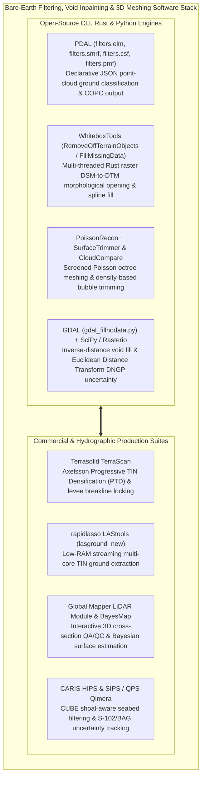

## 21.6 Software Ecosystem for Bare-Earth Extraction, Void-Filling, and 3D Meshing

Production workflows for extracting bare-earth DTMs (`Class 2`) and bare-seabed DBMs (`Class 40`), generating companion void-uncertainty rasters (`DNGP`), inpainting small dropouts, and reconstructing true 3D overhanging cliffs rely on an interoperable stack of open-source CLI/Python engines and high-throughput commercial suites.



---

### 21.6.1 Open-Source Command-Line and Python Workflows

#### 1. `PDAL`: Pre-Cleaned `SMRF` Ground Classification Pipeline
In **PDAL**, ground extractors (`filters.smrf`, `filters.pmf`, `filters.csf`) must *always* be preceded by low-point multipath removal (`filters.elm`) so negative reflection pits under water or solar panels do not corrupt the minimum seed grid. Notice also `ignore: "Classification[7:7],Classification[18:18]"` so flagged noise points never participate in morphological opening:

```json
{
  "pipeline": [
    {
      "type": "readers.las",
      "filename": "raw_topobathy_tile.copc.laz"
    },
    {
      "type": "filters.elm",
      "cell": 10.0,
      "class": 7,
      "threshold": 1.2
    },
    {
      "type": "filters.outlier",
      "method": "statistical",
      "mean_k": 16,
      "multiplier": 3.0,
      "where": "ReturnNumber == NumberOfReturns"
    },
    {
      "type": "filters.smrf",
      "ignore": "Classification[7:7],Classification[18:18]",
      "returns": "last,only",
      "cell": 1.0,
      "slope": 0.20,
      "window": 24.0,
      "threshold": 0.40,
      "scalar": 1.25
    },
    {
      "type": "writers.copc",
      "filename": "classified_bare_earth.copc.laz",
      "forward": "all"
    }
  ]
}
```

*(For dense vegetated mountains where cloth draping outperforms flat morphological windows, replace `filters.smrf` with `{"type": "filters.csf", "resolution": 1.0, "rigidness": 1, "step": 0.65, "hdiff": 0.45, "smooth": true}`.)*

#### 2. `WhiteboxTools` (`RemoveOffTerrainObjects`) & `GDAL` (`gdal_fillnodata.py`)
When only a raster DSM GeoTIFF is available (e.g., drone photogrammetry or stereo satellite tiles), **WhiteboxTools** provides the high-speed Rust tool **`RemoveOffTerrainObjects`** (`wbt.remove_off_terrain_objects` in Python), which applies top-hat morphological opening + steep-edge pinpointing and spline inpainting directly to raster grids, while **`gdal_fillnodata.py`** fills small residual `NoData` holes up to a strict pixel radius (`-md`) so large unmeasured ocean/lake domains are never hallucinated:

```bash
# 1. Strip buildings & trees smaller than 35 px from a 1 m photogrammetric DSM
whitebox_tools --run="RemoveOffTerrainObjects" \
    --dem="urban_dsm_1m.tif" \
    --output="urban_dtm_raw_1m.tif" \
    --filter=35 \
    --slope=15.0

# 2. Cautiously inpaint small occlusion holes (<= 15 pixels radius) with 1 smoothing pass
gdal_fillnodata.py -md 15 -si 1 \
    -co TILED=YES -co COMPRESS=DEFLATE -co PREDICTOR=3 \
    urban_dtm_raw_1m.tif urban_dtm_filled_1m.tif
```

#### 3. Generating Companion `DNGP` and Void-Inflated $\sigma_z$ GeoTIFFs in Python
To prevent downstream engineers from mistaking interpolated building or forest voids for $\pm 10\text{ cm}$ measurements, the following runnable Python script ingests a classified `LAS/LAZ` point cloud and a gridded DTM GeoTIFF, computes the exact **Distance-to-Nearest-Ground-Point (`DNGP`)** raster in $\mathcal{O}(N_{\text{px}})$ time via `scipy.ndimage.distance_transform_edt`, and writes a two-band diagnostic GeoTIFF (`Band 1 = DNGP [m]`, `Band 2 = Propagated 1σ DTM Uncertainty [m]`):

```python
"""Generate Distance-to-Nearest-Ground-Point (DNGP) & spatially varying DTM sigma_z."""

import laspy
import numpy as np
import rasterio
from scipy.ndimage import distance_transform_edt


def write_dtm_void_uncertainty(
    laz_path: str,
    dtm_tif_path: str,
    out_uncert_tif: str,
    sigma_sensor_m: float = 0.08,
    partial_sill_m2: float = 2.24,
    corr_range_m: float = 40.0,
) -> None:
    """Writes Band 1: DNGP (m) and Band 2: Void-inflated 1-sigma TVU (m)."""
    with rasterio.open(dtm_tif_path) as src:
        profile = src.profile.copy()
        height, width = src.height, src.width
        transform = src.transform
        px_size_x, px_size_y = abs(transform.a), abs(transform.e)
        dtm_nodata_mask = src.read_masks(1) == 0

    # 1. Rasterize presence of true ASPRS Class 2 (or Class 40 bathy) ground returns
    las = laspy.read(laz_path)
    is_ground = (las.classification == 2) | (las.classification == 40)
    gx, gy = np.asarray(las.x[is_ground]), np.asarray(las.y[is_ground])
    rows, cols = rasterio.transform.rowcol(transform, gx, gy)
    rows, cols = np.asarray(rows), np.asarray(cols)
    valid = (rows >= 0) & (rows < height) & (cols >= 0) & (cols < width)

    empty_mask = np.ones((height, width), dtype=bool)
    empty_mask[rows[valid], cols[valid]] = False

    # 2. Exact Euclidean Distance Transform (in meters) to nearest ground observation
    dngp_m = distance_transform_edt(
        empty_mask, sampling=(px_size_y, px_size_x)
    ).astype(np.float32)

    # 3. Spherical variogram variance inflation across unmeasured footprints
    #    Evaluates the 1-nearest-neighbor Kriging variance bound C(0) - C(d_min) = c0_nug + gamma_sph(d_min)
    h_ratio = np.clip(dngp_m / corr_range_m, 0.0, 1.0)
    gamma_void = partial_sill_m2 * (1.5 * h_ratio - 0.5 * (h_ratio**3))
    sigma_dtm = np.sqrt((sigma_sensor_m**2) + gamma_void).astype(np.float32)

    dngp_m[dtm_nodata_mask] = -9999.0
    sigma_dtm[dtm_nodata_mask] = -9999.0

    profile.update(count=2, dtype="float32", nodata=-9999.0, compress="deflate")
    with rasterio.open(out_uncert_tif, "w", **profile) as dst:
        dst.write(dngp_m, 1)
        dst.set_band_description(1, "Distance_To_Nearest_Ground_Point_m")
        dst.write(sigma_dtm, 2)
        dst.set_band_description(2, "Propagated_DTM_1Sigma_Uncertainty_m")
```

#### 4. True 3D Overhang Meshing with `PoissonRecon` and `SurfaceTrimmer`
When reconstructing sea caves, coastal bluffs, or undercut riverbanks with Michael Kazhdan's **`PoissonRecon`**, note two critical CLI specifics: `--bType` expects an **integer code** (`1` = Free, `2` = Dirichlet, `3` = Neumann [default]), and `--density` must be passed so `SurfaceTrimmer` can strip extrapolated "soap-bubble" triangles across open void boundaries:

```bash
# 1. Solve Screened Poisson PDE at octree depth 11 (~2^11 = 2048 voxel resolution)
#    --pointWeight 4.0: Strong positional screening through surveyed points
#    --bType 3: Neumann boundary condition (or --bType 2 for Dirichlet solid closure)
#    --density: Write local octree point-density attribute per vertex
PoissonRecon --in sea_cave_oriented.ply \
             --out sea_cave_raw_mesh.ply \
             --depth 11 \
             --pointWeight 4.0 \
             --bType 3 \
             --density

# 2. Trim low-density extrapolated bubble caps across unmapped cave recesses
SurfaceTrimmer --in sea_cave_raw_mesh.ply \
               --out sea_cave_trimmed_mesh.ply \
               --trim 6.5
```

---

### 21.6.2 Commercial and Regulated Production Suites

* **Terrasolid `TerraScan`:** Production standard for crewed airborne LiDAR bare-earth extraction. Executes multi-pass Axelsson Progressive TIN Densification (`Classify -> Ground`), allowing operators to lock verified 3D levee crest breaklines (`Class 2` model key-points) prior to densification and inspect Type I/II ambiguous zones via fast dynamic cross-sections.
* **rapidlasso `LAStools` (`lasground_new`, `las2dem`):** Implements streaming, out-of-core TIN ground classification capable of processing billions of points with minimal memory footprint, featuring domain-tuned presets (`-wilderness`, `-nature`, `-town`, `-city`, `-metro`, `-ultra_fine`) and `las2dem -kill <edge_len_m>` to automatically leave triangles wider than `<edge_len_m>` as honest `NoData` voids rather than fabricating stretched flat triangles across lakes and warehouses!
* **Blue Marble `Global Mapper` (LiDAR Module) & `BayesMap StripAlign/Filter`:** Provide interactive 3D profile QA/QC editing, custom-trained point-cloud classifiers, and Bayesian probabilistic surface estimation coupled directly to inter-swath trajectory error propagation.
* **Teledyne `CARIS HIPS & SIPS` & QPS `Qimera`:** Hydrographic equivalents for submerged bare-seabed extraction—running `CUBE` multi-hypothesis estimation to reject fish schools and kelp plumes while honoring `IHO S-44` shoal-preservation rules so rock pinnacles and wrecks are never beveled off as "outliers."

---

### 21.6.3 Software Comparison Matrix

| Tool / Suite | License | Core Ground / Void Algorithm | Overhang Support | Primary Operational Strength |
| :--- | :--- | :--- | :--- | :--- |
| **`PDAL`** | BSD-3-Clause | `SMRF`, `PMF`, `CSF`, `ELM` | Via 3D mesh plugins | Reproducible cloud/container JSON pipelines on `LAS`/`COPC`. |
| **`WhiteboxTools`** | MIT / Open | `RemoveOffTerrainObjects`, `FillMissingData` | 2.5D raster only | Blazing-fast Rust DSM-to-DTM filtering when point clouds are absent. |
| **`PoissonRecon`** | MIT | Screened Poisson octree PDE + `SurfaceTrimmer` | **Full 3D manifold** | Gold standard for sea caves, arches, and overhanging cliffs. |
| **`GDAL`** | MIT | `gdal_fillnodata.py` inverse-distance search | 2.5D raster only | Bounded-radius (`-md`) raster pinhole inpainting without basin overshoot. |
| **`TerraScan`** | Commercial | Axelsson Progressive TIN Densification (`PTD`) | 3D point cloud | Deterministic industrial production with hard breakline locking. |
| **`LAStools`** | Commercial / Mixed | Streaming multi-scale TIN (`lasground_new`) | 2.5D TIN (`-kill`) | Out-of-core multi-billion-point speed & triangle-edge void masking. |
| **`CARIS` / `Qimera`** | Commercial | `CUBE` Bayesian hypotheses + `SPLINE` | 3D cloud + 2.5D `BAG` | Shoal-safe hydrographic filtering with mandatory `TVU` band output. |

---

### 21.6.4 Implementing Delta Surface Fill (`DSF`) in Python for Large Alpine or Coastal Voids

When a data void spans hundreds of meters (e.g., an InSAR layover hole in steep mountains or an optically turbid river plume in coastal topo-bathy LiDAR), pure internal spline or IDW inpainting (`gdal_fillnodata.py`) fails because distance $d_{\min}$ exceeds the terrain correlation range $r_{\text{var}}$. Following **Grohman, Kroenung, and Strebeck (2006)**, the production remedy is **Delta Surface Fill (`DSF`)**: compute the boundary bias residual $\Delta z = z_{\text{primary}} - z_{\text{aux}}$ on a valid halo ring surrounding the void, smoothly solve Laplace's equation ($\nabla^2 (\Delta z) = 0$) across the interior so vertical datum offsets and long-wavelength tilts vanish seamlessly at the rim, and restore high-frequency auxiliary topography ($z_{\text{filled}} = z_{\text{aux}} + \widehat{\Delta z}$):

```python
"""Seamless Delta Surface Fill (Grohman et al., 2006) across large DEM voids."""

import numpy as np
from osgeo import gdal


def delta_surface_fill(
    primary_tif: str, aux_aligned_tif: str, out_tif: str, max_dist_px: int = 250
) -> None:
    """Fills NoData voids in primary_tif using bias-warped aux_aligned_tif."""
    ds_p = gdal.Open(primary_tif, gdal.GA_ReadOnly)
    ds_a = gdal.Open(aux_aligned_tif, gdal.GA_ReadOnly)
    band_p = ds_p.GetRasterBand(1)
    band_a = ds_a.GetRasterBand(1)
    nodata_p = band_p.GetNoDataValue()
    nodata_a = band_a.GetNoDataValue()
    z_prim = band_p.ReadAsArray().astype(np.float32)
    z_aux = band_a.ReadAsArray().astype(np.float32)

    valid_p = np.isfinite(z_prim) if nodata_p is None else (z_prim != nodata_p)
    valid_a = np.isfinite(z_aux) if nodata_a is None else (z_aux != nodata_a)
    both_valid = valid_p & valid_a
    # 1. Compute delta surface where both rasters are valid; mark voids as -9999.0
    delta = np.where(both_valid, z_prim - z_aux, -9999.0).astype(np.float32)

    mem_drv = gdal.GetDriverByName("MEM")
    ds_delta = mem_drv.Create("", ds_p.RasterXSize, ds_p.RasterYSize, 1, gdal.GDT_Float32)
    ds_delta.GetRasterBand(1).SetNoDataValue(-9999.0)
    ds_delta.GetRasterBand(1).WriteArray(delta)

    # 2. Interpolate smooth low-frequency delta across void interior via GDAL FillNodata
    gdal.FillNodata(
        targetBand=ds_delta.GetRasterBand(1),
        maskBand=None,
        maxSearchDist=max_dist_px,
        smoothingIterations=3,
    )
    delta_smooth = ds_delta.GetRasterBand(1).ReadAsArray()

    # 3. Restore auxiliary detail only where fill succeeded; keep remaining gaps as NoData
    out_nodata = -9999.0 if nodata_p is None else float(nodata_p)
    can_fill = (~valid_p) & valid_a & (delta_smooth != -9999.0)
    z_out = np.where(valid_p, z_prim, np.where(can_fill, z_aux + delta_smooth, out_nodata)).astype(np.float32)
    gtiff_drv = gdal.GetDriverByName("GTiff")
    ds_out = gtiff_drv.CreateCopy(out_tif, ds_p, strict=0, options=["COMPRESS=DEFLATE", "TILED=YES"])
    out_band = ds_out.GetRasterBand(1)
    out_band.SetNoDataValue(out_nodata)
    out_band.WriteArray(z_out)
    ds_out = None  # Flush and close dataset
```

Unlike direct patch-in replacement (`np.where(valid_p, z_prim, z_aux)`), which introduces artificial fault scarps around the void boundary whenever `z_prim` and `z_aux` differ by even $0.5\text{ m}$ in geoid realization or canopy penetration, `delta_surface_fill` guarantees $C^0$ boundary continuity while preserving fine ridges and thalwegs captured by the secondary sensor.
