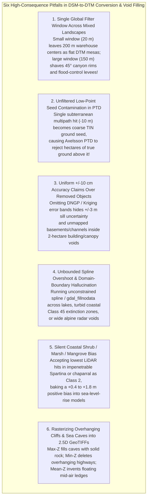

## 21.7 Common Pitfalls and Key Takeaways

Bare-earth filtering and void reconstruction sit at a deceptive boundary between physical measurement and mathematical extrapolation. A visually smooth, gap-free hillshade often conceals beveled flood levees, +1.2 m coastal marsh vegetation biases, negative-seed TIN craters, erased sea caves, and multi-meter interpolation guesswork underneath removed warehouses.

---

### 21.7.1 Common Pitfalls in Bare-Earth Extraction and Void Handling

#### 1. Using One Global Window Size Across Mixed Urban and Steep Alpine Terrain
Running a single global parameter set across an entire county forces a destructive Type I / Type II compromise: setting `window = 20 m` to protect $45^\circ$ canyon ridges and narrow river levees leaves the flat interiors of $250\text{ m}$ distribution warehouses inside `Class 2` Ground as $10\text{ m}$-tall rectangular mesas, whereas setting `window = 150 m` removes the warehouses at the cost of beveling mountain crests and shaving flood-control levees flat. Always stratify filtering parameters by land-cover/slope polygons and lock verified levee crests with inclusion breaklines.

#### 2. Seeding Progressive TIN Densification Without Low-Multipath Pre-Cleaning
Because Axelsson's `PTD` initializes its coarse ground mesh from the *absolute lowest point* in each $50\text{–}100\text{ m}$ seed block, a single uncleaned subterranean multipath blunder ($z_{\text{ghost}} = z_{\text{ground}} - 8\text{ m}$, common near water bodies, glass buildings, and solar farms) pulls the initial TIN vertex $8\text{ m}$ underground. Every legitimate bare-earth point within $50\text{ m}$ now sits $>8\text{ m}$ above the corrupted facet, failing the $d_{\max}$ and $\theta_{\text{thresh}}$ criteria and leaving a massive artificial crater surrounded by missing ground! Always run `PDAL filters.elm` and statistical low-point outlier checks *before* ground seeding.

#### 3. Reporting Open-Terrain Accuracy (`NVA`) Inside Occluded Footprints and Marshes
Quoting a single project-wide `RMSE_z = 6.5 cm` (`NVA = 12.7 cm`) across a DTM where 2-hectare factories were inpainted or coastal *Spartina* marshes blocked $100\%$ of laser pulses misleads civil engineers and flood modelers. Inside large excised footprints ($D > 2 r_{\text{var}}$), Ordinary Kriging uncertainty inflates beyond the regional terrain sill ($\sigma_{\text{OK}} > \sigma_{\text{sill}} \approx 1.5\text{–}3.5\text{ m}$), while dense low vegetation requires separate $95\text{th}$-percentile **Vegetated Vertical Accuracy (`VVA`)** field rod validation and biomass bias correction.

#### 4. Unbounded Void Filling Across Turbid Water or Wide Alpine Shadows
Applying unconstrained minimum-curvature splines or large-radius `gdal_fillnodata.py` without a water/extinction mask (`ASPRS Class 9` / `Class 45`) bridges across turbid river channels and unmapped coastal bays with flat or wildly oscillating biharmonic overshoots. Only small sensor-dropout voids ($d_{\min} \ll r_{\text{var}}$) should be interpolated purely internally; wide voids require **Delta Surface Fill** anchored to an auxiliary physical dataset (e.g., sonar soundings or satellite altimetry/stereo) and explicit provenance flagging.

#### 5. Collapsing Overhanging Cliffs, Arches, and Sea Caves into 2.5D Grids
Projecting terrestrial, mobile, or boat-mounted point clouds of undercut riverbanks and coastal sea caves onto a single-band GeoTIFF destroys multi-valued topology ($z_1 < z_2 < z_3$), hiding basal wave-erosion notches under intact cliff tops and corrupting volumetric rockfall change budgets.

---

### 21.7.2 Key Takeaways

1. **Match the Filter Architecture to the Landscape Physics:** Combine low-point multipath removal (`ELM`) with slope-adaptive **Progressive TIN Densification (`PTD`)** or **`SMRF`/`CSF`** for discrete point clouds, **Multiscale Curvature (`MCC`)** or **3D `KPConv`/`RandLA-Net`** for complex shrub/canopy regimes, and **`GEDI`/`ICESat-2`-calibrated ML bias subtraction (`FABDEM`)** when only spaceborne DSM rasters exist.
2. **Every DTM Needs a `DNGP` / Uncertainty Companion Band:** Accompany every bare-earth DTM or bare-seabed DBM with a **Distance-to-Nearest-Ground-Point (`DNGP`)** raster and void-inflated $\sigma_{z,\text{DTM}}(x, y)$ layer so users immediately distinguish $\pm 10\text{ cm}$ measured bare soil from $\pm 3\text{ m}$ interpolated footprints.
3. **Never Confuse `NVA` with `VVA`:** Validate dense shrubland, tundra, marsh, mangrove, and seagrass zones using independent physical RTK-GNSS rod penetrations reported at the non-parametric $95\text{th}$ percentile (`VVA`), never open-terrain Gaussian `RMSE_z`.
4. **Enforce Scale-Aware Void Policies:** Mask domain boundaries (`Class 9` water, `Class 45` optical extinction) before void filling, cap pure spatial interpolation at fraction-of-correlation-range radii (`las2dem -kill`, `gdal_fillnodata.py -md`), and use **Delta Surface Fill** when fusing secondary terrain into large voids.
5. **Switch to Oriented 3D Manifolds When Slope Approaches $90^\circ$:** Represent vertical scarps, sea caves, karst arches, and cantilevered structures using **Screened Poisson Surface Reconstruction** (`PoissonRecon` + density-based `SurfaceTrimmer`) or sparse **Truncated Signed Distance Fields (`TSDF`)**, measuring geomorphic change along 3D surface normals rather than vertical raster columns.
