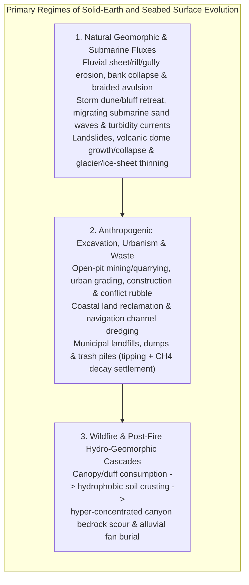
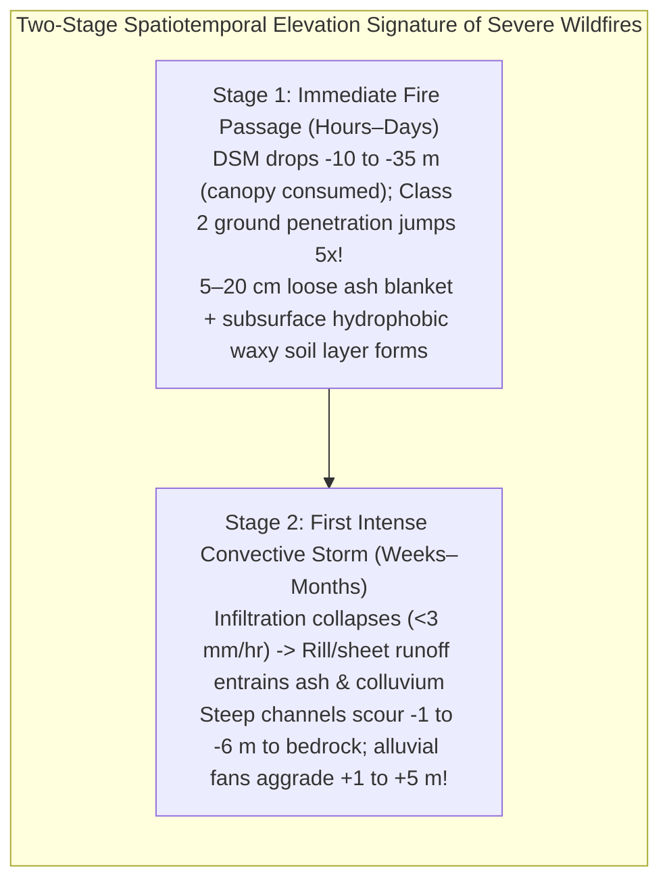

# Chapter 22: The Dynamic Earth: Temporal Changes, Moving Objects, AIS/ADS-B, Seasonality, and Change Detection

*The Earth's surface and the objects upon it are in constant motion across timescales from milliseconds to millennia.*

Traditional cartography rests on a convenient fiction: that topography is a static boundary condition frozen in time. In legacy GIS workflows, a single "master DEM" raster is ingested without an acquisition timestamp and reused for decades across flood modeling, ship routing, and civil earthwork. In physical reality, every elevation or depth coordinate $z(x, y, t)$ is an ephemeral snapshot of a planet in perpetual flux across twelve orders of magnitude in time—from millisecond laser interactions with industrial steam plumes and second-scale highway/maritime traffic to seasonal crop phenology, storm-driven submarine sand-wave migration, municipal landfill settlement, post-wildfire debris cascades, and catastrophic submarine turbidity currents.

This chapter transitions elevation modeling from static 2.5D grids into **4D spatiotemporal metrology** $(x, y, z, t)$. We examine natural and anthropogenic geomorphic evolution, derive the photogrammetric and scanning distortions induced by moving vehicles, ships, and aircraft (and show how **AIS** and **ADS-B** broadcast telemetry automatically purge them), dissect seasonal vegetative, agricultural, hydrological, cryospheric, and industrial plume transients, and establish statistically rigorous 2.5D and 3D change-detection frameworks.

---

## 22.1 Geomorphic and Anthropogenic Surface Evolution; Erosion and Deposition

Whether shaped by fluid shear stress, gravitational slope failure, biological decomposition, or mechanized earthmoving, elevation changes on land and beneath the sea obey the **Exner sediment and mass continuity equation**:

$$\frac{\partial z_{\text{bed}}(x, y, t)}{\partial t} = -\frac{1}{1 - \lambda_p} \nabla \cdot \mathbf{q}_s(x, y, t) + \dot{S}_{\text{anthro}}(x, y, t) + \dot{w}_{\text{tect/comp}}(x, y, t)$$

where $z_{\text{bed}}$ is positive-up solid-earth elevation ($\text{m}$), $\lambda_p \in [0.25, 0.55]$ is bulk bed porosity, $\mathbf{q}_s = [q_{s,x}, q_{s,y}]^\top$ is volumetric sediment flux per unit width ($\text{m}^2\cdot\text{s}^{-1}$), $\dot{S}_{\text{anthro}}$ represents human excavation, dredging, construction, or waste tipping ($\text{m}\cdot\text{s}^{-1}$), and $\dot{w}_{\text{tect/comp}}$ captures crustal deformation, glacial isostasy, or subsurface consolidation/decomposition settlement.

---

### 22.1.1 Natural Geomorphic Evolution Across Landscapes and Seascapes

#### 1. Fluvial Erosion, Streambank Collapse, and Braided Channel Avulsion
Subaerial drainage networks reorganize across continuous and episodic regimes:
* **Hillslope Sheet, Rill, and Gully Incision:** Intense convective rainfall detaches unprotected topsoil as overland sheetwash, concentrating into centimeter-scale ephemeral rills (`resolved only at Δx <= 5 cm` TLS/UAS DEMs) and meter-deep headward-eroding gullies (`Δz = -1 to -8 m` per storm season in loess and badland terrains).
* **Meander Migration and Sudden Avulsion:** Along alluvial valleys, outer-bank basal scour undermines cohesive riverbanks, driving lateral channel migration of $1\text{–}50\text{ m}\cdot\text{yr}^{-1}$, while gravel-bed braided rivers (e.g., Rangitikei and Waimakariri in New Zealand; proglacial Alaskan outwash plains) plug active threads with coarse bedload bars during peak flood discharge and **avulse** overnight into abandoned paleochannels kilometers away. Using a five-year-old LiDAR DTM to set bridge scour piers or FEMA floodway cross-sections in a braided corridor places hydraulic thalwegs on dry gravel islands.

#### 2. Coastal Storm Erosion, Submarine Sand Waves, and Canyon Turbidity Currents
Marine and coastal bathymetry is frequently **more** dynamic than terrestrial topography, yet hidden beneath opaque water where outdated chart soundings persist for decades:
* **Winter Storm Dune Overwash and Bluff Collapse:** Extreme storm surges and infragravity wave runup scarify barrier-island foredunes by $2\text{–}6\text{ m}$ vertically in $24\text{ hours}$, cut new breaching inlets, and trigger rotational slumping along unconsolidated glacial-till or marine-terrace sea cliffs (retreating $0.5\text{–}4\text{ m}\cdot\text{yr}^{-1}$ along California, Norfolk/Holderness UK, and Arctic permafrost coasts).
* **Migrating Submarine Sand Waves (`2–5 m` Rapid Channel Shoaling!):** In macro-tidal shelves and estuaries where bottom spring-tide currents exceed $1.0\text{–}2.5\text{ m}\cdot\text{s}^{-1}$—such as the Dover Strait, Southern North Sea, Torres Strait, Golden Gate, and Columbia River Bar—bedload transport organizes coarse sand into rhythmic asymmetric **submarine sand waves** ($H_{\text{wave}} = 2\text{–}12\text{ m}$ crest-to-trough amplitude, wavelength $\lambda_w = 50\text{–}400\text{ m}$). Governed by lee-face avalanche slip ($\sim 30^\circ$), crests migrate horizontally at $c_{\text{mig}} \approx 10\text{–}60\text{ m}\cdot\text{yr}^{-1}$:
  $$\Delta d_{\text{shoal}}(\Delta t) \approx -\Delta z_{\text{bed}} \approx -H_{\text{wave}} \text{ as a crest advances } \frac{\lambda_w}{2}$$
  Within $6\text{–}12\text{ months}$ of dredging, an encroaching sand-wave crest can shallow a $16.0\text{ m}$ deep-draft container channel to $11.5\text{ m}$ (grounding ultra-large vessels!) while simultaneously scouring away seabed cover beneath adjacent troughs to leave high-voltage offshore wind export cables dangerously suspended in **free spans**.
* **Submarine Landslides and Canyon Turbidity Currents:** On continental slopes and delta fronts (e.g., Fraser, Congo, Monterey, and Messina canyons), earthquake shaking or rapid river-mouth sediment loading triggers dense, turbulent sediment-water gravity flows racing downslope at $15\text{–}20\text{ m}\cdot\text{s}^{-1}$ ($55\text{–}72\text{ km/h}$). As proven after the historic **1929 Grand Banks earthquake** (**Heezen & Ewing, 1952**), a single canyon-flushing turbidity current can incise canyon floors by $10\text{–}50\text{ m}$, snap seabed telecommunications cables across $700\text{ km}$, and deposit multi-meter turbidite lobes on abyssal fans.
* **Landslides, Volcanic Eruptions, and Cryospheric Thinning:** Subaerial rock avalanches, pyroclastic/lava dome extrusions (e.g., 1980 Mount St. Helens $-400\text{ m}$ edifice collapse; 2018 Kīlauea caldera $-500\text{ m}$ slump; 2022 Hunga Tonga–Hunga Haʻapai $-850\text{ m}$ submarine caldera excavation), and secular mountain-glacier/ice-sheet surface lowering ($-1\text{ to }-15\text{ m}\cdot\text{yr}^{-1}$ in ablation zones) continuously invalidate static elevation baselines.

---

### 22.1.2 Anthropogenic Surface Evolution: Mines, Cities, Conflict, and Landfills

Modern humanity is Earth's premier geomorphic agent, displacing $>30\text{–}50\text{ Gt}\cdot\text{yr}^{-1}$ of rock, soil, dredged spoil, and solid waste—exceeding global natural river sediment delivery to the oceans:

1. **Open-Pit Mining, Quarrying, and Tailings Impoundments:** Tiered porphyry-copper, iron-ore, and coal open-pit mines (e.g., Bingham Canyon, Chuquicamata) lower pit floors by $15\text{–}40\text{ m}\cdot\text{yr}^{-1}$ while building $200\text{ m}$-tall waste-rock dumps and wet tailings dams (whose millimeter-per-week crest creep is monitored via InSAR and drone LiDAR to prevent catastrophic liquefaction breaches like Brumadinho 2019).
2. **Urban Excavation, Land Reclamation, Dredging, and Demolition/Warfare:** Deep skyscraper foundation pits, highway cut-and-fill corridors, capital harbor dredging + coastal island reclamation (Singapore, Rotterdam Maasvlakte 2, Pearl River Estuary), and urban demolition or armed-conflict bombardment (converting $30\text{ m}$ apartment blocks into $4\text{–}8\text{ m}$ rubble debris fields that block emergency access and urban drainage) transform DSMs and DTMs overnight.
3. **Dumps, Municipal Solid Waste (`MSW`) Landfills, and Trash Piles:** Sanitary landfills, industrial ash/slag heaps, and informal open dumps exhibit a uniquely biphasic, non-linear elevation trajectory:
   * **Operational Filling Phase ($\dot{z} > 0$):** Daily waste tipping, sheepsfoot-compactor rolling, and soil cover lifts raise active working cells by $0.5\text{–}3.0\text{ m}\cdot\text{month}^{-1}$, requiring weekly UAS SfM/LiDAR volumetric surveys to compute remaining **permitted airspace capacity** ($\text{m}^3$) and compaction bulk density ($\rho_{\text{waste}} = M_{\text{scale}} / \Delta V_{\text{DoD}}$).
   * **Post-Closure Anaerobic Biodegradation & Creep Settlement ($\dot{z} < 0$):** Once sealed beneath an engineered geomembrane/clay cap of initial waste thickness $H_0$, primary mechanical compression ($\epsilon_p$) is followed over $5\text{–}40\text{ years}$ by secondary mechanical creep ($C_\alpha$) and **microbial methanogenic biodegradation** ($\text{organic solids} \to \text{CH}_4 + \text{CO}_2 + \text{leachate}$), reducing solid mass by $15\%\text{–}35\%$:
     $$\Delta z_{\text{landfill}}(t) = -H_0 \left[ \epsilon_p + C_\alpha \log_{10}\!\left(\frac{t}{t_p}\right) + \epsilon_{\text{bio}}\Big(1 - e^{-k_{\text{bio}}\max(0,\, t - t_{\text{bio}})}\Big) \right], \qquad t \ge t_p$$
     On a $H_0 = 40\text{ m}$ landfill cell, post-closure settlement reaches **$-6\text{ to }-12\text{ m}$**, with localized differential subsidence bowls rupturing gas-collection headers, reversing stormwater drainage grades on the cap, and tilting post-closure solar PV arrays.

---

### 22.1.3 Wildfires and Post-Fire Debris-Flow Cascades

Wildfires trigger an abrupt two-stage transformation in both reflective DSMs and bare-earth DTMs:

* **Immediate Radiometric & Geometric Shift:** High-severity crown fire consumes foliage, fine branches, downed logs, and $5\text{–}25\text{ cm}$ of organic forest duff (`O-horizon`), leaving standing blackened snags over a low-albedo charcoal/ash blanket (which absorbs $1064\text{ nm}$ laser energy while dramatically boosting bare-ground pulse penetration!). Simultaneously, volatilized aliphatic hydrocarbons condense $2\text{–}6\text{ cm}$ below the soil surface onto cooler mineral grains, creating a water-repellent **hydrophobic soil horizon**.
* **Post-Fire Storm Debris-Flow Remapping:** When short-duration high-intensity rain ($I_{15\min} > 20\text{–}40\text{ mm}\cdot\text{h}^{-1}$) strikes the hydrophobic burn scar (e.g., the January 2018 Montecito, California debris flows following the Thomas Fire), overland runoff strips hillslope rills and bulks progressively in steep channels into boulder-laden debris flows ($\rho_{\text{flow}} \approx 1800\text{–}2200\text{ kg}\cdot\text{m}^{-3}$), scouring headwater gorges down to bedrock ($\Delta z = -2\text{ to }-6\text{ m}$) and avulsing across urbanized alluvial fans ($\Delta z = +1\text{ to }+4\text{ m}$), instantly rendering pre-storm flood-insurance DTMs obsolete. Emergency watershed assessment teams must therefore acquire rapid post-fire bare-earth LiDAR *before* winter rains to update debris-basin storage capacities and recalibrate empirical USGS hazard-volume regressions against observed burn severity and slope gradients ($\ge 23^\circ$).
