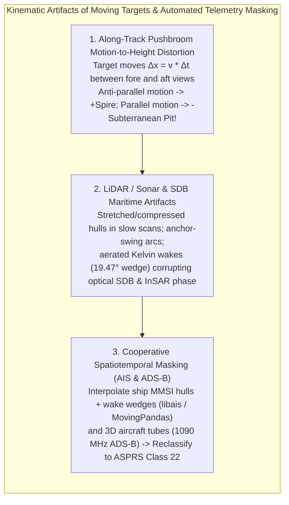
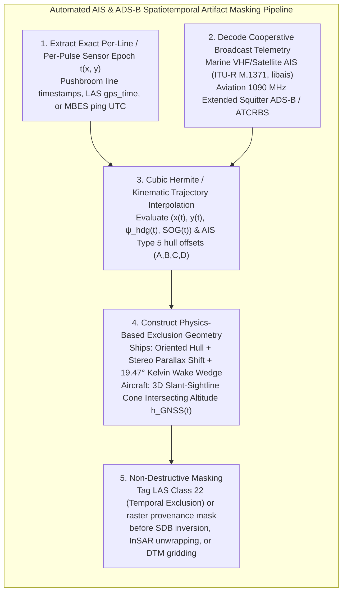

## 22.2 Dealing with Moving Objects and Timescale Impacts

Photogrammetric bundle adjustment, Interferometric SAR, airborne laser scanning, and multibeam echosounding all rely on a fundamental kinematic postulate: **the target surface remains stationary while the platform moves**. Real landscapes and seascapes violate this postulate constantly. Highway trucks, high-speed trains, container vessels under way, vessels swinging on anchor chains, turbulent Kelvin ship wakes, and commercial airliners crossing below orbital sensors translate tens to hundreds of meters during the multi-second window required to acquire stereo views or adjacent scan swaths.

Left unmasked, target motion couples directly into 3D triangulation equations—fabricating **hundred-meter-tall elevation needles or bottomless highway pits** in optical stereo DEMs, radar Doppler azimuth shifts in SAR, and phantom shoals in coastal bathymetry. Rather than attempting to hand-edit millions of transient blunders, modern elevation pipelines fuse sensor timestamps with global cooperative radio surveillance networks: maritime **AIS (Automatic Identification System)** and aviation **ADS-B / ATCRBS**.

---

### 22.2.1 Timescale Distortions: Vehicles, Trains, Ships, and Aircraft

#### 1. Along-Track Stereo Epipolar Motion-to-Height Coupling (With Exact Sign Rule!)
In spaceborne pushbroom stereo (e.g., WorldView-2/3, Pléiades, ASTER, Planet SkySat) and airborne three-line scanners (e.g., Leica ADS100), a forward-looking camera images a ground target at epoch $t_1$ and an aft-looking (or nadir) camera images the same corridor at $t_2 = t_1 + \Delta t$, separated by stereo base-to-height ratio $B / H_{\text{agl}}$ ($\Delta t \approx 1\text{–}60\text{ s}$).

As derived from exact 3D ray intersection in Section 22.6.1, if a vehicle, ship, or aircraft travels with horizontal velocity component $v_{\text{along}}$ measured **positive in the same direction as the sensor platform's ground track** ($v_{\text{platform}} > 0$), the stereo matcher misinterprets the along-track translation $\Delta x_{\text{along}} = v_{\text{along}}\Delta t$ as topographic parallax, shifting the reconstructed elevation by:

$$\Delta z_{\text{artifact}} = -\frac{H_{\text{agl}}}{B} \, v_{\text{along}} \, \Delta t = -\frac{v_{\text{along}}}{v_{\text{platform}} - v_{\text{along}}} \, H_{\text{agl}}$$

Pay close attention to the **physical sign** and **disparity-window regime**:
* **Target Moving *Opposite* to Sensor Track ($v_{\text{along}} < 0$, Heading Toward Approaching Sensor):** Between $t_1$ and $t_2$, the target moves backward toward the first exposure station, *shortening* the baseline separation between the forward and aft sightlines. The two rays intersect prematurely **above the Earth** ($\Delta z_{\text{artifact}} > 0$), thrusting a moving ship or truck upward into a **towering positive spire**!
* **Target Moving *With* Sensor Track ($v_{\text{along}} > 0$, Same Direction as Sensor):** The target advances downrange before the aft camera catches it, *widening* the ray separation so the sightlines cross **beneath the ground or sea surface** ($\Delta z_{\text{artifact}} < 0$), punching a **deep subterranean or sub-seabed pit**!
* **Purely Cross-Track Motion ($v_{\text{along}} = 0, v_{\text{cross}} \ne 0$):** Induces a vertical epipolar-plane miss (y-parallax). If the target is long and uniform (such as a freight train or ship wake oblique to the track), dense Semi-Global Matching (`SGM`) locks onto an adjacent shifted car/wave segment; otherwise correlation fails and leaves a `NoData` tear.
* **Why Ships Create Massive Spires in Satellite Stereo While Fast Cars Often Drop Out:** On a $H = 617\text{ km}$ Sun-synchronous satellite ($v_{\text{sat}} = 6880\text{ m}\cdot\text{s}^{-1}$, $B/H = 0.60 \implies \Delta t \approx 53.8\text{ s}$), a highway car at $100\text{ km/h}$ ($27.8\text{ m}\cdot\text{s}^{-1}$) moves $1495\text{ m}$ ($3000\text{ pixels}$ at $0.5\text{ m}$ GSD!), exceeding the `SGM` disparity search range so the car simply disappears or blurs out. By contrast, a $350\text{ m}$-long container ship steaming anti-parallel at $15.5\text{ knots}$ ($v_{\text{along}} = -8.0\text{ m}\cdot\text{s}^{-1}$) translates $430\text{ m}$—remaining inside coarse-to-fine pyramid search bounds to materialize in coastal DSMs as a **$\Delta z_{\text{artifact}} = +717\text{ m}$ floating mountain peak** in the middle of the harbor! Conversely, in **airborne three-line pushbroom stereo** ($H_{\text{agl}} = 3000\text{ m}, v_{\text{air}} = 75\text{ m}\cdot\text{s}^{-1}, \Delta t \approx 15\text{–}30\text{ s}$), highway trucks remain inside disparity bounds and generate huge asymmetric $+750\text{ m}$ spires and $-1500\text{ m}$ pits!

#### 2. Scanning LiDAR/Sonar Motion Skew, Anchor Chains, and Kelvin Wakes
Even in active time-of-flight LiDAR and multibeam sonar (where range $R = c\tau/2$ is immune to stereo parallax!), moving vessels and wakes degrade elevation products in three ways:
1. **Hull Stretching & Multi-Swath Ghost Vessels:** When a survey aircraft or USV scans a moving barge or ferry at speed $v_{\text{target}}$, relative velocity $v_{\text{rel}} = v_{\text{sensor}} \mp v_{\text{target}}$ stretches or compresses the hull length by $L_{\text{app}} = L_{\text{true}} \frac{v_{\text{sensor}}}{v_{\text{sensor}} - v_{\text{along}}}$, while moored vessels swinging on $150\text{ m}$ anchor chains during tidal reversal carve semicircular ghost hulls and seabed **anchor-chain scour trenches** across adjacent multibeam swaths.
2. **Kelvin Wakes and Bubble Plumes in Optical `SDB` and `ALB`:** Every displacement vessel moving in deep/intermediate water trails a classic V-shaped **Lord Kelvin gravity-wave wedge** bounded by exact half-angle $\theta_{\text{Kelvin}} = \arcsin(1/3) \approx 19.47^\circ$ regardless of ship speed, plus a central turbulent white-water propeller wake extending $0.5\text{–}3.0\text{ km}$ astern. In **Satellite-Derived Bathymetry (`SDB`)** (Chapter 11), bright broadband wake foam spikes blue-to-green log-reflectance ratios, tricking Stumpf/Lyzenga inversions into charting **$1\text{–}3\text{ km}$-long linear sandbars just $0.5\text{ m}$ deep** along deepwater shipping lanes! Simultaneously, entrained microbubbles beneath the wake scatter and extinguish $532\text{ nm}$ bathymetric LiDAR and $200\text{ kHz}$ sonar beams.
3. **Mid-Air Aircraft Interceptions in Spaceborne LiDAR & Stereo:** Commercial airliners cruising at $h = 9\text{–}12\text{ km}$ occasionally cross directly beneath **ICESat-2 ATLAS**, **ISS GEDI**, or satellite stereo swaths, producing high-reflectance mid-air photon clusters or stereo blunders that corrupt cloud-top and terrain statistics unless screened.

---

### 22.2.2 Using `AIS` and `ADS-B` to Automatically Remove Ship and Aircraft Artifacts

Because cooperative commercial vessels and aircraft continuously broadcast GNSS-derived state vectors over standardized radio links, spatiotemporal trajectory databases provide an exact, physics-informed mask for elevation pipelines.

#### 1. Maritime Automatic Identification System (`AIS` — `ITU-R M.1371`)
Standardized by the ITU in **1998** (`M.1371-0`) and mandated globally by IMO SOLAS Chapter V in **2002** for all international cargo vessels $\ge 300\text{ GT}$, domestic commercial vessels $\ge 500\text{ GT}$, and all passenger ships (`gis-history`), **AIS** operates via Self-Organizing Time-Division Multiple Access (`SOTDMA`) near $161.975\text{ MHz}$ and $162.025\text{ MHz}$, collected globally today by both coastal VHF receivers and LEO satellite constellations:
* **Dynamic Position Reports (`Messages 1, 2, 3` Class A; `Message 18` Class B):** Broadcast every $2\text{–}10\text{ s}$ under way ($3\text{ min}$ at anchor), providing MMSI vessel ID, GNSS longitude/latitude ($\sim 1/10\,000'$ precision), Speed Over Ground (`SOG`), Course Over Ground (`COG`), True Heading (`ψ`), and Rate of Turn (`ROT`).
* **Static & Voyage Data (`Message 5` / `Message 24`):** Broadcast every $6\text{ min}$, critically supplying the four **GNSS antenna-to-hull reference distances** $(A_{\text{bow}}, B_{\text{stern}}, C_{\text{port}}, D_{\text{starboard}}\text{ in meters}$, where $L_{\text{ship}} = A + B$ and $W_{\text{beam}} = C + D$) plus static vessel draft! Using $(A, B, C, D)$ matters enormously on a $400\text{ m}$ container ship: if the GNSS antenna sits on the stern bridge house ($A = 330\text{ m}, B = 70\text{ m}$), centering a naive symmetric box on $(x_{\text{AIS}}, y_{\text{AIS}})$ leaves **$130\text{ m}$ of the forward bow completely unmasked**!
* **Constructing the Total Ship + Wake + Parallax Mask:** At exact sensor acquisition time $t_0$:
  1. Interpolate $(\varphi(t_0), \lambda(t_0), \psi(t_0), \text{SOG}(t_0))$ in a local metric UTM projection (`MovingPandas`) after decoding raw `AIVDM` sentences (`libais`).
  2. Build the oriented rectangular hull polygon using $(A_{\text{bow}}, B_{\text{stern}}, C_{\text{port}}, D_{\text{starboard}})$ dilated by GNSS + attitude uncertainty ($\pm 15\text{ m}$), and—for stereo optical imagery—union the hull positions at *both* $t_1$ (forward view) and $t_2$ (aft view) plus the projected epipolar parallax-spike footprint!
  3. For optical `SDB` and `InSAR`, append an astern **Kelvin wake trapezoid** opening at half-angle $\theta_{\text{Kelvin}} = 19.47^\circ$ (padded to $22^\circ$ for cross-current shear) to length $L_{\text{wake}} = \tau_{\text{decay}} \cdot v_{\text{ship}}$ (where bubble-plume optical persistence $\tau_{\text{decay}} \approx 180\text{–}360\text{ s}$; e.g., $L_{\text{wake}} \approx 1.8\text{ km}$ at $15\text{ knots}$).
* **Caveat ("Dark Vessels"):** Small recreational boats, artisanal skiffs, naval warships, and illicit "dark vessels" with disabled transponders (**Kroodsma et al., 2018**) do not appear in AIS logs; operational pipelines pair AIS deterministic masking with optical/SAR CFAR ship-wake detectors.

#### 2. Aviation `ADS-B` and `ATCRBS` (`1090 MHz` Trajectory Filtering)
Evolving from the **1973 ATCRBS** secondary surveillance radar transponder standard (`gis-history`), modern **ADS-B Out** (`1090 MHz Extended Squitter` and `978 MHz UAT`) broadcasts aircraft ICAO 24-bit hex address, 3D GNSS ellipsoidal height $h_{\text{GNSS}}$ *and* barometric flight-level altitude $h_{\text{baro}}$, ground velocity vector, and callsign twice per second (archived openly by networks such as OpenSky Network and ADS-B Exchange).
* **Crucial Altitude-Datum Rule:** Never intersect sensor sightlines using uncorrected barometric flight levels (`FL350` referenced to standard $1013.25\text{ hPa}$ isobar, which deviates from WGS84 ellipsoidal height $h$ by **$\pm 100\text{ to }600\text{ m}$** depending on atmospheric temperature and synoptic pressure!). Always use the ADS-B **GNSS geometric height ($h_{\text{GNSS}}$)** message field, projecting the aircraft's 3D trajectory tube along the satellite/airborne camera or `ICESat-2` laser line-of-sight vector onto the ground plane to reclassify intercepted returns as **`ASPRS Class 22` (`Temporal Exclusion`)**.
