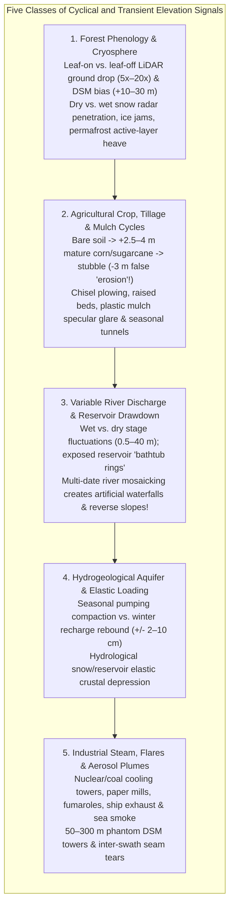
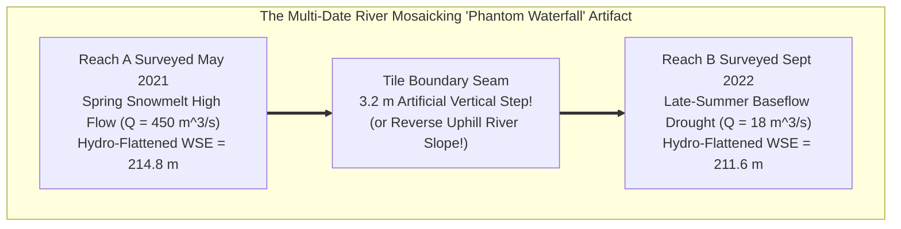

## 22.3 Seasonal, Vegetative, Agricultural, Hydrological, and Atmospheric Transients

Even if every tectonic plate halted, every landslide froze, and every vehicle vanished, two elevation surveys of the same watershed acquired six months apart would still disagree across vast areas by **centimeters to tens of meters**. Landscapes undergo continuous cyclic and episodic surface shifts driven by deciduous leaf phenology, snowpack and river ice, permafrost freeze-thaw heave, poroelastic aquifer "breathing," agricultural crop and tillage calendars, fluctuating river and reservoir water stages, and industrial/geothermal steam plumes.

When multi-date DEMs are differenced or mosaicked without accounting for these environmental transients, natural seasonal cycles masquerade as tectonic uplift, catastrophic erosion, or step-like waterfalls across river networks.

---

### 22.3.1 Seasonal Forest Phenology, Snow/Ice Physics, and Poroelastic Breathing

#### 1. Leaf-On vs. Leaf-Off Deciduous Canopy Cycles
Across temperate deciduous and mixed forests, seasonal leaf emergence fundamentally alters both DSM elevation and bare-earth DTM point support:
* **Leaf-Off Acquisition (Late Autumn to Early Spring, Snow-Free):** Bare leafless twigs allow **$30\%\text{–}60\%$ of airborne LiDAR pulses** to reach the mineral forest floor, delivering dense `Class 2` ground coverage ($\rho_{\text{ground}} = 4\text{–}12\text{ pts}\cdot\text{m}^{-2}$, $\sigma_{z,\text{DTM}} \approx 0.06\text{–}0.10\text{ m}$)—which is why **USGS 3DEP Lidar Base Specification** strictly mandates leaf-off collection windows for deciduous terrain!
* **Leaf-On Acquisition (Summer Canopy Closure):** Expanded foliage and dense summer herbaceous understory drop ground-return density by **$5\times\text{ to }20\times$** ($\rho_{\text{ground}} < 0.2\text{–}0.8\text{ pts}\cdot\text{m}^{-2}$). Simultaneously, optical stereo and X/C-band InSAR DSMs jump upward by $+10\text{ to }+30\text{ m}$ to the leaf canopy, while LiDAR ground filters suffer increased Type II understory commission (+$0.2\text{ to }+0.8\text{ m}$ apparent ground uplift) and wider interpolation voids.

#### 2. Snowpack, River Ice Jams, Permafrost Heave, and Aquifer Breathing
* **Dry vs. Wet Seasonal Snowpack:** Seasonal alpine snowpacks accumulate $1\text{–}8\text{ m}$ of thickness (`ASPRS Class 21`, Snow). Optical stereo and $532/1064\text{ nm}$ LiDAR reflect off the upper air-snow interface (modulo $2\text{–}10\text{ cm}$ green subsurface scattering in coarse firn), whereas microwave radar exhibits a dramatic seasonal dielectric switch: **cold dry snow** is nearly transparent to C- and L-band radar (penetrating meters toward the frozen ground, scaled by refractive index $n_{\text{snow}} \approx \sqrt{1 + 1.7\rho_s + 0.7\rho_s^2}$), whereas **$1\%$ liquid meltwater in spring wet snow** spikes dielectric loss by two orders of magnitude, abruptly shifting the InSAR scattering phase center upward to the wet snow top!
* **River/Lake Ice Breakup and Ice Jams:** Winter ice cover elevates apparent river surfaces by $0.3\text{–}1.5\text{ m}$, while spring breakup **ice jams** pile fractured floes into $3\text{–}10\text{ m}$-tall temporary dams at river bends and bridge piers—producing extreme localized backwater stages that look like solid earthen terraces in winter/spring DSMs.
* **Permafrost Active-Layer Freeze-Thaw ("Frost Heave"):** Across Arctic plains, seasonal summer thaw of pore ice in the upper $0.4\text{–}2.0\text{ m}$ active layer causes $3\text{–}20\text{ cm}$ of seasonal ground subsidence ($9\%$ water-ice volume contraction plus excess ice melt), reversed each autumn by upward frost heave—superimposed upon irreversible multi-meter **thermokarst** slump collapse where massive ground-ice wedges melt out.
* **Poroelastic Aquifer Breathing:** Seasonal groundwater extraction and recharge deform alluvial basins vertically via Terzaghi one-dimensional poroelastic consolidation $\Delta z_{\text{aquifer}}(t) = S_k \, \Delta h_{\text{head}}(t)$ (where $S_k = S_{sk} b_{\text{aq}}$ is skeletal storativity), producing reversible **$\pm 2\text{ to }\pm 10\text{ cm}$ seasonal vertical oscillations** (e.g., Santa Clara Valley, San Joaquin Valley, Taipei Basin) alongside irreversible inelastic clay compaction ($>20\text{ cm}\cdot\text{yr}^{-1}$).

---

### 22.3.2 Farm Crops, Tillage Roughness, and Agricultural Infrastructure

Agricultural landscapes cover $\sim 38\%$ of global ice-free land and cycle through meter-scale geometric and radiometric transformations every few months:
* **Annual Crop Phenology:** A bare winter field at $z_0$ progresses through spring emergence to **$2.5\text{–}4.5\text{ m}$-tall mature maize (corn), sorghum, hops, or sugarcane** by August, before dropping overnight at October harvest to $15\text{ cm}$ stubble! Differencing a late-summer satellite stereo or C/X-band InSAR DSM (or even an aggressively filtered leaf-on UAV point cloud where zero rays penetrate dense corn) against a spring baseline fabricates **$30\,000\text{ m}^3\cdot\text{ha}^{-1}$ of phantom "erosion"** after harvest.
* **Tillage, Raised Beds, and Paddy Ponding:** Moldboard/chisel plowing, potato hilling, and laser-leveled $25\text{ cm}$ vegetable beds alter micro-topographic roughness, bulk soil density (fluffing newly tilled soil upward by $3\text{–}8\text{ cm}$ before rain compaction!), and overland furrow flow direction (`90°` switch when farmers re-plow across contours!), while flooded rice paddies turn textured soil into specular water voids (`Class 9`).
* **Plastic Mulch, Hail Nets, and Seasonal Polytunnels:** Reflective silver/black polyethylene row mulch and seasonal "walk-in" hoop greenhouses ($2\text{–}3.5\text{ m}$ tall, erected and moved annually across berry and vegetable farms) trigger severe LiDAR specular dropouts and multi-meter DSM step changes between years.

---

### 22.3.3 Variable Water Stage in Streams, Rivers, and Reservoirs

Because $1064\text{ nm}$ NIR LiDAR, optical stereo, and radar cannot penetrate turbid inland waters, standard terrestrial DEMs record the **instantaneous water surface elevation (`WSE`)** $z_w(x, t_i)$ present on the exact hour of flight $t_i$.

1. **Mosaicking Multi-Date River Surveys ("Artificial Waterfalls" & Reverse Slopes):** Regional DEM compilations routinely stitch LiDAR projects flown in different seasons or years. If upstream Reach A was flown during spring snowmelt ($z_w = 214.8\text{ m}$) and downstream Reach B during autumn baseflow ($z_w = 211.6\text{ m}$), a **$3.2\text{ m}$ artificial waterfall** appears at the tile seam! Worse yet, if Reach A was flown at drought low stage ($211.0\text{ m}$) and downstream Reach B at flood stage ($213.5\text{ m}$), the mosaicked river exhibits a **$+2.5\text{ m}$ reverse uphill dam** that ponds simulated floodwaters across the valley!
2. **Exposed Reservoir Drawdown "Bathtub Rings":** Hydroelectric and irrigation reservoirs (e.g., Lake Mead, Lake Powell, Three Gorges) fluctuate vertically by **$15\text{–}60\text{ m}$** seasonally and interannually. Surveying at low pool exposes thousands of hectares of drowned canyon bathymetry that were flat `Class 9` water polygons in prior high-pool DEMs—essential to capture when building seamless reservoir storage-capacity curves $V(z) = \int_{z_{\min}}^z A(\zeta)\,d\zeta$.
3. **Discharge-Normalized Bathymetric Fusion:** Operational hydraulic DEMs must never treat instantaneous `Class 9` hydro-flattened surfaces as channel beds; submerged channel cross-sections must be surveyed with green $532\text{ nm}$ bathy-LiDAR / ADCP / SBES referenced to **orthometric bed elevation** $z_{\text{bed}} = z_{\text{WSE}}(t_i) - d_{\text{sonar}}(t_i)$ tied to simultaneous USGS/national stream-gauge telemetry.

---

### 22.3.4 Industrial Steam from Cooling Towers (and Other Aerosol Plumes)

A startling artifact in industrial, port, and volcanic DSMs is the **$50\text{–}300\text{ m}$-tall "phantom concrete tower"** rising above power stations, refineries, and harbors where no solid structure exists!

* **Physical Mechanism:** Hyperbolic nuclear and coal power-plant cooling towers, pulp-and-paper mills, steel quench towers, geothermal power plants and natural volcanic fumaroles, petrochemical flare stacks, ship funnel exhausts, cold-air **arctic sea smoke**, and active wildfire smoke columns eject buoyant plumes rich in condensed liquid water droplets ($r_d \approx 5\text{–}25\,\mu\text{m}$) and soot aerosols. Because droplet diameters exceed near-infrared and optical wavelengths ($2\pi r_d / \lambda \gg 1$, **Mie scattering regime**), dense steam clouds act as bright volumetric reflectors for $532/905/1064\text{ nm}$ LiDAR pulses and high-contrast texture blobs for stereo cameras!
* **Why Automated Filters Fail:** Unlike isolated birds (`Class 18`), a cooling-tower steam plume contains tens of thousands of spatially dense, locally coherent 3D points attached continuously to the concrete cooling-tower rim—fooling connected-component and morphological filters into classifying the entire $200\text{ m}$ billowing cloud as part of a `Class 6` Building! Meanwhile, wind shear blows the plume across different azimuths between adjacent flight swaths, wrecking automated strip alignment.
* **Multi-Return, Radiometric, and Temporal Persistence Defenses:**
  1. **Volumetric Multi-Return & Echo-Width Signature:** Solid roofs produce sharp single returns (`ReturnNumber == 1 && NumberOfReturns == 1`) with narrow waveform pulse widths; steam plumes produce volumetric multi-return clouds (`NumberOfReturns >= 2`) with broadened full-waveform echo widths and rapid interior laser penetration to ground/roof surfaces directly *beneath* the plume!
  2. **Multi-Epoch Persistence & Thermal/Facility Masking:** Differencing overlapping LiDAR strips flown 15 minutes apart reveals $100\%$ decorrelation across drifting plumes ($|\Delta z_{\text{swath}}| > 5\text{ m}$), allowing automated reclassification into **`ASPRS Class 18` (`High Noise`)** or **`Class 22` (`Temporal Exclusion`)**, reinforced by OSM `man_made=cooling_tower` / `industrial=*` polygon masks.

| Transient Phenomenon | Typical Vertical Magnitude ($\Delta z$) | Characteristic Timescale | Primary Sensor / Filter Remedy |
| :--- | :--- | :--- | :--- |
| **Deciduous Leaf-On vs. Leaf-Off** | $+10\text{ to }+30\text{ m}$ (DSM); $+0.2\text{ to }+0.8\text{ m}$ (DTM shrub bias) | Seasonal ($3\text{–}6\text{ months}$) | Enforce USGS 3DEP leaf-off LiDAR collection windows & VVA validation |
| **Snowpack & Wet-Snow Dielectric Switch** | $+0.5\text{ to }+8.0\text{ m}$ (`Class 21`) | Days to seasonal | Mask via Sentinel-2 `Dynamic World` snow probability & snow-free summer baselines |
| **Permafrost Thaw & Aquifer Breathing** | $\pm 0.02\text{ to }\pm 0.20\text{ m}$ (cyclic); $-1\text{ to }-5\text{ m}$ (thermokarst) | Seasonal to multi-decadal | Pair repeat LiDAR/InSAR with GNSS CORS and piezometric head records |
| **Row Crops & Agricultural Tillage** | $+0.05\text{ m}$ (tillage) to $+4.5\text{ m}$ (maize/sugarcane) | Weeks to seasonal | Exclude `Dynamic World` cropland polygons from stable co-registration masks |
| **River Stage & Reservoir Drawdown** | $+0.5\text{ to }+60.0\text{ m}$ (`Class 9` WSE) | Hours to interannual | Normalize hydro-flattened WSE to stream gauges; fuse low-pool bathy (`ALB`/`MBES`) |
| **Cooling-Tower Steam & Fumarole Plumes** | $+50\text{ to }+300\text{ m}$ phantom towers | Seconds to minutes | Strip via multi-return echo width (`NumberOfReturns >= 2`) & inter-swath decorrelation |
