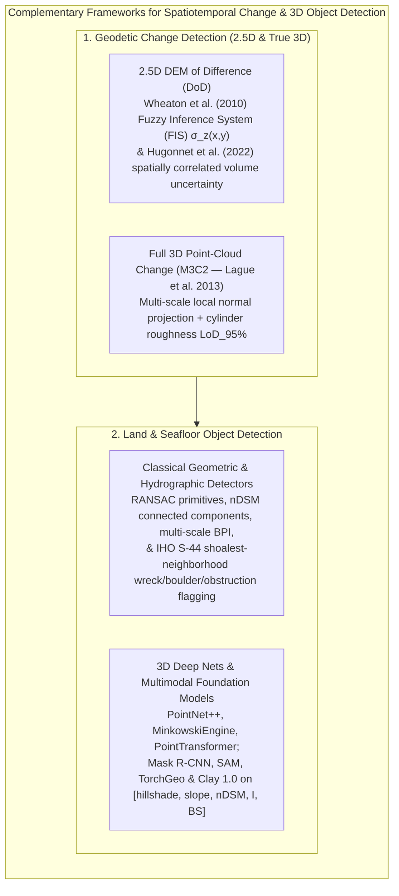

## 22.4 Change Detection and Object Detection: Traditional vs. Machine Learning Methods

Once multi-temporal elevation datasets have been aligned to an identical geodetic datum, epoch, and co-registered bedrock frame—and purged of moving traffic and seasonal phenology—analysts face two core quantitative tasks: **Change Detection** (estimating continuous surface displacement $\Delta z$ or 3D normal shift $L_{\text{M3C2}}$ and its propagated volumetric uncertainty) and **Object Detection** (isolating discrete natural and human-made features on land and on the seabed). Across both tasks, rigorous **geodetic metrology** and **deep-learning / geospatial foundation models** act as synergistic partners rather than substitutes.

---

### 22.4.1 Change Detection: From Spatially Variable 2.5D `DoD` to Full 3D `M3C2`

#### 1. 2.5D DEM of Difference (`DoD`) with Spatially Variable Fuzzy Error Models (`Wheaton et al., 2010`)
On low-to-moderate relief landforms (braided gravel-bed rivers, coastal beaches, open-pit mine benches, dredged harbor channels, agricultural fields, and ablating glaciers), surface elevation change between survey epochs $t_1$ and $t_2$ ($t_2 > t_1$) is computed cell-by-cell as the **DEM of Difference (`DoD`)**:

$$\Delta z(x, y) = z_{t_2}(x, y) - z_{t_1}(x, y)$$

*(Note on Hydrographic Sign Convention: When working with positive-down charted depths $d = -z$, shoaling/deposition yields $\Delta d = d_{t_2} - d_{t_1} < 0$ whereas scouring/dredging yields $\Delta d > 0$; converting to positive-up elevation $z = -d$ ensures $\Delta z > 0$ universally denotes material deposition/uplift and $\Delta z < 0$ denotes erosion/subsidence!)*

Before subtracting, **mandatory 3D rigid co-registration** (**Nuth & Kääb, 2011**, fitting $\Delta z / \tan\alpha = a\cos(b - \psi_{\text{aspect}}) + c$ over stable bedrock/paved control zones) must remove sub-pixel horizontal offsets $(\Delta E, \Delta N)$ and vertical datum bias $\Delta Z_0$. Even after co-registration, using a *single spatially uniform* $\text{RMSE}_z$ across the entire scene severely over-flags steep banks as "eroding" (false positives) while missing real thin sheet deposition on flat floodplains (false negatives).

To resolve this, **Joe Wheaton, James Brasington, Stephen Darby, and David Sear (2010)** introduced **spatially variable Fuzzy Inference System (`FIS`) error modeling**:
* At every pixel $(x, y)$, Mamdani fuzzy membership rules combine local **terrain slope** $\|\nabla z\|$, **3D point density** $\rho_{\text{pts}}$, **surface roughness / canopy cover**, and **3D GNSS point quality** to estimate epoch-specific vertical standard deviations $\sigma_{z,1}(x, y)$ and $\sigma_{z,2}(x, y)$.
* Propagating independent epoch errors yields the pixel-wise **Minimum Level of Detection (`LoD`)** at confidence level $1 - \alpha$ ($t_{0.95} = 1.960$ under Gaussian tails) and cell-level $t$-score $t_{\text{cell}}$:
  $$\sigma_{\Delta z}(x, y) = \sqrt{\sigma_{z,1}^2(x, y) + \sigma_{z,2}^2(x, y)}, \qquad \text{LoD}_{95\%}(x, y) = 1.960 \, \sigma_{\Delta z}(x, y), \qquad t_{\text{cell}}(x, y) = \frac{|\Delta z(x, y)|}{\sigma_{\Delta z}(x, y)}$$
* **Probabilistic & Spatial-Coherence Thresholding:** Rather than hard-zeroing every pixel with $|\Delta z| < \text{LoD}_{95\%}$ (which can bias thin, spatially extensive alluvial-fan deposition budgets toward zero!), Wheaton et al. weight pixel probabilities using **Bayesian spatial coherence** within $3\times 3$ or $5\times 5$ neighborhoods (boosting confidence when all 9 neighbors consistently show $+8\text{ cm}$ of deposition), while **Romain Hugonnet et al. (2022)** (`xdem`) integrate multi-range spherical variograms of stable-terrain residuals to compute exact spatially correlated volumetric confidence bounds $\Delta V \pm 1.96\,\sigma_V$.

#### 2. Full 3D Point-Cloud Change Along Surface Normals (`M3C2` — Lague et al., 2013)
Whenever terrain approaches vertical ($>45^\circ\text{–}90^\circ$) or overhangs—rockfall cliffs, undercut riverbanks, sea caves, engineered dam faces, and submarine canyon walls—2.5D vertical differencing $\Delta z$ explodes by $\Delta n / \cos\alpha \to \infty$ and interpolates across empty shadow zones.

**Dimitri Lague, Nicolas Brodu, and Jérôme Leroux (2013)** solved both failures with **Multiscale Model-to-Model Cloud Comparison (`M3C2`)**:
1. Select a subsampled set of **core points** $\{\mathbf{p}_i\}$ on reference cloud $\mathcal{C}_1$ (avoiding redundant computation on $10^8$ points while retaining full point density for statistics).
2. Estimate a clean local **3D unit surface normal** $\hat{\mathbf{n}}_i$ at normal scale $D$ chosen $20\times\text{–}25\times$ larger than local surface roughness $\sigma_i(D)$ so boulders or ripples do not randomize normal directions (or select the multi-scale $D^*$ maximizing planarity $(\lambda_2 - \lambda_3)/\lambda_1$).
3. Intersect a cylinder of smaller projection diameter $d$ coaxial with $\hat{\mathbf{n}}_i$ through raw clouds $\mathcal{C}_1$ and $\mathcal{C}_2$, computing normal-projected sample means $(\mu_1, \mu_2)$, local roughness standard deviations $(s_1, s_2)$, sample counts $(n_1, n_2)$, the signed 3D displacement $L_{\text{M3C2}} = \mu_2 - \mu_1$, and the spatially varying $95\%$ **3D Level of Detection** $\text{LoD}_{95\%}(d)$ incorporating isotropic registration uncertainty $\text{reg}$ (derived in Section 22.6.2).

---

### 22.4.2 Object Detection Across Land and Seafloor: Geometric vs. Machine Learning

#### 1. Traditional Geometric and Hydrographic Feature Detectors
Deterministic geometric detectors remain mandatory in safety-critical aviation and hydrographic certification because their false-negative bounds can be proved analytically:
* **`RANSAC` Primitive Fitting (`Fischler & Bolles, 1981`):** Fits planes, cylinders, and spheres with $>50\%$ outlier breakdown resilience to segment roof facets, retaining walls, tunnel rings, and above-ground pipelines.
* **Connected-Component Labeling on `nDSM` & Multi-Scale `BPI`:** Thresholding $\text{nDSM} = z_{\text{DSM}} - z_{\text{DTM}} > h_{\min}$ isolates discrete vehicles, stockpiles, and individual tree crowns (via inverted watershed marker segmentation), while multi-scale **Bathymetric Position Index (`BPI`)**:
  $$\text{BPI}(r_{\text{in}}, r_{\text{out}}) = z(x, y) - \bar{z}_{\text{annulus}}(r_{\text{in}}, r_{\text{out}})$$
  highlights positive seabed mounds, cold-water coral bioherms, pockmarks, and dredged spoil heaps.
* **Hydrographic Shoalest-Neighborhood Wreck/Boulder/Obstruction Detection (`IHO S-44`):** Under **IHO S-44 (6th ed., 2020/2022)** Exclusive Order (requiring detection of cubic features $\ge 0.5\text{ m}$), Special Order (cubic features $\ge 1.0\text{ m}$), and Order 1a ($\ge 2.0\text{ m}$ for depths $d \le 40\text{ m}$, or $0.10\,d$ [$10\%$ of depth] for $d > 40\text{ m}$—not to be confused with the $0.05\,d$ depth-dependent THU term!), hydrographic QC algorithms (`HydrOffice QC Tools` *Flier Finder* / *Holiday Finder*, `CARIS` *Find Wrecks and Obstructions*) scan unsmoothed soundings against a smoothed regional surface to flag any multi-hit local depth minimum $\Delta d_{\text{shoal}} = d_{\text{regional}} - d_{\min} \ge h_{\text{cube}}$ supported by $\ge N_{\min}$ independent beams, elevating verified boulders, rock pinnacles, and shipwrecks to **Designated Soundings** (`ASPRS Class 44` / `BAG Tracking List`).

#### 2. 3D Point-Cloud Networks and Multimodal Geospatial Foundation Models
Purely geometric rules struggle when targets resemble natural roughness—such as distinguishing a boulder-strewn glacial moraine from a World War II shipwreck, an archaeological Maya platform mound under jungle canopy, or bomb craters from natural karst sinkholes. Modern machine-learning pipelines combine multi-channel physics stacks:
* **3D Point-Cloud & 4D Spatiotemporal Architectures:** **`PointNet++`**, sparse voxel **`MinkowskiEngine` (`Choy, Gwak, & Savarese, 2019` — including 4D $(x, y, z, t)$ spatiotemporal convolutions!)**, and **`PointTransformer` (v1–v3)** ingest raw 3D point clouds enriched with calibrated laser intensity / sonar backscatter to segment cars, ships, cranes, boulders, and newly erected structures directly in 3D space.
* **2D/2.5D Instance Segmentation & Foundation Models (`Mask R-CNN`, `SAM`, `TorchGeo`, `Clay 1.0`):** Feeding multi-channel invariant terrain tensors—`[multi-azimuth hillshade / Sky-View Factor, slope α, profile/plan curvature, nDSM, LiDAR intensity / MBES backscatter BS(θ)]`—into **Mask R-CNN**, Meta's **Segment Anything Model (`SAM`)**, or open-source Vision Transformer geospatial foundation models such as **`Clay 1.0` (2024)** inside **`TorchGeo` (`Stewart et al., 2022`)** enables few-shot detection of landslide scars, thermokarst retrogressive thaw slumps, shipwreck hulls, and post-disaster building collapse across continental archives, while **Dynamic World (`Brown et al., 2022`)** supplies near-real-time $10\text{ m}$ Sentinel-2 probability masks (`water`, `crops`, `snow_and_ice`, `built`, `trees`) to automatically filter seasonal phenology and reservoir stage shifts out of elevation change maps!

---

### 22.4.3 Choosing Between Geodetic Metrology and Deep Learning: Operational Synthesis

In operational hazard and charting pipelines, replacing classical geodetic statistics with pure deep learning—or ignoring machine learning in cluttered multi-modal scenes—leads to avoidable failures. Instead, best-practice architectures stage both paradigms sequentially:

| Analytical Stage | Role of Classical Geodetic Metrology (`DoD`, `M3C2`, `IHO S-44`) | Role of Deep Learning & Foundation Models (`KPConv`, `SAM`, `Clay 1.0`) |
| :--- | :--- | :--- |
| **1. Pre-Alignment & Masking** | Solves exact 3D Nuth & Kääb / ICP rigid alignment parameters $(\Delta E, \Delta N, \Delta Z)$ with formal covariance matrices. | Segments `Dynamic World` seasonal crops, snow, moving vehicles, and drifting steam plumes out of the alignment and `DoD` domain. |
| **2. Candidate Change / Object Localization** | Flags every deterministic shoal peak exceeding IHO S-44 cubic thresholds ($h_{\text{cube}} \ge 0.5\text{–}2.0\text{ m}$) with zero false-negative training risk. | Semantic classification separates true geomorphic landslides, archaeological mounds, and shipwrecks from visually similar moraines, boulders, or tree-throw pits. |
| **3. Volumetric & Engineering Quantification** | Computes unbiased physical mass balances ($\Delta V$ in $\text{m}^3$) and rigorous $95\%$ confidence bounds ($\pm 1.96\,\sigma_V$) traceable to SI units. | *Never used directly to invent elevation numbers*—prevents neural regression biases from violating mass conservation! |

By confining neural networks and foundation models to **semantic segmentation, transient masking, and candidate localization**, while delegating **co-registration, elevation differencing, shoal preservation, and volumetric uncertainty propagation** strictly to physical metrology (`DoD` / `M3C2`), practitioners gain planetary-scale automation without sacrificing legal or scientific traceability.
