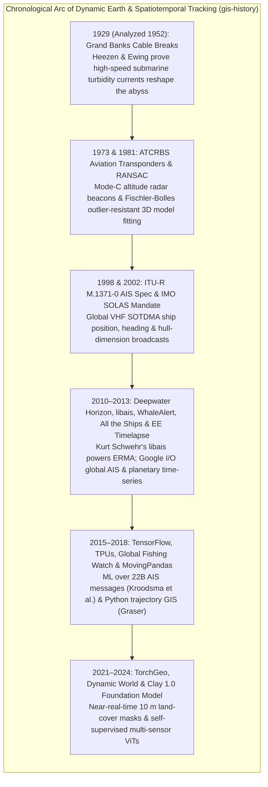
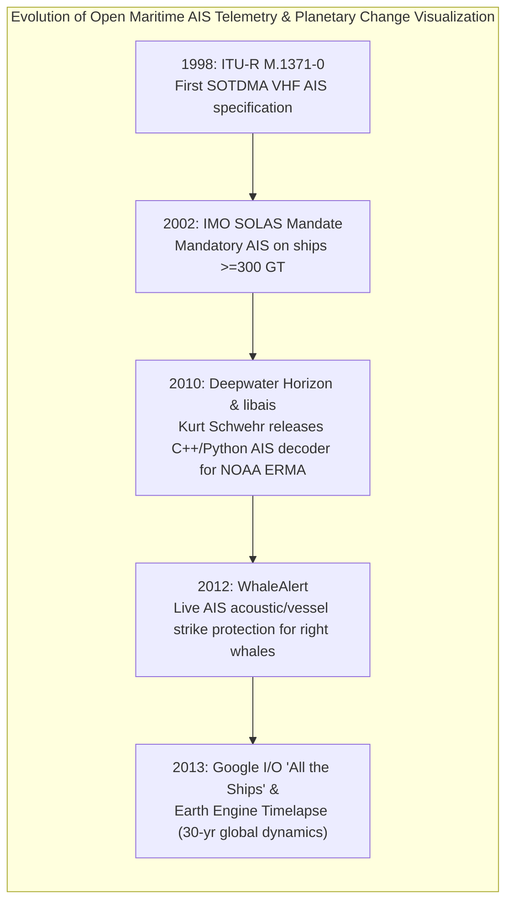

## 22.5 Historical Evolution of Dynamic Earth Tracking, Marine Telemetry, and Spatiotemporal AI

Recognizing that Earth's land surface, seafloor, and human traffic constitute a coupled 4D dynamical system required overturning nineteenth-century uniformitarian assumptions about a tranquil deep ocean, building global cooperative aircraft and ship transponder networks, and scaling machine learning to petabyte satellite archives. Every milestone below links directly to the [`gis-history`](https://github.com/schwehr/gis-history) chronology.

---

### 22.5.1 Discovering the Dynamic Seafloor, Aviation Beacons, and Robust Fitting (1929–1981)

#### 1929 (Decoded 1952): The Grand Banks Earthquake and Submarine Cable Breaks
On **November 18, 1929** (`gis-history`), an $M_w\,7.2$ earthquake on the Laurentian continental slope south of Newfoundland snapped six transatlantic telegraph cables instantaneously near the epicenter—and then, mysteriously, **six deeper cables downslope snapped one after another in exact depth sequence over the next 13 hours and 17 minutes**, culminating $720\text{ km}$ south on the Sohm Abyssal Plain!
* Twenty-three years later, Lamont Geological Observatory oceanographers **Bruce C. Heezen and Maurice Ewing (1952)** used the exact cable-break timestamps and seabed positions to calculate flow velocities reaching $25\text{–}28\text{ m}\cdot\text{s}^{-1}$ ($>90\text{ km/h}$ on the upper slope, averaging $\sim 50\text{ km/h}$ across the plain), proving definitively that catastrophic **submarine turbidity currents** carve deep-sea canyons and transport cubic kilometers of sediment in hours.
* This discovery shattered the dogma of an unchanging deep ocean floor and remains the direct physical motivation for modern submarine telecommunications cable route engineering (Chapter 1) and repeat multibeam canyon monitoring.

#### 1973: `ATCRBS` (Air Traffic Control Radar Beacon System)
Standardized across national airspace by the early **1970s (`1973` in `gis-history`)** building upon wartime IFF transponders, the **Air Traffic Control Radar Beacon System (`ATCRBS`)** paired $1030\text{ MHz}$ ground radar interrogations with $1090\text{ MHz}$ airborne transponder replies encoding 4096 octal identity codes (`Mode A`) and $100\text{ ft}$ Gillham-coded pressure altitude (`Mode C`). `ATCRBS` established the frequency allocation ($1090\text{ MHz}$) and 3D cooperative aircraft surveillance architecture that evolved into Mode S and GNSS-based **ADS-B Extended Squitter**, enabling modern automated mid-air aircraft filtering in spaceborne LiDAR and stereo pipelines.

#### 1981: `RANSAC` (`Fischler & Bolles, 1981`)
In **June 1981** (`gis-history`), **Martin A. Fischler and Robert C. Bolles** at SRI International published *Random Sample Consensus: A Paradigm for Model Fitting with Applications to Image Analysis and Automated Cartography* directly motivated by automated photogrammetric camera resection (`Location Determination Problem`) in the presence of gross matching blunders. Whereas ordinary least squares breaks down completely when a single moving car, bird, or tree branch contaminates a sample ($0\%$ breakdown point), `RANSAC` iteratively hypotheses minimal geometric subsets ($m=3$ points for a 3D plane) and maximizes inlier consensus, achieving $>50\%$ outlier immunity with $1 - p = (1 - w^m)^k$ probabilistic guarantees—powering virtually every modern 3D roof, pipe, and trajectory extractor.

---

### 22.5.2 The `AIS` Maritime Revolution and Planetary Time-Series (1998–2013)

#### 1998 & 2002: `ITU-R M.1371-0` and Mandatory `IMO` Shipboard `AIS`
In **November 1998** (`gis-history`), the International Telecommunication Union ratified Recommendation **`ITU-R M.1371-0`**, specifying autonomous Self-Organizing TDMA VHF broadcasts so vessels could exchange GNSS coordinates without shore-station coordination. Following the **2002** IMO SOLAS Chapter V carriage mandate (`gis-history`), tens of thousands of commercial ships began broadcasting continuous 6-bit ASCII-armored `NMEA 0183` (`!AIVDM` / `!AIVDO`) telemetry—unintentionally creating the world's richest open kinematic ocean dataset once low-Earth-orbit nanosatellites began capturing VHF packets from mid-ocean shipping lanes in the late 2000s.

#### 2010–2013: *Deepwater Horizon*, `libais`, `WhaleAlert`, and *All the Ships*
* **2010 (*Deepwater Horizon* & `libais`):** Following the April 20, 2010 *Deepwater Horizon* blowout in the Gulf of Mexico (`gis-history`), hundreds of response vessels, skimmers, acoustic survey ships, and ROV support ships operated simultaneously around the wellhead. Kurt Schwehr authored and open-sourced **`libais`** (`2010` in `gis-history`), a high-speed C++/Python parser for ITU-R M.1371 binary payloads, feeding live vessel tracks directly into **NOAA `ERMA`** (Environmental Response Management Application).
* **2012 (`WhaleAlert`):** Presented to the U.S. Congress in **2012** (`gis-history`), **`WhaleAlert`** fused live coastal AIS feeds, acoustic buoy detections, and seasonal management zones on nautical charts in real time to prevent fatal ship strikes on critically endangered North Atlantic right whales (*Eubalaena glacialis*).
* **2013 (*All the Ships* & Google Earth Engine *Timelapse*):** At **Google I/O 2013** (`gis-history`), Kurt Schwehr and Brianna Schuyler presented ***All the Ships***, demonstrating cloud-scale ingestion and visualization of global satellite AIS trajectories across the world's oceans. That same year (`2013` in `gis-history`), Google launched **Earth Engine *Timelapse*** (built on the Earth Engine platform later detailed by **Gorelick et al., 2017**), rendering three decades of annual cloud-free Landsat composites to reveal meandering Amazonian river avulsions, shrinking Aral Sea shorelines, coastal Dubai land reclamation, and retreating Alaskan glaciers to millions of viewers.

*(Parallel Geomorphic Milestone: During this same 2010–2013 window, **Wheaton et al. [2010]**, **Nuth & Kääb [2011]**, and **Lague, Brodu, & Leroux [2013]** established the modern statistical foundations of `DoD` Fuzzy-LoD sediment budgeting, 3D DEM co-registration, and `M3C2` point-cloud change detection.)*

---

### 22.5.3 Hardware-Accelerated Deep Learning, `MovingPandas`, and Foundation Models (2015–2024)

* **2015–2018 (`TensorFlow`, `TPU`, `Global Fishing Watch`, and `MovingPandas`):** The open-sourcing of **`TensorFlow` (`2015-11` in `gis-history`)** and deployment of Google's **Tensor Processing Unit (`TPU`, `2016-05` in `gis-history`)** enabled planetary-scale spatiotemporal inference. Launched in **September 2016** (`gis-history`) by SkyTruth, Oceana, and Google (**Kroodsma et al., 2018**), **Global Fishing Watch** processed $22\text{ billion}$ AIS positions with convolutional neural networks to classify vessel behavior and map industrial fishing across $>55\%$ of the global ocean. In **December 2018** (`gis-history`), **Anita Graser (2019)** started **`MovingPandas`**, bringing native trajectory segmentation, stop detection, and timestamp interpolation into the Python `GeoPandas` stack.
* **2021–2024 (`TorchGeo`, `Dynamic World`, `xdem`, and `Clay 1.0`):** In **May 2021** (`gis-history`), Microsoft and collaborators launched **`TorchGeo`** (**Stewart et al., 2022**), solving CRS-aware spatial sampling for PyTorch multi-sensor rasters. In **June 2022** (`gis-history`), Google and WRI launched **Dynamic World** (**Brown et al., 2022**), generating near-real-time $10\text{ m}$ nine-class land-cover probabilities on every Sentinel-2 L1C scene—giving elevation modelers an automated global phenology/water/snow mask—alongside the formalization of spatially correlated DEM uncertainty in **`xdem`** (**Hugonnet et al., 2022**). Finally, in **May 2024** (`gis-history`), **Made with Clay** released **`Clay 1.0`**, an open-source, open-weights Masked Autoencoder Vision Transformer geospatial foundation model explicitly ingesting DEMs alongside optical and SAR time series to detect geomorphic and anthropogenic change across the globe.

---

### 22.5.4 Synthesis Table: Key Historical Milestones in Dynamic Elevation & Tracking

| Year (`gis-history`) | Milestone / Standard / System | Primary Architects / Institutions | Transformative Impact on 4D Elevation Modeling |
| :--- | :--- | :--- | :--- |
| **1929 / 1952** | Grand Banks Turbidity Current Cable Analysis | Bruce Heezen & Maurice Ewing (Lamont) | Proved deep-sea canyons and abyssal plains undergo rapid, high-velocity mass-wasting bathymetric change. |
| **1973** | `ATCRBS` Radar Transponder Standard | FAA / ICAO | Established $1090\text{ MHz}$ cooperative 3D aircraft altitude telemetry, evolving into modern GNSS `ADS-B` mid-air LiDAR/stereo filtering. |
| **1981** | `RANSAC` Robust Estimation | Martin Fischler & Robert Bolles (SRI) | Enabled $>50\%$ outlier-immune geometric primitive and camera resection fitting across cluttered dynamic scenes. |
| **1998 / 2002** | `ITU-R M.1371-0` & `IMO SOLAS` `AIS` Mandate | ITU & International Maritime Organization | Created continuous global ship position, heading, and $(A,B,C,D)$ hull-offset broadcasts used to mask ships and Kelvin wakes. |
| **2010** | *Deepwater Horizon* Response & `libais` | Kurt Schwehr / NOAA `ERMA` | Open-sourced high-throughput C++/Python `AIVDM` decoding for real-time marine emergency response and remote-sensing ship masking. |
| **2012–2013** | `WhaleAlert`, *All the Ships* & EE *Timelapse* | NOAA/Partners; Schwehr & Schuyler; Google | Demonstrated global cloud-scale `AIS` trajectory analytics (Google I/O) and 30-year planetary surface-change visualization. |
| **2015–2018** | `TensorFlow`, `TPU`, `Global Fishing Watch` & `MovingPandas` | Google, SkyTruth, Oceana; Anita Graser | Scaled deep-learning vessel behavior classification to 22 billion `AIS` points and integrated trajectory interpolation into `GeoPandas`. |
| **2021–2024** | `TorchGeo`, `Dynamic World`, `xdem` & `Clay 1.0` | Stewart et al.; Brown et al.; Hugonnet et al.; Made with Clay | Unified CRS-aware PyTorch loaders, $10\text{ m}$ real-time phenology masks, variogram-correlated `DoD` error budgets, and open ViT foundation models. |
