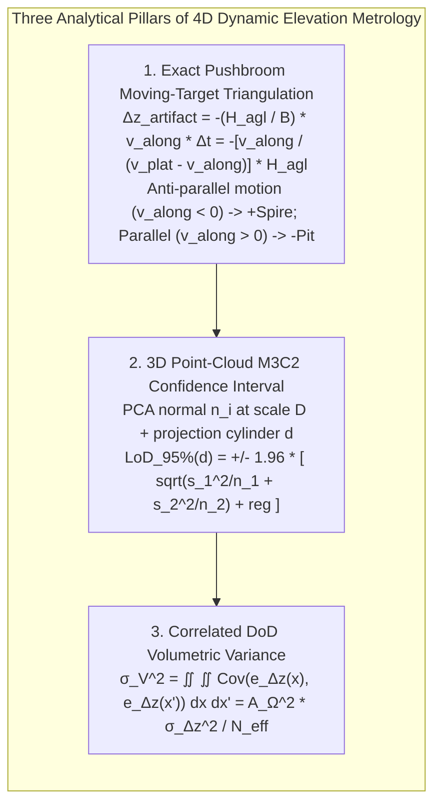
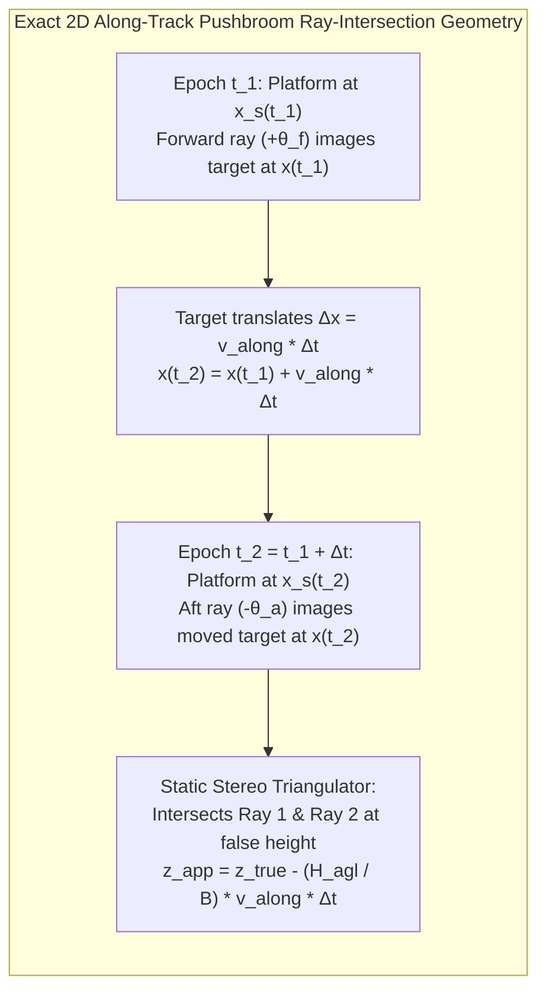

## 22.6 Mathematical Foundations of Dynamic Parallax, 3D `M3C2`, and Volumetric Change Uncertainty

Rigorous 4D elevation analysis requires three closed-form mathematical formulations:
1. **Exact 3D Stereo Ray-Intersection Kinematics** for a moving surface or mid-air object in along-track pushbroom stereo—resolving both the directional sign convention (spire vs. subterranean pit) and finite-speed asymmetry.
2. **Multiscale Model-to-Model Cloud Comparison (`M3C2`)** PCA normal estimation and cylinder-projected $95\%$ Level of Detection (**Lague et al., 2013**).
3. **Spatially Correlated Volumetric `DoD` Error Propagation** (**Wheaton et al., 2010; Hugonnet et al., 2022**), proving why uncorrelated white-noise formulas catastrophically underestimate watershed sediment-budget uncertainty.

---

### 22.6.1 Exact Ray-Intersection Derivation of Along-Track Stereo Motion Distortion

Consider a spaceborne or airborne pushbroom platform flying horizontally along the $+x$ axis at altitude $H$ above the datum with ground-track velocity $v_{\text{plat}} > 0$ ($\text{m}\cdot\text{s}^{-1}$). The sensor carries a **forward-looking** line camera pitched ahead by angle $\theta_f > 0$ (viewing in the $+x$ direction) and an **aft-looking** line camera pitched backward by angle $\theta_a \ge 0$ (viewing in the $-x$ direction; for a forward-nadir pair, $\theta_a = 0$).

Let a moving vehicle or vessel travel at true elevation $z_{\text{true}}$ ($H_{\text{agl}} = H - z_{\text{true}} > 0$) with horizontal velocity vector $\mathbf{v} = [v_{\text{along}}, v_{\text{cross}}]^\top$, where $v_{\text{along}} = \|\mathbf{v}\|\cos\phi_{\text{rel}}$ is **positive when moving in the same direction as the platform** ($\phi_{\text{rel}} = 0^\circ$) and **negative when moving opposite to the platform** ($\phi_{\text{rel}} = 180^\circ$).

#### Step 1: Exact Exposure Epochs and Platform Positions
1. **Forward View ($t_1$):** When the forward ray hits the target at $x(t_1) = x_1$, the platform's along-track coordinate is:
   $$x_s(t_1) = x_1 - H_{\text{agl}} \tan\theta_f$$
2. **Aft View ($t_2 = t_1 + \Delta t$):** During the inter-view time lag $\Delta t > 0$, the platform advances to $x_s(t_2) = x_s(t_1) + v_{\text{plat}}\,\Delta t$, while the target moves to $x(t_2) = x_1 + v_{\text{along}}\,\Delta t$. The aft ray strikes the moved target when:
   $$x_s(t_2) = x(t_2) + H_{\text{agl}} \tan\theta_a = x_1 + v_{\text{along}}\,\Delta t + H_{\text{agl}} \tan\theta_a$$

Subtracting $x_s(t_1)$ from $x_s(t_2)$ relates the nominal static stereo air-base $B = H_{\text{agl}}(\tan\theta_f + \tan\theta_a)$ (with base-to-height ratio $B / H_{\text{agl}} = \tan\theta_f + \tan\theta_a$) to the **exact target-coupled time lag $\Delta t$**:

$$v_{\text{plat}}\,\Delta t = B + v_{\text{along}}\,\Delta t \implies \Delta t = \frac{B}{v_{\text{plat}} - v_{\text{along}}}$$

#### Step 2: Stereo Ray Intersection and Exact Apparent Elevation
A photogrammetric stereo matcher (`SGM` / bundle adjustment) assumes the matched feature remained stationary at a single unknown 3D point $(x_{\text{app}}, z_{\text{app}})$ satisfying both ray equations simultaneously:

$$x_{\text{app}} - x_s(t_1) = (H - z_{\text{app}})\tan\theta_f, \qquad x_s(t_2) - x_{\text{app}} = (H - z_{\text{app}})\tan\theta_a$$

Adding these two ray equations eliminates $x_{\text{app}}$:

$$x_s(t_2) - x_s(t_1) = (H - z_{\text{app}})(\tan\theta_f + \tan\theta_a) = (H - z_{\text{app}})\frac{B}{H_{\text{agl}}}$$

Substituting $x_s(t_2) - x_s(t_1) = B + v_{\text{along}}\,\Delta t$ and $H - z_{\text{true}} = H_{\text{agl}}$ yields the **exact apparent elevation equation** (without any small-speed approximation!):

$$z_{\text{app}} = z_{\text{true}} - \frac{H_{\text{agl}}}{B} \, v_{\text{along}} \, \Delta t = z_{\text{true}} - \frac{v_{\text{along}}}{v_{\text{plat}} - v_{\text{along}}} \, H_{\text{agl}}$$

*(Note: When authors define target velocity positive toward the approaching sensor [$v_{\text{oncoming}} = -v_{\text{along}}$], the minus sign flips to $+$; writing $v_{\text{along}} = \mathbf{v}\cdot\hat{\mathbf{e}}_{\text{track}}$ explicitly eliminates all sign confusion!)*

#### Worked Numerical Verification: Satellite Ship vs. Airborne Highway Asymmetry
1. **Orbital Stereo (`WorldView-3`, $H_{\text{agl}} = 617\,000\text{ m}$, $v_{\text{plat}} = 6880\text{ m}\cdot\text{s}^{-1}$, $B/H_{\text{agl}} = 0.60 \implies B = 370.2\text{ km}$):**
   A container vessel steams *anti-parallel* to the satellite ground track at $15.55\text{ knots}$ ($v_{\text{along}} = -8.00\text{ m}\cdot\text{s}^{-1}$). Then $\Delta t = \frac{370\,200}{6880 - (-8.0)} = 53.75\text{ s}$, the vessel translates $\Delta x = -430.0\text{ m}$, and its reconstructed deck leaps into the air by:
   $$\Delta z_{\text{artifact}} = -\frac{-8.00}{6880 + 8.00} \times 617\,000\text{ m} = \mathbf{+716.6\text{ m}} \quad (\text{a } 717\text{ m harbor spire!})$$
2. **Airborne Pushbroom (`Leica ADS100`, $H_{\text{agl}} = 3000\text{ m}$, $v_{\text{plat}} = 75.0\text{ m}\cdot\text{s}^{-1}$, forward $27^\circ$ + nadir $0^\circ \implies B/H_{\text{agl}} = 0.5095, B = 1528.6\text{ m}$):**
   Because highway speeds ($90\text{ km/h} = 25.0\text{ m}\cdot\text{s}^{-1}$) equal one-third of aircraft speed, the $(v_{\text{plat}} - v_{\text{along}})$ denominator creates a striking **$2:1$ asymmetry**:
   * **Truck moving *opposite* to aircraft ($v_{\text{along}} = -25.0\text{ m}\cdot\text{s}^{-1}$):** $\Delta t = \frac{1528.6}{75 + 25} = 15.29\text{ s} \implies \Delta z_{\text{artifact}} = -\frac{-25}{100}(3000) = \mathbf{+750.0\text{ m}}$ spire!
   * **Truck moving *with* aircraft ($v_{\text{along}} = +25.0\text{ m}\cdot\text{s}^{-1}$):** $\Delta t = \frac{1528.6}{75 - 25} = 30.57\text{ s} \implies \Delta z_{\text{artifact}} = -\frac{+25}{50}(3000) = \mathbf{-1500.0\text{ m}}$ pit!

---

### 22.6.2 `M3C2` 3D Normal Distance and Level of Detection (`Lague et al., 2013`)

Given two ungridded 3D point clouds $\mathcal{C}_1$ (epoch $t_1$) and $\mathcal{C}_2$ (epoch $t_2$) aligned with isotropic residual registration error $\text{reg}$ ($\text{m}$), `M3C2` operates around each core point $\mathbf{p}_i \in \mathcal{C}_1$ in three steps:

1. **Multi-Scale Local PCA Surface Normal ($\hat{\mathbf{n}}_i$):** Within spherical neighborhood $\mathcal{B}(\mathbf{p}_i, D/2)$ containing $K$ points with centroid $\bar{\mathbf{p}}$, form the $3\times 3$ sample covariance matrix:
   $$\mathbf{\Sigma}_D(\mathbf{p}_i) = \frac{1}{K}\sum_{k=1}^K (\mathbf{p}_k - \bar{\mathbf{p}})(\mathbf{p}_k - \bar{\mathbf{p}})^\top, \qquad \lambda_1 \ge \lambda_2 \ge \lambda_3 \ge 0$$
   Choose normal scale $D$ such that $D / \sqrt{\lambda_3} \ge 20\text{–}25$, and set $\hat{\mathbf{n}}_i$ to the unit eigenvector associated with $\lambda_3$, oriented consistently toward an external viewpoint (e.g., scanner trajectory or $+z$ skyward).
2. **Coaxial Cylinder Sub-Cloud Projection:** Intersect a cylinder of diameter $d < D$ and half-length $L_{\max}$ along axis $\hat{\mathbf{n}}_i$ through $\mathcal{C}_1$ and $\mathcal{C}_2$, yielding $n_1$ and $n_2$ intercepted points (requiring $n_1 \ge 4, n_2 \ge 4$) with scalar normal coordinates $\xi_{m,j} = (\mathbf{q}_{m,j} - \mathbf{p}_i)\cdot\hat{\mathbf{n}}_i$ for $m \in \{1, 2\}$. Compute sample means $\mu_m = \frac{1}{n_m}\sum_{j=1}^{n_m} \xi_{m,j}$ and unbiased sample variances $s_m^2(d) = \frac{1}{n_m - 1}\sum_{j=1}^{n_m}(\xi_{m,j} - \mu_m)^2$.
3. **3D Displacement and $95\%$ Confidence Interval:** The signed normal change is $L_{\text{M3C2}}(\mathbf{p}_i) = \mu_2 - \mu_1$, and its **Level of Detection at $95\%$ confidence** combines random roughness/sampling standard error with systematic registration uncertainty (**Lague et al., 2013**):

$$\text{LoD}_{95\%}(d) = \pm 1.96 \left( \sqrt{\frac{s_1(d)^2}{n_1} + \frac{s_2(d)^2}{n_2}} + \text{reg} \right)$$

#### Worked Numerical Example: TLS Rockfall Monitoring on a Sea Cliff
At a coastal cliff core point ($d = 0.50\text{ m}$ cylinder), epoch $1$ has $n_1 = 36$ points with roughness $s_1 = 0.045\text{ m}$, epoch $2$ has $n_2 = 28$ points with roughness $s_2 = 0.052\text{ m}$, and ICP registration on stable concrete seawalls yields $\text{reg} = 0.015\text{ m}$:

$$\text{LoD}_{95\%} = \pm 1.96\left(\sqrt{\frac{0.045^2}{36} + \frac{0.052^2}{28}} + 0.015\right) = \pm 1.96(0.01236 + 0.01500) = \mathbf{\pm 0.0536\text{ m}} \quad (\pm 5.4\text{ cm})$$

A detached $18\text{ cm}$ cobble ($L_{\text{M3C2}} = -0.180\text{ m}$) exceeds $|\text{LoD}_{95\%}|$ by $3.4\times$ and is flagged as statistically significant cliff erosion, whereas apparent $3.5\text{ cm}$ jitter on rough boulder talus is properly rejected.

---

### 22.6.3 Spatially Correlated Volumetric `DoD` Uncertainty (`Hugonnet et al., 2022`)

When integrating raster `DoD` change $\Delta z_{i,j}$ over a glacier, mine pit, or river reach $\Omega$ of area $A_\Omega = M\,\Delta x\,\Delta y$ to compute net volumetric change $\Delta V = \Delta x\,\Delta y \sum_{(i,j)\in\Omega} \Delta z_{i,j}$, pixel errors $e_{\Delta z}(\mathbf{x})$ exhibit strong spatial autocorrelation $C_{\Delta z}(h_{\text{lag}})$ over correlation range $r_{\text{var}}$ (typically $20\text{–}500\text{ m}$ from IMU attitude drift and flight-line stripping) plus residual vertical bias $\sigma_{\text{bias}}$:

$$\sigma_V^2 = \iint_\Omega \iint_\Omega C_{\Delta z}(\|\mathbf{x} - \mathbf{x}'\|_2)\,d\mathbf{x}\,d\mathbf{x}' + A_\Omega^2 \sigma_{\text{bias}}^2 \approx A_\Omega^2 \left(\frac{\bar{\sigma}_{\Delta z}^2}{N_{\text{eff}}} + \sigma_{\text{bias}}^2\right), \qquad N_{\text{eff}} \approx \max\!\left(1,\; \frac{A_\Omega}{\frac{\pi}{5} r_{\text{var}}^2}\right)$$

*(for a spherical variogram when $\sqrt{A_\Omega} \gg r_{\text{var}}$, following **Hugonnet et al., 2022**, where correlation area is $\frac{\pi}{5} r_{\text{var}}^2 \approx 0.628\,r_{\text{var}}^2$; compare against naive white-noise $N_{\text{naive}} = M = A_\Omega / \Delta x^2$!)* On a $1\text{ km}^2$ floodplain ($M = 10^6$ pixels at $1\text{ m}$ spacing, $\bar{\sigma}_{\Delta z} = 0.10\text{ m}$, $r_{\text{var}} = 100\text{ m}$, $\sigma_{\text{bias}} = 0.015\text{ m}$), naive uncorrelated propagation claims $\sigma_{V,\text{naive}} = \mathbf{100\text{ m}^3}$, whereas true correlated + bias propagation yields $N_{\text{eff}} \approx 159$, giving $\sigma_V = 10^6 \sqrt{0.01/159 + 0.015^2} = \mathbf{16\,967\text{ m}^3}$—**$170\times$ larger**!

When DEM errors exhibit **multi-scale spatial correlation**—for instance, combining short-range interpolation roughness ($r_{\text{var},1} \approx 15\text{ m}$, partial sill $c_{s,1}$) with medium-range aircraft roll/pitch strip oscillation ($r_{\text{var},2} \approx 400\text{ m}$, partial sill $c_{s,2}$) and long-range vertical GNSS trajectory drift ($r_{\text{var},3} \approx 5000\text{ m}$, partial sill $c_{s,3}$)—variance additivity allows each nested spherical variogram component $q \in \{1, \dots, Q\}$ to be integrated independently (**Hugonnet et al., 2022**):

$$\sigma_V^2 = A_\Omega^2 \left( \sum_{q=1}^Q \frac{c_{s,q}}{N_{\text{eff},q}(A_\Omega, r_{\text{var},q})} + \sigma_{\text{bias}}^2 \right)$$

Notice the critical operational consequence: for any region of interest smaller than the long-wavelength trajectory correlation scale ($\sqrt{A_\Omega} < r_{\text{var},3}$), $N_{\text{eff},3} \to 1$, meaning unremoved long-wavelength GNSS/IMU drift acts mathematically identically to a systematic bias across the entire sediment budget unless removed via local stable-bedrock co-registration!
