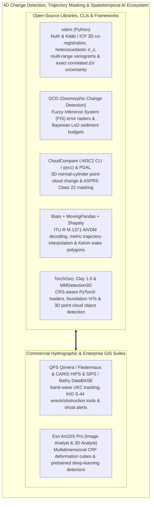

## 22.7 Software Ecosystem for Dynamic Earth Modeling, Change Detection, and Tracking

Operationalizing 4D elevation pipelines—co-registering multi-epoch grids over stable bedrock, propagating heteroscedastic and spatially correlated `DoD` sediment budgets, measuring 3D `M3C2` cliff change, decoding raw `AIS` ship streams to purge wakes and stereo spires, and running multimodal deep-learning detectors—draws upon a mature ecosystem of open-source libraries and industrial hydrographic/GIS platforms.



---

### 22.7.1 Open-Source Pipelines and Runnable Code Workflows

#### 1. `xdem`: 3D Bedrock Co-Registration and Correlated Volumetric Change in Python
Before computing any raster `DoD`, **`xdem`** (**Hugonnet et al., 2022**) aligns the secondary DEM to the reference DEM over a stable-terrain mask (excluding glaciers, active river bars, quarries, landfills, and forest canopies!), models heteroscedastic vertical error as a function of terrain slope and curvature, fits multi-range spherical variograms, and integrates volumetric change with rigorous spatially correlated error bounds:

```python
"""3D co-registration and spatially correlated volumetric DoD budget using xdem."""

import geoutils as gu
import numpy as np
import xdem

# 1. Load multi-temporal DEMs and a polygon mask of non-stable terrain (glacier/channel)
dem_t1 = xdem.DEM("watershed_2018_lidar_1m.tif")
dem_t2 = xdem.DEM("watershed_2024_lidar_1m.tif").reproject(dem_t1)
unstable_polys = gu.Vector("active_channel_and_forest.gpkg")
inlier_mask = ~unstable_polys.create_mask(dem_t1)

# 2. Remove 3D sub-pixel horizontal shift + vertical datum bias (Nuth & Kääb + tilt)
coreg = xdem.coreg.NuthKaab() + xdem.coreg.Deramp(poly_order=1)
dem_t2_aligned = coreg.fit_and_apply(dem_t1, dem_t2, inlier_mask=inlier_mask)

# 3. Compute DoD and infer heteroscedastic + spatially correlated error from stable terrain
dod = dem_t2_aligned - dem_t1
active_roi = gu.Vector("alluvial_fan_debris_zone.gpkg").create_mask(dod)

# Estimate robust NMAD error stratified by terrain slope and fit double-range variogram
slope, max_curv = xdem.terrain.get_terrain_attribute(
    dem_t1, attribute=["slope", "max_curvature"]
)
dh_err = xdem.spatialstats.infer_heteroscedasticity_from_stable(
    dvalues=dod, list_var=[slope, max_curv], stable_mask=inlier_mask
)[0]
# Standardize residuals to unit-variance z-scores on stable terrain & fit variogram
zscore_stable = dod / dh_err
zscore_stable.set_mask(~inlier_mask)
vgram = xdem.spatialstats.sample_empirical_variogram(
    values=zscore_stable, n_variograms=3, random_state=42
)
_, params_vgram = xdem.spatialstats.fit_sum_model_variogram(["Sph", "Sph"], vgram)
area_m2 = float(np.count_nonzero(active_roi.data) * dod.res[0] * dod.res[1])
neff = xdem.spatialstats.neff_circular_approx_numerical(
    area=area_m2, list_vparams=params_vgram
)
mean_dh = float(np.nanmean(dod.data[active_roi.data]))
sigma_mean_dh = float(np.nanmean(dh_err.data[active_roi.data])) / np.sqrt(neff)
print(f"Net Volume: {mean_dh * area_m2:,.0f} +/- {1.96 * sigma_mean_dh * area_m2:,.0f} m^3 (95% CI)")
```

#### 2. `CloudCompare` (`-M3C2` Headless CLI) & `GCD` (`Geomorphic Change Detection`)
* **Headless 3D `M3C2` for Steep Cliffs and Sea Caves:** `CloudCompare` runs `Lague et al. (2013)` directly from automated bash scripts via its `qM3C2` plugin, writing core-point normal distances (`M3C2 distance`), `distance uncertainty`, and binary `significant change` (`|L| > LoD_95%`) dimensions into output `LAS`/`LAZ` files:
  ```bash
  CloudCompare -SILENT -AUTO_SAVE OFF \
      -O -GLOBAL_SHIFT AUTO cliff_2022_tls.laz \
      -O -GLOBAL_SHIFT LAST cliff_2025_tls.laz \
      -M3C2 m3c2_cliff_params.txt \
      -C_EXPORT_FMT LAS -SAVE_CLOUDS FILE "cliff_m3c2_2022_2025.laz"
  ```
  *(Always pass `-GLOBAL_SHIFT AUTO` / `-GLOBAL_SHIFT LAST` so 6- and 7-digit UTM coordinates do not lose millimeter precision inside `Float32` buffers!)*
* **`GCD` (`Geomorphic Change Detection`):** Developed by **Joe Wheaton** and the Riverscapes Consortium (standalone & QGIS/ArcGIS add-in), `GCD` constructs Mamdani Fuzzy Inference System (`FIS`) spatial error grids from point-density, slope, and GNSS quality inputs, applies Bayesian spatial-coherence `LoD` thresholding, and partitions morphological sediment budgets by geomorphic unit (bars, pools, riffles, banks).

#### 3. Automated Ship Hull + Kelvin Wake Masking with `libais` and `MovingPandas`
When decoding raw `NMEA 0183` `!AIVDM` streams with Kurt Schwehr's **`libais`** (`import ais`), note two essential protocol realities: (1) `ais.decode(payload, pad)` parses the 6-bit armored payload field (`fields[5]`) and fill-bit integer (`int(fields[6].split('*')[0])`), while Unix reception timestamps reside in the preceding `IEC 62320` tag-block (`\c:1715001200*hh\`); and (2) hull + Kelvin wake geometry **must be constructed in a metric projected CRS** (never `EPSG:4326` degrees!) honoring `AIS Message 5` stern-to-bow antenna offsets $(A, B, C, D)$ and the exact $19.47^\circ$ Kelvin wake wedge:

```python
"""Build metric ship-hull + 19.47-deg Kelvin wake exclusion polygons via libais & MovingPandas."""

from datetime import datetime, timezone
import math
import ais
import geopandas as gpd
import movingpandas as mpd
import pandas as pd
from shapely import affinity
from shapely.geometry import Point, Polygon


def build_ais_ship_wake_masks(
    tagged_nmea_lines: list[str],
    scene_time_utc: datetime,
    metric_crs: str = "EPSG:32610",
    wake_persist_s: float = 240.0,
) -> gpd.GeoDataFrame:
    """Decodes tag-blocked AIVDM lines and returns metric hull+wake polygons at scene_time_utc."""
    pos_rows, dims_by_mmsi = [], {}
    for raw in tagged_nmea_lines:
        if "!" not in raw:
            continue
        tag_part, nmea_part = raw.split("!", 1)
        fields = nmea_part.strip().split(",")
        if len(fields) < 7 or fields[1] != "1":  # Single-fragment demo; reassemble multi-part in prod
            continue
        # Parse Unix epoch from IEC tag block \c:1715001200*CS\
        rx_epoch = None
        for tok in tag_part.strip("\\").split(","):
            if tok.startswith("c:"):
                rx_epoch = int(tok.split("*")[0][2:])
        pad = int(fields[6].split("*")[0])
        msg = ais.decode(fields[5], pad)

        if msg["id"] == 5:  # Static & Voyage Related Data -> Antenna-to-hull offsets (m)
            dims_by_mmsi[msg["mmsi"]] = (
                msg.get("dim_a", 100), msg.get("dim_b", 30),
                msg.get("dim_c", 15), msg.get("dim_d", 15),
            )
        elif msg["id"] in (1, 2, 3, 18) and rx_epoch is not None and abs(msg["x"]) <= 180.0:
            pos_rows.append({
                "mmsi": msg["mmsi"],
                "t": datetime.fromtimestamp(rx_epoch, tz=timezone.utc),
                "sog_mps": float(msg.get("sog", 0.0)) * 0.514444,
                "hdg_deg": float(msg["true_heading"] if msg.get("true_heading", 511) < 360 else msg.get("cog", 0.0)),
                "geometry": Point(msg["x"], msg["y"]),
            })

    if not pos_rows:
        return gpd.GeoDataFrame({"mmsi": pd.Series(dtype="int64"), "geometry": []}, crs=metric_crs)

    gdf = gpd.GeoDataFrame(pd.DataFrame(pos_rows), geometry="geometry", crs="EPSG:4326").to_crs(metric_crs)
    trajs = mpd.TrajectoryCollection(gdf, "mmsi", t="t")
    kelvin_tan = math.tan(math.radians(22.0))  # 19.47 deg Kelvin wedge + 2.5 deg shear margin

    masks = []
    for traj in trajs:
        if not (traj.get_start_time() <= scene_time_utc <= traj.get_end_time()):
            continue
        pt = traj.get_position_at(scene_time_utc, method="interpolated")
        row = traj.get_row_at(scene_time_utc, method="nearest")
        a_bow, b_stern, c_port, d_stbd = dims_by_mmsi.get(traj.id, (120.0, 40.0, 16.0, 16.0))
        wake_len = max(50.0, row["sog_mps"] * wake_persist_s)
        wake_half_w = 0.5 * (c_port + d_stbd) + wake_len * kelvin_tan
        # Local ship frame (+y = bow, +x = starboard), dilated by 15 m GPS/SDB margin
        poly_local = Polygon([
            (-c_port, a_bow), (d_stbd, a_bow), (d_stbd, -b_stern),
            (wake_half_w, -(b_stern + wake_len)), (-wake_half_w, -(b_stern + wake_len)),
            (-c_port, -b_stern),
        ]).buffer(15.0)
        # Rotate clockwise from North (+y) by heading and translate to interpolated GNSS antenna point
        poly_world = affinity.translate(
            affinity.rotate(poly_local, -row["hdg_deg"], origin=(0.0, 0.0)),
            xoff=pt.x, yoff=pt.y,
        )
        masks.append({"mmsi": traj.id, "geometry": poly_world})
    return gpd.GeoDataFrame(masks, crs=metric_crs)
```

#### 4. `TorchGeo`, `Clay 1.0`, `MMDetection3D`, and `PDAL`
* **`TorchGeo` (`Stewart et al., 2022`) & `Clay 1.0`:** `TorchGeo`'s `RasterDataset` and `IntersectionDataset` automatically reproject and align multi-epoch GeoTIFF DEMs (`nDSM`, `slope`, `SVF`) with Sentinel-2 `Dynamic World` masks on the fly during PyTorch training/inference without manual tile pre-chipping, feeding directly into `Clay` ViT backbones for landslide and urban change segmentation.
* **`MMDetection3D` & `PDAL`:** Provide 3D sparse-voxel (`MinkowskiEngine`, `CenterPoint`, `PointTransformer`) object detection on `LAS`/`COPC` point clouds, writing detected transient vehicles, cranes, and steam plumes out as `ASPRS Class 22` via `PDAL`. For example, once `build_ais_ship_wake_masks` (or an `ADS-B` corridor generator) exports dynamic exclusion polygons to `transient_vessels.gpkg`, `PDAL`'s `filters.overlay` non-destructively reclassifies every matching laser or sonar return into `Class 22` (`Temporal Exclusion`) in a single streaming pass:

```json
{
  "pipeline": [
    "harbor_bathylidar_raw.copc.laz",
    {
      "type": "filters.overlay",
      "datasource": "transient_vessels.gpkg",
      "dimension": "Classification",
      "layer": "ais_ship_wakes",
      "column": "las_class_22"
    },
    "harbor_bathylidar_masked.copc.laz"
  ]
}
```

---

### 22.7.2 Commercial Hydrographic and Geospatial Platforms

* **QPS `Qimera` / `Fledermaus` & Teledyne `CARIS HIPS & SIPS` / `Bathy DataBASE`:** Industry standards for dynamic port and channel monitoring—computing automated sand-wave migration vectors, post-dredge pay-volume tolerances, IHO S-44 cubic wreck/obstruction searches, and automated **"Shoaler-Than-Charted" Danger-to-Navigation (`DTON`)** alerts whenever repeat multibeam surveys detect seabed shoaling above ENC safety contours.
* **Esri `ArcGIS Pro` (`Image Analyst` & `3D Analyst`):** Manages multi-decade elevation time cubes via multidimensional Cloud Raster Format (`.crf`), provides interactive `Compute Change Raster` workflows, and bundles pre-trained `Mask R-CNN` / `PointCNN` packages for building-footprint change and vehicle removal.

---

### 22.7.3 Software Comparison Matrix

| Software / Library | License | Domain | Core Strength | Critical Operational Requirement |
| :--- | :--- | :--- | :--- | :--- |
| **`xdem`** | BSD-3-Clause | 2.5D Raster Time-Series | Nuth & Kääb co-registration + variogram-correlated $\sigma_V$ | Exclude unstable glaciers, channels, and forests from `inlier_mask`! |
| **`GCD`** | GPL-3.0 | Fluvial / Coastal `DoD` | Spatially variable `FIS` error rasters & morphological budgets | Calibrate fuzzy membership inputs to sensor point density & slope. |
| **`CloudCompare` (`M3C2`)** | GPL-2.0+ | True 3D Point Clouds | Normal-projected cliff/cave change + local `LoD_95%` | Always apply `-GLOBAL_SHIFT` on UTM coordinates; tune $D \ge 20\sigma$. |
| **`libais` + `MovingPandas`** | Apache-2.0 / BSD | Maritime `AIS` Streams | Exact `AIVDM` parsing, Type 5 hull offsets & Kelvin wake masks | Pair with optical/SAR detectors to catch non-broadcasting "dark vessels." |
| **`TorchGeo` + `Clay`** | MIT / Apache-2.0 | Multimodal AI Arrays | CRS-aware spatiotemporal sampling & ViT change embeddings | Pair ML detections with geodetic `LoD` checks before reporting volumes. |
| **`CARIS` / `Qimera`** | Commercial | Hydrographic `BAG`/`S-102` | Sand-wave UKC tracking, IHO S-44 wreck detection & `DTON` alerts | Enforce strict `SEP`/tidal datum consistency across survey epochs. |
