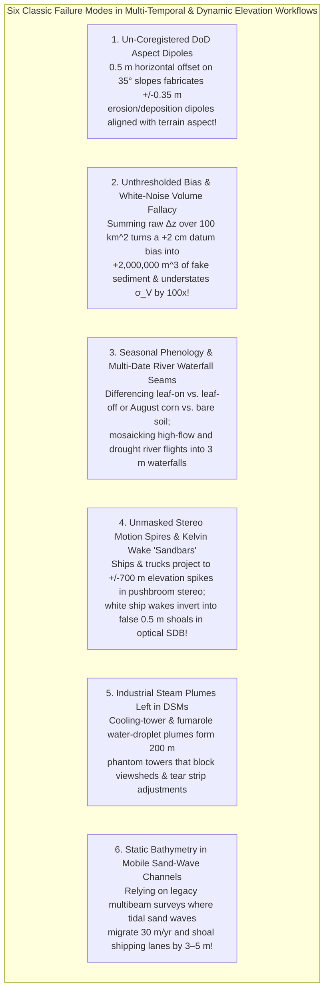

## 22.8 Common Pitfalls and Key Takeaways

Analyzing a dynamic planet with static-world assumptions manufactures dramatic—and completely fictitious—scientific and engineering conclusions. Subtle sub-pixel horizontal shifts mimic hillside creep, unthresholded centimeter biases invent millions of cubic meters of erosion, seasonal corn harvests and deciduous foliage mimic fault slip, cooling-tower steam clouds masquerade as skyscrapers, and five-year-old nautical charts conceal migrating sand waves across shipping lanes.

---

### 22.8.1 Common Pitfalls in Dynamic Elevation Analysis

#### 1. Differencing Un-Coregistered DEMs (The Aspect-Dipole Illusion)
Subtracting $z_{t_2} - z_{t_1}$ without first running 3D rigid co-registration (**Nuth & Kääb, 2011**) over stable bedrock/pavement converts any horizontal geolocation offset $\Delta\mathbf{x} = [\Delta E, \Delta N]^\top$ into a sinusoidal apparent vertical signal $\Delta z_{\text{misreg}} \approx -\nabla z \cdot \Delta\mathbf{x} = -\tan\alpha \, \|\Delta\mathbf{x}\| \cos(\psi_{\text{aspect}} - \psi_{\text{shift}})$. Just $0.50\text{ m}$ of unremoved horizontal shift on a $35^\circ$ canyon wall creates **$+0.35\text{ m}$ of false deposition on one wall and $-0.35\text{ m}$ of false erosion on the opposite wall**—a classic diagnostic cosine pattern on a $\Delta z / \tan\alpha$ vs. aspect plot!

#### 2. Summing Raw $\Delta z$ Without `LoD` Thresholding or Spatial Correlation ($2\,000\,000\text{ m}^3$ of Nothing)
Integrating raw pixel differences across a $100\text{ km}^2$ watershed ($10^8$ pixels at $1\text{ m}$) without **Level of Detection (`LoD`)** thresholding turns a minuscule $+2.0\text{ cm}$ residual vertical datum/geoid bias into:

$$\Delta V_{\text{fake}} = 10^8\text{ m}^2 \times 0.020\text{ m} = \mathbf{+2\,000\,000\text{ m}^3}$$

of fabricated sediment aggradation—while naive uncorrelated white-noise error propagation ($\sigma_{V,\text{naive}} = \Delta x^2 \sqrt{M}\sigma_{\Delta z}$) underestimates the true variogram-correlated volumetric uncertainty (**Hugonnet et al., 2022**) by two orders of magnitude!

#### 3. Confusing Seasonal Phenology, Crops, and River Stage with Solid-Earth Change
Differencing a July leaf-on or pre-harvest survey against a March leaf-off baseline mistakes $+0.4\text{ m}$ of deciduous shrub commission or $+3.0\text{ m}$ of standing maize for ground uplift. Similarly, mosaicking LiDAR tiles acquired during different river discharges without normalizing water surfaces creates $1\text{–}4\text{ m}$ artificial waterfalls or reverse uphill dams along river profiles.

#### 4. Leaving Stereo Motion Spires, Wake Foam, and Cooling-Tower Steam in Products
Unmasked ships and highway trucks in along-track pushbroom stereo project to $\pm 500\text{–}1500\text{ m}$ vertical spikes/pits ($\Delta z_{\text{artifact}} = -\frac{v_{\text{along}}}{v_{\text{plat}} - v_{\text{along}}} H_{\text{agl}}$); aerated Kelvin ship wakes trick optical `SDB` models into charting kilometer-long phantom sandbars; and industrial cooling-tower steam clouds build $100\text{–}300\text{ m}$ phantom towers in urban/port DSMs that corrupt RF line-of-sight and aircraft obstruction surfaces.

#### 5. Treating Dynamic Seafloors and Landfills as Static Baselines
Navigating deep-draft ships over five-year-old bathymetry in tidal sand-wave corridors invites catastrophic groundings as $5\text{ m}$ crests migrate into dredged channels, while building rigid drainage or solar infrastructure on capped municipal landfills without modeling $10\%\text{–}30\%$ anaerobic methane-decomposition settlement leads to cap rupture and ponding failure.

---

### 22.8.2 Key Takeaways

1. **Every DEM Is a 4D Observation $z(x, y, t)$:** Always record exact per-tile or per-pixel UTC acquisition timestamps alongside coordinate realization epochs; cross-reference every survey against river/tide gauges, snow/phenology calendars (`Dynamic World`), and landfill/mine operations logs.
2. **Co-Register on Stable Mask Before Any Subtraction:** Fit 3D Nuth & Kääb + tilt corrections strictly over stable, snow-free, bare bedrock/pavement (`xdem`), verify flat $\Delta z / \tan\alpha$ vs. aspect residuals, and never include moving glaciers, sand waves, or canopies in the alignment mask.
3. **Propagate Spatially Variable `LoD` and Correlated Volumetric Uncertainty:** Use spatially variable Fuzzy Inference (`GCD`) or heteroscedastic terrain-stratified error models + multi-range variograms (`xdem`) to report volumetric budgets with honest $95\%$ confidence intervals ($\Delta V \pm 1.96\,\sigma_V$).
4. **Switch from 2.5D `DoD` to 3D `M3C2` on Steep Terrain:** Measure rockfalls, coastal bluff collapse, undercut bank erosion, and canyon incision directly on ungridded 3D point clouds along scale-adaptive local surface normals (`M3C2`).
5. **Automate Dynamic Masking with `AIS`, `ADS-B`, and Multi-Return Physics:** Synchronize sensor timestamps with `libais` / `MovingPandas` vessel hull + $19.47^\circ$ Kelvin wake polygons and GNSS-altitude `ADS-B` flight tubes (`ASPRS Class 22`), and strip volumetric industrial steam plumes via multi-return/inter-swath persistence checks.
