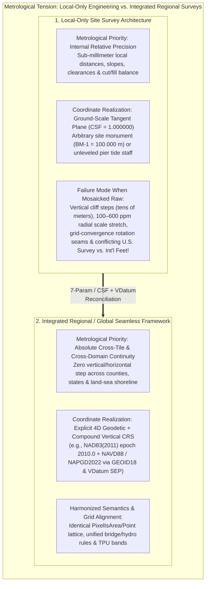

# Chapter 23: Local vs. Integrated Surveys and Building Composite DEM Products

*Reconciling isolated local surveys with global frameworks, and how to order, crop, blend, and override multi-source elevation datasets without introducing seams or destroying critical shoals.*

Continental, coastal, and global digital elevation models—such as the **USGS 3D Elevation Program (`3DEP`)**, **NOAA's Continuously Updated Digital Elevation Models (`CUDEM`)**, the **USGS Coastal National Elevation Database (`CoNED`)**, **EMODnet Bathymetry**, and **GEBCO / SRTM15+**—are never captured by a single sensor on a single afternoon. Instead, they are living **composite mosaics** synthesized from thousands of overlapping, heterogeneous surveys spanning more than a century: millimeter terrestrial laser scans of bridge piers, $8\text{ pts}\cdot\text{m}^{-2}$ airborne LiDAR blocks, $532\text{ nm}$ coastal bathymetric LiDAR, IHO Special Order multibeam acoustic swaths, crowd-sourced single-beam tracks, legacy 1930s lead-line smooth sheets, and $15\text{-arcsecond}$ satellite altimetry gravity inversions.

Synthesizing such disparate measurements into a single trustworthy grid confronts two fundamental challenges: first, reconciling **local-only engineering surveys** (optimized for internal steel-tape relative precision) with **integrated regional geodetic frameworks** (optimized for absolute seamless continuity across datums and epochs); and second, designing an automated fusion pipeline that orders, crops, and blends overlapping surfaces without fabricating artificial drainage dikes or smoothing away lethal navigation shoals.

---

## 23.1 Comparing Local-Only Datasets vs. Surveys Integrated with Regional/Global Data

Not every elevation survey is designed to sit on an ellipsoid-projected national grid. When a structural engineer stakes out a $400\text{ m}$ suspension bridge, an underground mine surveyor aligns two haulage drifts, or a small marina dredges a boat slip against a local tide staff, their operational loss function penalizes **internal relative strain and local slope error**—not absolute ITRF2020 geocentric offset. Problems erupt when those isolated local datasets are subsequently harvested into regional GIS or coastal inundation models without rigorous geodetic reconciliation.

---

### 23.1.1 Anatomy of Local-Only Datasets and Why Raw Ingestion Fails

Isolated site surveys—quarries, highway construction corridors, industrial plants, isolated alpine lakes, and small-craft harbor dredge checks—routinely incorporate five local conventions that violate regional DEM assumptions:

1. **Ground-Level Horizontal Coordinates ($\text{CSF} \equiv 1.000000$):** Construction blueprints require that a $100.000\text{ m}$ concrete foundation drawn in CAD measures $100.000\text{ m}$ horizontally on the physical ground. Surveyors achieve this either by working in a local topocentric tangent plane $(\Delta E_{\text{ground}}, \Delta N_{\text{ground}})$ or by multiplying State Plane / UTM coordinates about a project seed point $(E_0, N_0)$ by the inverse **Combined Scale Factor** $\text{CSF}^{-1} = \left(k \cdot \frac{R_\oplus}{R_\oplus + h}\right)^{-1}$ (Front Matter, Section 3.3). At $h = 2000\text{ m}$ elevation on a UTM central meridian ($k_0 = 0.9996$), $\text{CSF} = 0.999286$ ($-714\text{ ppm}$). Dropping a $4\text{ km} \times 4\text{ km}$ ground-scaled mine DEM directly onto a UTM regional grid stretches its perimeter outward by **$2.86\text{ m}$**, shearing haul roads and stream channels across the boundary! (Even worse, legacy U.S. plant grids multiplied *all* coordinates from $(0,0)$ rather than $(E_0, N_0)$ by $\text{CSF}^{-1}$—shifting a site at Northing $4\,000\,000\text{ m}$ horizontally by **$2.8\text{ km}$**, or by **$8.0\text{ m}$** when confusing U.S. Survey Feet [$1200/3937\text{ m}$] with International Feet [$0.3048\text{ m}$]!)
2. **Assumed Arbitrary Vertical Benchmarks and Unleveled Tide Staffs:** Site surveyors frequently set an iron rebar monument to $H_{\text{local}} = 100.000\text{ m}$ (specifically chosen so basement excavations never go negative!) or reference lake/berth soundings to a painted staff gauge on a seawall whose tie to NAVD88 or National Tidal Datum Epoch (`NTDE`) MLLW was never leveled—or sank $18\text{ cm}$ with pier settlement.
3. **True North vs. Grid North vs. Assumed Plant North:** Local total-station traverses oriented along a property boundary ("Plant North," rotated $14.2^\circ$ from True North) or astronomical/GNSS True North differ from map-projected Grid North by the **grid convergence angle** $\gamma_{\text{conv}} \approx (\lambda - \lambda_0)\sin\varphi$ (up to $\pm 3^\circ$ at UTM zone edges—producing a $52\text{ m}$ rotational tear across a $1\text{ km}$ tile!).
4. **Flat Tangent Plane vs. Geoid Curvature:** Local laser levels and total stations without Earth-curvature/refraction corrections define a flat plane tangent to the local plumbline at the instrument station, diverging vertically from the curved orthometric geoid by $\Delta H_{\text{curv}} = \frac{D^2}{2 R_\oplus}(1 - k_{\text{refr}}) \approx 6.8\text{ cm}$ at $1\text{ km}$ and **$1.70\text{ m}$ at $5\text{ km}$**.
5. **Inconsistent Surface Ontology:** A quarry or bridge-site DTM often retains culverts, temporary cofferdams, and bridge abutments that regional USGS 3DEP hydro-flattened DEMs strip out.

---

### 23.1.2 Requirements of Integrated Regional and Seamless Topo-Bathy Surveys

Integrated regional and global elevation programs (**USGS 3DEP** [Gesch et al., 2002; 2018], **NOAA CUDEM** [Amante et al., 2023], **USGS CoNED** [Danielson et al., 2016], and **Nippon Foundation–GEBCO Seabed 2030** [Mayer et al., 2018]) enforce six mandatory harmonization invariants before a single pixel is blended:

1. **Unified 4D Horizontal Frame and Epoch:** Every input point cloud or raster is transformed via `PROJ` time-dependent Helmert / deformation grids (e.g., `NAD83(NSRS2007)` or `ITRF2008` epoch `2009.4` $\to$ `NAD83(2011)` epoch `2010.0` or `ITRF2020` epoch `2020.0`), removing decimeter-to-meter tectonic plate drift in active margins (Chapter 4).
2. **Continuous Vertical Datum Transformation (`GEOID` + `SEP`):** Terrestrial orthometric heights ($H_{\text{NGVD29}}$, $H_{\text{NAVD88}}$), GNSS ellipsoidal heights ($h$), Great Lakes dynamic heights ($H_{\text{IGLD85}}$), and hydrographic chart depths ($d_{\text{MLLW}}, d_{\text{MLW}}, d_{\text{LAT}}$) are transformed onto a single positive-up target vertical datum via continuous gravimetric/hydrodynamic separation grids (`NOAA VDatum`, `UKHO VORF`, `PROJ` GTG grids) while explicitly propagating datum-transformation uncertainty $\sigma_{\text{VDatum}}(x, y)$ into the pixel's Total Vertical Uncertainty!
3. **Exact Sub-Pixel Lattice & Registration Alignment ("Snap Raster"):** Mixing `PixelIsArea` (GeoTIFF cell edges at integer coordinates, centers at $+0.5\,\Delta x$) with `PixelIsPoint` (GMT grid-line registration, centers at integer coordinates) introduces a systematic $\frac{1}{2}\sqrt{2}\,\Delta x$ diagonal shift across every merged survey! Integrated pipelines resample or grid directly onto a single **master snap lattice** ($x_j = x_{\text{origin}} + j\,\Delta x$).
4. **Harmonized Feature Semantics:** Standardizing bare-earth (`Class 2`) + submerged bottom (`Class 40`) retention, free-spanning bridge removal (`Class 17`), and solid coastal jetty preservation across all contributing datasets.

---

### 23.1.3 Worked Reconciliation Example: Salvaging an Orphan Harbor-Bridge Survey

Suppose a state DOT delivers a high-density $0.25\text{ m}$ terrestrial LiDAR + multibeam bridge-pier survey in local ground-scale coordinates $(x_{\text{loc}}, y_{\text{loc}}, z_{\text{loc}})$ referenced to an assumed pier brass disk (`BM-Bridge = +100.000 m`), and we wish to integrate it into a regional `NAD83(2011) / UTM Zone 10N + NAVD88` CUDEM mosaic:
* **Step 1 (Control Recovery):** Field RTK-GNSS + static OPUS occupations (`4 hours`) on `BM-Bridge` and two perimeter azimuth targets yield true `NAD83(2011)` UTM coordinates $(E_0, N_0) = (548\,210.420\text{ m}, 4\,182\,605.115\text{ m})$, ellipsoidal height $h_0 = -24.180\text{ m}$, `GEOID18` undulation $N_{\text{geoid}} = -32.410\text{ m}$ ($\implies H_{\text{NAVD88},0} = h_0 - N_{\text{geoid}} = +8.230\text{ m}$, revealing an exact vertical offset $\Delta H_0 = 8.230 - 100.000 = \mathbf{-91.770\text{ m}}$!), local UTM scale factor $k = 0.9996285$, elevation factor $\text{EF} = 1.0000038$, Combined Scale Factor $\text{CSF} = \mathbf{0.9996323}$, and Plant-North grid azimuth clockwise from Grid North $\Delta\psi = +1.8420^\circ$.
* **Step 2 (Exact 2D Similarity + Vertical Geoid Transformation):** Every local point $(x_{\text{loc}}, y_{\text{loc}}, z_{\text{loc}})$ relative to `BM-Bridge` $(x_0, y_0, 100.000)$ transforms into seamless regional UTM + NAVD88 coordinates (adding the $+r_{\text{loc}}^2/(2 R_\oplus)$ Earth-curvature rise from flat tangent plane back onto the curved equipotential geoid) via:
  $$\begin{bmatrix} E \\ N \end{bmatrix} = \begin{bmatrix} E_0 \\ N_0 \end{bmatrix} + \text{CSF}\begin{bmatrix} \cos\Delta\psi & \sin\Delta\psi \\ -\sin\Delta\psi & \cos\Delta\psi \end{bmatrix}\begin{bmatrix} x_{\text{loc}} - x_0 \\ y_{\text{loc}} - y_0 \end{bmatrix}, \qquad H_{\text{NAVD88}} = z_{\text{loc}} - 91.770\text{ m} + \frac{r_{\text{loc}}^2}{2 R_\oplus}$$
  Check residuals against overlapping regional 3DEP LiDAR on adjacent asphalt approaches drop from $91.8\text{ m}$ vertically and $25.7\text{ m}$ horizontally down to **$\text{NMAD}_z = 0.014\text{ m}$ ($1.4\text{ cm}$)**—preserving millimeter pier-scour detail inside a continentally consistent DEM!

---

### 23.1.4 Master Comparison Matrix: Local-Only vs. Integrated Regional Surveys

| Engineering Dimension | Local-Only Site Survey | Integrated Regional / Global DEM |
| :--- | :--- | :--- |
| **Primary Optimization Target** | Internal relative distances, grades, clearances & local volumes | Seamless cross-boundary continuity across land, coast & ocean |
| **Horizontal Scaling** | Ground scale ($\text{CSF} \equiv 1.000000$); flat tangent plane | Conformal/equal-area map projection ($k(\varphi,\lambda)$) or ellipsoidal $(\varphi,\lambda)$ |
| **Orientation Reference** | Structural baseline ("Plant North") or local True North | Explicit CRS Grid North ($\gamma_{\text{conv}}$ modeled) |
| **Vertical Zero Surface** | Arbitrary site benchmark ($+100\text{ m}$) or untied local tide staff | Geopotential geoid (`NAVD88`/`NAPGD2022`) or `VDatum`-tied `MLLW`/`LAT` |
| **Grid Registration** | CAD TIN or arbitrary local raster corner | Strictly locked to regional snap lattice (`PixelIsArea` vs. `PixelIsPoint`) |
| **Uncertainty & Lineage** | Single survey report PDF; uniform internal $\sigma$ | Per-pixel `combined_uncertainty`, `source_id`, and `acquisition_date` bands |
