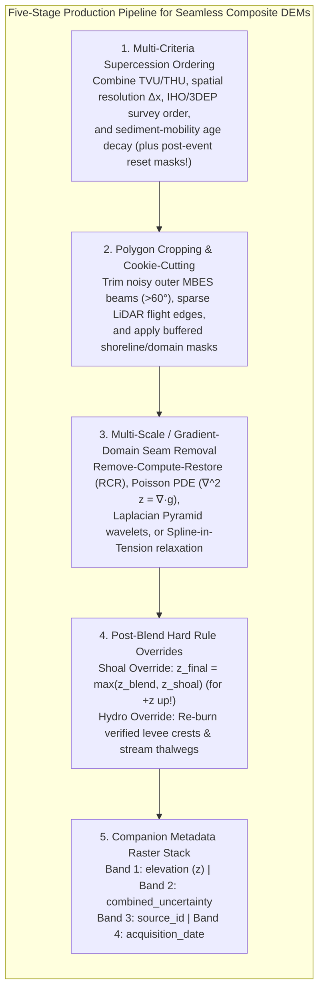
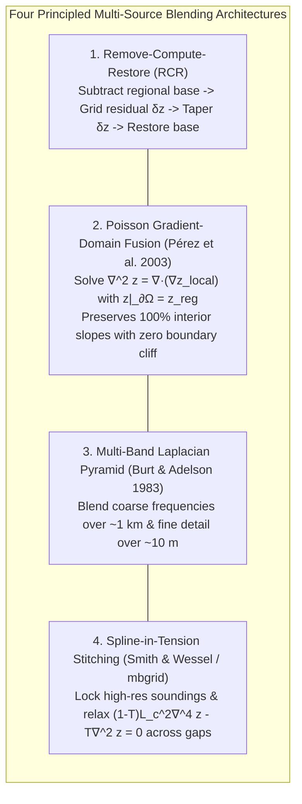

## 23.2 Building Composite Data Products: Ordering, Cropping, Blending, and Overrides

Once candidate elevation and bathymetric datasets have been transformed onto a shared horizontal projection, snap lattice, and positive-up vertical datum ($z$), compiling them into a single composite DEM requires a disciplined five-stage architecture: **Source Prioritization ("Supercession")**, **Polygon Cropping ("Cookie-Cutting")**, **Scale- and Gradient-Aware Blending**, **Rule-Based Hard Overrides**, and **Per-Pixel Provenance/Uncertainty Attribution**. Skipping any stage either replaces sub-meter multibeam canyons with blurry satellite gravity, bakes artificial cross-valley dams along survey seams, or shaves meters off lethal submerged rock pinnacles.

---

### 23.2.1 Source Prioritization and Ordering ("Supercession")

#### Why "Newest Is Best" Fails Catastrophically
In optical satellite mosaics, newer cloud-free imagery generally supersedes older imagery. Applying that same chronological rule (`Mosaic Operator = LAST` sorted by date) to elevation and bathymetry is disastrous:
* A **2025** global satellite radar-altimetry bathymetry grid ($\Delta x = 450\text{ m}$, $\sigma_z \approx \pm 15\text{–}80\text{ m}$) would overwrite a **2014** IHO Special Order multibeam survey ($\Delta x = 0.5\text{ m}$, $\sigma_z = \pm 0.14\text{ m}$), wiping out dredged harbor channels, shipwrecks, and submarine canyons!
* **The Converse Geomorphic Reset Trap:** Conversely, "highest resolution / lowest nominal sensor TVU is always best" *also* fails whenever an episodic catastrophic event reshapes the surface! After Hurricane Michael (2018) breached Cape San Blas, Florida, or after the 2018 Kīlauea eruption infilled Pohoiki Bay, a **2019** $2\text{ m}$ satellite-derived or single-beam emergency survey **must supersede** a pristine **2016** $0.5\text{ m}$ LiDAR/multibeam survey inside the active breach polygon because the 2016 topography physically no longer exists!

#### Multi-Criteria Supercession Scoring (`CATZOC` / `CUDEM` Hierarchy)
Operational compilation engines (such as NOAA `CUDEM waffles`, CARIS *Hydrographic Health Model*, and UKHO/CHS source-supercession matrices) rank overlapping sources $k \in \{1, \dots, K\}$ at cell $\mathbf{x}$ and target epoch $t$ via a composite **Supercession Score** $S_k(\mathbf{x}, t)$:

$$S_k(\mathbf{x}, t) = \mathbb{I}_{\text{valid}}(\mathbf{x}, t_k > t_{\text{event}}(\mathbf{x})) \cdot \left[ \frac{\Delta x_{\text{ref}}}{\max(\Delta x_k, \Delta x_{\text{target}})} \right]^{\alpha_{\text{res}}} \cdot \left[ \frac{\sigma_{\text{ref}}^2}{\sigma_{z,k}^2(\mathbf{x}) + r_{\text{mobility}}^2(\mathbf{x})(t - t_k)^2} \right]^{\alpha_{\text{unc}}} \cdot \omega_{\text{order}}(k)$$

where $\mathbb{I}_{\text{valid}} \in \{0, 1\}$ zeroes out pre-disaster surveys inside documented post-hurricane, post-dredge, post-landslide, or post-eruption disturbance polygons ($t_{\text{event}}$), $\Delta x_k$ is true effective spatial resolution (never oversampled pixel spacing, Chapter 18!), $\sigma_{z,k}(t)$ incorporates time-decaying sediment mobility $r_{\text{mobility}}$ (derived in Section 23.4.2), and $\omega_{\text{order}}(k)$ encodes formal quality tier (**IHO S-44 Exclusive Order $>$ Special Order $>$ Order 1a $>$ Order 1b $>$ Order 2 $>$ Satellite Gravity / Interpolated**; **USGS 3DEP QL0 $>$ QL1 $>$ QL2 $>$ Legacy Photogrammetry/Contours**).

---

### 23.2.2 Cropping and Cookie-Cutting Source Margins

Raw survey footprints are always noisiest along their outer perimeters:
* **Multibeam Outer-Swath Cropping:** Sound-velocity profile (`SVP`) refraction errors scale proportionally to $\tan^2\theta_{\text{beam}}$ (Chapter 10), causing the outermost $5\%\text{–}12\%$ of swath beams ($\theta_{\text{beam}} > 60^\circ$) to curl upward or downward into "smiles/frowns" by $0.2\text{–}1.5\text{ m}$. Automated ingestion pipelines trim outer beams wherever overlapping adjacent swaths provide higher-weight inner-beam coverage, or buffer survey bounding polygons inward by $2\text{–}5\,\Delta x$.
* **LiDAR Flight-Edge & TIN Sliver Cookie-Cutting:** Along project boundaries and aircraft turnarounds, scan-line spacing dilates and unconstrained Delaunay triangulation strings $200\text{ m}$-long flat "webbing" triangles across concave bays and valleys. Applying concave-hull (`alpha-shape`) masks buffered inward by $3\text{ m}$ cleanly excises edge slivers before mosaicking.

---

### 23.2.3 Blending, Feathering, and Seam Removal Across Four Spatial Paradigms

#### 1. Why Simple Linear Distance Feathering Fails on Biased Overlaps
Suppose Survey A ($z_A$) overlaps regional DEM $z_B$ along a transition buffer of width $L_{\text{buf}} = 50\text{ m}$, and an unremoved vertical datum or geoid residual bias $\Delta z_{\text{bias}} = z_A - z_B = +0.50\text{ m}$ remains between them. Linear distance-weighted feathering $z_{\text{blend}}(x) = \alpha(x) z_A(x) + [1 - \alpha(x)] z_B(x)$ with $\alpha(x) = 1 - x / L_{\text{buf}}$ differentiates to:

$$\frac{\partial z_{\text{blend}}}{\partial x} = \alpha\frac{\partial z_A}{\partial x} + (1 - \alpha)\frac{\partial z_B}{\partial x} - \frac{\Delta z_{\text{bias}}}{L_{\text{buf}}}$$

Across a gentle coastal floodplain sloping eastward at $s_{\text{true}} = -0.002$ ($0.2\%$ downslope), the feather ramp injects a **$-0.50 / 50 = -0.010$ ($1.0\%$) artificial scarp**—five times steeper than the natural valley gradient! If $\Delta z_{\text{bias}} = -0.50\text{ m}$, the net gradient flips sign to **$+0.008$ ($0.8\%$ uphill)**, erecting a continuous $50\text{ cm}$-tall synthetic earthen dam along the entire survey perimeter that ponds simulated floodwaters!

#### 2. Remove-Compute-Restore (`RCR`) & Poisson Gradient-Domain Fusion
* **Remove-Compute-Restore (`RCR`):** Standard in physical geodesy and `CUDEM`: (a) *Remove* the smooth regional reference surface from high-resolution local points ($\delta z_i = z_{\text{local},i} - z_{\text{reg}}(\mathbf{x}_i)$); (b) *Compute* a gridded residual anomaly field $\widehat{\delta z}(x, y)$ damped smoothly to $0$ outside the local survey hull via a $C^1$ cosine taper $w(d) = \frac{1}{2}\big[1 + \cos(\pi d / L_{\text{buf}})\big]$; and (c) *Restore* $z_{\text{comp}} = z_{\text{reg}} + w(d)\widehat{\delta z}$.
* **Poisson Surface Editing (`Pérez, Gangnet, & Blake, 2003`):** Solves $\nabla^2 z = \nabla \cdot \mathbf{g}_{\text{local}}$ inside $\Omega$ subject to exact Dirichlet boundary matching $z|_{\partial\Omega} = z_{\text{reg}}|_{\partial\Omega}$ (derived fully in Section 23.4.1). Rather than concentrating a $50\text{ cm}$ datum offset into a steep $50\text{ m}$ ramp, the harmonic membrane distributes the offset across the entire multi-kilometer domain with negligible $<0.01\%$ slope perturbation while preserving local rills, curbs, and reefs intact!

#### 3. Multi-Band Laplacian Pyramid Blending (`Burt & Adelson, 1983`)
Decomposes both DEMs into $J$ dyadic spatial-frequency octaves $L_0, L_1, \dots, L_{J-1}$ plus coarse residual $G_J$ ($z = G_J + \sum_{j=0}^{J-1} L_j$), where $L_j = G_j - \operatorname{Expand}(G_{j+1})$. By blending each band $L_j$ across a mask blurred at that band's own spatial scale ($2^j \Delta x$), **long-wavelength datum tilts blend imperceptibly over $1\text{–}2\text{ km}$** while **high-frequency $1\text{ m}$ rock outcrops transition crisply over $5\text{–}10\text{ m}$** without ghost double-edges!

#### 4. Stacked Spline-in-Tension Bathymetric Stitching (`GMT` / `MB-System mbgrid` / `Hell & Jakobsson, 2011`)
Where high-resolution multibeam swaths cross empty ocean background, **`mbgrid`** integrates high-resolution footprint-binned cells directly as fixed interior constraints and solves **Smith and Wessel's (1990)** continuous-curvature spline-in-tension PDE $(1 - T)L_c^2 \nabla^4(z - z_{\text{bg}}) - T\nabla^2(z - z_{\text{bg}}) = 0$ (typically tension $T = 0.25\text{–}0.35$ for bathymetry, preventing minimum-curvature biharmonic overshoot pits next to steep seamounts!) to relax smoothly into regional satellite-gravity bathymetry across unmapped gaps.

---

### 23.2.4 Explicit Overrides and Rule-Based Exceptions (Watch the Sign!)

Every mathematical blender—whether Poisson, wavelet, or spline-in-tension—acts as a differential smoother at transitions. Safety-critical features require **immutable post-blend hard overrides**:

1. **Navigation Shoal Override (`Designated Soundings` / `BAG Tracking List`):**
   A verified submerged pinnacle, boulder, or shipwreck mast must *never* be deepened by blending or resampling! **Pay strict attention to vertical coordinate polarity** (Front Matter, Section 1.1):
   * In **positive-up elevation $z$** (**IHO S-102**, `CUDEM`, NetCDF/CF, where depths below datum are negative, e.g., pinnacle $z_{\text{shoal}} = -2.0\text{ m} >$ surrounding seabed $z = -30.0\text{ m}$), shoal preservation enforces the **pointwise MAXIMUM**:
     $$z_{\text{final}}(\mathbf{x}) = \max\!\big(z_{\text{blended}}(\mathbf{x}),\; z_{\text{shoal}}(\mathbf{x})\big) \qquad (\text{positive-up elevation } z \uparrow)$$
   * In **positive-down depth $d = -z$** (legacy hydrographic soundings, where $d_{\text{shoal}} = +2.0\text{ m} < +30.0\text{ m}$), shoal preservation enforces the **pointwise MINIMUM**:
     $$d_{\text{final}}(\mathbf{x}) = \min\!\big(d_{\text{blended}}(\mathbf{x}),\; d_{\text{shoal}}(\mathbf{x})\big) \qquad (\text{positive-down depth } d \downarrow)$$
   *(Applying `min` to negative IHO S-102 elevations $z$ selects $-30.0\text{ m}$ instead of $-2.0\text{ m}$—deleting the rock pinnacle and grounding ships!)*
2. **Hydro-Enforcement Override (Levee Crests and Culvert Thalwegs):**
   After multi-source blending, verified 3D flood-levee crest breaklines (`max` elevation override along levee axis) and culvert/stream thalweg invert lines (`min` elevation breach along channel axis) are re-burned into the composite raster so feathering transitions never notch a floodwall or plug a drainage canal.

---

### 23.2.5 Mandatory Per-Pixel Provenance and Uncertainty Bands

No composite DEM should ever be published as a bare single-band elevation grid. Following **GEBCO Type Identifier (`TID`)** (**Weatherall et al., 2015**), **IHO S-102**, and **NOAA CUDEM** best practices, every composite product distributes three co-registered companion bands alongside elevation:
* **`source_id` (`UInt16` / `Int32` Provenance Mask + Sidecar Attribute Table / RAT):** Integer foreign key mapping every pixel to the exact contributing survey catalog record (agency, sensor modality, survey ID, license, or interpolation/void-fill method code, e.g., `GEBCO TID 11` = multibeam vs. `TID 40` = satellite gravity prediction).
* **`acquisition_date` (`Float32` Decimal Year or `Int32` `YYYYMMDD`):** Exact observation epoch of the dominant or weighted source at each pixel (essential for 4D `DoD` change analysis and post-storm validity auditing).
* **`combined_uncertainty` (`Float32` in meters, explicitly tagged $1\sigma$ or $95\%$ `TVU`):** Total propagated vertical uncertainty combining sensor `TVU`, datum transformation error $\sigma_{\text{VDatum}}$, void interpolation variance $\sigma_{\text{interp}}$, and sediment-mobility age inflation $r_{\text{mobility}}\Delta t$.
