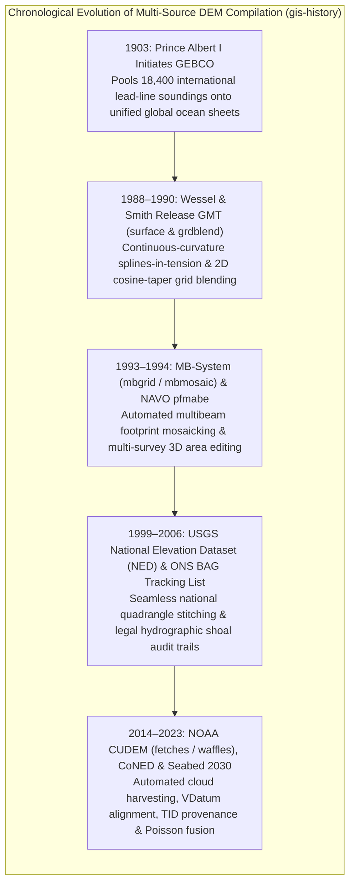
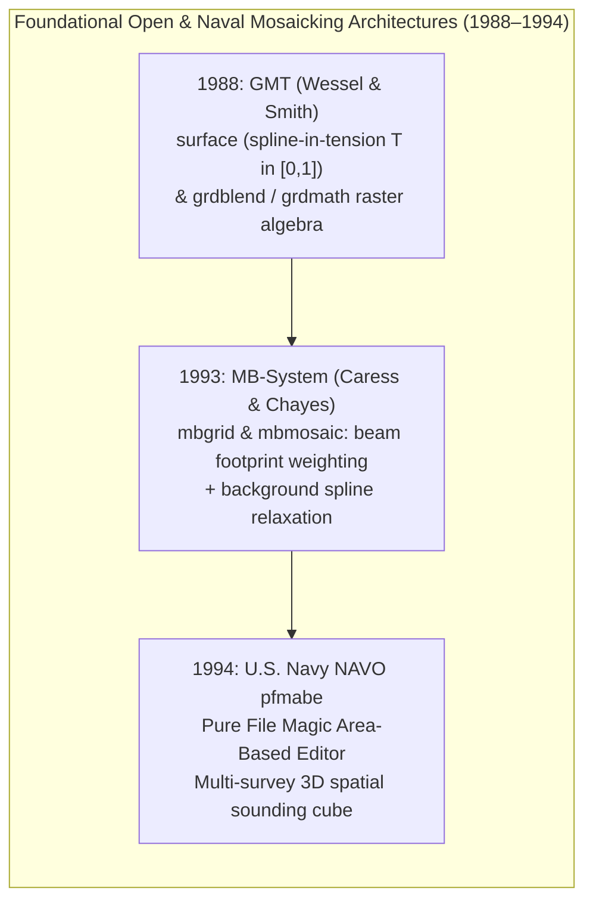

## 23.3 Historical Evolution of Composite Elevation Products and Harmonization

Assembling fragmented expedition tracks, topographic quadrangles, and coastal hydrographic smooth sheets into seamless multi-resolution elevation grids spans more than twelve decades of cartographic, geophysical, and open-source software innovation, anchored directly to key milestones in [`gis-history`](https://github.com/schwehr/gis-history).

---

### 23.3.1 International Bathymetric Pooling: `GEBCO` (`1903` to `Seabed 2030`)

In **April 1903** (`gis-history`), **Prince Albert I of Monaco** funded and convened an international commission of oceanographers and geographers (led scientifically by Julien Thoulet) to compile the first **General Bathymetric Chart of the Oceans (`GEBCO`, 1st Edition published 1905)**:
* Prior to 1903, every maritime nation guarded or published deep-sea soundings in incompatible units (British fathoms, French *brasses*, Russian *sazhens*, metric meters), prime meridians, and map projections.
* The 1903 commission pooled **18,400 deep-sea wire and lead-line soundings** onto 16 Mercator sheets ($72^\circ\text{S}–72^\circ\text{N}$) and 8 polar gnomonic sheets in metric positive-down depths—establishing the enduring template of composite bathymetry: **harmonizing multi-national source surveys onto a single mathematical reference frame while documenting data density**.
* Over a century later, operating jointly under the IHO and UNESCO Intergovernmental Oceanographic Commission (IOC), **GEBCO** transitioned from hand-drawn contours (`GEBCO 5th Edition`, 1982) to digital grids (`GEBCO One Minute Grid`, 2003; `30 arc-second`, 2008) and the **Nippon Foundation–GEBCO Seabed 2030 Project** (**Weatherall et al., 2015; Mayer et al., 2018**), which fuses crowd-sourced, research, and hydrographic multibeam swaths onto **SRTM15+** satellite-altimetry predicted bathymetry (**Tozer et al., 2019**) at $15\text{ arc-seconds}$ ($\sim 450\text{ m}$), accompanied by a mandatory per-pixel **Type Identifier (`TID`)** provenance grid!

---

### 23.3.2 Open-Source Geophysical Blending and Swath Mosaicking (`1988–1994`)

During the late 1980s and early 1990s, UNIX workstations and deep-sea multibeam sonars collided with a thorny numerical problem: minimum-curvature biharmonic splines ($\nabla^4 z = 0$) produced wild unphysical $500\text{ m}$ overshoot troughs and ridges whenever sparse ship tracks crossed flat abyssal plains next to steep seamounts, while pasting grids together left ugly rectangular step seams. Three open/operational software milestones in `gis-history` solved these challenges:

1. **1988 — Generic Mapping Tools (`GMT`, `surface`, `grdblend`, `grdmath`):** Initiated at Lamont-Doherty Geological Observatory in **1988** (`gis-history`) by **Paul Wessel and Walter H. F. Smith** (**Smith & Wessel, 1990; Wessel et al., 2019**), `GMT` introduced continuous-curvature **splines in tension** (`surface -T0.35`), suppressing biharmonic ringing across heterogeneous point spacing, alongside **`grdblend`** (2D cosine-tapered multi-grid mosaicking with streaming row-by-row memory efficiency) and **`grdmath`** (reverse-Polish grid algebra for Remove-Compute-Restore workflows).
2. **1993 — `MB-System` (`mbgrid` and `mbmosaic`):** Started at Lamont-Doherty in **1993** (`gis-history`) by **David W. Caress and Dale N. Chayes (1996)**, `MB-System` created an end-to-end open-source processing suite supporting dozens of vendor sonar formats. Crucially, **`mbgrid`** pioneered **two-stage composite bathymetric stitching**: weighting every sounding inside a grid cell by its true physical acoustic beam footprint ellipse + grazing-angle quality, prioritizing high-resolution multibeam where present, and smoothly solving a tensioned thin-plate spline to relax into coarse background grids across unmapped inter-swath holidays.
3. **1994 — U.S. Navy / NAVO `pfmabe` (*Pure File Magic Area-Based Editor*):** Developed beginning in **1994** (`gis-history`) by the U.S. Naval Oceanographic Office (`NAVO`, later open-sourced), **`pfmabe`** revolutionized hydrographic compilation by replacing single-line profile editing with **area-based multi-survey 3D spatial indexing (`PFM` bins)**. For the first time, compilers could load millions of soundings from decades of overlapping Navy, NOAA, and academic cruises into one 3D bounding box, color-coded by survey ID, immediately exposing $2\text{ m}$ tidal-datum busts, LORAN-C horizontal shifts, and uncleaned refraction smiles across overlapping surveys.

---

### 23.3.3 Seamless National Grids, `BAG` Tracking Lists, and `CUDEM` (`1999–Present`)

* **1999–2015 — USGS National Elevation Dataset (`NED`) to `3DEP` (`Gesch et al., 2002`):** Prior to 1999, U.S. terrestrial DEMs were distributed as isolated $7.5\text{-minute}$ ($1:24\,000$) quadrangle tiles scarred by severe edge steps, contour-to-grid striping, and mixed `NAD27`/`NAD83` and meter/foot units. The USGS **National Elevation Dataset (`NED`)** introduced automated quadrangle-edge matching, mean-profile filtering, `NAD83 + NAVD88` standardization, and priority source ordering—evolving in 2015 into the seamless LiDAR-based **3D Elevation Program (`3DEP`)** and coastal **CoNED (`Danielson et al., 2016`)**.
* **2003 — Poisson Gradient-Domain Editing (`Pérez, Gangnet, & Blake, 2003`):** Building on **Peter Burt and Edward Adelson's (1983)** multi-resolution Laplacian pyramid splines, Pérez et al. formulated variational **Poisson Editing** ($\nabla^2 z = \nabla \cdot \mathbf{v}$) at SIGGRAPH 2003, providing the exact elliptic PDE later adopted by geospatial and bathymetric compilers to stitch high-resolution local patches onto biased regional DEMs without ramp dikes.
* **2006 — Open Navigation Surface `BAG` Tracking List:** Standardized in **2006**, the HDF5 **Bathymetric Attributed Grid (`BAG`)** embedded mandatory co-registered `elevation` and `uncertainty` bands alongside an immutable **`Tracking List`** XML/table—guaranteeing an auditable chain of custody whenever designated shoal soundings override smoothed grid nodes.
* **2014–2023 — NOAA `CUDEM` (`fetches` & `waffles` — `Amante et al., 2023`):** Initiated in **2014** by **Christopher J. Amante, Matthew Love, Barry W. Eakins**, and colleagues at NOAA NCEI and CIRES (University of Colorado Boulder), the **Continuously Updated Digital Elevation Model (`CUDEM`)** program replaced multi-year manual tsunami/storm-surge DEM builds with reproducible, open-source Python automation (`ciresdem/cudem`). By coupling automated multi-agency cloud harvesting (`fetches`), on-the-fly `VDatum` / `PROJ` vertical datum transformations, stacked supercession weighting (`waffles -M stacks`), land-water coastline masking, and companion uncertainty/spatial-metadata rasters, `CUDEM` delivers continuously refreshed $1/9\text{-arcsecond}$ ($\sim 3\text{ m}$) and $1/3\text{-arcsecond}$ ($\sim 10\text{ m}$) seamless topo-bathymetric DEMs across U.S. coastal and island territories.

---

### 23.3.4 Regional European, Polar, and Planetary Composite Traditions (`EMODnet`, `IBCAO`, `Bedmap`)

Parallel to North American and global `GEBCO` efforts, specialized regional consortia solved unique multi-source compilation obstacles that directly shaped modern composite standards:

1. **Arctic and Polar Bathymetric Compilations (`IBCAO` & `IBCSO`, 2000–Present):** Compiling the **International Bathymetric Chart of the Arctic Ocean (`IBCAO`)** forced **Martin Jakobsson, Benjamin Hell**, and collaborators (**Hell & Jakobsson, 2011**) to fuse ultra-sparse nuclear-submarine under-ice upward-looking sonar tracks, icebreaker multibeam corridors, and drifting ice-camp spot soundings without generating severe spline artifacts at track crossings. Their **stacked continuous-curvature splines-in-tension** architecture—gridding dense data at fine resolution ($500\text{ m}$), gridding all data at coarse background resolution ($2.5\text{ km}$), and blending them via distance-to-observation masks—became the direct algorithmic engine adopted by `GEBCO_2014` (**Weatherall et al., 2015**) and `Seabed 2030`.
2. **European Marine Observation and Data Network (`EMODnet Bathymetry`, 2009–Present):** Harmonizing coastal bathymetry across more than 30 European hydrographic offices and marine research institutes required reconciling dozens of national chart datums (`LAT`, `Chart Datum`, Baltic `BSCD2000` normal heights, Mediterranean mean sea levels) onto a unified Lowest Astronomical Tide (`LAT`) / Mean Sea Level reference with standardized `CDI` (Common Data Index) per-pixel source attribution polygons at $1/16\text{-arcminute}$ ($\sim 115\text{ m}$) resolution.
3. **Transition from Static Releases to Cloud-Native Continuous Compilation:** Prior to 2015, composite DEMs were monolithic "versioned snapshots" rebuilt manually every 5 to 10 years. With the convergence of `Cloud-Optimized GeoTIFFs (COG)`, `COPC` point clouds (2021 in `gis-history`), `PROJ` Geodetic TIFF Grids (`GTG`, 2019–2020), and `STAC` spatiotemporal catalogs (Chapter 19), modern composite frameworks (`USGS 3DEP` dynamic elevation services, `NOAA CUDEM`, `Seabed 2030` regional centers) operate as **event-driven tile pipelines**—recomputing only the affected $0.25^\circ \times 0.25^\circ$ cells whenever a new post-storm LiDAR flight or hydrographic `BAG` survey is deposited into the archive, mirroring planetary composite traditions (`Mars MOLA + HRSC` and `Lunar LOLA + SLDEM2015`, Chapter 31) that tie high-resolution stereo strips onto global laser-altimetry crossovers.

| Era / Milestone (`gis-history`) | Core Innovation in Composite Synthesis | Enduring Legacy in Modern Pipelines |
| :--- | :--- | :--- |
| **1903 (`GEBCO` 1st Ed.)** | Multi-national metric pooling of 18,400 lead-line soundings | Global open bathymetric governance & `TID` source provenance |
| **1983 (`Burt & Adelson`)** | Multi-resolution Laplacian pyramid frequency-octave splining | Wide low-frequency bias blending + sharp high-frequency detail |
| **1988–1990 (`GMT surface`/`grdblend`)** | Biharmonic splines in tension ($T \in [0,1]$) & cosine-taper mosaicking | Overshoot-free regional gridding & streaming raster blending |
| **1993–1994 (`MB-System` & `pfmabe`)** | Beam-footprint weighting + 3D multi-survey area editing | Automated swath-to-background stitching & cross-cruise QC |
| **2003–2006 (`Poisson` & `BAG`)** | Gradient-domain $\nabla^2 z = \nabla\cdot\mathbf{g}$ & HDF5 `Tracking List` | Ramp-free seam removal & immutable shoal-override auditability |
| **2014–2023 (`NOAA CUDEM` & `CoNED`)** | Automated `fetches` + `VDatum` + `waffles` supercession stacks | Reproducible $3\text{ m}$ seamless land-sea `TBDEM` + uncertainty bands |
| **2022–2026+ (`IHO S-102` & STAC/COG)** | Operational ECDIS S-100 phase-in & event-driven cloud tile pipelines | Dynamic under-keel clearance routing over multi-band `COG`/`HDF5` composites |
