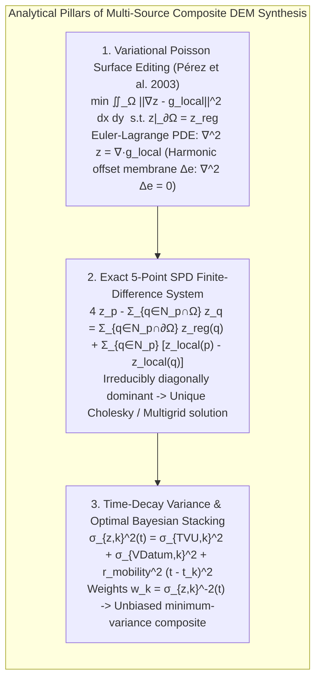

## 23.4 Mathematical Foundations of Gradient-Domain Blending and Temporal Uncertainty

Constructing a physically faithful composite DEM rests on two rigorous mathematical formulations:
1. **Variational Gradient-Domain Fusion (Poisson Surface Editing — Pérez, Gangnet, & Blake, 2003):** Proving via the calculus of variations how solving an elliptic boundary-value problem transfers fine local terrain slopes onto a regional datum without creating feather-zone dikes—with careful attention to exact discrete finite-difference sign conventions!
2. **Spatiotemporal Uncertainty Inflation and Inverse-Variance Bayesian Stacking:** Propagating survey Total Vertical Uncertainty (`TVU`), datum transformation error, and sediment-mobility age decay into optimal fusion weights and composite `combined_uncertainty` rasters.

---

### 23.4.1 Variational Derivation of Poisson Surface Editing (`Pérez et al., 2003`)

Let $\Omega \subset \mathbb{R}^2$ denote a bounded, simply or multiply connected local survey footprint with piecewise-smooth boundary $\partial\Omega$ and outward unit normal $\hat{\mathbf{n}}_{\partial\Omega}$. Inside $\Omega$, we possess a high-resolution local survey $z_{\text{local}}(x, y)$ (capturing fine channels, levees, and boulders, with spatial gradient $\mathbf{g}_{\text{local}} = \nabla z_{\text{local}} = \left[\frac{\partial z_{\text{local}}}{\partial x}, \frac{\partial z_{\text{local}}}{\partial y}\right]^\top$), while on and outside $\partial\Omega$ we possess a geodetically anchored regional DEM $z_{\text{reg}}(x, y)$. Along the seam $\partial\Omega$, a residual vertical mismatch $e_{\partial\Omega}(x, y) = z_{\text{reg}}(x, y) - z_{\text{local}}(x, y) \ne 0$ exists due to long-wavelength geoid, tidal-zoning, or trajectory residuals.

#### Step 1: Euler–Lagrange Equation and Harmonic Membrane Decomposition
We seek a twice-differentiable composite surface $z \in H^1(\Omega)$ whose interior spatial gradient matches the target guidance field $\mathbf{g}_{\text{local}}$ in the $L^2(\Omega)$ least-squares sense while satisfying exact $C^0$ Dirichlet continuity along $\partial\Omega$:

$$\min_{z} \mathcal{J}[z] = \iint_{\Omega} \big\|\nabla z(x, y) - \mathbf{g}_{\text{local}}(x, y)\big\|_2^2 \, dx \, dy \qquad \text{subject to} \quad z\big|_{\partial\Omega} = z_{\text{reg}}\big|_{\partial\Omega}$$

Perturbing $z \to z + \epsilon\eta$ by any smooth test function $\eta \in C_0^\infty(\Omega)$ vanishing on the boundary ($\eta|_{\partial\Omega} = 0$) and applying **Green's first identity**:

$$\left.\frac{d}{d\epsilon}\mathcal{J}[z + \epsilon\eta]\right|_{\epsilon=0} = 2\iint_{\Omega} (\nabla z - \mathbf{g}_{\text{local}})\cdot\nabla\eta \, dx \, dy = -2\iint_{\Omega} \big(\nabla^2 z - \nabla\cdot\mathbf{g}_{\text{local}}\big)\eta \, dx \, dy + 2\underbrace{\oint_{\partial\Omega} \eta\,(\nabla z - \mathbf{g}_{\text{local}})\cdot\hat{\mathbf{n}}_{\partial\Omega}\,ds}_{=\,0\text{ since }\eta|_{\partial\Omega}=0} = 0$$

By the fundamental lemma of the calculus of variations, $z(x, y)$ must satisfy the **Poisson partial differential equation** inside $\Omega$:

$$\nabla^2 z = \nabla \cdot \mathbf{g}_{\text{local}} \quad \text{in } \Omega, \qquad z = z_{\text{reg}} \quad \text{on } \partial\Omega$$

**Physical Insight (Equivalence to Harmonic Laplace Offset Interpolation):** Whenever the guidance vector field is conservative ($\mathbf{g}_{\text{local}} = \nabla z_{\text{local}}$, zero curl), define the shift surface $\Delta e(x, y) = z(x, y) - z_{\text{local}}(x, y)$. Because $\nabla^2 z_{\text{local}} = \nabla \cdot \nabla z_{\text{local}}$, subtracting $\nabla^2 z_{\text{local}}$ from both sides reduces the Poisson PDE to **Laplace's equation** on a smooth, low-frequency correction membrane:

$$\nabla^2 (\Delta e) = 0 \quad \text{in } \Omega, \qquad \Delta e\big|_{\partial\Omega} = \big(z_{\text{reg}} - z_{\text{local}}\big)\big|_{\partial\Omega}$$

By the **Maximum Principle for harmonic functions**, $\Delta e(x, y)$ attains its strict minimum and maximum solely on $\partial\Omega$ (it can *never* oscillate or overshoot in the interior!), and its gradient decays as $\|\nabla(\Delta e)\| \sim \frac{\max |z_{\text{reg}} - z_{\text{local}}|}{\operatorname{diam}(\Omega)}$ across the *entire* survey width rather than piling into a narrow feathering dike! Furthermore, when two noisy overlapping high-resolution surveys compete inside $\Omega$, Pérez et al.'s **mixed-gradient guidance field** $\mathbf{g}_{\text{mix}}(\mathbf{x}) = \arg\max_{\mathbf{g} \in \{\nabla z_{\text{local}}, \nabla z_{\text{reg}}\}} \|\mathbf{g}(\mathbf{x})\|_2$ (non-conservative, $\nabla \times \mathbf{g}_{\text{mix}} \ne 0$) preserves sharp scarps from *both* datasets simultaneously.

#### Step 2: Exact Sign-Consistent 5-Point Finite-Difference Discretization
On a uniform Cartesian raster of pixel spacing $h = \Delta x = \Delta y$, let $\Omega_h$ denote the set of $M$ interior grid pixels and $\partial\Omega_h$ denote the adjacent 4-connected exterior boundary ring. For each interior pixel $p = (i, j) \in \Omega_h$, let $\mathcal{N}_4(p) = \{(i\pm 1, j), (i, j\pm 1)\}$ denote its four cardinal neighbors. Multiplying $-\nabla^2 z = -\nabla \cdot \mathbf{g}$ by $h^2$ using centered second differences:

$$-h^2 (\nabla^2 z)_p = \sum_{q \in \mathcal{N}_4(p)} (z_p - z_q) = 4 z_p - \sum_{q \in \mathcal{N}_4(p)} z_q$$

To discretize $-h^2 (\nabla \cdot \mathbf{g})_p$ **with the exact matching sign** (a classic implementation bug: reversing $p$ and $q$ negates the guidance divergence and flips hills upside-down into craters!), define the directed edge difference from neighbor $q$ *to* center $p$ as $v_{pq} = z_{\text{local}}(p) - z_{\text{local}}(q)$ (or for general vector guidance $\mathbf{g}$, $v_{pq} = \frac{h}{2}\big[\mathbf{g}(p) + \mathbf{g}(q)\big]\cdot\hat{\mathbf{u}}_{q\to p}$ where $\hat{\mathbf{u}}_{q\to p} = \frac{\mathbf{x}_p - \mathbf{x}_q}{h}$ points **into** $p$). Equating $\sum_{q\in\mathcal{N}_4(p)} (z_p - z_q) = \sum_{q\in\mathcal{N}_4(p)} v_{pq}$ and moving known Dirichlet boundary neighbors $q \in \mathcal{N}_4(p) \cap \partial\Omega_h$ to the right-hand side yields **Pérez et al.'s (2003, Eq. 7) exact discrete Poisson system**:

$$4 z_p - \sum_{q \in \mathcal{N}_4(p) \cap \Omega_h} z_q = \sum_{q \in \mathcal{N}_4(p) \cap \partial\Omega_h} z_{\text{reg}}(q) + \sum_{q \in \mathcal{N}_4(p)} \big(z_{\text{local}}(p) - z_{\text{local}}(q)\big) \qquad \forall p \in \Omega_h$$

*(Sanity-Check Invariant: Set $z_{\text{reg}} \equiv z_{\text{local}} + C_0$. Substituting $z_p = z_{\text{local}}(p) + C_0$ gives LHS $= 4 z_{\text{local}}(p) + 4 C_0 - \sum_{\Omega_h} z_{\text{local}}(q) - |\mathcal{N}_4 \cap \Omega_h|C_0$, matching RHS $= \sum_{\partial\Omega_h} z_{\text{local}}(q) + |\mathcal{N}_4 \cap \partial\Omega_h|C_0 + 4 z_{\text{local}}(p) - \sum_{\mathcal{N}_4} z_{\text{local}}(q)$ identically since $|\mathcal{N}_4 \cap \Omega_h| + |\mathcal{N}_4 \cap \partial\Omega_h| = 4$!)*

In matrix form $\mathbf{A}\mathbf{z} = \mathbf{b}$ ($\mathbf{A} \in \mathbb{R}^{M \times M}$), $\mathbf{A}$ is symmetric ($A_{pq} = A_{qp} \in \{0, -1\}$ for $p \ne q$), **weakly diagonally dominant** on purely interior rows ($4 = 1 + 1 + 1 + 1$), and **strictly diagonally dominant** on every boundary-adjacent row ($4 > |\mathcal{N}_4(p) \cap \Omega_h|$). On any connected grid graph $\Omega_h$, $\mathbf{A}$ is therefore **irreducibly diagonally dominant** with positive diagonal entries—guaranteeing that $\mathbf{A}$ is strictly **Symmetric Positive-Definite ($\mathbf{A} \succ 0$)** and solvable in $\mathcal{O}(M)$ operations via Geometric/Algebraic Multigrid (`PyAMG`) or Preconditioned Conjugate Gradients!

---

### 23.4.2 Temporal Sediment-Mobility Uncertainty Inflation & Inverse-Variance Fusion

When $K$ overlapping surveys acquired at historical epochs $t_1, \dots, t_K$ are evaluated at compilation epoch $t$, each survey $k$'s effective $1\sigma$ vertical variance $\sigma_{z,k}^2(\mathbf{x}, t)$ combines its acquisition sensor variance $\sigma_{\text{sensor},k}^2(\mathbf{x}) = (\text{TVU}_{95\%,k} / 1.9600)^2$, vertical datum transformation variance $\sigma_{\text{VDatum},k}^2(\mathbf{x})$, slope-coupled horizontal error $\tan^2\alpha\,\sigma_{H,k}^2$, and **temporal morphological drift** driven by local sediment mobility rate $r_{\text{mobility}}(\mathbf{x})$ ($\text{m}\cdot\text{yr}^{-1}$):

$$\sigma_{z,k}^2(\mathbf{x}, t) = \sigma_{\text{sensor},k}^2(\mathbf{x}) + \sigma_{\text{VDatum},k}^2(\mathbf{x}) + \tan^2\alpha(\mathbf{x})\,\sigma_{H,k}^2(\mathbf{x}) + r_{\text{mobility}}^2(\mathbf{x})\,(t - t_k)^2$$

*(Note: For purely diffusive random-walk bedload fluctuations, variance grows linearly as $D_{\text{morph}}|t - t_k|$, whereas for persistent advective sand-wave migration or secular channel siltation at rate $r_{\text{mobility}}$, RMS elevation error grows linearly in time so variance scales quadratically as $r_{\text{mobility}}^2(t - t_k)^2$, matching IHO `CATZOC` / Hydrographic Health decay formulations.)*

Assuming zero systematic inter-survey bias after datum harmonization and `RCR`/Poisson alignment, maximum-likelihood / Best Linear Unbiased fusion weights each source by its inverse time-inflated variance $w_k(\mathbf{x}, t) = \sigma_{z,k}^{-2}(\mathbf{x}, t)$:

$$\hat{z}_{\text{comp}}(\mathbf{x}, t) = \frac{\sum_{k=1}^K w_k(\mathbf{x}, t)\,z_k(\mathbf{x})}{\sum_{k=1}^K w_k(\mathbf{x}, t)}, \qquad \sigma_{\text{comp}}(\mathbf{x}, t) = \left(\sum_{k=1}^K w_k(\mathbf{x}, t)\right)^{-1/2}$$

#### Worked Numerical Comparison: Granite Reef vs. Mobile Tidal Sand-Wave Channel
At compilation epoch $t = 2026.0$, two co-registered surveys overlap at a coastal inlet:
* **Survey 1 (`2012.0` IHO Special Order Multibeam, $\Delta t_1 = 14.0\text{ yr}$):** $z_1 = -12.40\text{ m}$, initial $1\sigma$ uncertainty $\sigma_{0,1} = 0.120\text{ m}$.
* **Survey 2 (`2025.0` Reconnaissance Bathy-LiDAR, $\Delta t_2 = 1.0\text{ yr}$):** $z_2 = -11.10\text{ m}$, initial $1\sigma$ uncertainty $\sigma_{0,2} = 0.220\text{ m}$.

1. **Case A — Crystalline Granite Ledge ($r_{\text{mobility}} = 0.002\text{ m}\cdot\text{yr}^{-1}$):**
   $$\sigma_1(2026) = \sqrt{0.120^2 + (0.028)^2} = 0.123\text{ m}, \qquad \sigma_2(2026) = \sqrt{0.220^2 + (0.002)^2} = 0.220\text{ m}$$
   Normalized weights are **$(0.761,\; 0.239)$**: the high-precision 2012 multibeam dominates ($76.1\%$), yielding $\sigma_{\text{comp}} = \mathbf{0.108\text{ m}}$.
2. **Case B — Mobile Tidal Sand-Wave Fairway ($r_{\text{mobility}} = 0.350\text{ m}\cdot\text{yr}^{-1}$):**
   $$\sigma_1(2026) = \sqrt{0.120^2 + (0.350 \times 14.0)^2} = \mathbf{4.901\text{ m}}, \qquad \sigma_2(2026) = \sqrt{0.220^2 + (0.350 \times 1.0)^2} = \mathbf{0.413\text{ m}}$$
   Normalized weights flip automatically to **$(0.007,\; 0.993)$**: the 14-year-old multibeam is down-weighted to $0.7\%$, locking $\hat{z}_{\text{comp}} = -11.11\text{ m}$ ($\sigma_{\text{comp}} = \mathbf{0.412\text{ m}}$) onto the modern shoaled sand wave!

---

### 23.4.3 Multi-Band Laplacian Pyramid Blending (`Burt & Adelson, 1983`)

When blending two full grids $z_A$ and $z_B$ across an arbitrary binary domain mask $M(x, y) \in \{0, 1\}$ without solving a global elliptic linear system (for example, in out-of-core GPU/Dask tile pipelines, Chapter 34), **multi-band Laplacian pyramid blending** separates spatial frequencies across $J$ dyadic octaves. Let $G_0^{(A)} = z_A$, $G_0^{(B)} = z_B$, and $G_0^{(M)} = M$ be the full-resolution grids, and recursively form Gaussian low-pass levels $G_{j+1} = \operatorname{Reduce}(G_j)$ (convolving with a separable binomial kernel $\frac{1}{16}[1, 4, 6, 4, 1]$ and decimating by $2\times$). Each **band-pass Laplacian octave** $L_j$ ($j = 0, \dots, J-1$) isolates terrain features of characteristic wavelength $\lambda_j \sim 2^{j+1}\Delta x$:

$$L_j^{(A)} = G_j^{(A)} - \operatorname{Expand}\!\big(G_{j+1}^{(A)}\big), \qquad L_j^{(B)} = G_j^{(B)} - \operatorname{Expand}\!\big(G_{j+1}^{(B)}\big)$$

Blending each octave individually using the corresponding scale-smoothed Gaussian mask $G_j^{(M)} \in [0, 1]$ and collapsing the pyramid from coarsest level $J$ back to level $0$:

$$L_j^{(\text{comp})} = G_j^{(M)} L_j^{(A)} + \big(1 - G_j^{(M)}\big) L_j^{(B)}, \qquad z_{\text{comp}} = \Big[G_J^{(M)} G_J^{(A)} + \big(1 - G_J^{(M)}\big) G_J^{(B)}\Big]_{\uparrow 0} + \sum_{j=0}^{J-1} \big[L_j^{(\text{comp})}\big]_{\uparrow 0}$$

automatically feathers long-wavelength vertical datum residuals ($j = J$, effective transition width $\sim 2^{J+1}\Delta x$, e.g., $2048\text{ m}$ for $J=10$ on a $1\text{ m}$ grid, reducing artificial slope perturbations below $2.5 \times 10^{-4}$!) while transitioning $1\text{ m}$ rock outcrops and channel banks ($j = 0$) over just $2\text{–}4\text{ m}$ without blurring or double-contour ghosting.
