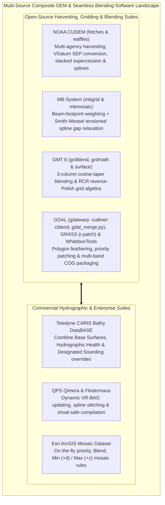

## 23.5 Software Ecosystem for Multi-Source Composite Modeling and Blending

Compiling dozens or thousands of heterogeneous topographic and bathymetric datasets into a seamless, uncertainty-attributed composite DEM relies on specialized open-source harvesting/blending suites, raster algebra CLIs, sparse elliptic PDE solvers, and enterprise hydrographic database platforms.



---

### 23.5.1 Open-Source Command-Line and Python Workflows

#### 1. NOAA `CUDEM`: Automated Harvesting (`fetches` / `fetchez`) and Stacked Synthesis (`waffles`)
Developed in Python by NOAA NCEI and CIRES (**Amante et al., 2023**, `ciresdem/cudem`), **`cudem`** automates coastal topo-bathymetric synthesis through two core CLI utilities and `.datalist` control files (`path format weight uncertainty`):
* **`fetches` (renamed `fetchez` in current releases):** Queries and downloads multi-agency archives (`3dep`, `digital_coast`, `ncei_thredds`, `ehydro`, `multibeam`, `icesat2`, `gebco`, `osm` coastlines) within a target `-R xmin/xmax/ymin/ymax` bounding box.
* **`waffles`:** Transforms vertical datums via `VDatum`/`PROJ` (`-P epsg:4269+5703`), resolves multi-source overlaps via weighted stacking (`-M stacks:supersede=True` with `-w`), interpolates across surf-zone gaps via tensioned splines (`-M cudem` or `-M gmt-surface`), and writes companion `-u` (`combined_uncertainty`) and `-s` spatial-metadata/provenance rasters:

```bash
# 1. Harvest USGS 3DEP LiDAR, USACE eHydro channels, NOAA BAGs & OSM land polygons
fetches -R -122.52/-122.36/37.76/37.86 3dep ehydro CUDEM osm

# 2. Compile a weighted datalist (source_entry  format  weight  uncertainty_m)
cat << 'EOF' > sf_bay_sources.datalist
usace_channel_2025.xyz     168  15.0  0.12
noaa_bag_special_2022.bag  200  12.0  0.18
usgs_3dep_ql1_2021.laz     300  10.0  0.08
regional_background.tif    200   1.0  2.50
EOF

# 3. Build 1/9 arc-second (~3 m) composite DEM + uncertainty (-u) & provenance (-s)
waffles -M stacks:supersede=True \
        -R -122.50/-122.38/37.77/37.85 \
        -E 1/9s -w -u -s \
        -P epsg:6318+5703 \
        -O sf_golden_gate_composite \
        sf_bay_sources.datalist
```

#### 2. `GMT` (`grdblend` & `grdmath`) and `MB-System` (`mbgrid`)
* **`GMT grdblend` and `grdmath` (`Wessel et al., 2019`):** In `GMT 6`, `grdblend` reads a **3-column** ASCII blendfile (`gridfile  inner_full_weight_-R  relative_weight`), cosine-tapering each input grid across the margin between its inner `-R` domain and its outer file extent (note: `-N` sets unconstrained NoData, while `-C` controls overlap clobber modes such as `-Cf` first or `-Cl` last—*never* pass a distance to `-C`!). Pairing `grdblend` with `grdmath` executes clean Remove-Compute-Restore (`RCR`) and hard shoal overrides:

```bash
# 1. Remove regional base from local harbor survey using GMT grdmath RPN algebra
gmt grdsample regional_base_10m.nc -Gregional_on_1m.nc -Rharbor_local_1m.nc
gmt grdmath harbor_local_1m.nc regional_on_1m.nc SUB = harbor_residual_1m.nc
gmt grdmath regional_on_1m.nc 0 MUL = zero_bg_1m.nc

# 2. 3-column blendfile: <gridfile> <inner_full_weight_region> <weight>
#    Cosine-taper the local residual to zero across the ~500 m outer margin, then Restore base
cat << 'EOF' > harbor_blend.txt
harbor_residual_1m.nc -R-122.455/-122.395/37.795/37.855  10.0
zero_bg_1m.nc         -R-122.460/-122.390/37.790/37.860   1.0
EOF

gmt grdblend harbor_blend.txt -R-122.46/-122.39/37.79/37.86 -I1e -N0 -Gharbor_residual_tapered.nc
gmt grdmath regional_on_1m.nc harbor_residual_tapered.nc ADD = harbor_blended.nc

# 3. Hard Positive-Up (+z) Shoal Override via 2-operand DENAN then MAX (no stack underflow)
gmt grdmath harbor_blended.nc designated_shoals_z_up.nc harbor_blended.nc DENAN MAX = harbor_shoal_safe.nc
```

* **`MB-System` (`mbgrid` and `mbmosaic` — `Caress & Chayes, 1996`):** Compiles cleaned multibeam swath datalists (`-I swath.mb-1`) using beam-footprint weighted Gaussian averaging (`-A2` positive-up topography/elevation where underwater bathymetry is negative $z < 0$, or `-A1` positive-down bathymetry $d > 0$), tensioned thin-plate spline gap filling (`-F5 -T0.35`), and automatic background DEM stitching (`-K background_altimetry.grd`) where high-resolution swaths smoothly relax into satellite bathymetry across unensonified deep-ocean gaps.

#### 3. `GDAL`, `GRASS GIS`, and `WhiteboxTools` Raster Patching Utilities
* **`GDAL` (`gdalwarp`, `gdalbuildvrt`, `gdal_merge.py`):** While legacy `gdal_merge.py -n -9999 -o merged.tif hi_res.tif lo_res.tif` provides quick last-in/first-in raster stamping, production pipelines prefer `gdalwarp -cutline valid_survey_poly.gpkg -cblend 25` (which feathers pixel values across a `25-pixel` cutline distance buffer) or zero-copy `gdalbuildvrt` mosaics compiled into multi-band Cloud-Optimized GeoTIFFs (`elevation`, `combined_uncertainty`, `source_id`, `acquisition_date`).
* **`GRASS GIS` (`r.patch`, `r.series`) & `WhiteboxTools` (`MosaicWithFeathering`):** `GRASS r.patch input=lidar_1m,sonar_2m,srtm_30m output=patched_dem` enforces strict priority-ordered hole filling (`first non-NULL pixel wins`), ideal for building deterministic `source_id` provenance masks prior to gradient-domain seam smoothing.

#### 4. Sparse Poisson Gradient-Domain Blending + Shoal Override in Python
Because linear feathering (`-cblend`) creates synthetic cross-valley dikes whenever a vertical datum residual exists, the following concise, production-ready Python function solves **Pérez et al.'s (2003)** exact 5-point discrete Poisson system (`Section 23.4.1`) over arbitrary valid survey masks using `scipy.sparse` and enforces positive-up (`+z`) shoal overrides:

```python
"""Seamless Poisson gradient-domain DEM fusion with positive-up (+z) shoal override."""

import numpy as np
from scipy import sparse
from scipy.sparse.linalg import spsolve


def poisson_blend_dem_with_shoal_override(
    z_reg: np.ndarray,
    z_local: np.ndarray,
    interior_mask: np.ndarray,
    z_designated_shoals: np.ndarray | None = None,
) -> np.ndarray:
    """Solves nabla^2(de) = 0 in interior_mask (z = z_local + de, z|_dOmega = z_reg)."""
    rows, cols = z_reg.shape
    # Exclude 1-px outer image border so all 4 neighbors exist for interior pixels
    mask = interior_mask.copy()
    mask[[0, -1], :] = False
    mask[:, [0, -1]] = False

    idx_map = np.full((rows, cols), -1, dtype=np.int32)
    iy, ix = np.nonzero(mask)
    m_unknowns = len(iy)
    idx_map[iy, ix] = np.arange(m_unknowns, dtype=np.int32)

    # Solve harmonic offset membrane: 4 * de_p - sum_{q in Omega} de_q = sum_{q in dOmega} (z_reg - z_local)_q
    diag_vals = np.full(m_unknowns, 4.0, dtype=np.float64)
    rhs = np.zeros(m_unknowns, dtype=np.float64)
    row_idx, col_idx, off_vals = [np.arange(m_unknowns)], [np.arange(m_unknowns)], [diag_vals]

    for dy, dx in ((-1, 0), (1, 0), (0, -1), (0, 1)):
        ny, nx = iy + dy, ix + dx
        nbr_id = idx_map[ny, nx]
        in_omega = nbr_id >= 0
        row_idx.append(np.nonzero(in_omega)[0])
        col_idx.append(nbr_id[in_omega])
        off_vals.append(np.full(np.count_nonzero(in_omega), -1.0))
        on_bdy = ~in_omega
        rhs[on_bdy] += z_reg[ny[on_bdy], nx[on_bdy]] - z_local[ny[on_bdy], nx[on_bdy]]

    a_mat = sparse.csr_matrix(
        (np.concatenate(off_vals), (np.concatenate(row_idx), np.concatenate(col_idx))),
        shape=(m_unknowns, m_unknowns),
    )
    delta_e = spsolve(a_mat, rhs)

    z_out = z_reg.astype(np.float64).copy()
    z_out[iy, ix] = z_local[iy, ix] + delta_e

    # Hard navigation shoal override for positive-up elevation z (e.g., IHO S-102 / CUDEM)
    if z_designated_shoals is not None:
        has_shoal = ~np.isnan(z_designated_shoals)
        z_out[has_shoal] = np.maximum(z_out[has_shoal], z_designated_shoals[has_shoal])
    return z_out.astype(np.float32)
```

*(Notice the algebraic elegance of solving directly for the harmonic offset $\Delta e = z - z_{\text{local}}$ via $\nabla^2(\Delta e) = 0$: it requires zero finite-difference derivatives on interior pixels, eliminates any risk of guidance-sign inversion, and preserves $100\%$ of `z_local` machine precision!)*

---

### 23.5.2 Commercial Hydrographic and Enterprise GIS Suites

* **Teledyne `CARIS Bathy DataBASE` (`Combine Base Surfaces`):** Enterprise compilation standard for national hydrographic offices (`NOAA`, `CHS`, `UKHO`, `SHOM`). Ingests `BAG` and `VR-BAG` (Variable-Resolution BAG) surfaces, evaluates multi-criteria supercession rules (*Hydrographic Health* / `CATZOC` + sediment mobility), and hard-locks `Designated Soundings` into **IHO S-102** Bathymetric Surface deliverables.
* **QPS `Qimera` and `Fledermaus`:** Provide interactive 3D cross-survey bias checking, spline edge-stitching, and automated shoal-biased overview generation.
* **Esri `ArcGIS Pro Mosaic Dataset`:** Serves dynamic multi-resolution terrain services (`LERC` elevation tiles) with configurable `Mosaic Operators` (`First`, `Last`, `Blend`, `Mean`, `Min`, `Max`). **Critical Sign Warning:** In a positive-down depth mosaic ($d > 0$), `Min` is shoal-biased; in a **positive-up elevation mosaic ($z < 0$, e.g., CUDEM / IHO S-102)**, `Min` selects the *deepest* sounding (erasing shoals!) and **`Max` must be selected for shoal preservation**!

---

### 23.5.3 Software Ecosystem Comparison Matrix

| Software / Tool | License | Core Blending / Mosaicking Mechanism | Provenance & `TVU` Support | Primary Operational Niche |
| :--- | :--- | :--- | :--- | :--- |
| **`CUDEM` (`fetches`/`waffles`)** | GPL-3.0 | Weighted supercession stacks, `VDatum`, splines | Native `-u` uncertainty & `-s` spatial masks | Automated coastal topo-bathy (`TBDEM`) compilation. |
| **`GMT` (`grdblend`/`grdmath`)** | LGPL-3.0 | 3-col cosine-taper & RPN `RCR` grid algebra | Via companion NetCDF bands (`TID`) | Global/basin bathymetry (`GEBCO`, `SRTM15+`). |
| **`MB-System` (`mbgrid`)** | GPL-3.0 | Acoustic footprint weighting + tensioned spline | Swath footprint density & variance grids | Multibeam cruise mosaicking onto regional backgrounds. |
| **`GDAL` / `GRASS` (`r.patch`)** | MIT / GPL-2.0+ | Cutline feathering (`gdalwarp`), `gdal_merge.py`, `r.patch` | Multi-band `COG` + Raster Attribute Tables | Cloud-native tile assembly & deterministic `source_id` masks. |
| **`CARIS Bathy DataBASE`** | Commercial | Rule-based `BAG`/`VR-BAG` supercession | Full `IHO S-102` + `BAG Tracking List` | Certified nautical charting & legal shoal custody. |
| **`Esri Mosaic Dataset`** | Commercial | On-the-fly dynamic `First`/`Blend`/`Min`/`Max` | Per-footprint attribute query tables | Enterprise streaming elevation services (`LERC`). |

---

### 23.5.4 Packaging the Four-Band Cloud-Optimized Composite Deliverable (`GDAL`)

Once elevation (`z_comp.tif`), propagated $1\sigma$ or $95\%$ vertical uncertainty (`combined_uncertainty.tif`), integer catalog provenance (`source_id.tif`), and decimal-year survey timestamp (`acquisition_date.tif`) have been generated on an identical snap lattice, `GDAL` packages them with explicit band-level semantic descriptions and appropriate overview resampling rules (**never** average `source_id` integer codes during pyramid generation—use `MODE` or `NEAREST` for integer masks, and shoal-preserving `MAX` [for $+z$] on navigational elevation overviews!):

```python
"""Assemble a 4-band Cloud-Optimized GeoTIFF composite DEM with explicit band semantics."""

from osgeo import gdal

gdal.UseExceptions()
vrt_ds = gdal.BuildVRT(
    "",
    [
        "z_comp_shoal_safe.tif",
        "combined_uncertainty.tif",
        "source_id_float_encoded.tif",
        "acquisition_date.tif",
    ],
    separate=True,
)
band_names = ("elevation", "combined_uncertainty", "source_id", "acquisition_date")
for idx, name in enumerate(band_names, start=1):
    vrt_ds.GetRasterBand(idx).SetDescription(name)

gdal.Translate(
    "coastal_composite_4band_cog.tif",
    vrt_ds,
    format="COG",
    creationOptions=[
        "COMPRESS=ZSTD",
        "PREDICTOR=3",
        "OVERVIEW_RESAMPLING=NEAREST",
        "BIGTIFF=IF_SAFER",
    ],
)
```

*(Note: Because TIFF requires homogeneous sample types across bands within a single IFD—or separate subdatasets/STAC assets—operational archives such as NOAA `CUDEM` and `GEBCO` frequently distribute `source_id` (`Int16`/`UInt16` with `DEFLATE` `PREDICTOR=2` and `MODE` overviews) as a dedicated co-registered companion COG asset inside the same **STAC Item** alongside the floating-point `elevation`, `combined_uncertainty`, and `acquisition_date` COGs!)*
