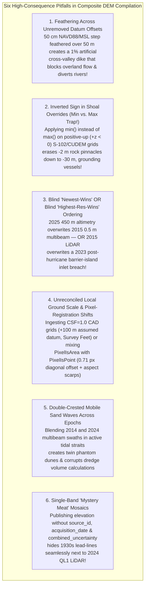

## 23.6 Common Pitfalls and Key Takeaways

A composite DEM is only as trustworthy as its weakest seam, its worst unflagged legacy source, and its strictest safety override. Most catastrophic failures in regional flood simulations and coastal navigation stem not from individual sensor noise, but from subtle compilation blunders when stitching heterogeneous surveys together.

---

### 23.6.1 Common Pitfalls in Composite Elevation Modeling

#### 1. Feathering Before Removing Vertical Datum or Geoid Biases
Running `gdalwarp -cblend` or Esri `Blend` across two surveys separated by an unremoved $0.50\text{ m}$ vertical datum offset (`NGVD29` vs. `NAVD88`, or untied local `MLLW`) converts a sharp vertical step into a $50\text{ m}$-wide artificial $1.0\%$ ramp—steeper than most coastal floodplains! Simulated stormwater ponds behind the feather zone as if blocked by an engineered levee. Always harmonize datums (`VDatum`), co-register overlaps, and blend in the **gradient/residual domain** (`Poisson` or `RCR`).

#### 2. Flipping `Min` vs. `Max` Polarity on Navigation Shoal Overrides
Because legacy hydrographic tables express depth positive-down ($d > 0$, where shoalest $= \min d$) while **IHO S-102**, `CUDEM`, and `TBDEM` grids express elevation positive-up ($z < 0$, where shoalest $= \max z$), applying a naive `min()` mosaic rule or spline filter to a positive-up bathymetric grid **deletes every submerged pinnacle, boulder, and shipwreck mast in favor of deeper water**! Every override stage must assert vertical sign convention explicitly in unit tests.

#### 3. One-Dimensional Supercession Rules ("Newest Wins" vs. "Finest Grid Wins")
Sorting sources purely by date lets a 2025 coarse satellite gravity grid obliterate a 2016 $0.5\text{ m}$ multibeam canyon survey; sorting purely by spatial resolution lets a pre-storm 2016 $0.5\text{ m}$ LiDAR island overwrite a real 2022 hurricane-cut tidal inlet captured at $2\text{ m}$ resolution. Supercession **must** combine resolution, `TVU`, sediment-mobility time decay $r_{\text{mobility}}\Delta t$, and explicit post-event disturbance reset polygons.

#### 4. Ingesting Unreconciled Local Ground-Scale Surveys and Mixed Grid Registrations
Dropping a local CAD site survey (`CSF = 1.0`, Plant North, assumed $100\text{ m}$ benchmark, or U.S. Survey Feet) into a projected regional DEM introduces $200\text{–}700\text{ ppm}$ radial stretch and meter-scale boundary tears, while mixing `GMT` gridline (`PixelIsPoint`) and `GeoTIFF` cell-center (`PixelIsArea`) rasters shifts topography diagonally by $\frac{1}{\sqrt{2}}\Delta x$, creating false step seams along every sloped boundary.

#### 5. Publishing Anonymous Single-Band Composite Grids
Smoothly spline-filling a 1928 lead-line smooth sheet next to 2024 `QL1` airborne LiDAR and shipping a single-band `Float32` GeoTIFF makes $\pm 5\text{ m}$ guesswork look identical in a hillshade to $\pm 0.08\text{ m}$ laser terrain—setting a severe engineering and legal liability trap for downstream users.

---

### 23.6.2 Key Takeaways

1. **Harmonize 4D Geodesy and Snap Lattices First:** Transform all candidate inputs to a unified horizontal realization/epoch, vertical datum (`GEOID` / `VDatum SEP`), Combined Scale Factor, and exact `PixelIsArea` snap grid *before* any mosaicking or blending occurs.
2. **Rank Sources via Physics-Informed Supercession:** Score overlapping surveys using intrinsic `TVU`/`THU`, effective resolution, formal survey order, **sediment-mobility age inflation** ($\sigma_z^2(t) = \sigma_0^2 + r_{\text{mobility}}^2\Delta t^2$), and post-disaster reset masks.
3. **Blend Gradients or Multi-Scale Octaves, Never Raw Biased Heights:** Use **Poisson harmonic offset editing** ($\nabla^2(\Delta e) = 0$), **Remove-Compute-Restore (`RCR`)**, **multi-band Laplacian pyramids**, or **tensioned splines (`T ≈ 0.35`)** after inward cropping of noisy outer swath beams.
4. **Enforce Post-Blend Hard Overrides with Verified Polarity:** Lock verified navigation hazards (`max(z_blend, z_shoal)` for positive-up $z$; `min(d_blend, d_shoal)` for positive-down $d$) and re-burn flood-levee crests and culvert thalwegs as the final immutable step.
5. **Ship Four Co-Registered Bands (`z`, `combined_uncertainty`, `source_id`, `acquisition_date`):** Preserve complete per-pixel provenance (`TID` / survey catalog key), observation timestamp, and propagated uncertainty in every composite deliverable.
