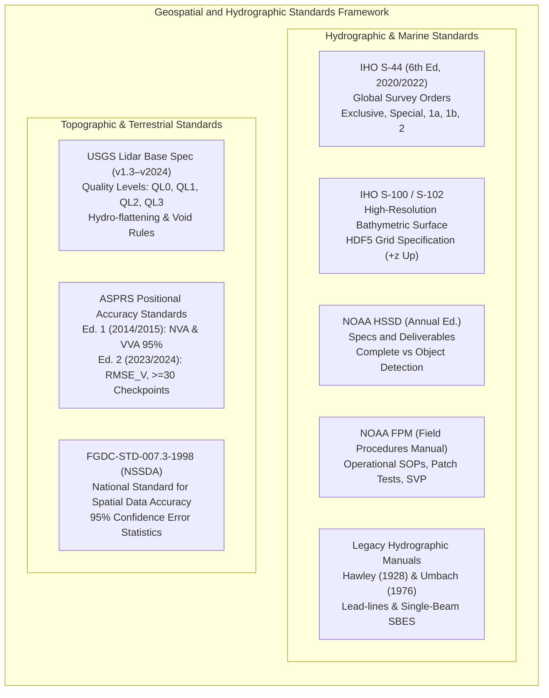

# Chapter 24: Survey Standards, Guide Documents, and Key Public DEM Products

*The official specifications that govern professional elevation and hydrographic surveys, and a critical comparison of the world's major open DEM datasets.*

---

## 24.1 Survey and Product Guide Documents

Digital elevation models are not mere mathematical surfaces; in engineering, navigation, and flood risk management, they are legal and regulatory instruments. A DEM used to dredge a shipping channel, delineate a 100-year floodplain, or guide an autonomous submarine must conform to codified, defensible survey specifications. Over the past century, national mapping agencies and international bodies have developed rigorous guide documents that translate instrument physics, statistical error bounds, and cartographic requirements into concrete operational standards.

Understanding these standards is essential not only for executing new surveys, but also for interpreting historical data: over $40\%$ of modern nautical charts and regional coastal DEMs still incorporate soundings collected under historical manuals dating back to the early 20th century.

---

### 24.1.1 NOAA Hydrographic Standards: HSSD and FPM

The United States National Oceanic and Atmospheric Administration (NOAA) Office of Coast Survey (OCS) maintains the world's most detailed operational hydrographic specifications.

#### 1. NOAA Hydrographic Surveys Specifications and Deliverables (HSSD)
Updated annually since 2000 (including a major 2024 modernization aligning with IHO S-100 data pipelines), the HSSD dictates every phase of survey execution, processing, and data submission for NOAA vessels and private hydrographic contractors:

* **Coverage Types:**
  * *Object Detection Coverage:* Mandated in critical harbors, anchorages, and channels where the under-keel clearance of commercial navigation is minimal. Requires $100\%$ multibeam ensonification (at high sounding density) or $200\%$ side-scan sonar coverage with concurrent multibeam developments capable of resolving a $1\text{-m}$ cubic hazard at depths $\le 20\text{ m}$ (or $2\text{-m}$ cube at depths $> 20\text{ m}$).
  * *Complete Bathymetric Coverage:* Mandated in open coastal waters and fairways. Relaxes the $1\text{-m}$ cube requirement across the entire outer swath, requiring $100\%$ multibeam bathymetric coverage (or $100\%$ side-scan sonar with concurrent multibeam) with grid resolution scaling with water depth.
* **BAG Grid Resolution by Depth:**
  To maintain high detail in shallow waters without creating unmanageable file sizes offshore, HSSD mandates variable-resolution (VR-BAG) grids or depth-bracketed single-resolution Bathymetric Attributed Grids (BAGs). Under single-resolution General/Complete Coverage tiers (scaling up by factors of two across slightly overlapping depth bands to prevent stair-step holidays on steep slopes), minimum grid resolution is $1.0\text{ m}$ ($0\text{–}40\text{ m}$), $2.0\text{ m}$ ($36\text{–}80\text{ m}$), $4.0\text{ m}$ ($72\text{–}160\text{ m}$), $8.0\text{ m}$ ($144\text{–}320\text{ m}$), and $16.0\text{ m}$ ($288\text{–}640\text{ m}$), while Object Detection surveys tighten shallow-water resolution to $0.5\text{ m}$ at $0\text{–}20\text{ m}$ (and $0.25\text{ m}$ under Exceptional Quality Metrics):
  $$\text{Object Detection } (0\text{–}20\text{ m}) \implies \text{Cell Size } \le 0.50\text{ m}; \qquad (18\text{–}40\text{ m}) \implies \le 1.0\text{ m}$$
  $$\text{Complete / General } (0\text{–}40\text{ m}) \implies \text{Cell Size } \le 1.0\text{ m}; \qquad (36\text{–}80\text{ m}) \implies \le 2.0\text{ m}$$
  $$\text{Deep Shelf Brackets } (72\text{–}160\text{ m}) \implies \le 4.0\text{ m}; \qquad (144\text{–}320\text{ m}) \implies \le 8.0\text{ m}$$
* **Cross-line Agreement Requirements:**
  Every hydrographic survey must include orthogonal cross-lines totaling at least $4\%$ (for Object Detection or Complete Coverage multibeam) or $8\%$ (for Set Line Spacing) of mainscheme linear mileage. HSSD mandates that at least $95\%$ of all grid-node comparison differences between cross-lines and mainscheme lines fall within the maximum allowable Total Vertical Uncertainty ($\text{TVU}_{\max}(d)$).
* **Designated Soundings & DTON Reporting:**
  * *Danger to Navigation (DTON):* Any uncharted shoal or obstruction that poses an immediate risk to surface navigation must be reported to the Marine Chart Division (MCD) within 24 hours of discovery, accompanied by raw point cloud verification and a preliminary chart cutout.
  * *Designated Sounding:* When surface gridding algorithms (such as CUBE) smooth out an authentic, hazardous high point of a rock or wreck, the hydrographer must manually flag the raw acoustic sounding as a "Designated Sounding." Gridding software must override the computed grid node with this exact shoal sounding depth.

#### 2. NOAA Field Procedures Manual (FPM)
Originally issued in 1997 and updated periodically (including major updates in 2014 and 2020+), the FPM provides the physical recipes required to achieve HSSD compliance:
* **Patch Test Procedures:** Prescribes exact line geometry, speed variations, and seafloor topography required to resolve transducer angular boresight mounting biases (roll $\delta\phi$, pitch $\delta\theta$, yaw $\delta\psi$) and navigation time synchronization latency ($\delta t_{\text{lat}}$).
* **Sound Speed Cast Protocols:** Mandates the frequency and spatial distribution of sound velocity profiler (SVP) casts or continuous Moving Vessel Profilers (MVP). If refractive "smiling" or "frowning" exceeds HSSD TVU limits at outer beams, the cast frequency must be increased or line spacing narrowed.
* **Ellipsoidally Referenced Surveys (ERS):** Field workflows for transitioning from traditional acoustic tide gauges and co-tidal discrete zoning to continuous GNSS kinematic positioning referenced to the GRS80/WGS84 ellipsoid, transformed to Low Water datums via NOAA VDatum.

#### 3. Historical Hydrographic Manuals: Hawley (1928) & Umbach (1976)
To model coastal hazards and compile composite coastal DEMs, practitioners frequently ingest soundings from smooth sheets surveyed prior to modern GPS and multibeam acoustics. Interpreting these data requires understanding the standards under which they were acquired:
* **Hawley (1928), *Hydrographic Manual* (USC&GS Special Publication 143):** Governed hand-lead and wire-drag operations. Horizontal positioning relied on visual three-point sextant fixes to shore stations ($\sigma_{\text{pos}} \approx 10\text{–}50\text{ m}$ depending on geometry). Soundings were measured with braided hemp/lead lines marked in fathoms and feet using $7\text{–}14\text{ lb}$ hand leads in shallow water and $30\text{–}100\text{ lb}$ deep-sea leads offshore. In depths $<10\text{ fathoms}$ ($18.3\text{ m}$), lead-line precision was typically $\pm 0.1\text{–}0.2\text{ m}$, but bottom coverage was essentially $0\%$ between discrete cast points spaced $50\text{–}100\text{ m}$ apart unless swept by a wire drag.
* **Umbach (1976), *Hydrographic Manual* (NOAA 4th Edition):** Governed the analog single-beam era (Raytheon DE-723 and Ross 200 Fineline echosounders). Horizontal positioning utilized microwave electronic systems (Raydist, Hi-Fix, Del Norte Trisponder) with horizontal precision of $\pm 5\text{–}15\text{ m}$. Vertical precision was limited by analog paper trace interpretation ($\pm 0.3\text{ m}$), uncorrected vessel squat, swell heave, and coarse discrete tide tables.

---

### 24.1.2 International Hydrographic Organization (IHO) Standards

The International Hydrographic Organization (IHO), headquartered in Monaco, sets universal baseline standards for nearly 100 member maritime states across the globe.

#### 1. IHO S-44: Standards for Hydrographic Surveys (6th Edition, 2020; Ed. 6.1.0, 2022)
IHO S-44 defines global survey categories. The 6th Edition introduced the "Exclusive Order" for critical port fairways and replaced rigid line-spacing tables with a flexible Matrix of survey parameters:

| Survey Order | Target Environment & Operational Purpose | Feature Detection & Coverage | Horizontal Uncertainty ($\text{THU}_{\max}$) at 95% | Vertical Uncertainty ($\text{TVU}_{\max}$) at 95% ($a, b$) |
| :--- | :--- | :--- | :--- | :--- |
| **Exclusive Order** | Strict under-keel clearance ($<1\text{ m}$); critical berths, drydocks, and channel chokepoints | $200\%$ coverage & search; cubic features $> 0.5\text{ m}$ | $1.0\text{ m}$ | $a = 0.15\text{ m}, \quad b = 0.0075$ |
| **Special Order** | Harbors, berthing areas, and associated critical fairways with limited clearance | $100\%$ coverage & search; cubic features $> 1.0\text{ m}$ | $2.0\text{ m}$ | $a = 0.25\text{ m}, \quad b = 0.0075$ |
| **Order 1a** | Harbors, coastal approaches, and areas where under-keel clearance is an issue ($d \le 100\text{ m}$) | $\le 100\%$ bathymetric coverage; full sea floor search; cubic features $> 2.0\text{ m}$ in $d \le 40\text{ m}$, $10\%\,d$ in $d > 40\text{ m}$ | $5.0\text{ m} + 0.05 \cdot d$ | $a = 0.50\text{ m}, \quad b = 0.0130$ |
| **Order 1b** | Areas where under-keel clearance is not critical to surface navigation ($d \le 100\text{ m}$) | Feature detection not required; general bathymetry only ($5\%$ line spacing) | $5.0\text{ m} + 0.05 \cdot d$ | $a = 0.50\text{ m}, \quad b = 0.0130$ |
| **Order 2** | Open ocean, shelf waters $> 100\text{ m}$ depth where general bathymetry is sufficient | Feature detection not required; general depiction only | $20.0\text{ m} + 0.10 \cdot d$ | $a = 1.00\text{ m}, \quad b = 0.0230$ |

The allowable vertical uncertainty at positive-down water depth $d$ is computed via:
$$\text{TVU}_{\max}(d) = \sqrt{a^2 + (b \cdot d)^2}$$
where parameter $a$ represents fixed vertical error independent of depth (e.g., heave sensor noise, tide datum conversion, antenna height measurement) and $b$ represents depth-dependent vertical error (e.g., sound velocity profile refraction, acoustic beam spreading, transducer tilt).

#### 2. IHO S-100 Framework and S-102 Bathymetric Surface Specification
The IHO S-100 Universal Hydrographic Data Model is replacing the legacy S-57 vector chart standard. Within this modern geospatial framework, **S-102** (Editions 2.2.0 and 3.0.0) defines the specification for high-resolution bathymetric surface products:
* Built upon the HDF5 hierarchical container format, adopting the **positive-up elevation ($z = -d$)** sign convention (so submerged seabed cells carry negative values below chart datum, contrasting with S-44's positive-down depth $d$).
* Stores primary elevation rasters alongside per-cell Total Vertical Uncertainty (TVU), tracking-list overrides, and metadata provenance (expanded in Ed. 3.0.0 to support survey date and source grids).
* Enables dynamic, real-time depth contour generation and safety-depth shading on electronic chart display systems (ECDIS) based on a vessel's real-time draft, squat, and tidal stage.

---

### 24.1.3 Terrestrial LiDAR and Photogrammetric Standards: USGS 3DEP & ASPRS

On land, national elevation models are governed by geodetic accuracy standards rooted in statistical error propagation over open vs. vegetated surfaces.

#### 1. USGS Lidar Base Specification (3D Elevation Program - 3DEP)
Maintained by the National Geospatial Program of the USGS (originally published as Techniques and Methods 11-B4 in 2012/2014, revised to v1.3 in 2018, and maintained continuously online through v2024), the Lidar Base Specification establishes strict technical baselines for all airborne LiDAR collections across the United States.

* **Quality Levels (QL):**

| Quality Level | Aggregate Nominal Pulse Density ($\text{ANPD}$) | Aggregate Nominal Pulse Spacing ($\text{ANPS}$) | Vertical Accuracy ($\text{RMSE}_z$ Non-Vegetated / NVA at $95\%$) | Target DEM Grid Cell Size |
| :--- | :--- | :--- | :--- | :--- |
| **QL0** | $\ge 8.0\text{ pls/m}^2$ | $\le 0.35\text{ m}$ | $\text{RMSE}_z \le 5.0\text{ cm}$ ($\text{NVA} \le 9.8\text{ cm}$) | $\le 0.50\text{ m}$ (typically $0.25\text{–}0.50\text{ m}$) |
| **QL1** | $\ge 8.0\text{ pls/m}^2$ | $\le 0.35\text{ m}$ | $\text{RMSE}_z \le 10.0\text{ cm}$ ($\text{NVA} \le 19.6\text{ cm}$) | $\le 0.50\text{ m}$ ($0.50\text{ m}$) |
| **QL2** | $\ge 2.0\text{ pls/m}^2$ | $\le 0.71\text{ m}$ | $\text{RMSE}_z \le 10.0\text{ cm}$ ($\text{NVA} \le 19.6\text{ cm}$) | $\le 1.0\text{ m}$ ($1.0\text{ m}$) |
| **QL3** | $\ge 0.5\text{ pls/m}^2$ | $\le 1.41\text{ m}$ | $\text{RMSE}_z \le 20.0\text{ cm}$ ($\text{NVA} \le 39.2\text{ cm}$) | $\le 2.0\text{ m}$ ($2.0\text{ m}$) |

Notice that **QL0 and QL1 share the exact same minimum pulse density ($\ge 8.0\text{ pls/m}^2$) and spacing ($\le 0.35\text{ m}$)**; QL0 is distinguished strictly by its doubled vertical accuracy requirement ($\text{RMSE}_z \le 5.0\text{ cm}$ vs. $10.0\text{ cm}$).

* **Hydro-Flattening Requirements:**
  USGS 3DEP establishes non-negotiable rules for cartographic and hydraulic hydro-flattening in bare-earth DTMs:
  * *Inland Lakes and Ponds:* All standing waterbodies with an area $\ge 2\text{ acres}$ ($\approx 8,094\text{ m}^2$) must be flattened to a single monotonic, constant elevation equal to or immediately below the surrounding bankline.
  * *Inland Streams and Rivers:* All flowing waterbodies with a nominal width $\ge 30\text{ m}$ ($\approx 100\text{ ft}$) must be carved as flat monotonic channels that decrease strictly downstream, preventing digital water from flowing uphill across pool-riffle sequences.
  * *Tidal Waters:* Estuaries, sounds, and oceans must be flattened to the water level at the time of flight or tidal datum boundary.

#### 2. ASPRS Positional Accuracy Standards for Digital Geospatial Data (Edition 1, 2014/2015 & Edition 2, 2023/2024)
The American Society for Photogrammetry and Remote Sensing (ASPRS) standard decoupled accuracy metrics from legacy paper map scale (e.g., "1 inch = 100 feet") and contour intervals, defining precision purely by statistical error over distinct land covers. Understanding both editions is critical because federal programs transition gradually:

* **Edition 1, Version 1.0 (2014, published 2015; still referenced by USGS LBS):**
  * **Non-Vegetated Vertical Accuracy (NVA):** Evaluated on flat, open terrain (asphalt, concrete, bare soil, short turf) using Gaussian theory at the $95\%$ confidence level:
    $$\text{RMSE}_z = \sqrt{\frac{1}{n} \sum_{i=1}^n (z_{\text{DEM},i} - z_{\text{GCP},i})^2}, \qquad \text{NVA}_{95\%} = 1.9600 \cdot \text{RMSE}_z$$
  * **Vegetated Vertical Accuracy (VVA):** Evaluated in brush, tall weeds, crops, and dense forested canopies where laser pulses clip leaves or understory branches, creating positive vertical skewness. Evaluated non-parametrically at the $95\text{th}$ percentile of absolute errors ($Q_{0.95}(|z_{\text{DEM}} - z_{\text{GCP}}|)$), with a minimum of $20$ NVA checkpoints for small projects ($\le 500\text{ km}^2$).
* **Edition 2 (v1.0, 2023; v2.0, June 2024):**
  * **Retirement of $95\%$ Confidence Multipliers:** Replaced legacy NSSDA-style $1.9600 \times$ confidence statements with direct **Root Mean Square Error** accuracy classes ($\text{RMSE}_H$, $\text{RMSE}_V$, $\text{RMSE}_{3D}$) to eliminate confusion between parametric Gaussian bounds and empirical quantiles.
  * **Increased Checkpoint Minimums & Survey Error Propagation:** Raised the minimum independent checkpoint count from $20$ to **$30$ checkpoints** (scaling up to $120$ for projects $>9,000\text{–}10,000\text{ km}^2$, with explicit "truth-in-reporting" statements required when $<30$ points are surveyed) and mandated accounting for survey checkpoint error itself.
  * **VVA Diagnostic Reporting:** Removed strict contractual pass/fail thresholds on VVA (because canopy penetration depends on dense foliage beyond sensor calibration), instead requiring VVA to be tested and reported "as found" alongside skewness and kurtosis diagnostics—plus **Low Confidence Area Polygons** delineating zones where dense vegetation, standing water, or steep topography obscures bare-earth returns.
