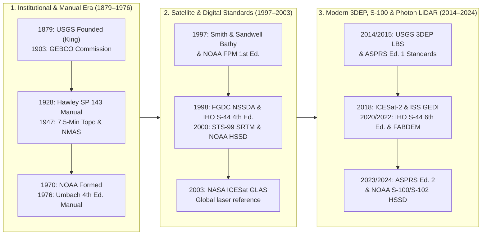

# Chapter 24: Survey Standards, Guide Documents, and Key Public DEM Products

*The official specifications that govern professional elevation and hydrographic surveys, and a critical comparison of the world's major open DEM datasets.*

---

## 24.3 Historical Evolution: From 19th-Century Manuals to Spaceborne Photons

The codification of elevation standards and the creation of open public DEM products did not emerge overnight. They represent a century-and-a-half progression from physical sounding weights and planetable topography to interferometric spaceborne radar and photon-counting orbital lasers. The milestones below, anchored in the `schwehr/gis-history` repository, illustrate how institutional mandates, catastrophic navigation accidents, and technological revolutions drove modern spatial standards.

---

### 24.3.1 Institutional Origins: 1879 USGS and 1903 GEBCO

#### 1879: Foundation of the United States Geological Survey (USGS)
Prior to 1879, topographic mapping of the American West was divided among rival military and civilian expeditions (the Wheeler, Hayden, King, and Powell surveys). On March 3, 1879, the 45th United States Congress enacted legislation establishing the USGS under its first director, Clarence King.

Early USGS topographers initially mapped the continent at reconnaissance scales ($1:250,000$, $1:125,000$, and $1:62,500$) using planetables, alidades, and aneroid barometers, before launching the formal national **$7.5\text{-minute}$, $1:24,000$ quadrangle series** in 1947 (completed across the conterminous U.S. in 1992). Crucially, King and his successor, John Wesley Powell, established the principle that national topography is a public good, creating the institutional mandate that culminated in the National Elevation Dataset (NED, 1999) and the 3D Elevation Program (3DEP).

#### 1903–1905: Prince Albert I of Monaco and the Birth of GEBCO
At the 7th International Geographical Congress in Berlin (1899), oceanographers recognized that deep-ocean soundings were scattered across private logbooks and colonial hydrographic offices. In 1903, Prince Albert I of Monaco convened a dedicated commission in Wiesbaden, Germany—acting on the proposals of Professor Julien Thoulet—to compile the world's first unified bathymetric chart, financing and supervising the production of the **1st Edition of the General Bathymetric Chart of the Oceans (GEBCO)**, printed in Paris in 1905:
* Consisted of 24 paper sheets covering the globe from $72^\circ\text{N}$ to $72^\circ\text{S}$ (plus polar projections).
* Constrained by just **$18,000$ discrete depth soundings** across all the world's oceans (an average of roughly one sounding per $20,000\text{ km}^2$!).
* Depths were hand-drawn into bathymetric contour intervals using hypsometric tints. This marked the founding of the international hydrographic cooperative framework that continues today under the IHO and the Nippon Foundation–GEBCO Seabed 2030 project.

---

### 24.3.2 The Manual Era: Hawley (1928) and Umbach (1976)

#### 1928: Hawley's *Hydrographic Manual* (USC&GS Special Publication 143)
Jean Hodgkins Hawley of the U.S. Coast and Geodetic Survey codified the rigorous operational rules of the pre-electronic era. Under Hawley's manual:
* Horizontal position was fixed by the "three-point problem" (measuring two horizontal angles simultaneously between three charted shore signals using brass sextants).
* Depths were obtained using the lead-line: a $7\text{–}14\text{ lb}$ hand lead (or $30\text{–}100\text{ lb}$ deep-sea lead offshore) attached to a braided hemp line seasoned and marked in fathoms and feet.
* In shoals and boulder fairways where lead-lines missed pinnacles between casts, Hawley mandated the **wire drag**: a continuous submerged horizontal wire supported by buoys and towed between two vessels. If the wire snagged, hydrographers verified the obstruction with direct divers or supplementary casts. This established the conceptual foundation for modern "Object Detection" standards.

#### 1970: Creation of NOAA
On October 3, 1970, President Richard Nixon implemented Reorganization Plan No. 4, consolidating the Coast and Geodetic Survey (founded 1807 by Thomas Jefferson), the Weather Bureau, and the Bureau of Commercial Fisheries into the **National Oceanic and Atmospheric Administration (NOAA)**. The Coast and Geodetic Survey became NOAA's National Ocean Survey (today's Office of Coast Survey, OCS).

#### 1976: Umbach's *Hydrographic Manual* (4th Edition)
Compiled and edited by Melvin J. Umbach under Captain Robert C. Munson (NOAA National Ocean Survey, July 1976), this manual became the definitive global reference of the late-20th-century analog hydrographic survey:
* Standardized analog single-beam echosounding (Raytheon DE-723 and Ross Fineline instruments operating at $100\text{–}200\text{ kHz}$).
* Detailed the transition to shore-based microwave positioning (Raydist, Cubic Argo, Motorola Mini-Ranger, Del Norte Trisponder).
* Codified vessel dynamic squat tests, bar checks for acoustic sound speed calibration, and lead-line verification of analog chart traces.

---

### 24.3.3 Codification of Survey Standards: NMAS, IHO S-44, NSSDA, and ASPRS

While field instruments evolved from brass sextants to swath sonars and airborne lasers, mathematical accuracy standards underwent an equally profound transformation from paper map-scale rules to sensor-independent error statistics:

1. **1947 — U.S. National Map Accuracy Standards (NMAS):** Established circular horizontal ($90\%$ within $1/50\text{ in}$ at scales finer than $1:20,000$) and vertical ($90\%$ within one-half the contour interval) tolerances tied strictly to printed paper map scale. Because digital DEMs have no fixed paper scale, NMAS became obsolete in the GIS era.
2. **1968–2022 — IHO S-44 Evolution:** First published in 1968 to harmonize nautical charting specifications internationally, IHO S-44 evolved through its 4th Edition (1998, introducing the $\sqrt{a^2 + (bd)^2}$ TVU formula), 5th Edition (2008, defining Special Order and Orders 1a/1b/2), and **6th Edition (2020; Ed. 6.1.0, 2022)**, which introduced **Exclusive Order** and a flexible Specification Matrix separating coverage, feature detection, and uncertainty from prescribed line-spacing rules—paired with the S-100/S-102 digital product architecture.
3. **1998–2024 — FGDC NSSDA, USGS 3DEP, and ASPRS Standards:** In 1998, the U.S. Federal Geographic Data Committee (FGDC) released the **National Standard for Spatial Data Accuracy (NSSDA)**, expressing accuracy in ground units at the $95\%$ confidence level ($1.9600 \cdot \text{RMSE}_z$). Building on NSSDA and the 1999 **National Elevation Dataset (NED)**, USGS commissioned the **National Enhanced Elevation Assessment (NEEA, 2012)**, launching **3DEP** and the **Lidar Base Specification** (Techniques and Methods 11-B4, 2012/2014, v1.3 2018). Concurrently, **ASPRS** released its **Positional Accuracy Standards for Digital Geospatial Data** (**Edition 1, 2014/2015**, codifying NVA vs. non-parametric VVA) and **Edition 2 (2023/2024)**, which retired the $95\%$ confidence multiplier in favor of direct $\text{RMSE}_V / \text{RMSE}_H$ reporting, raised minimum checkpoints to $30$, and integrated survey checkpoint error propagation.

---

### 24.3.4 The Digital and Satellite Revolution: 1997 to 2000

#### 1997: Satellite Gravity Bathymetry & The First NOAA FPM
The year 1997 marked a twin revolution in marine elevation modeling:
1. **The Smith & Sandwell Breakthrough:** On September 26, 1997, Walter H. F. Smith and David T. Sandwell published their landmark paper in *Science*, *"Global Sea Floor Topography from Satellite Altimetry and Ship Depth Soundings."* By combining newly declassified U.S. Navy Geosat and ESA ERS-1 radar altimetry data with sparse ship tracks, they demonstrated that intermediate-wavelength marine gravity anomalies ($15\text{–}160\text{ km}$) correlate directly with seafloor topography. This provided the first continuous bathymetric estimation of the global ocean floor, forming the direct ancestor of SRTM15+ and modern GEBCO grids.
2. **NOAA Field Procedures Manual (FPM):** In 1997, NOAA OCS issued the 1st Edition of the FPM, transitioning field units from paper-based analog survey logs to computerized data collection systems (such as Coastal Oceanographics Hypack), high-accuracy DGPS navigation, and early shallow-water multibeam sonar (Reson SeaBat 9001/8101).

#### 2000: SRTM (STS-99) and the First NOAA HSSD
In February 2000, two milestones redefined spatial elevation standards:
1. **Shuttle Radar Topography Mission (SRTM):** Flown aboard the Space Shuttle *Endeavour* (STS-99) from February 11–22, 2000, SRTM mapped $80\%$ of Earth's land area in 11 days using a $60\text{-meter}$ deployable mast. It produced the first homogeneous, near-global digital surface model of the world (1 arc-second $\sim 30\text{ m}$ and 3 arc-second $\sim 90\text{ m}$). SRTM served as the primary global elevation reference for two decades prior to TanDEM-X and Copernicus DEM.
2. **NOAA HSSD Codification:** In 2000, NOAA published the first formal edition of the *Hydrographic Surveys Specifications and Deliverables*. The 2000 HSSD broke decisively from single-beam line-spacing guidelines, establishing quantitative statistical rules for multibeam swath coverage, Total Propagated Uncertainty (TPE/TPU), and digital data deliverables, culminating in the 2024 S-100-aligned HSSD overhaul.

---

### 24.3.5 The Spaceborne LiDAR and Open Data Era: 2003 to 2018+

#### 2003: ICESat GLAS
In January 2003, NASA launched the **Ice, Cloud, and land Elevation Satellite (ICESat)** carrying the Geoscience Laser Altimeter System (GLAS). Operating with a $1064\text{-nm}$ infrared Nd:YAG surface altimetry laser (paired with a $532\text{-nm}$ atmospheric lidar channel), GLAS fired 40 pulses per second, projecting $\sim 70\text{-meter}$ laser footprints spaced $\sim 172\text{ m}$ apart along track. While designed for polar ice sheets, GLAS provided tens of millions of decimeter-level vertical control points across the globe, enabling scientists to model and remove long-wavelength vertical biases in SRTM (culminating in NASADEM) and ASTER GDEM.

#### 2018: ICESat-2 (ATLAS) and GEDI (ISS)
In 2018, spaceborne elevation sensing achieved an order-of-magnitude leap in vertical precision and spatial sampling:
1. **ICESat-2 (September 2018):** Carrying the Advanced Topographic Laser Altimeter System (ATLAS), ICESat-2 replaced coarse full-waveform pulses with **micropulse photon-counting LiDAR** ($532\text{-nm}$ green laser). Firing at $10\text{ kHz}$, ATLAS projects six beams arranged in three pairs, sampling returning photons every $0.7\text{ m}$ along track with a $\sim 11\text{–}17\text{ m}$ footprint. This yields decimeter-scale vertical profiles across ice, bare ground, and clear shallow coastal waters.
2. **GEDI (December 2018):** Mounted on the International Space Station, the Global Ecosystem Dynamics Investigation deployed a $1064\text{-nm}$ multi-beam full-waveform LiDAR with $\sim 25\text{-m}$ footprints specifically optimized to penetrate dense forest canopies between $51.6^\circ\text{N}$ and $51.6^\circ\text{S}$.

Together, ICESat-2 and GEDI provided the global bare-earth ground control that enabled machine-learning terrain extraction models such as **FABDEM**, converting X-band radar surface models into global bare-earth digital terrain models.
