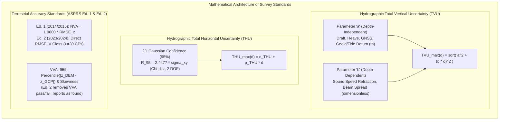
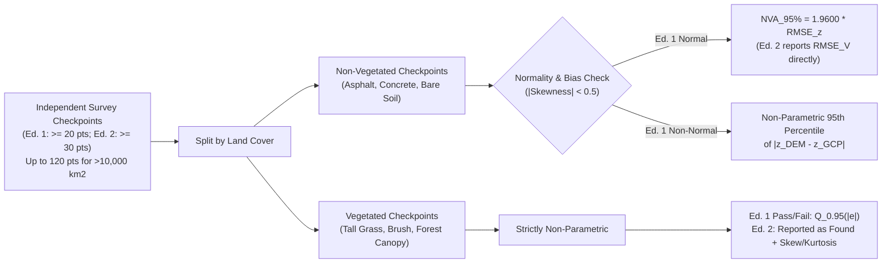

# Chapter 24: Survey Standards, Guide Documents, and Key Public DEM Products

*The official specifications that govern professional elevation and hydrographic surveys, and a critical comparison of the world's major open DEM datasets.*

---

## 24.4 Mathematical Foundations of Survey Standards

Both marine hydrographic standards (IHO S-44, NOAA HSSD) and terrestrial elevation standards (ASPRS, USGS 3DEP) are built upon rigorous statistical error propagation. Rather than defining accuracy as a vague single number, modern standards formulate allowable error as a continuous function of environmental depth, sensing geometry, and statistical confidence levels.

---

### 24.4.1 Hydrographic Vertical Uncertainty: The TVU Equation

Under IHO S-44 (6th Edition) and the NOAA HSSD, the maximum allowable Total Vertical Uncertainty ($\text{TVU}_{\max}$) at the **$95\%$ confidence level** is specified as a monotonic function of water depth $d$:

$$\text{TVU}_{\max}(d) = \sqrt{a^2 + (b \cdot d)^2}$$

#### 1. Physical Derivation of Coefficients $a$ and $b$
Because $\text{TVU}_{\max}(d)$ is specified at the **$95\%$ confidence level** ($1.9600\,\sigma$), every $1\sigma$ component variance must be scaled consistently before comparing against $a$ and $b$. The total $1\sigma$ vertical variance $\sigma_z^2(d)$ of an acoustic sounding combines depth-independent variances $\sigma_{\text{fixed}}^2$ and depth-proportional variances $\sigma_{\text{prop}}^2(d)$:

$$\sigma_z^2(d) = \sigma_{\text{fixed}}^2 + \sigma_{\text{prop}}^2(d), \qquad \text{TVU}_{95\%}(d) = 1.9600\,\sigma_z(d) = \sqrt{\big(1.9600\,\sigma_{\text{fixed}}\big)^2 + \big(1.9600\,\sigma_{\text{prop}}(d)\big)^2}$$

* **The Constant Term $a$ (Depth-Independent Uncertainty at $95\%$):**
  Represents all physical errors that do not scale with water column thickness. In an ellipsoidally referenced survey (ERS), the $1\sigma$ fixed variance is:
  $$\sigma_{\text{fixed}}^2 = \sigma_{\text{GNSS},z}^2 + \sigma_{\text{lever}}^2 + \sigma_{\text{heave}}^2 + \sigma_{\text{draft}}^2 + \sigma_{\text{geoid/vdatum}}^2$$
  * $\sigma_{\text{GNSS},z}$: Vertical kinematic GNSS positioning uncertainty ($1\sigma \approx 0.02\text{–}0.05\text{ m}$).
  * $\sigma_{\text{lever}}$: Physical survey of the IMU-to-transducer acoustic lever arm ($1\sigma \approx 0.005\text{–}0.01\text{ m}$).
  * $\sigma_{\text{heave}}$: Residual swell heave filter lag ($1\sigma \approx 0.03\text{–}0.05\text{ m}$).
  * $\sigma_{\text{draft}}$: Static settlement and dynamic squat of the vessel hull ($1\sigma \approx 0.02\text{–}0.05\text{ m}$).
  * $\sigma_{\text{geoid/vdatum}}$: Transformation uncertainty between the GRS80 ellipsoid and the tidal chart datum (e.g., MLLW via NOAA VDatum, $1\sigma \approx 0.05\text{–}0.10\text{ m}$).
  Summing typical Special Order values in quadrature gives $\sigma_{\text{fixed}} \approx \sqrt{0.03^2 + 0.01^2 + 0.04^2 + 0.03^2 + 0.09^2} \approx 0.11\text{ m}$ ($1\sigma$); multiplying by $1.9600$ yields a $95\%$ fixed budget of $0.21\text{ m} \le a = 0.25\text{ m}$. Across IHO survey orders, $a$ spans $0.15\text{ m}$ (Exclusive Order) to $1.00\text{ m}$ (Order 2).

* **The Proportional Coefficient $b$ (Depth-Dependent Uncertainty at $95\%$):**
  From the simplified depth relation $d \approx \frac{1}{2} c \tau \cos\theta$, first-order error propagation yields physical terms whose standard deviation scales linearly with depth $d$:
  $$\sigma_{\text{prop}}^2(d) \approx \left[ \left(\frac{\sigma_c}{c}\right)^2 + (\sigma_\theta \tan\theta)^2 + \left(\frac{\sigma_\tau}{\tau}\right)^2 \right] d^2$$
  * $\frac{\sigma_c}{c}$: Relative water-column sound velocity uncertainty (note that for uncompensated vertical sound-speed gradients at outer swath angles $\theta \ge 60^\circ$, ray-bending amplifies depth error further as $\tan^2\theta \cdot \frac{\delta c}{c}$).
  * $\sigma_\theta$: Transducer pointing error (roll/pitch accuracy in radians) amplified by $\tan\theta$.
  * $\sigma_\tau$: Acoustic bottom-detection two-way travel time jitter.
  Scaling by $1.9600$, the dimensionless $95\%$ coefficient $b$ ranges from $0.0075$ ($0.75\%$ of depth) for Exclusive/Special Order surveys to $0.023$ ($2.3\%$ of depth) for Order 2 deep-water mapping.

#### 2. The 95% Confidence Level Multiplier
In 1D vertical measurement theory, assuming errors follow a zero-mean Gaussian distribution $\epsilon_z \sim \mathcal{N}(0, \sigma_z^2)$, the cumulative probability is:

$$P(-z_{\text{crit}} \le \epsilon_z \le +z_{\text{crit}}) = \frac{1}{\sqrt{2\pi}\sigma_z} \int_{-z_{\text{crit}}}^{z_{\text{crit}}} e^{-\frac{u^2}{2\sigma_z^2}} \, du = \text{erf}\left(\frac{z_{\text{crit}}}{\sigma_z\sqrt{2}}\right)$$

For a $95\%$ two-tailed confidence level ($P = 0.95$):
$$z_{\text{crit}} = \Phi^{-1}(0.975) \cdot \sigma_z = 1.95996 \cdot \sigma_z \approx 1.96 \cdot \sigma_z$$

Hence, the modeled Total Propagated Uncertainty (TPU) of a sounding $\sigma_{\text{TPU},z}$ must satisfy:
$$1.96 \cdot \sigma_{\text{TPU},z}(d) \le \text{TVU}_{\max}(d)$$

---

### 24.4.2 Hydrographic Horizontal Uncertainty: The THU Equation

Total Horizontal Uncertainty ($\text{THU}$) governs the allowable circular positioning error of a sounding. Because horizontal position is two-dimensional ($\Delta x, \Delta y$), its error distribution is bivariate.

Assuming independent and identically distributed Gaussian errors in easting and northing ($\sigma_x = \sigma_y = \sigma_h$):
$$\epsilon_r = \sqrt{\Delta x^2 + \Delta y^2}$$

The radial error $\epsilon_r$ follows a **Rayleigh distribution** with probability density function:
$$f(r) = \frac{r}{\sigma_h^2} e^{-\frac{r^2}{2\sigma_h^2}}, \quad r \ge 0$$

The cumulative probability of falling within a horizontal radius $R_{95\%}$ is:
$$P(r \le R_{95\%}) = \int_0^{R_{95\%}} \frac{r}{\sigma_h^2} e^{-\frac{r^2}{2\sigma_h^2}} \, dr = 1 - e^{-\frac{R_{95\%}^2}{2\sigma_h^2}} = 0.95$$

Solving for $R_{95\%}$:
$$e^{-\frac{R_{95\%}^2}{2\sigma_h^2}} = 0.05 \implies \frac{R_{95\%}^2}{2\sigma_h^2} = -\ln(0.05) \approx 2.9957$$
$$R_{95\%} = \sqrt{2 \cdot (-\ln 0.05)} \cdot \sigma_h \approx \sqrt{5.9915} \cdot \sigma_h \approx 2.4477 \cdot \sigma_h$$

Under IHO S-44 (6th Ed.), allowable horizontal uncertainty at $95\%$ confidence is specified as:
$$\text{THU}_{\max}(d) = c_{\text{THU}} + p_{\text{THU}} \cdot d$$

---

### 24.4.3 Survey Order Parameter Matrix

| Parameter / Order | Exclusive Order | Special Order | Order 1a | Order 1b | Order 2 |
| :--- | :--- | :--- | :--- | :--- | :--- |
| **Fixed TVU ($a$)** | $0.15\text{ m}$ | $0.25\text{ m}$ | $0.50\text{ m}$ | $0.50\text{ m}$ | $1.00\text{ m}$ |
| **Depth Coeff. ($b$)** | $0.0075$ ($0.75\%$) | $0.0075$ ($0.75\%$) | $0.0130$ ($1.30\%$) | $0.0130$ ($1.30\%$) | $0.0230$ ($2.30\%$) |
| **Max TVU at $10\text{ m}$** | **$0.168\text{ m}$** | **$0.261\text{ m}$** | **$0.517\text{ m}$** | **$0.517\text{ m}$** | **$1.026\text{ m}$** |
| **Max TVU at $30\text{ m}$** | **$0.271\text{ m}$** | **$0.336\text{ m}$** | **$0.634\text{ m}$** | **$0.634\text{ m}$** | **$1.214\text{ m}$** |
| **Max TVU at $100\text{ m}$** | $0.765\text{ m}^*$ (typically applied $d \le 40\text{ m}$) | **$0.791\text{ m}$** | **$1.393\text{ m}$** | **$1.393\text{ m}$** | **$2.508\text{ m}$** |
| **Fixed THU ($c_{\text{THU}}$)** | $1.00\text{ m}$ | $2.00\text{ m}$ | $5.00\text{ m}$ | $5.00\text{ m}$ | $20.00\text{ m}$ |
| **Depth THU ($p_{\text{THU}}$)** | $0.0$ | $0.0$ | $0.05$ ($5\% d$) | $0.05$ ($5\% d$) | $0.10$ ($10\% d$) |
| **Feature Detection** | Cubic $> 0.5\text{ m}$ ($200\%$ search) | Cubic $> 1.0\text{ m}$ ($100\%$ search) | Cubic $> 2.0\text{ m}$ ($d \le 40\text{ m}$); $10\%\,d$ ($d > 40\text{ m}$) | Not Required | Not Required |

*(Note: \*Exclusive Order is intended for shallow, high-risk critical areas such as berths and tight channels; the $100\text{ m}$ figure is shown for formula comparison only.)*

---

### 24.4.4 Terrestrial Accuracy Statistics: ASPRS Edition 1 vs. Edition 2

The American Society for Photogrammetry and Remote Sensing (ASPRS) standards establish distinct evaluation regimes across bare-earth and vegetated land covers, evolving significantly between **Edition 1 (2014/2015)** (still embedded in USGS 3DEP TM 11-B4 contracts) and **Edition 2 (2023/2024)**.

#### 1. Non-Vegetated Vertical Accuracy (NVA) and Direct $\text{RMSE}_V$
Given $N$ independent survey checkpoints $(x_i, y_i, z_{\text{GCP},i})$ surveyed on bare ground via high-precision GNSS RTK or total station (with survey error variance $\text{RMSE}_{\text{survey}}^2$), and corresponding interpolated DEM values $z_{\text{DEM},i}$:

The vertical elevation error for point $i$ is:
$$\Delta z_i = z_{\text{DEM},i} - z_{\text{GCP},i}$$

The sample mean error (systematic bias) and vertical Root Mean Square Error ($\text{RMSE}_z$, or $\text{RMSE}_V$ in Edition 2) are:
$$\overline{\Delta z} = \frac{1}{N} \sum_{i=1}^N \Delta z_i, \qquad \text{RMSE}_z = \sqrt{\frac{1}{N} \sum_{i=1}^N (\Delta z_i)^2} = \sqrt{\overline{\Delta z}^2 + \frac{N-1}{N} s_z^2}$$
where $s_z$ is the sample standard deviation. If systematic bias is negligible ($\overline{\Delta z} \approx 0$) and $N$ is large, $\text{RMSE}_z \approx s_z$.

* **ASPRS Edition 1 (2014/2015) & USGS 3DEP Formulation:** Defines **NVA** at the $95\%$ confidence level as:
  $$\text{NVA}_{95\%} = 1.9600 \cdot \text{RMSE}_z$$
  *Normality & Bias Screening:* If sample skewness $S = \frac{\frac{1}{N}\sum (\Delta z_i - \overline{\Delta z})^3}{s_z^3}$ is strongly asymmetric ($|S| > 0.5\text{–}1.0$) or if $|\overline{\Delta z}|$ represents a substantial fraction of $\text{RMSE}_z$ (e.g., $>0.25\,\text{RMSE}_z$), the Gaussian multiplier $1.9600$ underestimates tail risk; analysts should remove any constant datum bias or report empirical percentiles.
* **ASPRS Edition 2 (2023/2024) Modernization:** Eliminates the $1.9600$ confidence-level multiplier entirely to prevent misinterpretation, grading elevation products directly by $\text{RMSE}_V$ classes (requiring $\ge 30$ checkpoints for areas $\le 1{,}000\text{ km}^2$, scaling by $+10$ per additional $1{,}000\text{ km}^2$ up to $120$), and explicitly accounts for reference checkpoint survey accuracy ($\text{RMSE}_{\text{survey}} \le \frac{1}{3}\text{RMSE}_{\text{product}}$ recommended, or modeled via $\text{RMSE}_{\text{observed}}^2 = \text{RMSE}_{\text{DEM}}^2 + \text{RMSE}_{\text{survey}}^2$).

#### 2. Vegetated Vertical Accuracy (VVA)
In vegetated environments (crops, brush, dense timber), laser returns frequently clip understory vegetation rather than reaching bare soil. This introduces a heavy positive skew ($\Delta z > 0$) with long non-Gaussian tails. Consequently, parametric Gaussian multipliers ($\text{RMSE}_z \cdot 1.96$) are invalid:
* Under **Edition 1 (and USGS 3DEP)**, **VVA** is evaluated using the **non-parametric 95th percentile** of absolute errors:
  $$\text{VVA}_{95\%} = Q_{|\Delta z|}(0.95)$$
  computed by sorting absolute errors $e_{(1)} \le e_{(2)} \le \dots \le e_{(M)}$ and interpolating at rank index $k = 0.95 \cdot M$ (with linear interpolation between $e_{(\lfloor k \rfloor)}$ and $e_{(\lceil k \rceil)}$).
* Under **Edition 2 (2023/2024)**, VVA pass/fail contractual thresholds were retired for general LiDAR acquisitions because canopy penetration depends on foliage density beyond instrument calibration; instead, VVA residuals, sample skewness, and excess kurtosis must be tested and reported "as found" unless custom vegetated thresholds are contracted in advance.

---

### 24.4.5 Acoustic Feature Detection Mathematics

To achieve IHO Special Order (resolving a $1.0\text{-m}$ cube) or Exclusive Order (resolving a $0.5\text{-m}$ cube), an acoustic multibeam system must place a minimum number of discrete soundings on the target. NOAA HSSD mandates a minimum of **$3 \times 3 = 9$ soundings** across the horizontal footprint of the feature.

Given a vessel traveling at survey speed $V$ ($\text{m/s}$), ping repetition rate $f_p$ ($\text{Hz}$), equiangular across-track beam spacing $\Delta \theta$ ($\text{rad}$), beam angle $\theta$ from nadir, and water depth $d$ ($\text{m}$):

1. **Along-Track Sounding Spacing:**
   $$\Delta x_{\text{along}} = \frac{V}{f_p}$$
2. **Across-Track Sounding Spacing at Beam Angle $\theta$:**
   $$\Delta y_{\text{across}}(\theta) = \frac{d \cdot \Delta \theta}{\cos^2\theta} \qquad \left(\text{reducing to } d \cdot \Delta\theta \text{ at nadir } \theta = 0\right)$$
3. **Physical Two-Way Travel Time Ping-Rate Limit:**
   For swath half-angle $\theta_{\max}$ and water sound speed $c \approx 1500\text{ m/s}$, the maximum slant range $R_{\max} = d / \cos\theta_{\max}$ caps the non-ambiguous ping rate:
   $$f_{p,\max} = \frac{c}{2 R_{\max}} = \frac{c \cos\theta_{\max}}{2 d}$$

To ensure that a target of horizontal dimension $s$ (e.g., $s = 0.5\text{ m}$) receives at least $m = 3$ along-track hits:
$$\Delta x_{\text{along}} \le \frac{s}{m} \implies V_{\max} = \frac{s \cdot f_p}{m}$$

*Operational Example:*
In $d = 20\text{ m}$ water using a $\pm 45^\circ$ swath ($R_{\max} = 20 / \cos 45^\circ = 28.28\text{ m}$), two-way acoustic travel time limits the ping rate to $f_{p,\max} = 1500 / (2 \times 28.28) = 26.5\text{ Hz}$, allowing $f_p = 25\text{ Hz}$ operation. Resolving an Exclusive Order target ($s = 0.5\text{ m}$) with $m = 3$ along-track pings imposes a strict vessel speed limit:
$$V_{\max} = \frac{0.5\text{ m} \cdot 25\text{ s}^{-1}}{3} = 4.17\text{ m/s} \approx 8.1\text{ knots}$$
If the vessel opens its swath to $\pm 60^\circ$ ($R_{\max} = 40\text{ m}$), $f_{p,\max}$ drops to $18.75\text{ Hz}$ ($V_{\max} \le 3.13\text{ m/s} \approx 6.1\text{ knots}$)—and if the vessel accelerates to $12\text{ knots}$ ($6.17\text{ m/s}$) at $25\text{ Hz}$, along-track spacing widens to $\Delta x_{\text{along}} = 0.247\text{ m}$, reducing guaranteed worst-case hits under arbitrary target phase alignment to $\lfloor s / \Delta x_{\text{along}} \rfloor = \lfloor 0.50 / 0.247 \rfloor = 2 < 3$ pings across the $0.5\text{-m}$ target and violating Exclusive Order feature detection.
