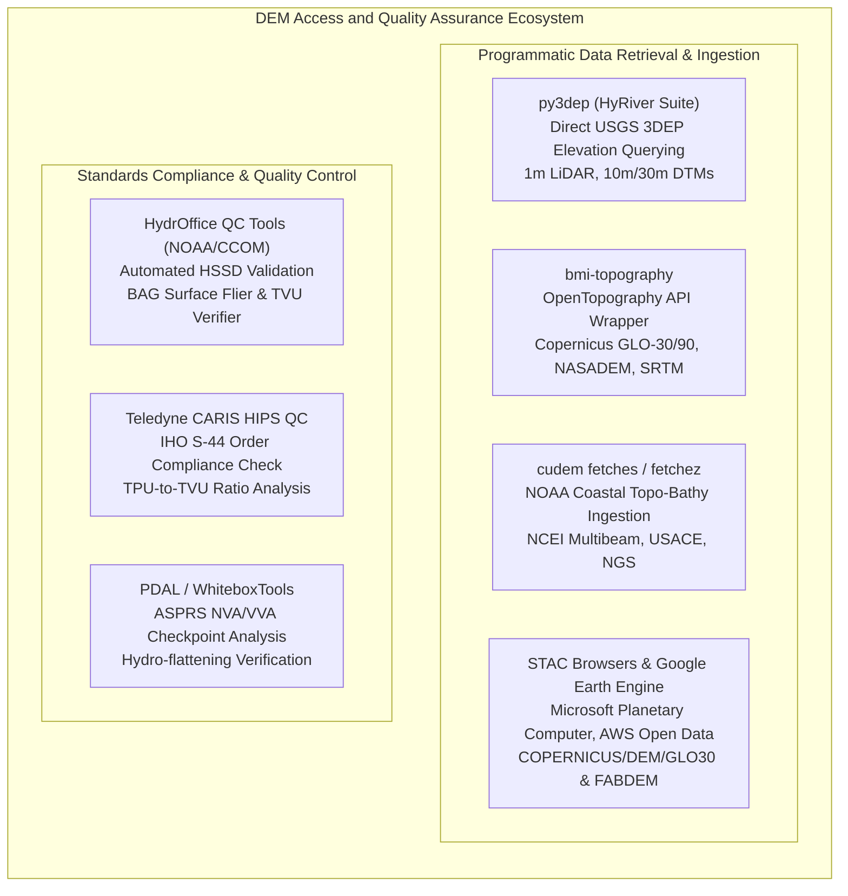

# Chapter 24: Survey Standards, Guide Documents, and Key Public DEM Products

*The official specifications that govern professional elevation and hydrographic surveys, and a critical comparison of the world's major open DEM datasets.*

---

## 24.5 Software Ecosystem

Accessing global and national public DEMs and verifying survey compliance against IHO S-44 or ASPRS standards requires a sophisticated ecosystem of programmatic APIs, cloud-native STAC catalogs, and automated quality-control software. This section details both open-source tools and commercial enterprise suites used to ingest, process, and audit elevation surfaces.



---

### 24.5.1 Open-Source Data Access Tools

#### 1. `py3dep`: Python Interface for USGS 3DEP
Part of the HyRiver geospatial software stack developed by Taher Chegini, `py3dep` provides seamless, cloud-native access to the USGS 3D Elevation Program. It handles coordinate transformations, bounding-box clipping, and multi-resolution fetching from USGS 3DEP AWS Cloud and 3D Elevation Web Coverage Services (WCS).

```python
"""
Fetch USGS 3DEP high-resolution bare-earth DTMs using py3dep.
Demonstrates extracting a 1-meter LiDAR DTM and computing slope/aspect.
"""

import py3dep
import xarray as xr
import matplotlib.pyplot as plt

def retrieve_usgs_elevation(bbox: tuple[float, float, float, float], resolution: int = 1) -> xr.DataArray:
    """
    Retrieves USGS 3DEP elevation raster for a bounding box.
    
    Args:
        bbox: (min_x, min_y, max_x, max_y) in EPSG:4326 (lon/lat).
        resolution: Target cell size in meters (1 for LiDAR, 10 for 1/3-arcsec).
        
    Returns:
        xr.DataArray containing elevation in meters (NAVD88).
    """
    print(f"Querying USGS 3DEP at {resolution}m resolution for bbox: {bbox}")
    
    # py3dep automatically queries the highest-resolution tier available
    dem = py3dep.get_map(
        layers="DEM",
        geometry=bbox,
        resolution=resolution,
        geo_crs="EPSG:4326",
        crs="EPSG:5070"  # Conus Albers Equal Area
    )
    
    print(f"Retrieved raster shape: {dem.shape}, min elevation: {dem.min().values:.2f}m, max: {dem.max().values:.2f}m")
    return dem

# Example bounding box: Boulder Creek Watershed, Colorado
# (min_lon, min_lat, max_lon, max_lat)
boulder_bbox = (-105.28, 40.01, -105.25, 40.03)
# dem_1m = retrieve_usgs_elevation(boulder_bbox, resolution=1)
```

#### 2. `bmi-topography`: OpenTopography API Integration
Developed by Mark Piper and the Community Surface Dynamics Modeling System (CSDMS), `bmi-topography` wraps the OpenTopography REST API into a Basic Model Interface (BMI) standard. It allows automated pulling of global datasets (Copernicus `COP30`/`COP90`, `SRTMGL1`/`SRTMGL3`, `AW3D30`, `NASADEM`, and `USGS1m`/`USGS10m`/`USGS30m`) directly into scientific simulation models. Note that the Click-based CLI uses kebab-case flags (`--dem-type`, `--output-format`, `--cache-dir`), whereas the YAML config and Python `Topography` class use snake_case keys (`dem_type`, `output_format`, `cache_dir`):

```bash
# Fetch Copernicus GLO-30 using the bmi-topography CLI
# Requires OPENTOPOGRAPHY_API_KEY environment variable for restricted/high-rate calls
bmi-topography --dem-type="COP30" \
               --south=36.0 \
               --north=36.2 \
               --west=-112.2 \
               --east=-112.0 \
               --output-format="GTiff" \
               --cache-dir="./ot_cache"
```

#### 3. NOAA CUDEM `fetches` / `fetchez`
The NOAA National Centers for Environmental Information (NCEI) and CIRES developed `fetches` (now also maintained as the standalone `fetchez` ETL package in the `continuous-dems` ecosystem) as the data-discovery engine for CUDEM (`waffles`). It queries dozens of federal and global elevation repositories via `-R xmin/xmax/ymin/ymax` bounding regions:
* `fetchez build -R -71.2/-70.8/42.1/42.4 nos`: Downloads NOAA National Ocean Service hydrographic surveys (`nos` / `hydronos`).
* `fetchez build -R -71.2/-70.8/42.1/42.4 usace`: Fetches U.S. Army Corps of Engineers eHydro channel navigation and dredge surveys.
* `fetchez build -R -71.2/-70.8/42.1/42.4 digital_coast multibeam`: Queries NOAA Digital Coast topo-bathy LiDAR and NCEI multibeam swath tracks.

#### 4. STAC Browsers and Google Earth Engine (GEE)
Modern cloud-native DEM discovery relies on **SpatioTemporal Asset Catalog (STAC)** APIs (such as Microsoft Planetary Computer `pystac-client` for `cop-dem-glo-30` and `3dep-seamless`, or OpenTopography / AWS Open Data Registry endpoints) that allow HTTP Range streaming of specific Cloud-Optimized GeoTIFF (COG) windows without downloading full global archives. For petabyte-scale planetary analysis, Google Earth Engine hosts pre-tiled collections of major public DEMs:
* `COPERNICUS/DEM/GLO30`: Copernicus $30\text{-m}$ global DSM (`DEM` band plus companion water-body mask `WBM`).
* `USGS/3DEP/1m`: Conterminous U.S. $1\text{-meter}$ LiDAR bare-earth elevation collections.
* `JAXA/ALOS/AW3D30/V3_2`: ALOS World 3D DSM version 3.2.
* `projects/sat-io/open-datasets/FABDEM`: Global $30\text{-m}$ bare-earth DTM (Hawker et al.).

```bash
# Mask out satellite-gravity predicted (TID=40) and algorithm-interpolated (TID=41)
# depths in a GEBCO Int16 grid using GDAL, retaining only direct survey cells (TID 10..17).
# Critical: use -32768 (not -9999, which collides with real hadal trench depths in [-10970, -9999] m!)
gdal_calc.py -A GEBCO_2024_elevation.tif -B GEBCO_2024_tid.tif \
             --outfile=GEBCO_2024_direct_only.tif \
             --NoDataValue=-32768 \
             --calc="numpy.where((B >= 10) & (B <= 17), A, -32768)" \
             --co="COMPRESS=ZSTD" --co="TILED=YES"
```

---

### 24.5.2 Quality Control and Standards Compliance Software

#### 1. HydrOffice QC Tools (NOAA OCS / UNH CCOM)
The joint Center for Coastal and Ocean Mapping at the University of New Hampshire (CCOM/JHC) and NOAA OCS develop **QC Tools**, an open-source Python suite that automates the verification of hydrographic data against NOAA HSSD and IHO S-44 standards:
* **The "Flier Finder" Engine:** Evaluates BAG surfaces for high-frequency acoustic noise spikes (isolated multi-meter elevation departures caused by kelp, acoustic side-lobe multipath, or second-bounce reflections).
* **Grid QA / TVU Compliance Tool:** Ingests a Bathymetric Attributed Grid (BAG), extracts the per-node elevation $d$ and Total Propagated Uncertainty $\sigma_z$, and computes the compliance ratio against IHO S-44 orders.

```python
"""
Python verification script evaluating a Bathymetric Attributed Grid (BAG)
against IHO S-44 TVU thresholds across multiple survey orders.
"""

import numpy as np
import h5py

def evaluate_iho_tvu_compliance(
    bag_path: str, order: str = "Special", uncertainty_is_1sigma: bool = False
) -> dict:
    """
    Evaluates hydrographic surface compliance against IHO S-44 TVU limits.
    
    Args:
        bag_path: Path to the HDF5 Bathymetric Attributed Grid (.bag).
        order: Target IHO S-44 Order ('Exclusive', 'Special', 'Order1a', 'Order2').
        uncertainty_is_1sigma: Set True if /BAG_root/uncertainty stores 1-sigma std dev
            (e.g., rawStdDev/CUBEStdDev) rather than 95% TVU (NOAA HSSD productUncert).
        
    Returns:
        Dictionary of compliance metrics (fraction passing, worst outliers).
    """
    # Define S-44 TVU parameters (a, b) at 95% confidence
    s44_params = {
        "Exclusive": (0.15, 0.0075),
        "Special":   (0.25, 0.0075),
        "Order1a":   (0.50, 0.0130),
        "Order2":    (1.00, 0.0230)
    }
    
    if order not in s44_params:
        raise ValueError(f"Unknown IHO Order: {order}")
        
    a, b = s44_params[order]
    
    with h5py.File(bag_path, "r") as bag:
        # BAG stores elevation z as positive-up (z < 0 below datum, z > 0 for drying heights)
        elev_z = bag["/BAG_root/elevation"][:]
        uncert_raw = bag["/BAG_root/uncertainty"][:]
        
    # Mask out null / unobserved cells (ONS BAG standard NoData sentinel is 1,000,000.0)
    valid_mask = (
        (elev_z < 999999.0)
        & (uncert_raw < 999999.0)
        & np.isfinite(elev_z)
        & np.isfinite(uncert_raw)
    )
    
    # Convert positive-up elevation z to positive-down water depth d (clamp drying heights z > 0 to d = 0)
    valid_depth = np.maximum(0.0, -elev_z[valid_mask])
    valid_uncert = uncert_raw[valid_mask]
    
    # Scale to 95% confidence level only if the BAG stores 1-sigma standard deviation
    modeled_tvu_95 = (1.9600 * valid_uncert) if uncertainty_is_1sigma else valid_uncert
    
    # Compute maximum allowable TVU under IHO S-44
    allowable_tvu_95 = np.sqrt(a**2 + (b * valid_depth)**2)
    
    # Compute compliance ratio: Ratio <= 1.0 means compliant
    compliance_ratio = modeled_tvu_95 / allowable_tvu_95
    passing_cells = np.sum(compliance_ratio <= 1.0)
    total_valid = len(valid_depth)
    percent_compliant = (passing_cells / total_valid) * 100.0
    
    results = {
        "order_tested": order,
        "total_nodes": total_valid,
        "nodes_passing": int(passing_cells),
        "percent_compliant": percent_compliant,
        "hssd_pass": percent_compliant >= 95.0,  # NOAA HSSD mandates >= 95% pass rate
        "mean_ratio": float(np.mean(compliance_ratio)),
        "max_ratio": float(np.max(compliance_ratio))
    }
    
    print(f"--- IHO S-44 Compliance Report: {order} Order ---")
    print(f"Total Valid Nodes: {results['total_nodes']:,}")
    print(f"Compliant Nodes:   {results['nodes_passing']:,} ({results['percent_compliant']:.2f}%)")
    print(f"NOAA HSSD Status:  {'PASS' if results['hssd_pass'] else 'FAIL (Requires Remediation)'}")
    print(f"Mean TVU Ratio:    {results['mean_ratio']:.3f} (Values <= 1.0 meet spec)")
    print(f"Max TVU Ratio:     {results['max_ratio']:.3f}")
    
    return results
```

#### 2. ASPRS Checkpoint Verification Workflow (NVA, VVA, and Skewness Audit)
On land, open-source validation scripts (using `scipy.stats` and `numpy`, or PDAL / WhiteboxTools checkpoint extraction) must evaluate both parametric $\text{RMSE}_z$ / NVA and non-parametric VVA quantiles alongside skewness diagnostics:

```python
"""
Audit terrestrial DEM checkpoints under ASPRS Edition 1 (2015) and Edition 2 (2023/2024).
Computes bias, RMSE_z, skewness, Edition 1 NVA/VVA, and Edition 2 checkpoint sufficiency.
"""

import numpy as np
from scipy.stats import skew, kurtosis


def audit_asprs_checkpoints(
    dz_nva: np.ndarray,
    dz_vva: np.ndarray,
    survey_rmse: float = 0.02,
    project_area_km2: float = 400.0,
) -> dict:
    """Evaluate NVA and VVA error distributions against ASPRS thresholds."""
    # ASPRS Ed. 2 minimum: 30 checkpoints up to 1,000 km2, +10 per 1,000 km2 (cap 120)
    min_cp_ed2 = min(120, 30 + max(0, int(np.ceil((project_area_km2 - 1000.0) / 1000.0))) * 10)

    bias_nva = float(np.mean(dz_nva))
    rmse_nva = float(np.sqrt(np.mean(dz_nva**2)))
    skew_nva = float(skew(dz_nva, bias=False))
    nva_ed1_95 = 1.9600 * rmse_nva
    nva_empirical_95 = float(np.percentile(np.abs(dz_nva), 95))

    # Account for survey checkpoint error when checking Edition 2 error budget
    rmse_dem_only = float(np.sqrt(max(0.0, rmse_nva**2 - survey_rmse**2)))

    vva_95 = float(np.percentile(np.abs(dz_vva), 95))
    skew_vva = float(skew(dz_vva, bias=False))
    kurt_vva = float(kurtosis(dz_vva, bias=False))

    return {
        "n_nva": len(dz_nva),
        "n_vva": len(dz_vva),
        "ed2_min_required": min_cp_ed2,
        "ed2_sample_ok": (len(dz_nva) >= min_cp_ed2) and (len(dz_vva) >= min_cp_ed2),
        "nva_bias_m": bias_nva,
        "nva_rmse_m": rmse_nva,
        "nva_dem_only_rmse_m": rmse_dem_only,
        "nva_skewness": skew_nva,
        "nva_ed1_95_m": nva_ed1_95,
        "nva_empirical_95_m": nva_empirical_95,
        "vva_95th_pct_m": vva_95,
        "vva_skewness": skew_vva,
        "vva_excess_kurtosis": kurt_vva,
    }
```

#### 3. Commercial QC Suites: CARIS HIPS and Esri Living Atlas
* **Teledyne CARIS HIPS and SIPS:** The commercial standard for hydrographic data processing. Its built-in IHO S-44 QC module generates spatial color-coded compliance surfaces directly inside the CARIS Bathy DataBASE, highlighting sub-standard nodes where excessive vessel heave, high ship speeds, or poor GPS DOP breached Order 1a or Special Order thresholds.
* **Esri ArcGIS Living Atlas of the World:** Hosts dynamic multi-directional hillshades and elevation layers combining 3DEP, Copernicus GLO-30, and GEBCO. While convenient for rapid web visualization, GIS analysts must be cautious: Esri's dynamic image services employ bilinear or cubic resampling across pyramid levels, which can artificially smooth out extreme elevation peaks and navigation hazards during zooming.
