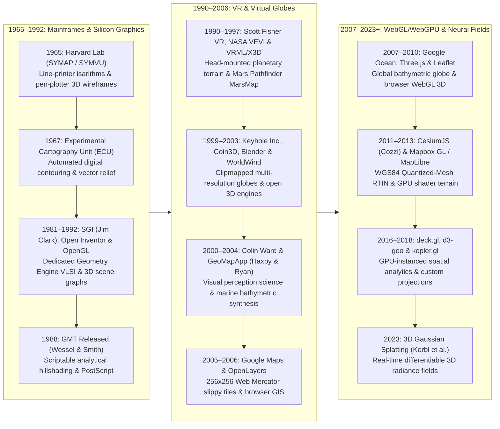

# Chapter 25: Deep Dive into Visualization of DEMs

*How human visual perception, colormaps, shading physics, 3D graphics engines, and 3D Gaussian Splats reveal—or distort—terrain and uncertainty.*

---

## 25.5 Historical Evolution: From Pen Plotters to 3D Gaussian Splats

The visualization of digital terrain is an unbroken six-decade arc spanning mainframe pen plotters, specialized silicon graphics workstations, virtual globes, browser-based WebGL engines, and differentiable radiance fields. The milestones below, anchored in the `schwehr/gis-history` repository, trace how computational graphics transformed static elevation matrices into interactive, immersive representations of the planet.

---

### 25.5.1 The Mainframe and Dedicated Silicon Era: 1965 to 1992

#### 1965: Harvard Lab for Computer Graphics (SYMAP and SYMVU)
Under the leadership of Howard Fisher at the Harvard Laboratory for Computer Graphics and Spatial Analysis, researchers created **SYMAP** (Synagraphic Mapping System). SYMAP generated the world's first digital isarithmic and choropleth elevation maps by overstriking characters on standard IBM 1403 line printers to create gray tonal shades (and incorporated Donald Shepard's classic 1968 inverse-distance-weighting interpolation algorithm).

In 1968–1969, Frank J. Rens (with colleagues at the Harvard Lab) developed **SYMVU**, which parsed grid matrices to draw 3D perspective terrain wireframes on mechanical CalComp pen plotters. For the first time, geographers could view a digital elevation grid from arbitrary azimuths and elevation angles without carving physical clay or plaster relief models.

#### 1967: The Experimental Cartography Unit (ECU, London)
Founded by David Bickmore at the Royal College of Art in London, the ECU pioneered high-precision automated cartography. Working with Ferranti flatbed plotters, the ECU generated the first digitally contoured and shaded relief maps directly from stereoplotter digital elevation strings.

#### 1981–1992: Silicon Graphics (SGI) and the OpenGL Revolution
In 1981, Jim Clark and colleagues from Stanford University founded **Silicon Graphics, Inc. (SGI)**. Clark invented the **Geometry Engine**—a custom VLSI chip dedicated exclusively to 3D geometric matrix transformations, clipping, and perspective division. SGI workstations (IRIS, Indigo, Onyx) dominated computer graphics for two decades.

* **1989: SGI Open Inventor:** Rikk Carey and Paul Strauss developed an object-oriented 3D scene graph library in C++. It introduced hierarchical nodes, camera projections, light sources, and materials, defining the architectural pattern that governs modern 3D engines.
* **1992: OpenGL 1.0:** SGI released the open, vendor-neutral OpenGL specification, abstracting hardware acceleration across Unix, Windows, and Macintosh platforms. Every modern GIS rendering engine (from QGIS 3D to CesiumJS) traces its graphics pipeline lineage to OpenGL.

#### 1988: Generic Mapping Tools (GMT)
Paul Wessel and Walter H. F. Smith released **GMT**. Scriptable on Unix command lines, GMT introduced the first open-source implementation of analytical shaded relief (`grdgradient` and `grdimage`) and continuous-curvature tension splines (`surface`), establishing the publication cartography standard for global marine and solid-earth geophysics.

---

### 25.5.2 Virtual Reality and the Birth of Virtual Globes: 1990 to 2006

#### 1990–1997: Scott Fisher VR, NASA Ames VEVI, VRML/X3D, and Ames Viz
* **1990: Scott Fisher & Virtual Environments:** Following foundational head-mounted display work at NASA Ames, Scott Fisher popularized telepresence and spatial virtual environments (including his influential 1990 *Scientific American* Virtual Reality publication), establishing stereoscopic depth cues for terrain exploration.
* **1993: NASA Ames VEVI (Virtual Environment Vehicle Interface):** Developed by the Intelligent Mechanisms Group at NASA Ames Research Center, **VEVI** ingested stereo photogrammetric and sonar DEMs to steer teleoperated robots in hostile terrain—including the Antarctic Telepresence Remotely Operated Vehicle (TROV) beneath McMurdo Sound sea ice (1993) and CMU's Dante II volcanic crater robot inside Mt. Spurr (1994).
* **1997: VRML 2.0 / X3D and NASA Ames Viz:** The Virtual Reality Modeling Language (VRML) and its ISO successor **X3D** brought declarative `ElevationGrid` terrain meshes to early web browsers. That same year, **NASA Ames Viz** (MarsMap) transformed Mars Pathfinder stereo lander imagery into interactive 3D terrain models for mission science planning.

#### 1999–2003: Keyhole, Coin3D, Blender, and NASA WorldWind
* **1999–2001: Keyhole Inc. and EarthViewer:** Founded by John Hanke, Mark Aubin, and Brian McClendon, **Keyhole Inc.** solved the fundamental barrier of 3D planetary rendering using SGI's **Clipmapping** algorithm (Tanner et al. 1998) to stream hierarchical elevation and imagery pyramids over narrowband connections. Released as **EarthViewer 1.0** in 2001, it reached global audiences during 2003 broadcasts and was acquired by Google in 2004 to become **Google Earth**.
* **2000: Colin Ware and Coin3D:** Colin Ware published the 1st Edition of *Information Visualization: Perception for Design* (followed by *Visual Thinking for Design* in 2008), bridging visual neurobiology and terrain cartography. That same year, Systems in Motion released **Coin3D**, an open-source C++ implementation of the Open Inventor scene graph used inside CAD and scientific terrain viewers.
* **2002–2003: Open-Source Blender and NASA WorldWind:** Originally created in 1994, **Blender** was released as free open-source GPL software in 2002, eventually powering photorealistic Cycles path-traced DEM renders (`BlenderGIS`). In 2003, **NASA WorldWind** debuted as an early open-source 3D virtual globe streaming SRTM and Landsat imagery.

#### 2004–2006: GeoMapApp and the AGU Virtual Globes Era
* **2004: GeoMapApp:** William (Bill) F. Haxby and William B. F. Ryan at Lamont-Doherty Earth Observatory released **GeoMapApp**, bringing interactive multibeam and satellite-gravity bathymetric exploration to researchers with Haxby's iconic pastel marine palette.
* **2006: Fall AGU Virtual Globes Session:** Organized by John Bailey at the 2006 American Geophysical Union Fall Meeting, the Virtual Globes session catalyzed scientific adoption of KML, Google Earth, and WorldWind for 3D DEM dissemination.

---

### 25.5.3 The Web Browser and WebGL Revolution: 2005 to 2018

#### 2005–2009: Google Maps, OpenLayers, Google Earth, and Google Ocean
* **2005–2006: Slippy Tiles & OpenLayers:** Google Maps launched in February 2005, popularizing the **Web Mercator (EPSG:3857)** $256 \times 256$ "slippy tile" quadtree ($z/x/y$), followed in 2006 by **OpenLayers** as the foundational open-source JavaScript slippy-map library.
* **2007–2009: Google Earth & Google Ocean:** Google Earth expanded across platforms in 2007, and in February 2009 Google Earth 5.0 launched **Google Ocean**, integrating Smith & Sandwell marine bathymetry alongside global multibeam cruises and submersible dive tracks. That same year, SGI filed for Chapter 11 bankruptcy, marking the complete shift from proprietary graphics workstations to commodity GPUs.

#### 2010–2018: Three.js, Leaflet, CesiumJS, MapLibre, `d3-geo`, and `deck.gl`
* **2010: Three.js and Leaflet:** Ricardo Cabello (`mrdoob`) released **Three.js** for browser WebGL 3D scene graphs without plugins, while Vladimir Agafonkin launched **Leaflet** for lightweight mobile-ready slippy maps.
* **2011: CesiumJS:** Patrick Cozzi and AGI created CesiumJS, the open-source WebGL virtual globe that introduced **Quantized-Mesh** terrain streaming and **OGC 3D Tiles**.
* **2013: Mapbox GL JS / MapLibre GL JS:** Replaced static raster hillshade tiles with GPU-rendered vector tiles and floating-point **Terrain-RGB** rasters for 60 fps client-side dynamic shading and elevation profiling.
* **2016–2018: `d3-geo`, `deck.gl`, and `kepler.gl`:** Mike Bostock's **`d3-geo`** (2016) brought exact spherical adaptive resampling and cartographic projections to SVG/Canvas web maps, while Uber's **`deck.gl`** (2016) and **`kepler.gl`** (2018) harnessed WebGL2/WebGPU shaders to render tens of millions of 3D elevation points and terrain meshes interactively.

---

### 25.5.4 The Differentiable Radiance Era: 2023+

#### 2023: 3D Gaussian Splatting (3DGS)
In July 2023, Bernhard Kerbl, Georgios Kopanas, Thomas Leimkühler, and George Drettakis published *3D Gaussian Splatting for Real-Time Radiance Field Rendering* at ACM SIGGRAPH. By representing physical scenes as millions of parameterized 3D ellipsoids optimized via differentiable rasterization, 3DGS shattered the speed and resolution limits of Neural Radiance Fields (NeRFs).

For the first time in GIS history, non-2.5D topography—vertical sea cliffs, natural arches, overhanging rock faces, and urban infrastructure—can be rendered with photorealistic view-dependent fidelity at over $100\text{ fps}$. The subsequent development of **2DGS** and **SuGaR** in 2024 bridged the gap between photorealistic graphics and rigorous geodetic elevation modeling, allowing surveyors to extract metrically accurate bare-earth DEMs from dense multi-view image radiance fields.

| Era & Years | Representative Platforms | Underlying Graphics Architecture | Primary Terrain Representation & Frame Rate |
| :--- | :--- | :--- | :--- |
| **1. Mainframe & Workstation (1965–1992)** | SYMAP, SYMVU, ECU, SGI IRIS, GMT, Open Inventor | Batch CPU line printers/plotters $\to$ SGI Geometry Engine VLSI & OpenGL 1.0 | Overstruck ASCII grids, isometric pen-plotter wireframes, PostScript analytical hillshades (static to $\sim 5\text{–}15\text{ fps}$) |
| **2. Early VR & Virtual Globes (1990–2006)** | NASA VEVI, VRML/X3D, Keyhole EarthViewer, Coin3D, WorldWind, GeoMapApp | Fixed-function GPU hardware clipmapping & hierarchical quadtree LOD streaming | Multi-resolution elevation pyramids & textured TIN tiles ($\sim 15\text{–}30\text{ fps}$) |
| **3. Browser WebGL & Shaders (2005–2022)** | Google Maps/Earth/Ocean, Three.js, CesiumJS, MapLibre GL, `deck.gl` | Programmable WebGL2 / WebGPU vertex & fragment shaders in browser sandboxes | `Terrain-RGB` heightmaps, `Quantized-Mesh` RTINs, OGC 3D Tiles ($60\text{ fps}$) |
| **4. Differentiable Radiance Fields (2023+)** | 3DGS (Kerbl et al.), 2DGS (Huang et al.), SuGaR (Guédon & Lepetit) | Tile-based CUDA / WebGPU differentiable alpha-composited splat rasterizers | Anisotropic 3D Gaussian ellipsoids & oriented 2D surfels capturing full 3D overhangs ($>100\text{ fps}$) |
