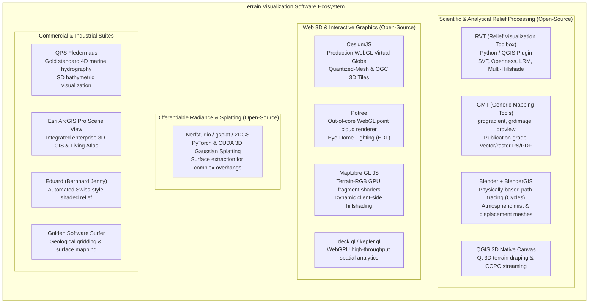

# Chapter 25: Deep Dive into Visualization of DEMs

*How human visual perception, colormaps, shading physics, 3D graphics engines, and 3D Gaussian Splats reveal—or distort—terrain and uncertainty.*

---

## 25.7 Software Ecosystem

The software ecosystem for digital terrain visualization ranges from scriptable command-line utilities and scientific Python libraries to photorealistic 3D ray-tracers, browser-based WebGL globes, and CUDA-accelerated Gaussian splatting engines. This section reviews the primary open-source and commercial platforms used to process, render, and publish elevation surfaces.



---

### 25.7.1 Open-Source Analytical and Scientific Tools

#### 1. Relief Visualization Toolbox (RVT)
Developed by Žiga Kokalj, Klemen Zakšek, and Peter Pehani at the Research Centre of the Slovenian Academy of Sciences and Arts (ZRC SAZU), **RVT** is the premier scientific library for advanced terrain visualization. Available as a standalone GUI, a QGIS plugin, and an open-source Python library (`rvt-py`), RVT provides optimized NumPy/C++ implementations of:
* Analytical Hillshading (single and multi-directional).
* Sky-View Factor (SVF) and Anisotropic SVF.
* Positive and Negative Openness.
* Local Relief Models (LRM).
* Simple Local Relief Model (SLRM).
* Sky-illumination models and shadow analysis.

```python
"""
Compute Sky-View Factor (SVF) and Multi-Directional Hillshade
using the open-source Relief Visualization Toolbox (rvt-py).
"""

import rvt.vis
import rasterio

def generate_enhanced_terrain_layers(input_dem_path: str, output_svf_path: str, output_hillshade_path: str):
    """
    Computes SVF and multi-directional hillshade from a high-resolution DEM raster.
    
    Args:
        input_dem_path: Path to input GeoTIFF elevation raster.
        output_svf_path: Path to save 32-bit Sky-View Factor GeoTIFF.
        output_hillshade_path: Path to save multi-directional hillshade GeoTIFF.
    """
    with rasterio.open(input_dem_path) as src:
        dem_arr = src.read(1).astype("float32")
        profile = src.profile.copy()
        res_x, res_y = src.res  # Positive pixel dimensions (x, y) from affine transform
        nodata_val = src.nodata
        
    res = (res_x + res_y) / 2.0
    print(f"Loaded DEM: {dem_arr.shape}, nominal resolution: {res:.2f}m")
    
    # 1. Compute Sky-View Factor (radius = 10 cells, 16 search directions)
    #    Pass no_data=nodata_val so -9999 border pixels do not create 10 km horizon cliffs!
    print("Computing Sky-View Factor (16 directions, search radius 10 cells)...")
    svf_dict = rvt.vis.sky_view_factor(
        dem=dem_arr,
        resolution=res,
        compute_svf=True,
        compute_asvf=False,
        compute_opns=False,
        svf_n_dir=16,
        svf_r_max=10,
        svf_noise=1,
        no_data=nodata_val,
    )
    svf_arr = svf_dict["svf"]
    
    # 2. Compute Multi-Directional Hillshade (16 directions, sun altitude 35 deg)
    #    Note: rvt.vis.multi_hillshade returns shape (nr_directions, rows, cols)!
    print("Computing Multi-Directional Hillshade...")
    multi_hs_stack = rvt.vis.multi_hillshade(
        dem=dem_arr,
        resolution_x=res_x,
        resolution_y=res_y,
        nr_directions=16,
        sun_elevation=35,
        no_data=nodata_val,
    )
    
    # Export SVF (1-band) and Multi-Directional Hillshade composite (mean across directions)
    svf_profile = profile.copy()
    svf_profile.update(dtype=rasterio.float32, count=1)
    with rasterio.open(output_svf_path, "w", **svf_profile) as dst:
        dst.write(svf_arr.astype(rasterio.float32), 1)
        
    multi_hs_mean = multi_hs_stack.mean(axis=0).astype("float32")
    with rasterio.open(output_hillshade_path, "w", **svf_profile) as dst:
        dst.write(multi_hs_mean, 1)
        
    print(f"Successfully exported:\n  - SVF: {output_svf_path}\n  - Hillshade: {output_hillshade_path}")
```

#### 2. The Generic Mapping Tools (GMT)
GMT remains the gold standard for publication-grade static figures in earth science journals (Nature, JGR, GRL, Science).
* `gmt grdgradient dem.nc -A315 -Ne0.8 -Ggradient.nc`: Computes directional derivatives normalized to a cumulative Laplace distribution for high dynamic-range hillshading.
* `gmt grdimage dem.nc -Igradient.nc -Cbatlow -JM15c -Baf -P > map.ps`: Drapes a perceptually uniform colormap over shaded relief with sub-pixel antialiasing.
* `gmt grdview dem.nc -Igradient.nc -Cbatlow -JZ3c -p135/30 -Qs > 3d_mesh.ps`: Generates 3D perspective surface meshes with full vector hidden-line removal.

#### 3. Blender (`BlenderGIS`) and QGIS 3D Native Canvas
* **Blender and `BlenderGIS`:** For cinematic scientific communication and high-end cartography, the open-source 3D package **Blender** paired with the **`BlenderGIS`** addon imports georeferenced GeoTIFF elevation grids and vector overlays directly into metric scene coordinates. Analysts drive dynamic micro-displacement modifier meshes through the **Cycles** physically-based path-tracing engine to simulate atmospheric Rayleigh scattering, soft topographic shadows, volumetric mist, and water specular reflections.
* **QGIS 3D Canvas & COPC Streaming:** Modern QGIS integrates a native Qt 3D canvas supporting direct streaming of Cloud-Optimized Point Clouds (COPC) with hardware Eye-Dome Lighting, real-time DEM elevation profiles, multi-band draping, and on-the-fly terrain hillshade/slope blend modes (`Multiply` hillshade over `cmocean`/`batlow` hypsometry) without generating intermediate image files.

---

### 25.7.2 Open-Source WebGL and Real-Time Interactive Engines

#### 1. CesiumJS and OGC 3D Tiles
The standard for browser-based 3D virtual globes. Provides native support for **Quantized-Mesh** terrain streaming (`CesiumTerrainProvider`) and **OGC 3D Tiles 1.1** (glTF 2.0 payloads). Features real-time sun position calculation based on UTC date/time, atmospheric scattering fog, dynamic terrain vertical exaggeration (`scene.verticalExaggeration`), and terrain-clamped vector draping.

#### 2. Potree and COPC Viewers
An open-source WebGL point cloud renderer developed by Markus Schütz at TU Wien:
* Streams billions of LiDAR points over HTTP Range requests using an out-of-core octree hierarchy (paired with `Entwine` / `COPC` or `PotreeConverter`).
* Uses hardware-accelerated **Eye-Dome Lighting (EDL)** to render dense point clouds with high-contrast structural relief without generating surface normals (`viewer.setEDLEnabled(true)`).
* Supports client-side cross-sectional elevation profiling, point classification filtering (ASPRS Class 2 Ground vs. Class 5 High Vegetation), and 3D measurement.

#### 3. MapLibre GL JS, Three.js, `deck.gl`, and `d3-geo`
* **MapLibre GL JS:** The community-led fork of Mapbox GL JS. Supports GPU-based **Terrain-RGB** and **Terrarium** slippy tiles (easily built from GeoTIFFs using open-source `rio-rgbify` or GDAL pipelines), executing fragment shaders on client GPUs for interactive 60 fps hillshading, sun azimuth/altitude sliders, and dynamic elevation contours.
* **Three.js & `deck.gl` / `kepler.gl`:** Provide custom WebGL/WebGPU terrain mesh pipelines (`TerrainLayer` in `deck.gl` using `MARTINI` RTIN tessellation to convert Terrain-RGB/Terrarium rasters into adaptive 3D meshes in browser memory) capable of rendering tens of millions of spatial points and dynamic flood surfaces simultaneously.
* **`d3-geo`:** Provides exact spherical adaptive resampling (`d3.geoPath`) and specialized cartographic projections (Equal Earth, Albers, Stereographic) for interactive browser-based contour and hillshade SVG/Canvas graphics.

```bash
# 1. Convert a Float32 GeoTIFF DEM into Mapbox Terrain-RGB PNG slippy tiles (z6-z14)
#    using rio-rgbify (Rasterio plugin) for client-side MapLibre GL JS 3D shading
rio rgbify -b -10000 -i 0.1 --min-z 6 --max-z 14 \
           input_dem_3857.tif terrain_rgb_tiles.mbtiles

# 2. Index a large LAS/LAZ point cloud into a Potree octree with COPC compatibility
#    or convert directly into a single-file COPC archive via PDAL for web streaming
pdal translate raw_lidar.laz site_cloud.copc.laz
```

#### 4. Nerfstudio, `gsplat`, and 2DGS
Open-source research toolchains (developed by UC Berkeley, INRIA, and the graphics research community) for training and rendering 3D Gaussian Splats:
* `gsplat`: A highly optimized, differentiable CUDA/PyTorch rasterization library for Gaussian splatting, integrated inside **Nerfstudio** (`ns-train splatfacto`) for rapid scene optimization from COLMAP camera poses.
* `2DGS` (2D Gaussian Splatting): Explicitly designed to constrain Gaussian ellipsoids to flat 2D surfels with normal consistency and depth distortion regularization, enabling geometrically valid TSDF fusion / Poisson surface reconstruction and bare-earth DEM extraction across overhanging sea cliffs and rock arches.

---

### 25.7.3 Commercial and Industrial Visualization Suites

#### 1. QPS Fledermaus
Developed by Quality Positioning Services (QPS), **Fledermaus** is the unchallenged industry standard for marine hydrographic visualization:
* Built upon the proprietary **SD (Spatial Data)** file format, which enables real-time 4D exploration of massive multibeam bathymetry, water column acoustic backscatter, and sub-bottom profiler seismic horizons.
* Provides real-time dynamic vertical exaggeration, custom bathymetric palettes (including Haxby), and interactive flight-path recording for deep-ocean ROV dive debriefs.

#### 2. Esri ArcGIS Pro Scene View
Esri's flagship desktop 3D visualization environment:
* Renders global and local scenes using Esri's World Elevation Service (combining 3DEP, Copernicus GLO-30, and GEBCO) and native `SLPK` Scene Layer Packages / I3S point clouds.
* Seamlessly integrates BIM (Revit/IFC) models, textured multipatch buildings, subsurface voxel/geological strata, and interactive line-of-sight / viewshed visibility domes.

#### 3. Eduard (Swiss-Style Shaded Relief) and Golden Software Surfer
* **Eduard:** Developed by Bernhard Jenny (Monash University / Oregon State University), **Eduard** is a specialized desktop application that uses neural relief-shading models to automate classic Swiss-style relief shading—locally adjusting illumination direction along mountain ridgelines, applying multi-scale aerial perspective, and desaturating valley haze while keeping major landforms crisp.
* **Golden Software Surfer:** Widely used in mining, geotechnical engineering, and environmental remediation for rapid 2D/3D surface contouring, Kriging variogram modeling, wireframe overlays, watershed volume reporting, and borehole stratigraphy visualization.

| Software Tool | License / Access | Primary Visualization Niche | Key Strength |
| :--- | :--- | :--- | :--- |
| **`rvt-py` / RVT** | Open-Source (Apache 2.0) | Archaeological & fault micro-relief | SVF, Openness, LRM, Multi-Hillshade |
| **GMT / PyGMT** | Open-Source (LGPL/BSD) | Publication-grade figures & cartography | Exact projections, `batlow`/`cmocean` CPTs |
| **QGIS 3D & BlenderGIS** | Open-Source (GPL) | Interactive 3D & path-traced rendering | COPC EDL streaming & atmospheric Cycles |
| **CesiumJS / MapLibre / Potree** | Open-Source (Apache/BSD) | Browser 3D virtual globes & point clouds | Quantized-Mesh, Terrain-RGB, EDL |
| **`gsplat` / 2DGS** | Open-Source (Apache/MIT) | Complex overhangs & radiance meshes | Real-time $>100\text{ fps}$ splatting & surfels |
| **QPS Fledermaus / Eduard / Surfer** | Commercial | Hydrography / Swiss relief / Geotech | 4D SD volumes, Swiss shading, variograms |
