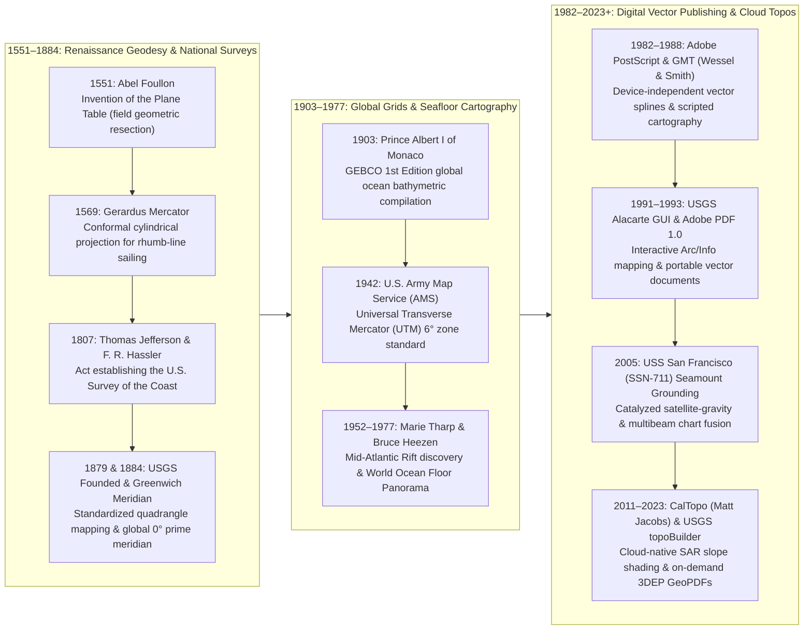

# Chapter 26: Navigating, Charting, Topographic Maps, and Cartographic Production

*Turning elevation models into operational navigation systems, official nautical charts, and publication-grade topographic maps.*

---

## 26.4 Historical Evolution: From Plane Tables to CalTopo

The history of navigating and mapping from elevation models is written in the instruments of field topographers, the mathematical projections of navigators, and the catastrophic accidents that exposed gaps in public charts. The milestones below, anchored in the `schwehr/gis-history` repository, trace the lineage of topographic mapping and hydrographic charting from Renaissance surveying tables to cloud-native backcountry tools.

---

### 26.4.1 The Renaissance and Nautical Geodesy: 1551 to 1807

#### 1551: Abel Foullon and the Plane Table
French engineer Abel Foullon described the **plane table** (*L'holomètre*, earliest mention 1551; published in *Usage et description de l'holomètre*, Paris, 1555). By mounting a leveling drafting board on a tripod equipped with a rotating sight-rule (alidade), surveyors could perform graphic geometric resection and triangulation directly in the field. Sighting distant mountain peaks and plotting intersection rays eliminated laborious manual trigonometry, enabling field topographers to hand-sketch terrain relief and contours directly onto paper sheets for nearly four centuries.

#### 1569: Gerardus Mercator's Conformal Cylindrical Projection
Flemish geographer Gerardus Mercator published his 1569 world nautical map, *Nova et Aucta Orbis Terrae Descriptio ad Usum Navigantium Emendata*. Mercator mathematically stretched the spacing of latitude parallels proportionally to $\sec\varphi$ (integrating $\sec\varphi\,d\varphi = \ln\tan(\frac{\pi}{4} + \frac{\varphi}{2})$), ensuring that lines of constant compass bearing (rhumb lines or loxodromes) plot as straight lines. For five centuries, Mercator's projection has governed marine navigation and modern web slippy maps (EPSG:3857).

#### 1807: Foundation of the Survey of the Coast
On February 10, 1807, President Thomas Jefferson signed an Act of Congress authorizing a survey of the coasts of the United States. Under Swiss geodesist Ferdinand Rudolph Hassler, the **Survey of the Coast** (later the U.S. Coast and Geodetic Survey, and today NOAA OCS and NGS) established the nation's primary geodetic triangulation networks and standardized coastal charting, ensuring that shipping channels and coastal topography were rigorously tied to astronomical coordinates.

---

### 26.4.2 Institutional Cartography and Military Grids: 1879 to 1942

#### 1879: USGS and 1884 International Meridian Conference
* **1879:** On March 3, 1879, Congress established the **U.S. Geological Survey (USGS)** under Clarence King, consolidating western surveys and launching systematic topographic quadrangle mapping across North America (culminating in the $7.5\text{-minute}$, $1:24,000$ standard begun in 1947).
* **1884:** Delegates (41 representatives from 25 nations) convened at the **International Meridian Conference in Washington, D.C.**, voting to adopt the Royal Observatory at Greenwich, London, as the universal Prime Meridian ($0^\circ$ longitude) and establishing the universal 24-hour solar day. Prior to 1884, hydrographic charts referenced competing national prime meridians (Paris, Washington, Ferro, Cadiz), creating catastrophic longitudinal offsets when mariners switched between national chart folios.

#### 1903: GEBCO Initiation
Convened in 1903 by Prince Albert I of Monaco (with the first 24-sheet edition printed in 1905), the **General Bathymetric Chart of the Oceans (GEBCO)** created the first international compilation of ocean-floor contours and discrete soundings under standardized color tints and metric/fathom conventions.

#### 1942: Universal Transverse Mercator (UTM) Standard
During World War II, artillery and amphibious units suffered severe targeting errors because Allied forces operated across incompatible local conic grids and national ellipsoids. Beginning in 1942, the **U.S. Army** / **Army Map Service (AMS)** standardized the **Universal Transverse Mercator (UTM)** grid:
* Divided the Earth between $80^\circ\text{S}$ and $84^\circ\text{N}$ into 60 uniform $6^\circ$ longitudinal zones.
* Applied a central scale reduction factor $k_0 = 0.9996$ to limit horizontal scale distortion to roughly $1$ part in $2,500$ across each zone.
* Paired UTM with the **Military Grid Reference System (MGRS)**, enabling field teams and aircraft to transmit compact, unambiguous metric coordinate fixes across tactical radio.

---

### 26.4.3 The Seafloor Revolution and Digital Typography: 1952 to 1993

#### 1952–1977: Marie Tharp and the Discovery of the Mid-Atlantic Rift
At Columbia University's Lamont Geological Observatory, cartographer **Marie Tharp** and oceanographer Bruce Heezen faced thousands of analog single-beam paper echograms collected by research vessels.
* Because women were barred from sailing aboard Lamont research vessels at the time, Tharp worked ashore, painstakingly plotting bathymetric sounding profiles across the Atlantic Ocean.
* In 1952, Tharp discovered a continuous, V-shaped axial rift valley running down the crest of the Mid-Atlantic Ridge—visually corroborated in her landmark 1957 North Atlantic physiographic diagram. When Bruce Heezen cross-referenced her profiles against submarine earthquake epicenters, the coincidence revealed an active mid-ocean spreading rift.
* Collaborating with Austrian landscape painter Heinrich Berann, Tharp published the **1977 World Ocean Floor Panorama**, visually proving plate tectonics and seafloor spreading to both scientists and the general public.

#### 1982–1993: Adobe PostScript, GMT, USGS Alacarte, and PDF
* **1982: PostScript:** John Warnock and Charles Geschke founded Adobe Systems and created **PostScript**, a Turing-complete, device-independent vector page description language. PostScript allowed mathematical representation of cubic Bézier contour splines, line dashing, text halos, and affine coordinate transformations, liberating cartographers from manual copperplate engraving and peel-coat scribing.
* **1988: Generic Mapping Tools (GMT):** Paul Wessel and Walter H. F. Smith leveraged PostScript to create GMT, allowing geoscientists to write reproducible shell pipelines that generated camera-ready shaded relief maps, Mercator scale bars, and contoured bathymetry directly from gridded matrices.
* **1991: USGS Alacarte:** Developed at USGS Menlo Park, **Alacarte** became the first graphical user interface (GUI) front end for Esri's command-line Arc/Info GIS, lowering the barrier for field geologists and cartographers to edit digital elevation contours, hillshades, and vector overlays interactively.
* **1993: Portable Document Format (PDF):** Adobe released PDF 1.0. Decades later, the addition of OGC/Adobe geospatial coordinate tags (**GeoPDF**) enabled USGS *US Topo* quadrangles to be distributed as self-contained, multi-layer vector/raster digital map sheets readable on any field tablet or desktop workstation.

---

### 26.4.4 Modern Maritime Tragedies and Cloud-Native Backcountry Mapping: 2005 to 2011

#### 2005: The Grounding of the *USS San Francisco* (SSN-711)
On January 8, 2005, the *Los Angeles*-class nuclear attack submarine **USS *San Francisco* (SSN-711)** was operating submerged at flank speed ($>30\text{ knots}$) at a depth of $525\text{ feet}$ ($160\text{ m}$) approximately $364\text{ nautical miles}$ southeast of Guam while en route to Brisbane, Australia.
* The navigation team was plotting its route on a Defense Mapping Agency chart (`DMA 81023`, dated 1989) depicting open deep water without an identified seamount at the track intersection (showing only vague "discolored water" notation miles away).
* The submarine slammed head-on into an uncharted underwater seamount rising sharply toward the surface. The forward ballast tanks and sonar dome were crushed, 98 sailors were injured, and Machinist's Mate Second Class Joseph Allen Ashley was killed.
* *Investigation Findings:* Satellite radar altimetry gravity data collected and published years earlier by Smith and Sandwell (1997) clearly resolved the gravitational signature of the seamount at that exact coordinate, yet the operational chart had never been updated with satellite-derived bathymetry. The accident forced naval hydrographic offices worldwide to systematically fuse multi-source satellite bathymetry and modern multibeam DEMs into submarine navigation databases.

#### 2011: Matt Jacobs and CalTopo
In 2011, volunteer search-and-rescue (SAR) responder and software engineer Matt Jacobs created **CalTopo**. Frustrated by slow, fragmented desktop GIS workflows during time-critical mountain rescues:
* Jacobs built a browser-based mapping engine fusing historical USGS $7.5\text{-minute}$ topos, modern 3DEP LiDAR hillshading, USFS trails, live GOES/VIIRS fire-detection hotspots, and SNOTEL snowpack feeds.
* **2011–Present: Wilderness Backcountry & Search-and-Rescue Cartography:** CalTopo popularized interactive **slope-angle shading** (highlighting avalanche-prone terrain between $30^\circ$ and $45^\circ$), viewshed visibility overlays, and instantaneous UTM/USNG GeoPDF export with customizable declination diagrams. Alongside open-source mobile field platforms, CalTopo became an operational standard for backcountry SAR teams, avalanche forecasters, and wildland incident management teams across North America, bridging historical USGS quadrangles with modern 3DEP LiDAR topography.
* **2022–Present: On-Demand Dynamic Quadrangles (USGS topoBuilder):** Departing from the decades-long static print-and-revision cycle of traditional 7.5-minute sheets, the USGS launched the **topoBuilder** / **OnDemand Topo** application (pilot February 2022; permanent standard offering January 2023). Rather than forcing users to edge-match pre-cut map sheets, the platform queries *The National Map* and 3DEP elevation holdings dynamically, compiling custom GeoPDF and GeoTIFF quadrangles centered on any user-defined coordinates with freshly generated contours, shaded relief, and magnetic declination collars.

| Historical Era | Primary Surveying & Compilation Medium | Coordinate & Datum Standardization | Operational Navigation & Safety Milestone |
| :--- | :--- | :--- | :--- |
| **1551–1884: Field Resection & Coastal Geodesy** | Plane table & alidade field sketching, lead-line soundings, copperplate engraving | Mercator conformal projection (1569), U.S. Survey of the Coast triangulation (1807), Greenwich Prime Meridian (1884) | Rhumb-line ocean navigation & standardized harbour approach charts |
| **1903–1977: Global Grids & Analog Photogrammetry** | Kelsh/Wild stereoplotters, single-beam echograms, physiographic hand-rendering | GEBCO global ocean contours (1903), UTM $6^\circ$ zones & MGRS (1942), NAD27/NGVD29 | Completion of $55{,}000+$ USGS 7.5-minute quads & discovery of the Mid-Atlantic Rift (Tharp 1952–1977) |
| **1982–2005: Digital Vector & Early ECDIS** | PostScript Bézier splines, GMT scripts, DLGs, early multibeam & satellite gravity | NAD83/WGS84, NAVD88, IHO S-57 vector ENCs, GeoPDF | Honeywell EGPWS/TAWS eliminates $>95\%$ of airline CFIT; *USS San Francisco* (2005) forces chart modernization |
| **2009–Present: Cloud-Native LiDAR & S-102** | Automated 3DEP 1-m LiDAR contouring, CalTopo WebGL tiles, USGS topoBuilder | ITRF2020/NATRF2022, NAPGD2022, IHO S-100 / S-102 HDF5 bathymetric surfaces | Real-time dynamic ECDIS safety contours, SAR avalanche slope shading, and subsea AUV TRN/BAN |
