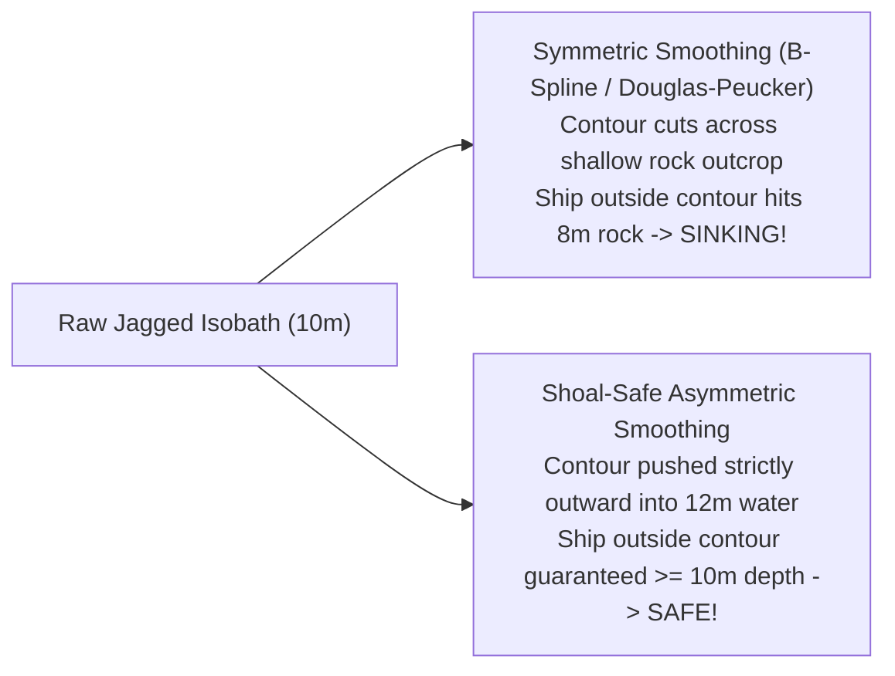

# Chapter 26: Navigating, Charting, Topographic Maps, and Cartographic Production

*Turning elevation models into operational navigation systems, official nautical charts, and publication-grade topographic maps.*

---

## 26.5 Mathematical Foundations of Nautical Generalization and TRN

Cartography and autonomous navigation impose rigorous mathematical constraints on digital elevation models. In nautical charting, line smoothing is governed by asymmetric safety inequalities; in autonomous navigation, terrain models serve as non-linear observation manifolds within Bayesian particle filters.

```mermaid
flowchart TD
    subgraph MathParadigms["Mathematical Formulations for Navigation and Charting"]
        direction TB
        subgraph HydroSafety["Nautical Shoal-Safe Contour Generalization"]
            RawContour["Raw Depth Contour C(d0):\nd(x) = d0 (positive downward)"]
            AsymmetricIneq["One-Sided Safety Inequality:\nFor all x in Omega_safe(C_tilde): d(x) - TVU_95(x) >= d0"]
            Morphological["Morphological Dilation / Rolling-Disk Operator\nGuarantees zero encroachment into shallow water"]
            RawContour --> AsymmetricIneq --> Morphological
        end

        subgraph BayesianTRN["Terrain-Relative Navigation (TRN) Particle Filter"]
            MotionState["Inertial State Propagation:\nx_t = f(x_{t-1}, u_t) + w_t\nCompound quadratic INS error growth"]
            DEM_Lookup["DEM Observation Manifold:\ny_hat_m = h_DEM(x_k, theta_m)\nInterpolated depth/elevation along beam ray"]
            LikelihoodUpdate["Likelihood & Weight Evaluation:\nw_k^(t) = w_k^(t-1) * prod( exp( -1/2 * (y_m - y_hat_m)^2 / (sigma_s^2 + sigma_DEM^2(x_k)) ) )"]
            Resample["Effective Sample Size Resampling: N_eff < K/2\nBounds INS drift to DEM resolution"]
            MotionState --> DEM_Lookup --> LikelihoodUpdate --> Resample
        end
    end
```

---

### 26.5.1 The Shoal-Safe One-Sided Bathymetric Contour Inequality

In topographic mapping, line simplification algorithms (such as Douglas-Peucker, Visvalingam-Whyatt, or Chaikin corner-cutting) treat spatial deviations symmetrically: a contour line is allowed to cut across ridges or valleys provided the perpendicular displacement falls within an aesthetic tolerance $\epsilon$.

In nautical charting, symmetric generalization is legally and physically prohibited. A smoothed depth contour defining navigable water must obey a **strict one-sided inequality constraint**.

#### 1. Formal Set Formulation (Positive-Down Depth $d$ vs. Positive-Up S-102 Elevation $z$)
Following the handbook sign convention, let the continuous positive-downward bathymetric depth surface below the chart tidal datum (e.g., Mean Lower Low Water) be denoted as $d(\mathbf{x}) \ge 0$ for horizontal coordinates $\mathbf{x} = (x, y) \in \mathbb{R}^2$ (so the corresponding positive-upward IHO S-102 elevation is $z(\mathbf{x}) = -d(\mathbf{x})$).

For a target safety depth contour $d_0$ (e.g., $d_0 = 10.0\text{ meters}$, equivalent to $z_0 = -10.0\text{ m}$), the raw, ungeneralized isobath is the level set:
$$C(d_0) = \big\{ \mathbf{x} \in \mathbb{R}^2 : d(\mathbf{x}) = d_0 \big\}$$

This contour partitions the marine domain into two regions:
1. **The Navigable Deep Water Domain:** $\Omega_{\text{deep}} = \big\{ \mathbf{x} \in \mathbb{R}^2 : d(\mathbf{x}) \ge d_0 \big\}$
2. **The Hazardous Shoal Water Domain:** $\Omega_{\text{shoal}} = \big\{ \mathbf{x} \in \mathbb{R}^2 : d(\mathbf{x}) < d_0 \big\}$

#### 2. The Cartographic Safety Constraint
Let $\tilde{C}(d_0)$ denote the generalized, smoothed cartographic contour line presented to the mariner on an official chart, and let $\Omega_{\text{safe}}\big(\tilde{C}(d_0)\big)$ be the region on the deep-water side of this line.

To guarantee that no vessel drawing draft $d_0$ can run aground while navigating within the designated safe region, $\tilde{C}(d_0)$ must satisfy the **Shoal-Safe Generalization Inequality**:

$$\forall \mathbf{x} \in \Omega_{\text{safe}}\big(\tilde{C}(d_0)\big), \quad d(\mathbf{x}) - \text{TVU}_{95\%}(\mathbf{x}) \ge d_0 \qquad \Longleftrightarrow \qquad z(\mathbf{x}) + \text{TVU}_{95\%}(\mathbf{x}) \le -d_0$$
where $\text{TVU}_{95\%}(\mathbf{x})$ is the Total Vertical Uncertainty of the underlying survey at the $95\%$ confidence level under IHO S-44.

#### 3. Mathematical Proof of Failure for Symmetric Smoothing
Let $\mathbf{x}_p$ be an isolated submerged rock pinnacle rising to depth $d(\mathbf{x}_p) = 8.0\text{ m}$ ($z(\mathbf{x}_p) = -8.0\text{ m}$) surrounded by $15\text{-m}$ deep water. The rock pinnacle creates an isolated closed loop $C_{\text{rock}}(10\text{ m})$ of diameter $10\text{ meters}$.
* If an automated cartographic tool applies a symmetric low-pass filter (e.g., Gaussian convolution with kernel $\sigma = 50\text{ m}$), the high-frequency $10\text{-m}$ loop is smoothed away:
  $$\Omega_{\text{safe}}(\tilde{C}) \cap \Omega_{\text{shoal}}(C) \ne \emptyset$$
* At point $\mathbf{x}_p$:
  $$\mathbf{x}_p \in \Omega_{\text{safe}}(\tilde{C}) \quad \text{but} \quad d(\mathbf{x}_p) = 8.0\text{ m} < 10.0\text{ m}$$
* Even before subtracting $\text{TVU}_{95\%}$, the safety inequality is violated by $2.0\text{ meters}$. A vessel master relying on this chart will pilot the vessel directly over the rock, resulting in a hull breach.

#### 4. The Morphological Rolling-Disk Operator
To generate mathematically compliant shoal-safe contours, hydrographic algorithms employ **mathematical morphology** using a structuring element $B_R$ (a disk of radius $R$ representing the minimum cartographic legibility radius):
$$\Omega_{\text{shoal, safe}} = \Omega_{\text{shoal}} \oplus B_R = \bigcup_{\mathbf{b} \in B_R} (\Omega_{\text{shoal}} + \mathbf{b})$$
The generalized contour is extracted as the boundary of the dilated shoal domain:
$$\tilde{C}(d_0) = \partial \big( \Omega_{\text{shoal}} \oplus B_R \big)$$
Because morphological dilation is an extensive operator ($\Omega \subseteq \Omega \oplus B_R$), the shoal region can only expand; it can never contract. Equivalently in raster elevation space, taking a local rolling-disk minimum depth filter $d_{\text{safe}}(\mathbf{x}) = \min_{\mathbf{b}\in B_R} d(\mathbf{x}+\mathbf{b})$ (or local maximum S-102 elevation $z_{\text{safe}}(\mathbf{x}) = \max_{\mathbf{b}\in B_R} z(\mathbf{x}+\mathbf{b})$) prior to contouring forces the safe navigable boundary strictly outward into deeper water, ensuring $100\%$ compliance with the safety inequality.

---

### 26.5.2 Terrain-Relative Navigation (TRN) Bayesian Particle Filter

In Terrain-Relative Navigation (TRN) and Bathymetric-Aided Navigation (BAN), an autonomous vehicle computes its position by matching altimeter or sonar returns against an onboard DEM using a **Sequential Monte Carlo (Particle Filter)** framework.

#### 1. State Space and Kinematic Motion Model
Let the vehicle state vector at discrete time step $t$ be defined as:
$$\mathbf{x}_t = \begin{pmatrix} \mathbf{p}_t \\ \mathbf{v}_t \end{pmatrix} = \begin{pmatrix} p_x, & p_y, & p_z, & v_x, & v_y, & v_z \end{pmatrix}^\top \in \mathbb{R}^6$$
where $\mathbf{p}_t$ is 3D position in the geodetic mapping frame ($p_z$ positive upward) and $\mathbf{v}_t$ is 3D velocity.

The system propagates state hypotheses via the non-linear strapdown inertial integration equation:
$$\mathbf{x}_t = \mathbf{f}(\mathbf{x}_{t-1}, \, \mathbf{u}_t) + \mathbf{w}_t$$
where $\mathbf{u}_t = (\tilde{\mathbf{f}}_b, \tilde{\boldsymbol{\omega}}_b)^\top$ contains specific force accelerations and angular velocity rates measured by the vehicle's onboard IMU, and $\mathbf{w}_t \sim \mathcal{N}(\mathbf{0}, \mathbf{Q}_t)$ is zero-mean Gaussian process noise modeling accelerometer and gyroscope drift.

#### 2. Non-Linear DEM Measurement Equation
At time step $t$, the vehicle acquires $M$ discrete distance measurements from a downward-looking sensor (e.g., $M$ beams of an acoustic multibeam sonar, radar altimeter, or flash LiDAR).

For beam $m \in \{1, \dots, M\}$ at off-nadir angle $\theta_m$ (measured from the downward nadir vertical) measuring slant range $\rho_m$:
* In **aerial / planetary TRN** (positive-up elevation $z$):
  $$y_{t, m} = p_{z, t} - \rho_m \cos\theta_m$$
* In **subsea AUV BAN** (where vehicle depth $d_{\text{AUV},t}$ is measured positive downward by a Paroscientific pressure sensor):
  $$y_{t, m} = d_{\text{AUV},t} + \rho_m \cos\theta_m$$

The theoretical measurement expected from candidate particle position $\mathbf{x}_t$ is computed by querying the onboard digital elevation model $h_{\text{DEM}}$ (matching the same sign convention):
$$\hat{y}_{t, m}(\mathbf{x}_t) = h_{\text{DEM}}\big( p_{x, t} + \Delta x_m(\mathbf{x}_t, \theta_m), \; p_{y, t} + \Delta y_m(\mathbf{x}_t, \theta_m) \big)$$
where $\Delta x_m, \Delta y_m$ represent the horizontal footprint offset of beam $m$ transformed through the vehicle attitude matrix $\mathbf{R}_b^l(\phi, \theta, \psi)$.

#### 3. Measurement Likelihood, Beam Correlation Tempering, and Weight Update
Let the total measurement error $\epsilon_m = y_{t, m} - \hat{y}_{t, m}$ be modeled with variance combining physical sensor range noise $\sigma_{\text{sensor}}^2$ and local reference elevation uncertainty $\sigma_{\text{DEM}}^2(\mathbf{x}_t)$:

$$\sigma_{\text{total}, m}^2(\mathbf{x}_t) = \sigma_{\text{sensor}}^2 + \sigma_{\text{DEM}}^2(\mathbf{x}_t)$$

Because neighboring multibeam beams or correlated terrain errors within a single ping are not strictly statistically independent, practical BAN filters introduce an effective-beam tempering exponent $\beta \in (0, 1]$ (e.g., $\beta = M_{\text{eff}}/M$) to avoid overconfident particle collapse:

$$p(\mathbf{y}_t \mid \mathbf{x}_{t, k}) \propto \left[ \prod_{m=1}^M \frac{1}{\sqrt{2\pi \sigma_{\text{total}, m}^2(\mathbf{x}_{t, k})}} \exp\left( -\frac{\big( y_{t, m} - \hat{y}_{t, m}(\mathbf{x}_{t, k}) \big)^2}{2 \sigma_{\text{total}, m}^2(\mathbf{x}_{t, k})} \right) \right]^\beta$$

For a filter maintaining $K$ discrete particles ($k = 1, \dots, K$), the importance weights are updated recursively and normalized:
$$w_k^{(t)} = w_k^{(t-1)} \cdot p(\mathbf{y}_t \mid \mathbf{x}_{t, k}), \qquad \tilde{w}_k^{(t)} = \frac{w_k^{(t)}}{\sum_{j=1}^K w_j^{(t)}}$$

#### 4. State Estimation, Resampling, and Cramér–Rao Observability Bound
The minimum mean-square error (MMSE) vehicle position estimate is the weighted ensemble mean $\hat{\mathbf{x}}_t = \sum_{k=1}^K \tilde{w}_k^{(t)} \mathbf{x}_{t, k}$, with **Effective Sample Size** $N_{\text{eff}} = \left(\sum_{k=1}^K (\tilde{w}_k^{(t)})^2\right)^{-1}$ triggering **Systematic Resampling** whenever $N_{\text{eff}} < K / 2$. By the Cramér–Rao Lower Bound (CRLB), the best achievable horizontal error covariance $\mathbf{P}_{xy}$ after $M_{\text{eff}}$ independent terrain observations is bounded below by the inverse Fisher Information Matrix:
$$\mathbf{P}_{xy} \succeq \mathbf{J}_{\text{TRN}}^{-1}, \qquad \mathbf{J}_{\text{TRN}} = \sum_{m=1}^{M_{\text{eff}}} \frac{1}{\sigma_{\text{total},m}^2} \nabla h_{\text{DEM}}(\mathbf{x}_m)\,\nabla h_{\text{DEM}}(\mathbf{x}_m)^\top$$
Consequently, over flat abyssal plains where $\nabla h_{\text{DEM}} = \mathbf{0}$, $\mathbf{J}_{\text{TRN}}$ becomes singular ($\det \mathbf{J}_{\text{TRN}} = 0$), and across linear sand ridges where terrain varies only along one axis, $\mathbf{J}_{\text{TRN}}$ has rank $1$—constraining cross-ridge position while leaving along-ridge position unobservable.

*Worked CRLB Numerical Comparison:*
Suppose a single-beam sonar altimeter ($\sigma_{\text{total}} = 0.5\text{ m}$) acquires $M_{\text{eff}} = 25$ independent measurements across an isotropic seamount flank with $\|\nabla h_{\text{DEM}}\| = 0.20$ equally distributed in East and North ($\partial h/\partial x = \partial h/\partial y = 0.1414$). Then the diagonal Fisher Information is $J_{xx} = J_{yy} = 25 \times (0.1414^2 / 0.5^2) = 2.0\text{ m}^{-2}$, yielding a Cramér–Rao $1\sigma$ horizontal positioning bound of $\sigma_x = \sigma_y \ge 1/\sqrt{2.0} = 0.71\text{ m}$. Across a mudflat with $\|\nabla h_{\text{DEM}}\| = 0.005$, the identical sensor yields $J_{xx} = 0.00125\text{ m}^{-2}$ and $\sigma_x \ge 28.3\text{ m}$, failing to bound inertial drift. Equally critical is gradient diversity across the track: over a straight planar continental slope where $\partial h/\partial y = k\,\partial h/\partial x$ everywhere along the track, the off-diagonal cross-term $J_{xy} = \sum (\partial h/\partial x)(\partial h/\partial y)/\sigma_{\text{total}}^2$ drives $\det(\mathbf{J}) = J_{xx}J_{yy} - J_{xy}^2 \to 0$. The resulting error ellipse degenerates along the isobath direction—cross-slope range stays tightly locked, while along-contour inertial drift remains completely unobservable until the vehicle crosses a canyon, ridge, or fracture zone that restores rank-2 curvature.
