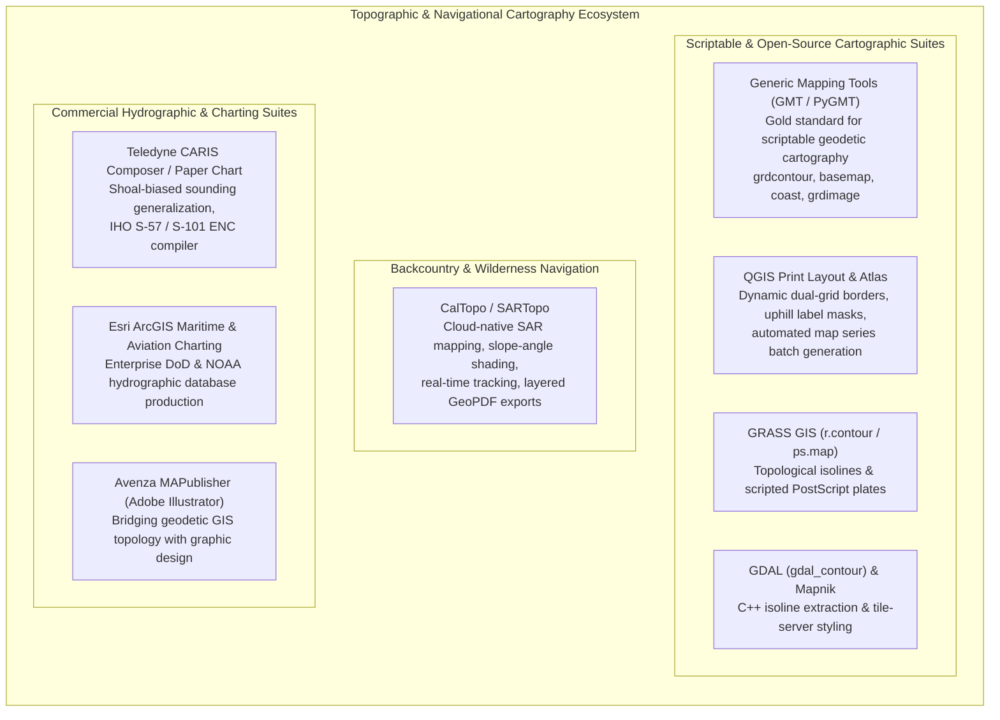

# Chapter 26: Navigating, Charting, Topographic Maps, and Cartographic Production

*Turning elevation models into operational navigation systems, official nautical charts, and publication-grade topographic maps.*

---

## 26.6 Software Ecosystem

Producing navigational charts, national topographic maps, and publication-grade cartographic figures from digital elevation models requires specialized software architectures. The ecosystem divides into scriptable open-source cartographic engines, desktop GIS layout environments, web-based search-and-rescue platforms, and mission-critical hydrographic compilation suites.



---

### 26.6.1 Open-Source Scriptable and Desktop Tools

#### 1. Generic Mapping Tools (GMT and PyGMT)
For scientific publishing (e.g., Nature, JGR, Geophysical Journal International), **GMT** is the undisputed reference standard. It provides mathematical control over projection distortion, dual-grid borders, variable-scale bars, and vector typography:
* `gmt grdcontour`: Generates contour lines with uphill-reading labels, automated index contour intervals, and masked halos behind numbers.
* `gmt basemap`: Draws complex map frames with alternating black-and-white "railroad" borders, annotating geographic coordinates (DMS) alongside projected metric grid ticks (UTM).
* `gmt coast`: Overlays high-resolution shoreline vectors from the GSHHG database, automatically clipping bathymetry to marine areas and land to terrestrial elevations.

```bash
#!/usr/bin/env bash
# Automated GMT Script: Compiling a Publication-Grade Shaded Topo Map
# Generates a high-resolution PDF with dual UTM/Geographic collar and uphill contours

set -euo pipefail

REGION="-105.35/-105.20/39.95/40.05"
PROJ="M15c" # 15 cm wide Mercator projection
DEM="boulder_dem.nc"
GRADIENT="boulder_grad.nc"
OUT_PREFIX="boulder_topographic_map"  # Modern mode appends .pdf automatically

# 1. Compute directional illumination gradient for shaded relief (azimuth 315°)
gmt grdgradient ${DEM} -A315 -Ne0.8 -G${GRADIENT}

# 2. Render shaded relief with perceptually uniform 'batlow' colormap
gmt begin ${OUT_PREFIX} pdf
    gmt grdimage ${DEM} -I${GRADIENT} -Cbatlow -R${REGION} -J${PROJ}

    # 3. Overlay topographic contours:
    # -C50: Draw intermediate contours every 50m
    # -A250+f8p+u" m"+ap+u+v: Index contours every 250m, uphill-reading (+ap+u), curved (+v)
    # -Q20: Skip noisy micro-contours with fewer than 20 vertices
    gmt grdcontour ${DEM} -C50 -A250+f8p+u" m"+ap+u+v -Wc0.15p,gray30 -Wa0.5p,black -Q20

    # 4. Draw publication frame with geographic annotations and ticks
    gmt basemap -R${REGION} -J${PROJ} -Baf -BWSen \
        --FONT_ANNOT_PRIMARY=9p,Helvetica,black \
        --FORMAT_GEO_MAP=ddd:mmF

    # 5. Add a 5 km metric scale bar and True North rose
    gmt basemap -Lg-105.23/39.96+c39.96+w5k+f+l"Kilometers" -Tdg-105.32/40.03+w1.5c
gmt end show
```

#### 2. QGIS Print Layout and the Atlas Engine
The QGIS layout environment provides enterprise cartographic publishing tools:
* **The Atlas Generation Engine:** Automatically iterates through a polygon coverage layer to generate hundreds of consecutive, standardized $7.5\text{-minute}$ topographic quadrangle GeoPDFs.
* **Dynamic Grid Overlays:** Allows cartographers to stack multiple coordinate systems onto a single map frame (e.g., drawing WGS84 geographic lat/long crosses across the map canvas while rendering UTM Zone 13N metric grid coordinates along the collar).
* **Contour Label Masking:** Utilizes advanced text buffer halos with selective feature masking, suppressing contour segments directly underneath numeric labels without erasing adjacent contour lines.

#### 3. GDAL (`gdal_contour`), GRASS GIS (`r.contour` / `ps.map`), and Mapnik
* **GDAL `gdal_contour`:** Extracts vector contour linestrings via marching squares. (Note: pass `-p` *only* when creating filled elevation band polygons with `-amin`/`-amax`, not when generating line contours!)
```bash
# Extract 10m contour linestrings from a 3DEP GeoTIFF and tag 50m index lines via SQL
# Use ROUND(elev_m) before CAST to avoid floating-point truncation (e.g., 149.999999 -> 149)
gdal_contour -a elev_m -i 10.0 -f "GPKG" input_3dep_1m.tif output_contours.gpkg
ogr2ogr -update -nln contours_tagged output_contours.gpkg output_contours.gpkg \
        -dialect SQLite -sql "SELECT *, (CAST(ROUND(elev_m) AS INT) % 50 = 0) AS is_index FROM contour"
```
* **GRASS GIS (`r.contour` and `ps.map`):** Provides topologically clean contour generation with minimum vertex filtering (`r.contour input=dem output=contours_10m step=10 cut=25`) and scriptable PostScript plate composition (`ps.map`) supporting dual grids, magnetic declination diagrams, and automated legend boxes.
* **Mapnik:** A high-throughput C++/Python rendering engine powering OpenStreetMap and custom hillshade/contour tile stacks (`Mapnik` XML stylesheets composite multi-resolution shaded relief rasters beneath haloed contour labels at web scale).

#### 4. Shoal-Safe Morphological Contour Conditioning in Python
Before calling `gdal_contour` or `grdcontour` on a nautical bathymetry surface (stored positive-up in S-102/BAG or positive-down depth), applying a one-sided morphological rolling-disk filter guarantees that smoothed contours displace strictly seaward:

```python
"""
Apply a one-sided shoal-safe rolling-disk dilation before extracting nautical depth contours.
Depth array d >= 0 is positive downward; TVU_95 is subtracted conservatively.
"""

import numpy as np
from scipy.ndimage import minimum_filter


def shoal_safe_depth_surface(depth_m: np.ndarray, tvu_95_m: np.ndarray, radius_cells: int = 3) -> np.ndarray:
    """Return a shoal-safe conditioned depth surface for seaward-only contouring."""
    # Step 1: Subtract 95% Total Vertical Uncertainty (shallower conservative bound)
    conservative_depth = np.maximum(0.0, depth_m - tvu_95_m)

    # Step 2: Construct circular structuring element B_R (rolling disk)
    y, x = np.ogrid[-radius_cells:radius_cells + 1, -radius_cells:radius_cells + 1]
    disk_mask = (x**2 + y**2) <= radius_cells**2

    # Step 3: Local minimum depth over B_R expands shoal regions strictly outward
    return minimum_filter(conservative_depth, footprint=disk_mask, mode="nearest")
```

#### 5. CalTopo and SARTopo
Created by Matt Jacobs, **CalTopo** is the operational standard for wildland search-and-rescue, structural backcountry navigation, and avalanche forecasting:
* **Slope-Angle Shading:** Interactively color-codes elevation gradients to highlight avalanche terrain ($30^\circ\text{–}45^\circ$).
* **Layered Georeferenced PDFs:** Compiles historical USGS quads, high-resolution LiDAR relief, and active satellite wildfire thermal infrared hot-spots into layered GeoPDF files exported directly to GPS-enabled mobile applications (e.g., Avenza Maps).

---

### 26.6.2 Commercial Marine and Aviation Charting Suites

#### 1. Teledyne CARIS Paper Chart and CARIS Composer
The international benchmark software used by national hydrographic offices (including NOAA, the UK Hydrographic Office, and the Canadian Hydrographic Service) for official chart production:
* **Automated Shoal-Biased Sounding Selection:** Implements topological spatial point-thinning algorithms that enforce the shoal-bias rule ($d_{\text{charted}} \le \min(d)$ for positive-down chart depth $d$, or equivalently $z_{\text{charted}} \ge \max(z)$ for positive-up IHO S-102 elevation $z$), ensuring that the shallowest sounding within any symbol cluster is preserved while suppressing deeper soundings.
* **Nautical Contour Generalization:** Implements asymmetric morphological snake and rolling-disk operators that guarantee depth contours are displaced strictly into deeper waters, preventing navigation hazards.

#### 2. Esri ArcGIS Maritime and Aviation Charting
Specialized extensions for ArcGIS Pro providing full compliance with defense and civilian charting specifications:
* **ArcGIS Maritime:** Manages hydrographic databases structured according to IHO S-57, S-101 (next-generation vector ENCs), and S-102 (high-definition bathymetric surfaces).
* **ArcGIS Aviation:** Evaluates airborne obstruction surfaces under FAA Part 77 and ICAO Annex 14. Projects 3D runway clearance funnels over airborne LiDAR DTMs, automatically flagging tree canopies, cell towers, and cranes that penetrate protected approach airspace.

#### 3. Avenza MAPublisher
A bridge connecting spatial GIS data with Adobe Illustrator:
* Ingests georeferenced DEM contours, hillshades, and shapefiles directly into Illustrator artboards while preserving geodetic projection parameters and coordinate grids.
* Allows graphic designers and cartographers to apply refined typography, custom vector stroke profiles, depression hachures, and alpine rock drawing while preserving GeoPDF coordinate export capability.

---

### 26.6.3 End-to-End Automated Topographic Map Production Checklist

Whether compiling a publication-ready GMT plate, a QGIS Atlas quadrangle series, or an IHO S-102 nautical overlay, automated cartographic pipelines should enforce five programmatic invariants before PDF/ENC export:

1. **Pre-Contour Accuracy Gate ($\text{CI} \ge 3.29\,\text{RMSE}_z$):** Validate the input DEM's metadata accuracy against the requested contour interval so sensor jitter is never vectorized as false terrain.
2. **Topological & Safety Conditioning:** For terrestrial hydrography, extract contours only *after* hydro-flattening and breakline enforcement; for bathymetry, apply one-sided morphological rolling-disk dilation ($d_{\text{safe}} = \min_{\mathbf{b}\in B_R}(d - \text{TVU}_{95\%})$) before calling `gdal_contour` or `grdcontour`.
3. **Automated Label Knockouts & Uphill Orientation:** Configure label placement engines with `+ap+u` (GMT) or up-slope curved placement with white text-halo masking (QGIS/Mapnik) so labels never obscure steep scarps or invert slope reading.
4. **Projection-Aware Marginalia:** Generate dual coordinate borders (geographic graticule + projected UTM/State Plane ticks), compute the center-of-sheet grid convergence $\gamma_{\text{conv}}$ and WMM epoch declination $\delta$, and attach variable-latitude scale bars whenever Mercator projections span $>5^\circ$ of latitude.
5. **Embedded Machine-Readable Collar Metadata:** Export layered GeoPDFs (`gdal_translate -of PDF` / QGIS Atlas) or HDF5/S-102 containers preserving embedded CRS WKT2 strings, vertical datum EPSG codes, and source lineage reliability polygons.

| Tool / Platform | Primary Role | Open vs. Closed | Key Cartographic / Safety Feature |
| :--- | :--- | :--- | :--- |
| **GMT / PyGMT** | Publication plates & automated contours | Open-Source (LGPL/BSD) | Uphill `+ap+u` labels, dual-grid frames, exact geodetic scales |
| **QGIS Print Layout & Atlas** | Quadrangle series & GeoPDF production | Open-Source (GPL) | Automated Atlas tiling, selective halo masking, dual grids |
| **GDAL (`gdal_contour`)** | High-speed isoline & polygon extraction | Open-Source (MIT) | Marching-squares vectorization to GeoPackage/GeoPDF |
| **GRASS GIS (`r.contour`, `ps.map`)** | Topological contours & batch PS plates | Open-Source (GPL) | Minimum-vertex `cut=` noise suppression & scripted PostScript |
| **Mapnik** | High-throughput raster/vector tile styling | Open-Source (LGPL) | Multi-scale hillshade + haloed contour tile rendering |
| **CalTopo / SARTopo** | Wilderness & SAR field mapping | Web Hybrid (Proprietary/Free tier) | Slope-angle avalanche shading & layered GeoPDF export |
| **Teledyne CARIS Composer** | Official S-57 / S-101 / paper nautical charts | Commercial | Shoal-biased sounding selection & seaward contour generalization |
| **Esri ArcGIS Maritime / Aviation** | ENC/S-102 & FAA/ICAO obstacle charting | Commercial | S-100 compliance & 3D airport approach obstruction surfaces |
