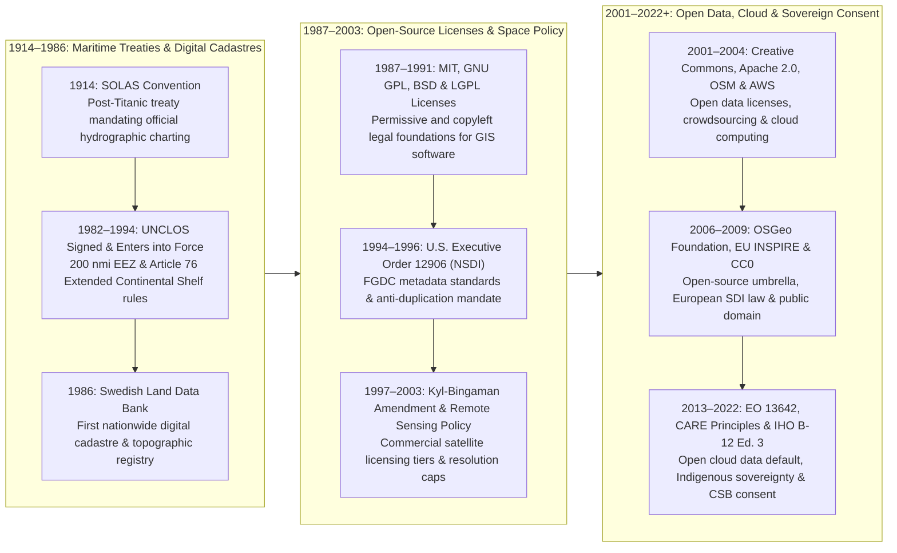

# Chapter 27: Legal, Privacy, Sovereignty, National Security, and Cost Optimization

*The human, legal, geopolitical, and economic dimensions of collecting and publishing 3D models of the world.*

---

## 27.5 Historical Evolution: Legal Treaties, Open Source, and Spatial Data Infrastructure

The legal and institutional governance of spatial elevation data developed in tandem with international maritime law, open-source software licenses, and national spatial data infrastructures. The timeline below, anchored in the `schwehr/gis-history` repository, highlights how geopolitical treaties, maritime disasters, and open-data movements shaped the governance of digital elevation models.

---

### 27.5.1 Maritime Safety Treaties and Digital Cadastres: 1914 to 1986

#### 1914: The SOLAS Convention
Following the sinking of the RMS *Titanic* in April 1912, maritime nations convened in London to adopt the first **International Convention for the Safety of Life at Sea (SOLAS)**.
* Chapter V of SOLAS codified the legal obligation of contracting governments to ensure that hydrographic surveys are carried out and that official nautical charts, notices to mariners, and depth models are published to ensure safe navigation.
* SOLAS established the principle that navigational bathymetry is an essential public safety responsibility of coastal sovereign states.

#### 1982–1994: UNCLOS and Article 76
Adopted in Montego Bay, Jamaica, in December 1982, the **Third United Nations Convention on the Law of the Sea (UNCLOS)** created the modern international maritime legal order:
* Codified the **$12\text{-nautical-mile}$ Territorial Sea** and the **$200\text{-nautical-mile}$ Exclusive Economic Zone (EEZ)**.
* **Article 76** formulated the mathematical and geodetic rules enabling coastal states to claim an **Extended Continental Shelf (ECS)** beyond $200\text{ nmi}$ based on bathymetric criteria (the Foot of the Continental Slope and the $2,500\text{-meter}$ isobath). When UNCLOS officially entered into force in November 1994, it triggered a global race among maritime nations to acquire high-resolution deep-water multibeam surveys to secure sovereign mineral rights over millions of square kilometers of abyssal seafloor.

#### 1986: The Swedish Land Data Bank
Completed in 1986 by Lantmäteriet, the **Swedish Land Data Bank** became the world's first nationwide digital cadastre, integrating parcel boundaries, land-ownership registries, and topographic coordinates into a centralized digital registry—demonstrating how sovereign spatial databases streamline property taxation, flood-risk permitting, and public works.

---

### 27.5.2 The Open-Source Licensing Foundation: 1987 to 1991

The digital elevation processing engines used today (GDAL, PROJ, PDAL, GRASS, QGIS) rely on legal software licenses formulated during the free and open-source software movements of the late 1980s and early 1990s:

* **1987: The MIT License:** Drafted at the Massachusetts Institute of Technology, this permissive license granted users unconditional rights to use, copy, modify, merge, publish, and sell software with only a simple attribution and copyright notice. It became the legal bedrock of foundational geospatial libraries (including PROJ and MapLibre).
* **1989: GNU General Public License (GPL v1):** Authored by Richard Stallman of the Free Software Foundation (FSF), the GPL established **copyleft**, legally requiring that any distributed software incorporating GPL code release its complete source code under the same terms (governing QGIS and GRASS GIS).
* **1990: The BSD License:** Formulated at UC Berkeley for the Computer Systems Research Group (CSRG), establishing the four-clause (and later three-clause/two-clause) permissive framework widely used across Unix, GMT, and academic geospatial tools.
* **1991: GNU Lesser General Public License (LGPL):** Introduced by the FSF to bridge permissive and copyleft models, allowing proprietary and permissively licensed applications to dynamically link against shared spatial libraries (such as GEOS and older GMT modules) without forcing the caller's application code under the full GPL.

---

### 27.5.3 National Spatial Data Infrastructures and Space Policy: 1994 to 2003

#### 1994–1996: Executive Order 12906 and the U.S. NSDI
On April 11, 1994, President Bill Clinton signed **Executive Order 12906**, *Coordinating Geographic Data Acquisition and Access: The National Spatial Data Infrastructure (NSDI)* (followed by FGDC metadata and clearinghouse implementation milestones through 1996):
* Mandated that federal agencies coordinate spatial data collection through the **Federal Geographic Data Committee (FGDC)**.
* Established public federal metadata clearinghouses (CSDGM, 1994) and prohibited federal agencies from duplicating collections when existing public data met specifications. This executive mandate laid the institutional groundwork that culminated in the unified USGS 3D Elevation Program (3DEP).

#### 1997: The Kyl-Bingaman Amendment
Passed as Section 1064 of Public Law 104-201, the amendment barred U.S. commercial satellite operators from releasing imagery and derived stereo elevation models over Israel at a resolution finer than commercially available foreign sources. This established a 23-year statutory ceiling ($2.0\text{-meter}$ GSD) that shaped commercial remote sensing policy until NOAA revised the cap to $0.40\text{ m}$ in July 2020.

#### 2003: U.S. Commercial Remote Sensing Space Policy
Signed into law in April 2003 (building on the Land Remote Sensing Policy Act of 1992 and later modernized via 15 CFR Part 960 in 2020), the **U.S. Commercial Remote Sensing Space Policy** established the federal licensing framework authorizing private commercial constellations (Maxar WorldView, GeoEye, Planet) to collect sub-meter optical stereo and commercial SAR elevation products, subject to national-security foreign-availability tiers and wartime shutter control.

---

### 27.5.4 Open Data, Crowdsourcing, and Cloud Infrastructure: 2001 to 2009

#### 2001: Foundation of Creative Commons
Legal scholar Lawrence Lessig and colleagues founded **Creative Commons (CC)**, releasing standardized public copyright licenses (CC-BY, CC-BY-SA, CC-NC). This provided spatial data creators with legal tools to share elevation rasters and scientific bathymetry with clear reuse permissions.

#### 2004: Apache 2.0, OpenStreetMap, and AWS
The year 2004 represented a triple inflection point for modern spatial computing:
1. **The Apache 2.0 License:** Released by the Apache Software Foundation, adding explicit patent grants and trademark protections to permissive open-source licensing (used by GDAL, Arrow, and modern big-data geospatial stacks).
2. **OpenStreetMap (OSM):** Steve Coast founded OpenStreetMap in the UK, demonstrating that crowdsourced spatial contributors could map global road networks and topography faster and more flexibly than centralized commercial mapping monopolies.
3. **Cloud Infrastructure:** Amazon Web Services (AWS) launched its foundational cloud infrastructure, while Google published the seminal *MapReduce* paper. Together, these technologies enabled the parallelized, petabyte-scale processing of global satellite elevation models.

#### 2006: The Open Source Geospatial Foundation (OSGeo)
In February 2006, open-source geospatial developers formed the **Open Source Geospatial Foundation (OSGeo)**. OSGeo established a non-profit legal umbrella, software quality governance, and code provenance verification for foundational projects:
* **GDAL/OGR** (Frank Warmerdam): The universal translator for raster and vector geospatial formats.
* **PROJ**: The universal coordinate transformation library.
* **GRASS GIS and QGIS**: Desktop analysis and cartography suites.

#### 2007: The European Union INSPIRE Directive
Enacted by the European Parliament and Council, the **INSPIRE Directive (2007/2/EC)** legally mandated that all 27 EU member states establish standardized, interoperable spatial data infrastructures covering 34 spatial data themes—including **Elevation (Theme 11)**. INSPIRE required national mapping agencies to publish classified LiDAR DTMs and bathymetric grids via standardized OGC Web Coverage Services (WCS).

#### 2009: Creative Commons Zero (CC0)
In 2009, Creative Commons published **CC0 1.0 Universal (Public Domain Dedication)**. CC0 allowed international researchers, private foundations, and national agencies (such as the Nippon Foundation-GEBCO Seabed 2030 and OpenTopography) to legally waive all copyright and database protections worldwide, establishing the legal standard for frictionless, cloud-native open elevation data.

* **2013: U.S. OSTP Public Access Directive & Executive Order 13642:** In February 2013, the White House Office of Science and Technology Policy (OSTP) mandated public access plans for federally funded research data, followed on May 9, 2013 by Executive Order 13642 (*"Making Open and Machine Readable the New Default for Government Information"*) and OMB Memorandum M-13-13. Together, they institutionalized open, machine-readable distribution across federal mapping agencies and accelerated the transition of USGS 3DEP and NOAA bathymetric holdings into public cloud buckets without egress walls or restrictive click-wrap licenses.
* **2018–Present: Sovereign Bathymetric Consent & Crowdsourced Protocols (Seabed 2030 & IHO B-12 Ed. 3.0.0):** Launching of the Nippon Foundation–GEBCO Seabed 2030 initiative (2017–2018) and publication of **IHO Publication B-12 Edition 3.0.0** (2022) addressed a persistent legal bottleneck: under UNCLOS Part XIII, ships collecting opportunistic depth logs inside foreign territorial seas or EEZs risked violating coastal-state marine scientific research consent regimes. B-12 Ed. 3.0.0 formalized a country-by-country "positive consent" registry inside the IHO Data Centre for Digital Bathymetry (DCDB), allowing coastal nations to pre-authorize filtered crowdsourced transit soundings while automatically withholding data over unconsented waters.

| Governance Era | Landmark Treaties, Statutes & Licenses | Primary Legal / Economic Mechanism | Impact on Elevation & Bathymetric Practice |
| :--- | :--- | :--- | :--- |
| **1914–1986: Maritime Safety & Early Cadastres** | SOLAS (1914), FTCA (1946), UNCLOS (1982), Swedish Land Data Bank (1986) | Sovereign charting obligations, discretionary immunity, Article 76 ECS formulas | Mandated official hydrographic surveying and triggered deep-ocean multibeam mapping for continental shelf claims |
| **1987–1997: Open-Source & Space Regulation** | MIT (1987), GPL (1989), BSD (1990), EO 12906 NSDI (1994), Kyl-Bingaman (1997) | Permissive/copyleft software licensing, federal FGDC coordination, GSD caps | Enabled the open-source geospatial stack (`PROJ`, `GRASS`, `GDAL`) and ended duplicate federal flights |
| **2001–2009: Open Data & Cloud Foundations** | Creative Commons (2001), Apache 2.0 & OSM (2004), OSGeo (2006), EU INSPIRE (2007), CC0 (2009) | Standardized open data attribution/waivers, OGC WCS mandates, cloud object storage | Democratized global DEM sharing (`OpenTopography`, `GEBCO`) and planetary-scale cloud processing |
| **2013–Present: Sovereign Consent & Cloud-Native Era** | EO 13642 (2013), GDPR (2016), CARE Principles (2020), 15 CFR 960 (2020), IHO B-12 Ed. 3 (2022) | PII anonymization, Indigenous data governance, tiered space licensing, positive-consent CSB | Enforced mobile-LiDAR PII scrubbing, tribal sacred-site redaction, and cloud-native `COG`/`COPC` streaming |
