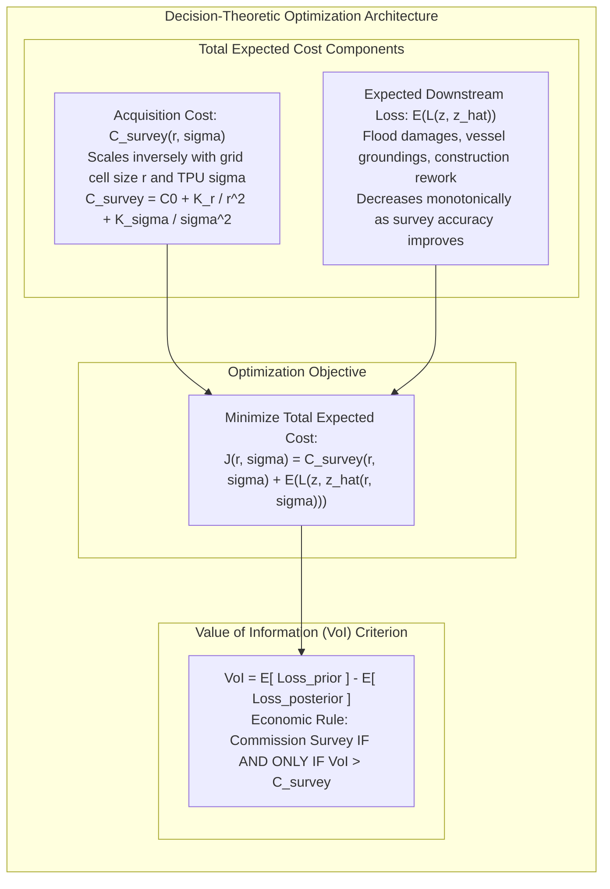

# Chapter 27: Legal, Privacy, Sovereignty, National Security, and Cost Optimization

*The human, legal, geopolitical, and economic dimensions of collecting and publishing 3D models of the world.*

---

## 27.6 Mathematical Foundations of Survey Economics and Value of Information

How does a national mapping director decide whether to commission an expensive $0.5\text{-meter}$ QL1 LiDAR survey ($\$350/\text{km}^2$) or accept a free $30\text{-meter}$ satellite DEM? How does a port authority decide whether to conduct a high-precision IHO Exclusive Order multibeam survey or rely on historical soundings?

In engineering economics, this decision is not resolved by intuition; it is solved via **Decision Theory** and the **Value of Information (VoI)**. By modeling elevation accuracy as a continuous reduction in downstream expected loss (flood damage, dredging volume overruns, vessel groundings), decision-makers can mathematically determine the optimal survey resolution and sensor budget.

---

### 27.6.1 The Survey Cost Model

The financial cost of collecting spatial elevation data is governed by the physics of sensor coverage and line geometry.

#### 1. Resolution and Flight-Line Mileage Scaling
Let an area of interest have spatial extent $A$ ($\text{km}^2$). To resolve terrain features at grid resolution $r$ ($\text{meters}$), the nominal pulse spacing or sounding density $\rho$ ($\text{pts/m}^2$) must satisfy:
$$\rho \propto \frac{1}{r^2}$$

In airborne LiDAR and marine multibeam sonar, achieving a pulse density $\rho$ requires flying or sailing parallel survey swaths with across-track swath width $W$. Because swath width is constrained by sensor altitude $H$ or water depth $d$ ($W \approx 2 H \tan(\theta/2)$), increasing point density requires lowering flight altitude $H$ or narrowing line spacing:
* Narrowing swath line spacing by a factor of 2 doubles the total linear survey mileage $L_{\text{miles}} = \frac{A}{W (1 - \text{overlap})}$.
* Doubling flight lines doubles vessel fuel burn, pilot flight hours, and operator labor costs.

#### 2. The Total Survey Cost Function
The direct financial cost $C_{\text{survey}}(r, \sigma)$ of acquiring an elevation dataset with spatial resolution $r$ and vertical measurement uncertainty $\sigma$ is formulated as:

$$C_{\text{survey}}(r, \sigma) = C_0 + \frac{K_r}{r^2} + \frac{K_\sigma}{\sigma^2}$$
where:
* $C_0$: Fixed project overhead (mobilization, port fees, base station setup, flight permits).
* $K_r$: Resolution cost coefficient (swath density, flight time, point-cloud storage, GPU processing).
* $K_\sigma$: Precision cost coefficient (higher-grade navigation-grade IMUs, multi-frequency dual-swath sonars, RTK GNSS networks, intensive sound speed profiling).

---

### 27.6.2 The Downstream Loss Function

An elevation model is an intermediate input into downstream operational decisions. Errors in the DEM lead to bad decisions that manifest as real financial losses.

#### 1. Asymmetric Loss in Marine Navigation and Flood Risk
In coastal dredging and marine navigation, following the handbook's convention of positive-downward depth $d \ge 0$, the loss function is strongly asymmetric:
* If the estimated seafloor depth $\hat{d}$ is deeper than the true depth $d$ ($\hat{d} > d$, under-reporting shallow hazards), a ship drawing draft $D_{\text{draft}}$ runs aground. The financial loss includes vessel salvage, environmental oil-spill cleanup, and cargo loss ($C_{\text{grounding}} \sim \$10^7\text{–}\$10^9$).
* If estimated depth $\hat{d}$ is shallower than true depth $d$ ($\hat{d} < d$, over-reporting hazards), the port authority unnecessarily dredges deeper than required, or vessels cargo light-load, wasting capital ($C_{\text{dredge}} \sim \$15\text{–}\$50/\text{m}^3$).

The asymmetric loss function is modeled as a piecewise-linear **pinball (quantile) loss**:
$$L(d, \hat{d}) = \begin{cases} c_{\text{hazard}} \cdot (\hat{d} - d), & \text{if } \hat{d} > d \quad (\text{under-reporting shoal}) \\ c_{\text{waste}} \cdot (d - \hat{d}), & \text{if } \hat{d} \le d \quad (\text{false alarm / over-dredge}) \end{cases}$$
where $c_{\text{hazard}} \gg c_{\text{waste}}$ (typically by a factor of $100:1$ to $10{,}000:1$). Minimizing the expected loss $\mathbb{E}[L(d, \hat{d})]$ with respect to the reported depth $\hat{d}$ via Leibniz's rule ($\frac{\partial}{\partial \hat{d}}\mathbb{E}[L(d, \hat{d})] = c_{\text{hazard}}\,F_d(\hat{d}) - c_{\text{waste}}\,[1 - F_d(\hat{d})] = 0$, where $F_d$ is the cumulative distribution function of true depth $d \sim \mathcal{N}(\mu_d, \sigma_d^2)$) yields the exact **Bayes-optimal shoal-biased estimator**:
$$F_d(\hat{d}^*) = \frac{c_{\text{waste}}}{c_{\text{hazard}} + c_{\text{waste}}} \quad \Longrightarrow \quad \hat{d}^* = \mu_d + \sigma_d\,\Phi^{-1}\!\left(\frac{c_{\text{waste}}}{c_{\text{hazard}} + c_{\text{waste}}}\right)$$
For instance, when grounding damage exceeds dredging cost by $c_{\text{hazard}}/c_{\text{waste}} = 99:1$, the critical fractile is $F_d(\hat{d}^*) = 0.01$ ($\Phi^{-1}(0.01) \approx -2.326$), proving mathematically that the optimal charted depth $\hat{d}^* = \mu_d - 2.326\,\sigma_d$ must sit at the conservative shoal quantile rather than the unbiased sample mean $\mu_d$.

#### 2. Quadratic Error Loss in Infrastructure Design
In civil earthwork grading and flood inundation modeling (with positive-up elevation $z$), loss is frequently modeled as quadratic in vertical error $\epsilon = z - \hat{z}$:
$$L(z, \hat{z}) = k_L \cdot (z - \hat{z})^2$$
where $k_L$ ($\$\cdot\text{m}^{-2}$) represents the marginal economic penalty per unit vertical variance integrated across the project footprint.

Given that total vertical error variance $\sigma_z^2$ combines sensor uncertainty $\sigma^2$ and spatial discretization error $\sigma_{\text{grid}}^2(r) \approx \kappa_{\text{grid}} \cdot r^2$ (where dimensionless roughness factor $\kappa_{\text{grid}} \propto \|\nabla z\|^2$ scales terrain slope variability):
$$\mathbb{E}\big[ L(z, \hat{z}) \big] = k_L \cdot \big( \sigma^2 + \kappa_{\text{grid}} \cdot r^2 \big)$$

---

### 27.6.3 Minimizing Total Expected Lifecycle Cost

The project planner's objective is to minimize the **Total Expected Cost $\mathcal{J}(r, \sigma)$**:

$$\mathcal{J}(r, \sigma) = C_{\text{survey}}(r, \sigma) + \mathbb{E}\big[ L(z, \hat{z}) \big] = C_0 + \frac{K_r}{r^2} + \frac{K_\sigma}{\sigma^2} + k_L \big( \sigma^2 + \kappa_{\text{grid}} \cdot r^2 \big)$$

To find the optimal spatial resolution $r^*$ and optimal sensor precision $\sigma^*$, we compute the partial derivatives and set them to zero:

#### 1. Optimal Spatial Resolution $r^*$
$$\frac{\partial \mathcal{J}}{\partial r} = -\frac{2 K_r}{r^3} + 2 k_L \kappa_{\text{grid}} r = 0 \implies r^4 = \frac{K_r}{k_L \kappa_{\text{grid}}} \implies r^* = \left( \frac{K_r}{k_L \kappa_{\text{grid}}} \right)^{1/4}$$

* **Dimensional & Physical Interpretation:** Notice $K_r$ has units $\$\cdot\text{m}^2$, $k_L$ has units $\$\cdot\text{m}^{-2}$, and $\kappa_{\text{grid}}$ is dimensionless, yielding units $(\text{m}^4)^{1/4} = \text{m}$!
  * As the downstream risk of terrain error increases ($k_L \to \infty$, such as an urban flood basin or high-consequence levee), the optimal grid cell size $r^*$ shrinks to sub-meter tolerances.
  * In rugged terrain with steep slopes ($\kappa_{\text{grid}}$ large), optimal resolution $r^*$ tightens; in flat desert range land ($k_L, \kappa_{\text{grid}}$ small), coarse satellite grids ($30\text{ m}$) minimize lifecycle cost.

#### 2. Optimal Sensor Uncertainty $\sigma^*$
$$\frac{\partial \mathcal{J}}{\partial \sigma} = -\frac{2 K_\sigma}{\sigma^3} + 2 k_L \sigma = 0 \implies \sigma^4 = \frac{K_\sigma}{k_L} \implies \sigma^* = \left( \frac{K_\sigma}{k_L} \right)^{1/4}$$

*Worked Optimization Calculation:*
Suppose a $100\text{-km}^2$ coastal flood engineering study has resolution cost coefficient $K_r = \$40{,}000\cdot\text{m}^2$, sensor precision coefficient $K_\sigma = \$100\cdot\text{m}^2$, roughness slope factor $\kappa_{\text{grid}} = 0.01$, and marginal flood-modeling variance penalty $k_L = \$5\times 10^6\cdot\text{m}^{-2}$. Substituting into the closed-form optima gives:
$$r^* = \left(\frac{40{,}000}{5\times 10^6 \times 0.01}\right)^{1/4} = (0.80)^{1/4} \approx 0.95\text{ m}, \qquad \sigma^* = \left(\frac{100}{5\times 10^6}\right)^{1/4} = (2\times 10^{-5})^{1/4} \approx 0.067\text{ m}$$
This matches **USGS 3DEP QL2/QL1 LiDAR** ($1.0\text{ m}$ grid, $\text{RMSE}_z \le 0.10\text{ m}$), proving quantitatively why neither free $30\text{-m}$ SRTM nor an ultra-dense $0.05\text{-m}$ terrestrial scan is economically optimal at watershed scale.

---

### 27.6.4 The Value of Information (VoI) Decision Criterion

In formal Bayesian decision theory, a new survey should be commissioned **if and only if** the expected reduction in downstream risk exceeds the full cost of the survey.

Let:
* $\mathcal{D}_0$: The prior decision state based on pre-existing legacy data (e.g., a 1970 single-beam chart or $30\text{-m}$ SRTM DEM) with prior expected loss $\mathbb{E}[L \mid \mathcal{D}_0]$.
* $\mathcal{D}_1$: The posterior decision state after collecting a new high-resolution survey with posterior expected loss $\mathbb{E}[L \mid \mathcal{D}_1]$.

The **Value of Information (VoI)** is defined as:

$$\text{VoI} = \mathbb{E}\big[ L \mid \mathcal{D}_0 \big] - \mathbb{E}\big[ L \mid \mathcal{D}_1 \big]$$

$$\text{The Golden Economic Decision Rule:}$$
$$\text{Commission Survey } \iff \text{VoI} > C_{\text{survey}}(r^*, \sigma^*)$$

#### Operational Case Study: Port Channel Deepening
* **Scenario:** A port authority is evaluating whether to commission a $\$150,000$ IHO Exclusive Order multibeam survey ($C_{\text{survey}} = \$150,000$) before deepening a container terminal fairway.
* **Prior State ($\mathcal{D}_0$):** Using an uncalibrated 2012 single-beam dataset ($\sigma \approx 0.50\text{ m}$), dredging contractors must enforce a $1.2\sigma = 0.60\text{-meter}$ "over-dredge safety buffer" across $2\text{ km}^2$ of rock seabed to guard against unmapped bedrock spikes. At $\$40/\text{m}^3$, dredging that unnecessary safety buffer costs:
  $$\text{Loss}(\mathcal{D}_0) = 2{,}000{,}000\text{ m}^2 \times 0.60\text{ m} \times \$40/\text{m}^3 = \$48{,}000{,}000$$
* **Posterior State ($\mathcal{D}_1$):** Commissioning the Exclusive Order multibeam survey provides a verified $0.5\text{-meter}$ grid with $1\sigma \le 0.08\text{ m}$ ($\text{TVU}_{95\%} \le 0.16\text{ m}$), reducing the required over-dredge allowance to $0.15\text{ m}$:
  $$\text{Loss}(\mathcal{D}_1) = 2{,}000{,}000\text{ m}^2 \times 0.15\text{ m} \times \$40/\text{m}^3 = \$12{,}000{,}000$$
* **Value of Information:**
  $$\text{VoI} = \$48,000,000 - \$12,000,000 = \$36,000,000$$
Since $\text{VoI} = \$36\text{M} \gg C_{\text{survey}} = \$0.15\text{M}$, the survey yields a **$240:1$ return on investment**, providing an overwhelming mathematical justification for the survey expenditure.

#### Break-Even Sensitivity and Vertical-Datum Liability Bias
Even if rock-dredging unit costs dropped tenfold (to $\$4/\text{m}^3$), commissioning the survey would still save $\$3.6\text{M}$; the economic break-even threshold occurs only if marginal hazard-avoidance savings fall below:
$$c_{\text{break-even}} = \frac{C_{\text{survey}}}{A \cdot \Delta d_{\text{buffer}}} = \frac{\$150{,}000}{2{,}000{,}000\text{ m}^2 \times (0.60 - 0.15)\text{ m}} \approx \$0.17/\text{m}^3$$
Crucially, however, both VoI and the asymmetric pinball loss assume zero unmodeled vertical datum bias ($\mathbb{E}[\hat{d} - d] = 0$). If a contractor ingests an archival ellipsoid-referenced survey without transforming through a tidal/geoid separation surface ($\Delta d_{\text{datum}} = +0.80\text{ m}$ systematic offset relative to MLLW), every reported $\hat{d}$ appears $0.80\text{ m}$ deeper than true navigable clearance. No local over-dredge buffer scaled by $\sigma$ alone compensates for an uncalibrated $\Delta d_{\text{datum}}$, converting what appeared to be a $240:1$ net saving into unquantified grounding liability—illustrating why CRS/datum metadata provenance is inseparable from economic optimization.
