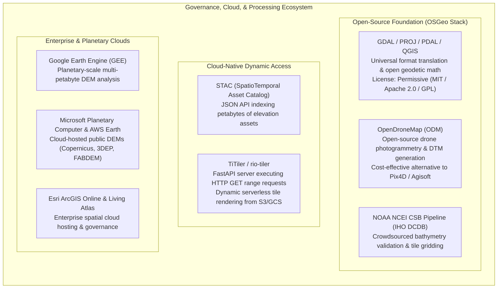

# Chapter 27: Legal, Privacy, Sovereignty, National Security, and Cost Optimization

*The human, legal, geopolitical, and economic dimensions of collecting and publishing 3D models of the world.*

---

## 27.7 Software Ecosystem

Managing legal compliance, crowdsourced data ingestion, open-source governance, and cost optimization requires an integrated software stack spanning open-source foundations, federal pipelines, and planetary cloud platforms. This section reviews the open-source engines and enterprise platforms that power legal and economic spatial data management.



---

### 27.7.1 Open-Source Processing and Crowdsourcing Platforms

#### 1. The OSGeo Foundation Stack (`GDAL`, `PROJ`, `PDAL`, `PostGIS`, `QGIS`, `GeoServer`)
The **Open Source Geospatial Foundation (OSGeo)** curates the fundamental libraries that underpin $95\%$ of all geospatial software:
* **GDAL/OGR:** Translates over 200 raster and vector formats and builds bandwidth-minimizing Cloud Optimized GeoTIFFs using **`ZSTD`** or bounded-error **`LERC`** compression.
* **PROJ:** Handles geodetic datum conversions and map projections, including modern vertical grid-shift transformations via PROJ Geodetic Transformation Grids (e.g., transforming ellipsoidal heights to orthometric NAVD88 via NGS `us_noaa_g2018u0.tif`).
* **PDAL (Point Data Abstraction Library):** Automates classified LiDAR filtering, PII point-cloud anonymization/cropping outside public rights-of-way, and conversion between LAS/LAZ and Cloud Optimized Point Cloud (COPC) archives.
* **PostGIS & GeoServer:** Manage enterprise spatial access controls, cadastral boundary overlays, and OGC Web Coverage Service (WCS) endpoints required under EU INSPIRE and national NSDI mandates.

```bash
# 1. Build a lossless ZSTD Cloud-Optimized GeoTIFF (COG) with floating-point predictor
gdal_translate input_dem_f32.tif output_cog_zstd.tif \
               -of COG -co COMPRESS=ZSTD -co PREDICTOR=3 -co LEVEL=9 -co OVERVIEWS=IGNORE_EXISTING

# 2. Build a bounded-error LERC COG (guaranteed max error <= 1 cm) for ~5x-10x cloud savings
gdal_translate input_dem_f32.tif output_cog_lerc.tif \
               -of COG -co COMPRESS=LERC_ZSTD -co MAX_Z_ERROR=0.01

# 3. Reset UserData everywhere, tag corridor polygon (allow_pub=1), crop PII curtilage, write COPC
cat <<'EOF' | pdal pipeline --stdin
[
  "raw_corridor.laz",
  {"type": "filters.assign", "value": "UserData = 0"},
  {"type": "filters.overlay", "dimension": "UserData",
   "datasource": "utility_row.gpkg", "column": "allow_pub"},
  {"type": "filters.range", "limits": "UserData[1:1]"},
  {"type": "writers.copc", "filename": "corridor_public.copc.laz"}
]
EOF
```

#### 2. OpenDroneMap (ODM)
For organizations seeking to bypass expensive commercial photogrammetry subscriptions (e.g., Pix4D, Agisoft Metashape):
* **OpenDroneMap (ODM)** is an open-source, containerized photogrammetric computer vision engine built on top of OpenSfM and OpenMVS.
* Ingests consumer drone RGB imagery, performs structure-from-motion (SfM) bundle adjustment, and generates georeferenced classified dense point clouds, digital surface models (DSM), and bare-earth digital terrain models (DTM) with sub-centimeter resolution, keeping proprietary survey assets entirely on-premises without third-party cloud uploads.

#### 3. NOAA NCEI Crowdsourced Bathymetry (CSB) Pipeline
Maintained on GitHub by NOAA National Centers for Environmental Information, the open-source **CSB Processing Pipeline**:
* Validates incoming NMEA 0183/2000 sounding streams submitted by commercial vessels to the IHO Data Centre for Digital Bathymetry (DCDB).
* Automatically checks incoming soundings for geographic bounds, flags suspicious vessel speeds or sensor spikes, applies tidal corrections, and aggregates soundings into open GeoJSON, CSV, and Parquet spatial records.

---

### 27.7.2 Cloud-Native Ingestion: STAC and HTTP Range Requests

The modern standard for cost-effective elevation data access is the **SpatioTemporal Asset Catalog (STAC)** specification paired with **Cloud Optimized GeoTIFFs (COG)**. Rather than downloading gigabytes of imagery, a Python client queries a STAC metadata catalog, identifies the target asset, and streams only the requested bounding box via HTTP GET range requests.

```python
"""
Cloud-native elevation extraction using pystac_client, odc.stac, and rioxarray.
Queries the Microsoft Planetary Computer STAC API to stream a small bounding box
from the global Copernicus GLO-30 DEM without downloading full tile archives.
"""

from pystac_client import Client
import planetary_computer as pc
import odc.stac
import matplotlib.pyplot as plt

def stream_cloud_dem(bbox: list[float], output_png: str = "streamed_elevation.png"):
    """
    Streams elevation pixels from a cloud-hosted COG via HTTP Range Requests.
    
    Args:
        bbox: [min_lon, min_lat, max_lon, max_lat] in EPSG:4326.
    """
    print(f"Connecting to Planetary Computer STAC catalog for bbox: {bbox}")
    catalog = Client.open(
        "https://planetarycomputer.microsoft.com/api/stac/v1",
        modifier=pc.sign_inplace
    )
    
    # Search for Copernicus GLO-30 DEM items intersecting the bounding box
    search = catalog.search(
        collections=["cop-dem-glo-30"],
        bbox=bbox
    )
    items = list(search.items())
    print(f"Found {len(items)} intersecting STAC items.")
    
    # Stream and crop the data directly into an xarray.Dataset
    # Project directly to metric UTM (EPSG:32610, 30m) via HTTP Range requests
    data = odc.stac.load(
        items,
        bands=["data"],
        bbox=bbox,
        crs="EPSG:32610",
        resolution=30
    )
    
    dem_array = data["data"].squeeze().values
    print(f"Streamed array shape: {dem_array.shape}, min elev: {dem_array.min():.1f}m, max: {dem_array.max():.1f}m")
    
    # Render quick-look plot
    plt.figure(figsize=(8, 6), dpi=300)
    plt.imshow(dem_array, cmap="terrain")
    plt.colorbar(label="Elevation (meters, EGM2008)")
    plt.title("Streamed Copernicus GLO-30 (Zero Local Storage)")
    plt.axis("off")
    plt.tight_layout()
    plt.savefig(output_png)
    plt.close()
    print(f"Saved quick-look to {output_png}")

# Example: Mount St. Helens Crater, Washington State
# [min_lon, min_lat, max_lon, max_lat]
# stream_cloud_dem([-122.22, 46.18, -122.16, 46.22])
```

---

### 27.7.3 Enterprise and Planetary Geospatial Platforms

#### 1. Google Earth Engine (GEE)
The premier platform for multi-temporal, planetary-scale elevation analysis:
* Hosts pre-tiled, server-side catalogs of **Copernicus GLO-30/90**, **NASADEM**, **ALOS AW3D30**, **USGS 3DEP 1m/10m**, and **FABDEM**.
* Executes parallelized geospatial algorithms (such as watershed flow accumulation, slope, aspect, and volumetric change detection) across tens of thousands of Google Cloud CPUs, enabling researchers to process global mountain ranges in seconds.

#### 2. Commercial Geospatial Clouds: AWS, GCP, Azure, and Planetary Computer
* **AWS Registry of Open Data:** Hosts the entire **USGS 3DEP** point cloud repository (in COPC/EPT format) and NOAA's National Ocean Service bathymetric database in `us-west-2` / `us-east-1`, allowing cloud compute nodes running in-region to process terabytes of LiDAR with zero egress fees.
* **Google Cloud Platform (GCP) & Microsoft Azure / Planetary Computer:** Host global Copernicus GLO-30, NASADEM, and ArcticDEM STAC-indexed collections alongside serverless dynamic tile renderers (`TiTiler` / `rio-tiler` over GCS/Azure Blob Storage) that serve on-demand terrain hillshades and elevation queries without duplicating static image caches.

#### 3. Esri ArcGIS Online and the Living Atlas
Esri's commercial cloud platform:
* Provides access to the **World Elevation Service**, which dynamically merges multi-resolution datasets into a single continuous raster endpoint alongside enterprise identity-based access controls for sensitive or embargoed municipal/tribal elevation assets.
* While convenient for web mapping, enterprise users must manage credit consumption models, verify commercial licensing terms for exported derivatives, and remain mindful of dynamic server-side resampling filters.

| Tool / Platform | Governance / Cost Niche | License / Tier | Key Technical Capability |
| :--- | :--- | :--- | :--- |
| **GDAL / PROJ / PDAL** | Cost-free format, datum & COPC pipelines | Open-Source (MIT / BSD) | `ZSTD`/`LERC` COGs, PROJ GTG grids, COPC redaction |
| **OpenDroneMap (ODM)** | On-premises privacy-preserving UAS SfM | Open-Source (AGPLv3) | Local DSM/DTM generation without cloud uploads |
| **IHO DCDB CSB Pipeline** | Low-cost crowdsourced bathymetry ingest | Open-Source (Public Domain) | Automated NMEA QC and transit-sounding validation |
| **TiTiler & STAC APIs** | Eliminating local multi-TB data duplication | Open-Source (MIT / Apache 2.0) | HTTP Range COG slicing and dynamic tile rendering |
| **Google Earth Engine / AWS / Azure** | Petabyte-scale cloud DEM processing | Commercial Cloud / Free Research | Co-located compute avoiding network egress costs |
| **Esri ArcGIS Online** | Enterprise governance & portal permissions | Commercial SaaS | Role-based access control over sensitive DEM layers |

---

### 27.7.4 Automated Governance, Provenance & Storage-Audit Pipeline

Before publishing any elevation tile into a public STAC catalog or municipal portal, an automated pre-flight check should verify three independent controls: **license & vertical datum provenance** (preventing downstream misinterpretation under liability law), **cloud-native chunk layout** (confirming internal tiling and overview pyramids exist before incurring HTTP egress), and **compression efficiency** (quantifying byte savings against an uncompressed `float32` baseline).

```python
"""
Pre-publication governance and storage-cost auditor for Cloud Optimized GeoTIFFs.
Checks CRS vertical datum completeness, embedded license tags, COG tiling/overviews,
and actual storage reduction relative to an uncompressed float32 array.
"""
import os
import rasterio

def audit_cog_governance(cog_path: str, storage_usd_per_gb_month: float = 0.023) -> dict:
    file_bytes = os.path.getsize(cog_path)
    with rasterio.open(cog_path) as src:
        tags = src.tags()
        raw_bytes = src.width * src.height * src.count * 4  # float32 baseline
        compression_ratio = raw_bytes / max(file_bytes, 1)
        has_vertical_crs = src.crs is not None and (src.crs.is_compound or "VERT" in src.crs.to_wkt().upper())
        has_overviews = len(src.overviews(1)) > 0
        is_tiled = src.is_tiled

    raw_gb = raw_bytes / 1e9
    cog_gb = file_bytes / 1e9
    return {
        "is_tiled_cog": is_tiled and has_overviews,
        "compression": tags.get("COMPRESSION", "NONE"),
        "compression_ratio": round(compression_ratio, 2),
        "has_vertical_datum": has_vertical_crs,
        "license_tag": tags.get("TIFFTAG_COPYRIGHT") or tags.get("LICENSE", "MISSING"),
        "monthly_savings_usd_per_1000_tiles": round(1000.0 * (raw_gb - cog_gb) * storage_usd_per_gb_month, 2),
    }
```

#### Operational Pre-Release Governance Checklist
1. **Explicit Datum & License Encoding:** Never distribute raw DEM GeoTIFFs without both a compound horizontal/vertical CRS (`EPSG:6349`, `EPSG:9518`, or WKT2 `VERTCRS`) and embedded `TIFFTAG_COPYRIGHT` / STAC `license` SPDX identifiers (e.g., `CC0-1.0` or `CC-BY-4.0`) to prevent accidental public-domain assumptions over commercial assets.
2. **Restricted-Zone & CARE Gatekeeping:** Apply explicit vector masking (`allow_pub=1`) and metadata redaction checks before copying UAS or sub-meter mobile-mapping point clouds out of local on-premises processing environments.
3. **Byte-Range Egress Validation:** Confirm HTTP `Accept-Ranges` headers and internal $512 \times 512$ overviews before linking STAC items into web viewers; an un-tiled uncompressed GeoTIFF causes every pan/zoom operation to trigger full-file downloads rather than kilobyte range slices.
