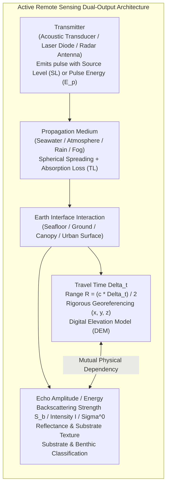

# Chapter 28: Acoustic Backscatter, LiDAR Intensity, and Substrate/Benthic Co-Products

*Why elevation and depth sensors never measure geometry alone—and how co-registered return amplitude disambiguates terrain surfaces and hazards.*

---

## 28.1 Physical Principles of Return Amplitude and Backscatter

Every active remote sensing system—whether an acoustic multibeam echosounder (MBES), an airborne topographic or bathymetric LiDAR, or a spaceborne Synthetic Aperture Radar (SAR)—transmits a calibrated pulse of wave energy toward the Earth and records the returning echo. While geospatial software has historically focused almost exclusively on the **two-way travel time** (extracting coordinates $x, y, z$ to construct a digital elevation model), the sensor simultaneously records the **amplitude, energy, and waveform shape** of the returning pulse.

This return amplitude—known as **acoustic backscatter**, **LiDAR intensity**, or **radar cross-section**—is not an auxiliary bonus; it is the physical companion of elevation. Elevation tells the analyst *where* the surface is; backscatter and intensity tell the analyst *what* that surface is composed of. Furthermore, without an accurate 3D DEM, backscatter cannot be radiometrically calibrated; and without backscatter, a DEM cannot be forensically vetted against false shoals, vegetation blunders, or floating artifacts.



---

### 28.1.1 The Modalities of Return Energy: Sonar, LiDAR, and Radar

The physical mechanism of backscattering differs according to the wave nature (mechanical vs. electromagnetic) and the sensing medium:

#### 1. Acoustic Seafloor Backscatter ($S_b$ or $BS$)
In marine acoustics, mechanical compressional pressure waves propagate through the water column and interact with the seafloor. A rigorous distinction must be maintained between the **Target Strength ($\text{TS}$)** of a discrete point object and the area-normalized **Bottom Backscattering Strength ($S_b(\theta_g)$ or $BS(\theta_g)$)** of a continuous distributed seabed:
* **Point-Target vs. Area-Normalized Backscattering Strength:** For a discrete target (such as a calibration sphere or naval mine), Target Strength is the decibel ratio of backscattered intensity referred to $r_{\text{ref}} = 1\text{ m}$ to incident plane-wave intensity: $\text{TS} = 10\log_{10}\big(r_{\text{ref}}^2 I_{\text{scat}}(r_{\text{ref}}) / I_{\text{inc}}\big)$ (in $\text{dB re } 1\text{ m}^2$). For an extended seafloor patch of ensonified footprint area $A_{\text{footprint}}$, we normalize by the area to obtain the dimensionless differential backscattering cross-section per unit area per unit solid angle $\sigma_b(\theta_g)$, whose decibel equivalent is the **Bottom Backscattering Strength ($S_b(\theta_g)$ or $BS(\theta_g)$)**, expressed in $\text{dB re } 1\text{ m}^2\cdot\text{m}^{-2}$ (or simply $\text{dB}$):
  $$BS(\theta_g) = S_b(\theta_g) = 10 \log_{10} \sigma_b(\theta_g) = 10 \log_{10}\left( \frac{r_{\text{ref}}^2 \, I_{\text{scat}}(r_{\text{ref}})}{A_{\text{footprint}} \, I_{\text{inc}}} \right)$$
  where $\theta_g = \frac{\pi}{2} - \theta_i$ is the local grazing angle measured from the DEM tangent plane ($\theta_i$ is the incidence angle measured from the outward surface normal $\hat{\mathbf{n}}_{\text{DEM}}$).
* **Physical Controls:** Acoustic backscatter is governed by the contrast in **characteristic acoustic impedance** ($Z_{\text{ac}} = \rho \cdot c$, where $\rho$ is bulk density and $c$ is compressional sound speed) across the water-sediment interface, combined with wavelength-scale interface roughness and subsurface volumetric inhomogeneities. Hard crystalline granite, basaltic lava flows, or cobble pavements reflect strong acoustic energy ($BS \approx -10\text{ dB to }-18\text{ dB}$ at $45^\circ$ grazing angle); fine silt and uncompacted fluid mud absorb sound and scatter weakly ($BS \approx -35\text{ dB to }-50\text{ dB}$).

#### 2. LiDAR Radiometric Intensity ($I$) and Calibrated Reflectance ($\rho_\lambda$)
In airborne, mobile, and spaceborne laser scanning, a short laser pulse (typically $\lambda_{\text{opt}} = 1064\text{ nm}$ near-infrared or $1550\text{ nm}$ shortwave-infrared for terrestrial topography, and $532\text{ nm}$ green for airborne lidar bathymetry) illuminates a finite footprint on the ground or seabed:
* **The Laser Radar Range Equation:** For an extended Lambertian surface that fills the instantaneous laser beam footprint at slant range $R$ and incidence angle $\theta_i$, the optical power $P_r$ received by a detector of aperture diameter $D_{\text{rx}}$ is governed by (Wagner et al., 2006; Höfle & Pfeifer, 2007):
  $$P_r(R, \theta_i) = \frac{P_t \, D_{\text{rx}}^2}{4 R^2} \, \eta_{\text{sys}} \, \eta_{\text{atm}}^2(R) \, \rho_\lambda \cos\theta_i$$
  where $P_t$ is transmitted peak pulse power, $\eta_{\text{sys}}$ is optical system transmission efficiency, $\eta_{\text{atm}}(R) = \exp(-\alpha_{\text{atm}} R)$ is one-way atmospheric transmittance, and $\rho_\lambda \in [0, 1]$ is the directional-hemispherical spectral reflectance at wavelength $\lambda$. In Airborne Lidar Bathymetry (ALB, Chapter 9), the green $532\text{ nm}$ benthic return experiences an additional two-way water-column exponential decay $\exp(-2 K_d d / \cos\theta_w)$ governed by the diffuse attenuation coefficient $K_d$.
* **Raw Intensity vs. Radiometric Calibration:** In standard ASPRS LAS/LAZ files, `Intensity` is stored as a quantized 16-bit unsigned integer ($\text{DN} \in [0, 65535]$) proportional to the peak photodiode voltage or time-integrated waveform energy. Because raw $\text{DN}$ scales with $R^{-2}\cos\theta_i$ and varies with pulse repetition frequency (PRF) and automatic gain control (AGC), it must be normalized using the 3D DEM before comparing material reflectances. Asphalt road surfaces and wet marsh soils strongly absorb $1064\text{ nm}$ photons ($\rho_{1064} \approx 0.05\text{–}0.15$), whereas dry Portland cement concrete, quartz beach sand, and healthy mesophyll leaf tissue strongly reflect near-infrared energy ($\rho_{1064} \approx 0.40\text{–}0.75$).

#### 3. Radar Backscatter: Beta-Naught ($\beta^0$), Sigma-Naught ($\sigma^0$), and Gamma-Naught ($\gamma^0$)
In spaceborne and airborne Synthetic Aperture Radar (SAR, Chapter 11), coherent microwave pulses (X-band $\lambda \approx 3.1\text{ cm}$, C-band $\lambda \approx 5.6\text{ cm}$, L-band $\lambda \approx 23.5\text{ cm}$, P-band $\lambda \approx 70\text{ cm}$) interact with surface dielectric permittivity and geometric roughness:
* **$\beta^0$ (Radar Brightness):** The dimensionless reflectivity per unit area in **slant-range / azimuth coordinates**, requiring no topographic knowledge.
* **$\sigma^0$ (Sigma-Naught):** The normalized radar cross-section per unit **ground area** on the reference ellipsoid or local DEM slope ($\sigma^0 = \beta^0 \sin\theta_i$, expressed in $\text{dB re } 1\text{ m}^2\cdot\text{m}^{-2}$).
* **$\gamma^0$ (Gamma-Naught) and Terrain-Flattened $\gamma_T^0$:** The radar cross-section normalized per unit area **perpendicular to the incident radar line of sight** (Small, 2011):
  $$\gamma^0 = \frac{\sigma^0}{\cos\theta_i} = \beta^0 \tan\theta_i$$
  When normalized using the true 3D DEM facet area projected into the plane perpendicular to the look vector, terrain-flattened $\gamma_T^0$ removes foreshortening brightness anomalies on mountain slopes. Furthermore, in InSAR DEM generation, the interferometric phase standard deviation $\sigma_\phi$ is inversely proportional to complex coherence $\gamma_{\text{coh}}$, which depends directly on the signal-to-noise ratio (SNR) of the backscatter amplitude.

---

### 28.1.2 Surface Scattering vs. Volume Scattering

When a wave packet reaches the boundary of an elevation model, the returning echo is generated by two distinct physical regimes: **surface scattering** and **volume scattering**.

```mermaid
flowchart LR
    Incoming["Incident Wave Packet\n(Acoustic or Optical Wavefront)"] --> Interface["Boundary Interface (z = f(x, y))\nAcoustic Impedance Delta_Z or Optical Refractive Index Delta_n"]
    
    Interface -->|Impedance Mismatch| SurfaceScat["Surface Scattering\nGoverned by micro-roughness sigma_h relative to wavelength lambda\nSpecular return at nadir; diffuse scattering at oblique angles"]
    
    Interface -->|Transmitted Energy (1 - R)| Penetration["Wave Penetration into Subsurface"]
    Penetration --> VolumeScat["Volume Scattering\nInternal heterogeneities:\n- Sub-bottom shells, pebbles, gas bubbles\n- Forest canopy leaves, branches, twigs\n- Firn / snow ice grain boundaries"]
```

#### 1. Surface Scattering and the Rayleigh Criterion
Surface scattering occurs strictly at the 2D discontinuity interface separating the two media. Its angular behavior depends on the relationship between surface vertical micro-roughness $\sigma_h$ (the standard deviation of surface elevation variations) and wave wavelength $\lambda$:

The phase difference $\Delta \Phi$ between two rays reflected from adjacent surface heights differing by $\Delta h$ is:
$$\Delta \Phi = \frac{4\pi \sigma_h}{\lambda} \cos\theta_i$$
where $\theta_i$ is the angle of incidence relative to the surface normal.

* **The Rayleigh Roughness Criterion:**
  * If $\Delta \Phi < \frac{\pi}{2}$ (i.e., $\sigma_h < \frac{\lambda}{8 \cos\theta_i}$), the surface is **acoustically or optically smooth**. The reflected wave remains coherent, producing strong specular reflection at nadir ($\theta_i \approx 0^\circ$) and vanishingly weak backscatter at oblique grazing angles.
  * If $\Delta \Phi \ge \frac{\pi}{2}$, the surface is **rough**. The wavefront is broken into incoherent diffuse scattering distributed across all angles.
* *Wavelength Sensitivity:* A sandy seafloor with $2\text{-cm}$ ripple crests is rough to a $300\text{-kHz}$ multibeam sonar ($\lambda = 5\text{ mm}$), scattering sound back to the transducer across wide swaths. To a $12\text{-kHz}$ deep-ocean sonar ($\lambda = 12.5\text{ cm}$), that same sand ripple is acoustically smooth, behaving like a mirror that reflects energy away from outer beams.

#### 2. Volume Scattering
Volume scattering occurs when energy penetrates beyond the immediate interface and scatters off internal inhomogeneities within the underlying medium:
* **Marine Sediments:** In soft unconsolidated clays and muddy silts, acoustic waves penetrate several decimeters to meters beneath the apparent seabed. Sound scatters off buried shell fragments, burrows excavated by benthic fauna, coarse sand lenses, and biogenic methane gas bubbles. In muds, volume scattering often dominates over surface scattering at oblique grazing angles ($>30^\circ$).
* **Forest Canopies in LiDAR:** In airborne LiDAR, the laser pulse does not encounter a single flat surface; it propagates through a $30\text{-meter}$ deep volume of leaves, twigs, and branches. Multiple discrete returns or full-waveform digitization capture volume scattering throughout the vertical canopy profile before a final return strikes the bare earth.
* **Dry Snow and Glacial Ice in Radar:** In X-band and C-band SAR altimetry (SRTM, TanDEM-X), microwaves penetrate several meters into dry polar firn, scattering off internal ice grain boundaries and refrozen ice lenses. If the volume scattering phase center is not corrected, the resulting DEM measures an elevation $1\text{–}5\text{ meters}$ below the true snow surface!

---

### 28.1.3 Cross-Modality Comparison and Worked Rayleigh Roughness Example

To appreciate how wavelength $\lambda$ dictates what "roughness" means across topographic and bathymetric sensors, Table 28.1 compares the physical wave parameters, Rayleigh smoothness thresholds $\sigma_{h,\text{crit}} = \frac{\lambda}{8\cos\theta_i}$ (evaluated at $\theta_i = 30^\circ$, where $\cos 30^\circ \approx 0.8660$), and typical penetration depths across active elevation-mapping instruments.

| Sensor Modality | Typical Frequency / Wavelength | Rayleigh Threshold $\sigma_{h,\text{crit}}$ ($\theta_i = 30^\circ$) | Dominant Scattering Regime | Typical Subsurface Penetration |
| :--- | :--- | :--- | :--- | :--- |
| **Topographic NIR LiDAR** | $f \approx 282\text{ THz}$ ($\lambda = 1064\text{ nm}$) | $0.15\,\mu\text{m}$ | Optically rough on all natural surfaces (except calm mirror water); multi-return volume scattering in canopies | $0\text{ mm}$ in soil/rock; penetrates $10\text{–}50\text{ m}$ through forest canopy gaps |
| **Bathymetric Green LiDAR (ALB)** | $f \approx 563\text{ THz}$ ($\lambda = 532\text{ nm}$ in air; $399\text{ nm}$ in water) | $0.06\,\mu\text{m}$ | Refracts across air-water interface; volume scattering from suspended turbidity ($K_d$) + diffuse benthic return | $1\text{–}3\times$ Secchi depth ($5\text{–}50\text{ m}$ in clear coastal water; $<1\text{ mm}$ into seabed) |
| **Shallow-Water MBES** | $f = 300\text{ kHz}$ ($\lambda = 5.0\text{ mm}$ at $c = 1500\text{ m/s}$) | $0.72\text{ mm}$ | Coarse sand, gravel, ripples, and shells are acoustically rough; only planar fluid mud is smooth | $1\text{–}10\text{ cm}$ into soft silt/mud |
| **Deep-Ocean MBES** | $f = 12\text{ kHz}$ ($\lambda = 12.5\text{ cm}$ at $c = 1500\text{ m/s}$) | $1.80\text{ cm}$ | Sand ripples ($\sigma_h < 1\text{ cm}$) appear acoustically smooth; cobbles, talus, and lava pillows are rough | $0.5\text{–}5\text{ m}$ into abyssal pelagic ooze |
| **X-Band InSAR (TanDEM-X)** | $f = 9.65\text{ GHz}$ ($\lambda = 3.11\text{ cm}$) | $4.49\text{ mm}$ | Gravel, plowed soil, and upper canopy leaves are rough; paved runways and calm water are smooth | $1\text{–}5\text{ cm}$ in dry soil; $1\text{–}4\text{ m}$ in dry polar firn |
| **L-Band / P-Band SAR (NISAR / Biomass)** | $f = 1.25\text{ GHz}$ ($\lambda = 24\text{ cm}$) / $435\text{ MHz}$ ($\lambda = 69\text{ cm}$) | $3.46\text{ cm}$ / $9.96\text{ cm}$ | Penetrates foliage; scatters from tree trunks, branches, and coarse boulder fields | $5\text{–}30\text{ m}$ through forest canopy; $0.5\text{–}2\text{ m}$ in hyper-arid desert sand |

#### Worked Numerical Comparison: Acoustic vs. Radar Scattering on a Rippled Sandbed
Consider a coastal tidal flat (exposed at low tide to an X-band SAR satellite and submerged at high tide under a dual-frequency survey vessel carrying a $300\text{ kHz}$ shallow-water multibeam and a $12\text{ kHz}$ deep-water check transducer) with root-mean-square micro-roughness $\sigma_h = 4.0\text{ mm}$ viewed at incidence angle $\theta_i = 45^\circ$ ($\cos 45^\circ = 0.7071$):

1. **At $300\text{ kHz}$ Multibeam ($\lambda = 5.0\text{ mm}$):**
   $$\Delta\Phi_{300\text{kHz}} = \frac{4\pi (0.0040\text{ m})}{0.0050\text{ m}} (0.7071) = 7.11\text{ rad} \gg \frac{\pi}{2} \quad (1.57\text{ rad})$$
   Because $\Delta\Phi \gg \pi/2$, the sandbed is **strongly rough**, generating robust diffuse backscatter ($BS \approx -22\text{ dB}$) across outer multibeam beams for reliable phase bottom detection.
2. **At $12\text{ kHz}$ Sonar ($\lambda = 12.5\text{ cm} = 0.125\text{ m}$):**
   $$\Delta\Phi_{12\text{kHz}} = \frac{4\pi (0.0040\text{ m})}{0.125\text{ m}} (0.7071) = 0.284\text{ rad} < \frac{\pi}{2}$$
   Because $\Delta\Phi < \pi/2$, the exact same sandbed is **acoustically smooth** at $12\text{ kHz}$, reflecting energy specularly away from the receiver at $\theta_i = 45^\circ$ and causing low outer-beam SNR.
3. **At X-Band SAR ($\lambda = 3.11\text{ cm} = 0.0311\text{ m}$) at Low Tide:**
   $$\Delta\Phi_{\text{X-band}} = \frac{4\pi (0.0040\text{ m})}{0.0311\text{ m}} (0.7071) = 1.14\text{ rad} < \frac{\pi}{2}$$
   The exposed sandflat lies in the transitional smooth-to-moderate regime ($\sigma^0 \approx -16\text{ dB}$), providing just enough backscatter above the $-22\text{ dB}$ noise-equivalent sigma zero ($\text{NESZ}$) to maintain interferometric coherence $\gamma_{\text{coh}} \approx 0.75$.
