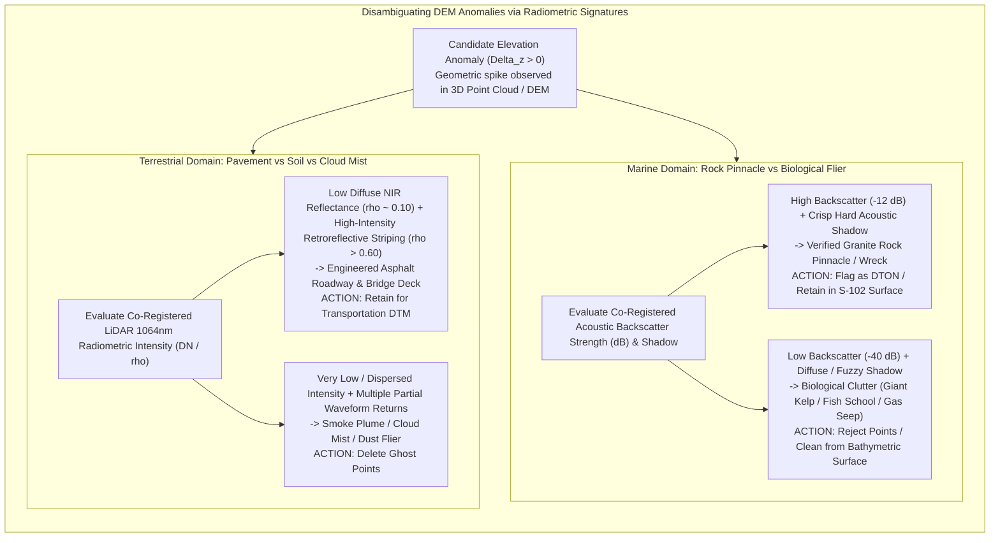

# Chapter 28: Acoustic Backscatter, LiDAR Intensity, and Substrate/Benthic Co-Products

*Why elevation and depth sensors never measure geometry alone—and how co-registered return amplitude disambiguates terrain surfaces and hazards.*

---

## 28.3 Disambiguating DEM Anomalies with Backscatter and Intensity

A common blind spot in elevation modeling is assuming that every geometric point $(x, y, z)$ returned by a sensor represents the true, solid surface of the Earth. In reality, sound and light scatter off biological organisms, rising gas flares, atmospheric water droplets, and transient obstacles.

When an analyst examines a raw point cloud or unverified DEM grid, geometry alone is ambiguous: a $3\text{-meter}$ vertical mound rising from the seafloor could be a lethal granite navigation pinnacle, or it could be a transient clump of giant bull kelp floating in the current. On land, a flat, level corridor could be an engineered asphalt highway, or it could be a smooth, unvegetated mudflat. **Co-registered backscatter and radiometric intensity provide the decisive physical evidence required to disambiguate true terrain from environmental artifacts.**

---

### 28.3.1 Marine Hydrography: Rock Pinnacles vs. Kelp, Fish, and Gas Plumes

In shallow coastal waters, automatic multibeam bottom-detection algorithms (whether amplitude peak detection or phase zero-crossing) frequently trigger on targets suspended in the water column:

#### 1. The Granite Pinnacle vs. Bull Kelp Bed Trap
* **The Geometric Dilemma:** In the coastal waters of the Pacific Northwest, Northern California, or New England, giant kelp (*Macrocystis pyrifera*) forms dense submarine forests anchored to the seabed. Gas-filled pneumatocysts cause kelp frills to float upward, forming dense organic mounds $2\text{–}10\text{ meters}$ above the seabed. To an automated gridding algorithm (such as CUBE or minimum-curvature splines), a kelp patch produces identical geometric sounding clusters to a sharp granite rock pinnacle.
* **The Backscatter Disambiguation:**
  * **Granite Rock:** Solid rock has an enormous acoustic impedance contrast against seawater ($Z_{\text{rock}} \approx 8.0 \times 10^6\text{ kg}\cdot\text{m}^{-2}\cdot\text{s}^{-1}$ vs. $Z_{\text{water}} \approx 1.5 \times 10^6$). At $300\text{ kHz}$, rock reflects an intense acoustic backscatter return of **$-10\text{ dB to }-15\text{ dB}$**, casting a sharp, pitch-black acoustic shadow across the seafloor directly behind it.
  * **Kelp Canopy:** Kelp tissue consists of over $90\%$ water, yielding an acoustic impedance nearly identical to seawater ($Z_{\text{kelp}} \approx 1.55 \times 10^6$). The return energy is extremely weak and diffuse (**$-35\text{ dB to }-50\text{ dB}$**), and the acoustic shadow behind the canopy is fuzzy, pale, and incomplete.
* *Operational Action:* If a hydrographer mistakenly flags a kelp bed as a rock, dredging funds are wasted attempting to blast non-existent bedrock. Conversely, if an automated filter deletes a real rock thinking it is kelp, a commercial vessel will ground. Co-registered backscatter analysis ensures verified hazards are preserved as IHO S-102 designated soundings while biological clutter is excised.

#### 2. Methane Gas Plumes and Hydrothermal Vents
In hydrocarbon-bearing basins and active volcanic margins, biogenic or thermogenic methane bubbles seep from the seabed:
* **The Acoustic Anomaly:** Rising bubble flares produce intense acoustic backscatter in the water column because the impedance contrast between gas and seawater is nearly $100\%$.
* **Geometric Corruption:** Multibeam bottom-detection algorithms lock onto the acoustic flare, generating false "chimneys" or "spires" in the bathymetry that appear to rise $50\text{ meters}$ above the seafloor.
* **Disambiguation:** Inspecting the raw **Water Column Imaging (WCI)** data and multi-frequency acoustic backscatter reveals that the feature lacks a solid base, has high phase variance across successive pings, and drifts horizontally with ocean currents. The bathymetric grid can be edited to restore the true flat seabed beneath the plume.

#### 3. Quantitative Multi-Observable Marine Disambiguation Matrix
Under **IHO S-44 (6th Edition)** and the **NOAA Hydrographic Surveys Specifications and Deliverables (HSSD)**, any shoal feature rising more than $1\text{ m}$ above surrounding depths in navigationally significant waters ($d < 40\text{ m}$) must be either verified as a real obstruction (and submitted as a Danger to Navigation, DTON, or designated sounding in the Bathymetric Attributed Grid, BAG) or proved to be spurious noise. Table 28.2 summarizes the joint geometric-radiometric decision rules used by hydrographers:

| Candidate Anomaly | Seafloor Backscatter $BS(\theta_g)$ ($300\text{ kHz}$) | Acoustic Shadow Zone Geometry | Water-Column (WCI) & Multi-Pass Persistence | CUBE Hypothesis Disambiguation & Charting Action |
| :--- | :--- | :--- | :--- | :--- |
| **Crystalline Bedrock Pinnacle / Boulder** | Very high ($-8\text{ to }-15\text{ dB}$), strong impedance contrast ($Z_{\text{ac}} \approx 8\text{–}15\text{ MRayl}$) | Sharp, zero-energy black acoustic shadow extending down-range ($L_{\text{shadow}} = h_{\text{obj}} / \tan\theta_g$) | Stationary across orthogonal cross-lines; zero WCI mid-water detachment | Apply **Designated Sounding** override on shoalest verified point; preserve in IHO S-102 surface |
| **Steel Shipwreck / Debris** | Extremely high specular spikes ($-3\text{ to }-12\text{ dB}$) + corner-reflector ringing | Crisp geometric shadow matching hull/mast superstructure | Stationary; rectilinear edges visible in high-density snippet imagery | Flag as **DTON / Wreck feature** (`WRECKS` in S-57/S-101); verify least depth with bar check or ROV |
| **Giant Kelp Canopy (*Macrocystis*)** | Low to moderate ($-32\text{ to }-45\text{ dB}$); pneumatocysts scatter weakly without hard interface | Diffuse, semi-transparent shadow; underlying seafloor reflection still visible at $-20\text{ dB}$ beneath canopy | Fronds sway tens of decimeters between passes with tidal current; vertical stems in WCI | Reject canopy fliers from bathymetric CUBE grid; select true basal rock/sand return; chart kelp symbol (`WEDKLP`) |
| **Dense Pelagic School of Fish** | Moderate volume scattering ($S_v \approx -35\text{ to }-55\text{ dB/m}^3$) from swimbladders | Little or no seabed shadow; seabed trace continues unbroken directly underneath | Moves or vanishes on subsequent adjacent swath line ($t + 5\text{ min}$) | Delete water-column soundings; retain underlying seabed hypothesis |
| **Methane Gas Seep Flare** | Intense mid-water resonant bubble scattering ($S_v > -25\text{ dB/m}^3$) | No geometric shadow; often paired with a high-backscatter authigenic carbonate crust ($-12\text{ dB}$) at base | Rising vertical or current-tilted plume in WCI; high ping-to-ping phase jitter | Clean vertical plume spikes from bathymetry; retain basal pockmark or carbonate mound geometry |

---

### 28.3.2 Terrestrial and Coastal Remote Sensing: Pavement, Canopy, Water, and Ghost Points

In airborne topographic and topo-bathymetric LiDAR, radiometric intensity ($I$), full-waveform echo width ($w_e$), and multi-wavelength return ratios serve as primary physical features for automated point-cloud classification (ASPRS LAS Classes 1–45) and infrastructure asset extraction.

#### 1. Disambiguating Transportation Infrastructure from Bare Soil and Vegetation
* **The Feature Extraction Challenge:** Autonomous vehicle high-definition (HD) mapping fleets and state departments of transportation need to extract curb lines, road crowns, bridge decks, guardrails, and lane markings directly from airborne or mobile LiDAR point clouds where elevation differences may be less than $1\text{–}2\text{ cm}$.
* **The Multi-Attribute Radiometric Signature:**
  * **Asphalt Pavement:** Composed of hydrocarbon bitumen and dark mineral aggregate, asphalt strongly absorbs near-infrared radiation ($1064\text{ nm}$), exhibiting low normalized reflectance ($\rho_{1064} \approx 0.08\text{–}0.14$) and a narrow, single-return Gaussian waveform width ($w_e \approx \tau_p$, equal to the transmitted laser pulse duration).
  * **Thermoplastic and Glass-Bead Road Striping:** Highway lane markings embed retroreflective glass microspheres ($n \approx 1.5\text{–}1.9$) that focus incident laser light directly back toward the receiver aperture (**cat's-eye retroreflection**). Consequently, their apparent Lambertian-equivalent reflectance exceeds unity ($\rho_{\text{app},1064} > 0.60\text{–}1.80$), allowing millimeter-accurate extraction of lane centerlines even at night.
  * **Bare Soil vs. Short Turf Grass:** A freshly graded dirt construction pad and a mowed golf-course fairway may have identical planar geometric roughness ($\sigma_z < 1\text{ cm}$), making them indistinguishable to pure geometric ground filters (Chapter 21). However, healthy chlorophyll-bearing turf exhibits the classic vegetation **red-edge jump**, yielding high $1064\text{ nm}$ reflectance ($\rho_{1064} \approx 0.45\text{–}0.60$) compared to damp mineral soil ($\rho_{1064} \approx 0.15\text{–}0.25$). When paired with a green $532\text{ nm}$ channel, the active Normalized Difference Ratio $(I_{1064} - I_{532}) / (I_{1064} + I_{532})$ cleanly separates low vegetation from bare mineral earth.

#### 2. Filtering Atmospheric "Ghost Points" (Steam, Dust, and Cloud Fog) and Specular Water Dropouts
* **The Geometric Pitfall:** When an airborne LiDAR flies over an industrial power-plant cooling tower, a geothermal fumarole field, a dusty quarry haul road, or valley radiation fog, laser pulses scatter off suspended water droplets or aerosol particulates. These reflections appear in the raw point cloud as dense clusters of points floating $5\text{–}150\text{ meters}$ above the ground ("low/high noise," ASPRS Class 7 and Class 18).
* **Radiometric and Waveform Disambiguation:**
  * Solid terrain returns high pulse energy concentrated in a sharp, narrow temporal echo ($w_e \approx 1.5\text{–}3.0\text{ ns}$) with high amplitude.
  * Aerosol mist and steam plumes produce volumetric Mie scattering distributed across several meters of slant range. In full-waveform LiDAR (e.g., Riegl VQ-series), this manifests as **pulse broadening** ($w_e > 6\text{–}15\text{ ns}$) paired with extremely low peak amplitude near the detector's minimum noise threshold ($\text{DN} < 5\text{–}15$).
  * Conversely, over calm inland lakes and coastal marshes, $1064\text{ nm}$ NIR pulses suffer near-total absorption and specular reflection away from the receiver at off-nadir angles ($\theta_i > 15^\circ$), creating **radiometric dropouts** (voids) accompanied by blinding specular saturation spikes ($\text{DN} = 65535$) at exact nadir ($\theta_i \approx 0^\circ$) where range walk (first-photon / saturation bias) pulls the apparent water elevation $5\text{–}25\text{ cm}$ higher than the true water surface.

#### 3. Worked Numerical Example: Acoustic Shadow Length and Backscatter Verification of a Harbor Pinnacle
Suppose a $300\text{ kHz}$ multibeam survey in a $d_0 = 18.0\text{ m}$ harbor channel detects an isolated shoal point at depth $d_{\text{shoal}} = 14.8\text{ m}$ (rising $h_{\text{obj}} = 3.2\text{ m}$ above the flat seabed) at an across-track distance $x = 24.0\text{ m}$ from nadir (transducer draft $d_{\text{tx}} = 1.0\text{ m}$, so vertical height of transducer above surrounding seabed is $H_{\text{tx}} = 18.0 - 1.0 = 17.0\text{ m}$):

1. **Expected Acoustic Shadow Geometry:**
   The grazing angle $\theta_g$ of the acoustic ray grazing the crest of the $3.2\text{ m}$ feature (at vertical offset $\Delta z_{\text{crest}} = 14.8 - 1.0 = 13.8\text{ m}$ below the transducer and horizontal distance $x = 24.0\text{ m}$) is:
   $$\tan\theta_g = \frac{\Delta z_{\text{crest}}}{x} = \frac{13.8\text{ m}}{24.0\text{ m}} = 0.5750 \implies \theta_g = 29.9^\circ$$
   If the $3.2\text{ m}$ anomaly is a solid, opaque granite pinnacle or boulder attached to the bed, it must block all acoustic rays behind its crest over a radial across-track shadow length $L_{\text{shadow}}$ on the flat $18.0\text{ m}$ seabed:
   $$L_{\text{shadow}} = \frac{h_{\text{obj}}}{\tan\theta_g} = \frac{3.2\text{ m}}{0.5750} = 5.57\text{ m}$$
2. **Radiometric Diagnostic:**
   * **Case A (True Rock Hazard):** The crest snippet records a calibrated backscatter of $BS(29.9^\circ) = -11.4\text{ dB}$, and the snippet trace immediately down-range from $x = 24.0\text{ m}$ to $x = 29.6\text{ m}$ drops to the thermal noise floor ($<-55\text{ dB}$). The feature is physically verified as a solid obstruction and flagged as an immediate DTON.
   * **Case B (Biological / Kelp Clutter):** The anomaly records $BS(29.9^\circ) = -41.2\text{ dB}$, and the seabed snippet trace between $x = 24.0\text{ m}$ and $x = 29.6\text{ m}$ remains continuously visible at $-24.0\text{ dB}$ (typical medium sand) with zero shadow interruption. The $14.8\text{ m}$ sounding is proved to be a mid-water biological target through which acoustic energy passed freely, and is safely rejected from the navigational surface.
