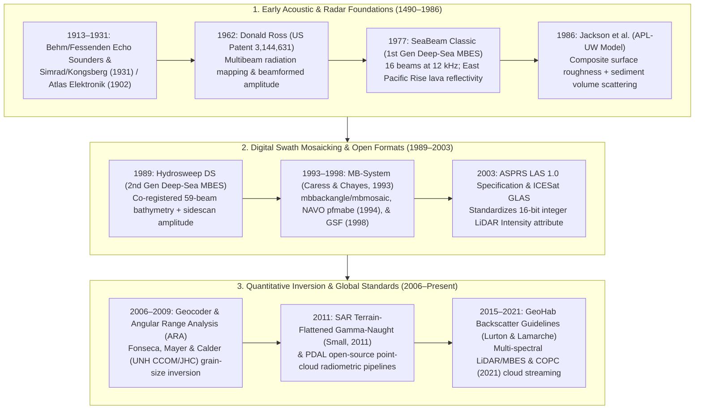

# Chapter 28: Acoustic Backscatter, LiDAR Intensity, and Substrate/Benthic Co-Products

*Why elevation and depth sensors never measure geometry alone—and how co-registered return amplitude disambiguates terrain surfaces and hazards.*

---

## 28.4 Historical Evolution: From Analog Echograms to Calibrated Radiometry (`gis-history` Context)

The co-registration of elevation geometry with return amplitude is the product of a six-decade evolution in underwater acoustics, microwave radar, marine geophysics, and laser altimetry. Anchored to the chronological milestones in the [`schwehr/gis-history`](https://github.com/schwehr/gis-history) repository, this section traces how backscatter and intensity matured from uncalibrated qualitative "sidescan-like shading" into metrically calibrated, physics-based measurements governed by international standards.

---

### 28.4.1 The Genesis of Multibeam Amplitude and Scattering Theory: 1490 to 1986

#### From Early Hydroacoustics (1490–1931) to the 1962 Multibeam Patent
While Leonardo da Vinci observed in 1490 that a tube placed in water could detect distant ships by sound, quantitative hydroacoustics began in the early twentieth century with the founding of **Atlas Elektronik (1902)** in Bremen, the **1912 sinking of the *RMS Titanic***, the **1913 echo-sounder patent** by Alexander Behm, and the **1931 founding of Simrad** (the precursor to Kongsberg Maritime). Early single-beam paper echograms recorded return amplitude only as the darkness and vertical thickness of a burnt carbon trace on electrosensitive paper.

#### 1962: US Patent 3,144,631 (Donald Ross and General Instrument Corp.)
On December 28, 1962, Donald G. Ross filed **US Patent `US3144631A`** (granted August 11, 1964, assigned to General Instrument Corporation) for a *"Radiation Mapping System"*:
* Ross's architecture established the orthogonal **Mills Cross** acoustic array—combining a narrow along-track transmit fan with an orthogonal across-track array of receive hydrophone beams.
* Crucially, Ross recognized that by sampling both the arrival time and the peak envelope voltage of each steered receive beam across time, the instrument could simultaneously map bathymetric contours and the directional acoustic reflectivity of the seabed.

#### 1977: The SeaBeam Classic Breakthrough and Early Academic Sonar Groups
Developed by General Instrument Corporation from the classified US Navy SASS (Sonar Array Sounding System) program, the **SeaBeam Classic** ($12\text{ kHz}$, 16 beams of $2.67^\circ \times 2.67^\circ$ spanning a $42\text{–}45^\circ$ swath) entered civilian oceanography in **1977** aboard the French research vessel *Jean Charcot* and in **1981** aboard Scripps Institution of Oceanography's R/V *Thomas Washington*:
* Although early SeaBeam computers were built primarily to plot real-time depth contour strips, marine geophysicists led by Christian de Moustier at Scripps digitized the raw acoustic trace envelopes from magnetic tape. They demonstrated that quantitative beam amplitudes delineated fresh, glassy basaltic sheet flows ($-10\text{ dB}$) from pelagic sediment pockets ($-30\text{ dB}$) along the East Pacific Rise that were completely indistinguishable in the $10\text{ m}$ contour lines.
* In **1986**, Darrell R. Jackson, Dale P. Winebrenner, and Akira Ishimaru at the University of Washington Applied Physics Laboratory (APL-UW) published the **Composite Roughness Model** in the *Journal of the Acoustical Society of America*, unifying Kirchhoff small-slope specular reflection near nadir, small-perturbation Bragg roughness scattering at intermediate grazing angles, and sediment volume scattering into a single predictive physical equation.

---

### 28.4.2 Second-Generation Multibeams and Open-Source Mosaicking: 1989 to 1998

In the late 1980s, deep-sea and coastal mapping transitioned from narrow 16-beam arrays to wide-swath digital systems, while academic groups built the software foundations to co-process geometry and amplitude.

#### 1989: Hydrosweep DS and the UNB Ocean Mapping Group
In **1989**, Krupp Atlas Elektronik introduced the **Hydrosweep DS** (2nd-generation deep-sea multibeam, 59 beams across a $90^\circ$ swath installed on Germany's R/V *Meteor* and Lamont-Doherty's R/V *Maurice Ewing*), while Simrad introduced the shallow-water **EM1000** ($95\text{ kHz}$, 60 beams) and deep-water **EM12**. For the first time, these systems digitized intra-beam time series ("snippets"), producing thousands of amplitude samples per ping alongside discrete depth soundings.
* At the **University of New Brunswick (UNB)**—where **CARIS** had spun out in **1979**—Larry A. Mayer and John E. Hughes Clarke established the **Ocean Mapping Group (OMG)** in the early 1990s. Their landmark 1996 paper in *Marine Geophysical Researches* proved that co-registered shallow-water multibeam bathymetry and radiometrically corrected backscatter could resolve decimeter-scale sediment transport bedforms, pipeline scour, and benthic habitats across continental shelves.

#### 1993–1998: MB-System, `pfmabe`, and the Generic Sensor Format (GSF)
Prior to 1993, every sonar vendor used incompatible proprietary binary telegrams, and commercial packages routinely stripped or distorted amplitude values.
* **1993 (`MB-System`):** David W. Caress and Dale N. Chayes released **MB-System** (built seamlessly alongside Paul Wessel and Walter Smith's **1988 Generic Mapping Tools, GMT**). MB-System introduced open-source utilities—specifically **`mbbackangle`** and **`mbmosaic`**—that computed true 3D local grazing angles $\theta_g$ directly from the bathymetric grid normals and projected angular-normalized amplitudes into publication-grade GeoTIFF mosaics.
* **1994 (`pfmabe`) & 1998 (`GSF`):** The US Naval Oceanographic Office (NAVO) initiated the **Pure File Magic Area-Based Editor (`pfmabe`)** in 1994 for rapid 3D sounding verification and released the open **Generic Sensor Format (GSF)** in 1998, standardizing Vendor-Specific and History records so that per-beam calibrated backscatter, grazing angles, and TVG parameters could be archived in a single self-describing file.

---

### 28.4.3 Terrestrial LiDAR Standardization and Radar Terrain Flattening: 2003 to 2011

As airborne laser scanning (derived from the **1960 laser** and **1961 LiDAR** inventions) and spaceborne SAR (derived from the **1951 SAR** concept and **2000 SRTM** mission) expanded globally in the 2000s, the terrestrial community confronted the exact same geometric-radiometric coupling challenges as marine acousticians.

#### 2003: ASPRS LAS 1.0 and NASA ICESat (GLAS)
Prior to 2003, airborne LiDAR vendors (Optech, Leica, Riegl, TopEye) exported ASCII tables or proprietary binary files where return amplitude was either omitted or scaled arbitrarily.
* In **2003**, the American Society for Photogrammetry and Remote Sensing (ASPRS, founded in **1934**) published the **LAS 1.0 Specification**, mandating a 16-bit unsigned integer **`Intensity` ($[0, 65535]$)** attribute in every point data record format. Simultaneously, NASA launched **ICESat** in January 2003, demonstrating spaceborne $1064\text{ nm}$ full-waveform digitizing and calibrated surface reflectance retrieval over ice sheets and forests.
* Between **2006 and 2007**, Wolfgang Wagner, Bernhard Höfle, and Norbert Pfeifer formalized the **Laser Radar Range Equation** and full-waveform Gaussian decomposition for topographic LiDAR, proving that dividing raw intensity by $R^{-2}\cos\theta_i$ (where $\theta_i$ is computed from the 3D DEM normal) removes flight-altitude and topographic-slope shading artifacts.

#### 2011: David Small's SAR Gamma-Naught ($\gamma_T^0$) Terrain Flattening and PDAL
In spaceborne radar, steep mountain slopes facing the satellite compress many ground pixels into a single slant-range bin (foreshortening and layover), causing massive radiometric brightening of $+10\text{ to }+20\text{ dB}$ even when surface roughness is uniform.
* In **2011**, David Small (University of Zurich) published the definitive **Radiometric Terrain Correction (RTC)** homomorphic area-integration algorithm (*"Flattening gamma"*), which projects high-resolution DEM facets into the plane perpendicular to the radar look vector to produce terrain-flattened $\gamma_T^0$. Today, RTC $\gamma_T^0$ powered by Copernicus GLO-30 DEMs is the foundational Analysis-Ready Data (ARD) standard for Sentinel-1 and NISAR.
* Also in **2011**, Howard Butler and colleagues released the open-source **Point Data Abstraction Library (PDAL)**, enabling programmable C++ and Python radiometric normalization pipelines across billion-point LiDAR datasets.

---

### 28.4.4 Quantitative Acoustic Inversion and the GeoHab Standard: 2006 to Present

#### 2006–2009: Geocoder and Angular Range Analysis (ARA) at UNH CCOM/JHC
For decades, acoustic backscatter mosaics had normalized away the angular dependence $BS(\theta_g)$ to produce a visually flat greyscale image—discarding the very physical curve that differentiates sediment types!
* At the **Center for Coastal and Ocean Mapping / Joint Hydrographic Center (CCOM/JHC)** at the **University of New Hampshire (UNH)** (founded by Larry Mayer in 1999), **Luciano Fonseca, Larry Mayer, and Brian Calder** developed the **Geocoder** engine and **Angular Range Analysis (ARA)** (Fonseca & Mayer, 2007; Fonseca et al., 2009).
* Rather than discarding angular variations, ARA preserves the full observed curve $BS(\theta_g)$ from nadir ($90^\circ$) to outer swath ($20^\circ$), corrects every sample's grazing angle and footprint area using the co-registered 3D bathymetric DEM, and inverts the curve against the APL-UW Jackson model to estimate physical acoustic impedance, roughness, and mean sediment grain size ($\phi$). Geocoder was subsequently integrated into QPS FMGT, CARIS SIPS, and SonarWiz.

#### 2015–2021: GeoHab Guidelines, Multi-Spectral Active Sensing, and COPC
Under the international Marine Geological and Biological Habitat Mapping (**GeoHab**) consortium, **Xavier Lurton and Geoffroy Lamarche** led the Backscatter Working Group in publishing the landmark **2015 guidelines** and **2018 special issue** in *Marine Geophysical Research*. These standards unified sonar hardware calibration (reference hydrophone tank tests and natural seafloor calibration sites), exact TVG stripping equations, and DEM-coupled footprint geometry across all major multibeam manufacturers. Paired with the rise of **multi-spectral airborne LiDAR** (e.g., Optech Titan $1550/1064/532\text{ nm}$ in 2014), **multi-frequency multibeam echosounders** (2017–present), and **Cloud-Optimized Point Clouds (COPC, 2021)**, radiometric amplitude is now universally archived and streamed as an inseparable physical dimension of modern 3D elevation models.
