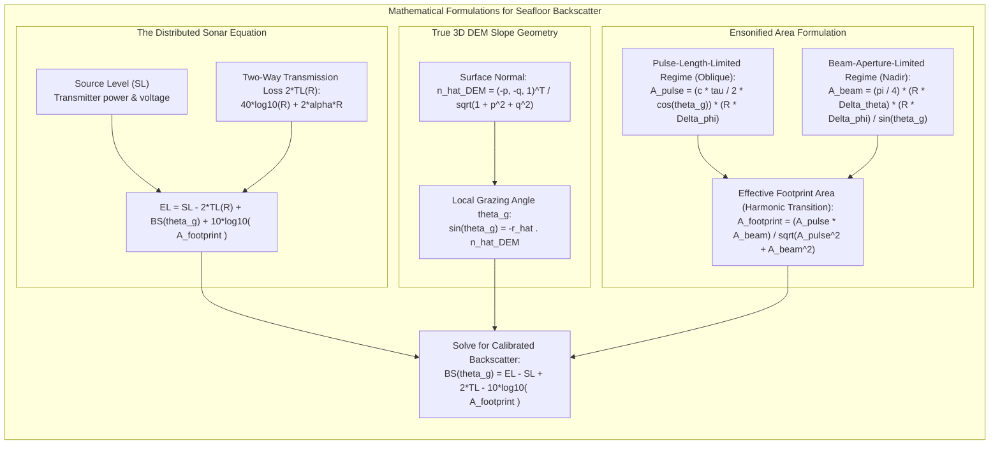

# Chapter 28: Acoustic Backscatter, LiDAR Intensity, and Substrate/Benthic Co-Products

*Why elevation and depth sensors never measure geometry alone—and how co-registered return amplitude disambiguates terrain surfaces and hazards.*

---

## 28.5 Mathematical Foundations of Acoustic Backscatter and Radiometric Correction

Transforming raw acoustic receiver voltages into physical seafloor backscattering strength requires solving the sonar equation for distributed surface targets. This section derives the complete mathematical formulation linking sensor voltage, spherical wave transmission loss, true 3D DEM grazing angles, and slope-projected footprint areas.

---

### 28.5.1 The Active Sonar Equation for Distributed Targets

For a continuous, distributed interface like the seafloor, acoustic scattering is distributed across an extended surface patch rather than concentrated in a discrete point reflector.

The acoustic power received at the transducer array (expressed as **Echo Level $\text{EL}$** in $\text{dB re } 1\,\mu\text{Pa}$) is governed by the active sonar equation:

$$\text{EL} = \text{SL} - 2\text{TL}(R) + \text{TS}_{\text{area}}$$
where:
* $\text{SL}$: Transmit Source Level ($\text{dB re } 1\,\mu\text{Pa at } 1\text{ meter}$).
* $\text{TL}(R)$: One-way transmission loss over slant range $R$ ($\text{dB}$).
* $\text{TS}_{\text{area}}$: Target Strength of the distributed ensonified area.

#### 1. Target Strength Decomposition
For a distributed surface, target strength is the product of the intrinsic **Bottom Backscattering Strength per unit area ($S_b$ or $BS$)** and the physical **ensonified footprint area ($A_{\text{footprint}}$)**:

$$\text{TS}_{\text{area}} = 10 \log_{10}\left( \int_{A_{\text{footprint}}} \sigma_b \, dA \right) \approx BS(\theta_g) + 10 \log_{10} A_{\text{footprint}}(\theta_g, R)$$
where $\sigma_b$ is the dimensionless differential scattering cross-section per unit solid angle per unit area, and $BS(\theta_g) = 10\log_{10}\sigma_b$ (expressed in $\text{dB re } 1\text{ m}^2/\text{m}^2$).

#### 2. Two-Way Transmission Loss
Accounting for spherical wave spreading and seawater absorption over two-way slant range $2R$:
$$2\text{TL}(R) = 40 \log_{10}(R) + 2 \cdot \alpha(f, T, S, P) \cdot R$$
where $\alpha$ is the absorption coefficient in $\text{dB/meter}$.

Substituting into the sonar equation yields:
$$\text{EL} = \text{SL} - \big( 40 \log_{10} R + 2 \alpha R \big) + BS(\theta_g) + 10 \log_{10} A_{\text{footprint}}(\theta_g, R)$$

---

### 28.5.2 Deriving the True Local Grazing Angle from the 3D DEM

Backscatter strength $BS(\theta_g)$ depends heavily on the angle between the incoming acoustic ray and the tangent plane of the seabed.

#### 1. Coordinate Definitions and Surface Normal
Let the seafloor elevation model be defined on a grid $z = f(x, y)$ in a Cartesian coordinate system where $+z$ points Upward.

The spatial surface gradients are:
$$p = \frac{\partial z}{\partial x}, \quad q = \frac{\partial z}{\partial y}$$

The outward-pointing unit normal vector derived directly from the DEM is:
$$\hat{\mathbf{n}}_{\text{DEM}} = \frac{1}{\sqrt{1 + p^2 + q^2}} \begin{pmatrix} -p \\ -q \\ 1 \end{pmatrix}$$

#### 2. Ray Vector and Grazing Angle Calculation
Let $\mathbf{x}_{\text{sensor}} = (x_s, y_s, z_s)^T$ be the physical 3D coordinate of the sonar transducer at ping transmission, and let $\mathbf{x}_{\text{seafloor}} = (x_b, y_b, z_b)^T$ be the sounding position on the seafloor.

The slant range vector is:
$$\mathbf{r} = \mathbf{x}_{\text{seafloor}} - \mathbf{x}_{\text{sensor}}, \quad R = \|\mathbf{r}\|$$
The incident ray unit vector pointing *toward* the seafloor is:
$$\hat{\mathbf{r}} = \frac{\mathbf{r}}{R}$$

The angle of incidence $\theta_i$ is the angle between the incoming ray and the inward surface normal ($-\hat{\mathbf{n}}_{\text{DEM}}$):
$$\cos\theta_i = -\hat{\mathbf{r}} \cdot \hat{\mathbf{n}}_{\text{DEM}}$$

The **local grazing angle $\theta_g$** is the complementary angle measured upward from the tangent plane to the ray:
$$\theta_g = 90^\circ - \theta_i \implies \sin\theta_g = \cos\theta_i = -\hat{\mathbf{r}} \cdot \hat{\mathbf{n}}_{\text{DEM}}$$

$$\theta_g = \arcsin\left( -\hat{\mathbf{r}} \cdot \hat{\mathbf{n}}_{\text{DEM}} \right)$$

*If the seafloor is assumed horizontal ($\hat{\mathbf{n}} = (0, 0, 1)^T$), then $\sin\theta_g = -r_z/R = \cos\phi_{\text{launch}}$. Any local slope angle $\beta$ shifts the true grazing angle by $\Delta \theta_g = \beta$, inducing errors exceeding $15\text{ dB}$ in backscatter strength if uncorrected!*

---

### 28.5.3 Ensonified Footprint Area ($A_{\text{footprint}}$)

The physical area of the seafloor contributing acoustic energy to a single time sample depends on whether the echo is bounded by the acoustic pulse duration or by the beamwidth aperture.

#### 1. Pulse-Length-Limited Regime (Oblique Angles)
At oblique angles ($\theta_g \ll 90^\circ$), the transmit pulse of duration $\tau$ ($seconds$) projects across the seabed. The instantaneous radial length ensonified on the slope is:
$$L_{\text{across}} = \frac{c \tau}{2 \cos\theta_g}$$
where $c$ is the sound speed at the seabed.

The along-track width of the footprint is governed by the two-way along-track beamwidth $\Delta \phi_{\text{along}}$ ($\text{radians}$):
$$L_{\text{along}} = R \cdot \Delta \phi_{\text{along}}$$

The ensonified area in the pulse-length-limited regime is:
$$A_{\text{pulse}}(\theta_g, R) = L_{\text{across}} \cdot L_{\text{along}} = \frac{c \tau R \Delta \phi_{\text{along}}}{2 \cos\theta_g}$$

#### 2. Beam-Aperture-Limited Regime (Near Nadir)
As the ray approaches normal incidence ($\theta_g \to 90^\circ$), $\cos\theta_g \to 0$, causing $A_{\text{pulse}}$ to diverge toward infinity. In reality, the footprint cannot exceed the geometric ellipse bounded by the beamwidth apertures:
$$L_{\text{across, beam}} = R \cdot \Delta \theta_{\text{across}}$$
$$L_{\text{along, beam}} = R \cdot \Delta \phi_{\text{along}}$$

The beam-limited footprint area projected onto the seabed tangent plane (inclined at incidence angle $\theta_i = 90^\circ - \theta_g$, where $\cos\theta_i = \sin\theta_g$) is an ellipse (Lurton & Lamarche, 2015):
$$A_{\text{beam}}(\theta_g, R) = \frac{\pi}{4\sin\theta_g} \big( R \cdot \Delta \theta_{\text{across}} \big) \big( R \cdot \Delta \phi_{\text{along}} \big)$$

#### 3. Continuous Effective Area Formulation
In robust processing algorithms (such as the Lurton & Lamarche 2015 formulation), the effective footprint area is evaluated as the harmonic combination:

$$A_{\text{footprint}}(\theta_g, R) = \frac{A_{\text{pulse}} \cdot A_{\text{beam}}}{\sqrt{A_{\text{pulse}}^2 + A_{\text{beam}}^2}} = \frac{\frac{c \tau R \Delta \phi}{2\cos\theta_g}}{\sqrt{1 + \left( \frac{2 c \tau \tan\theta_g}{\pi R \Delta \theta} \right)^2}}$$
This closed-form formulation transitions smoothly from the beam-limited specular disk at nadir to the pulse-limited strip at outer beams without numerical singularities.

---

### 28.5.4 Inverting for Calibrated Seafloor Backscattering Strength

Solving the active sonar equation for the true bottom backscattering strength $BS(\theta_g)$:

$$BS(\theta_g) = \text{EL} - \text{SL} + 40 \log_{10}(R) + 2 \alpha_{\text{ac}} R - 10 \log_{10} A_{\text{footprint}}(\theta_g, R)$$

By explicitly evaluating $R$, $\hat{\mathbf{r}}$, $\hat{\mathbf{n}}_{\text{DEM}}$, and $\theta_g$ at every point on the seabed using the co-registered 3D DEM, all sensor transmission losses, footprint geometry distortions, and topographic slope shadings are eliminated. The resulting $BS(\theta_g)$ surface represents an intrinsic acoustic property of the seabed substrate, suitable for objective geoscientific and biological habitat classification.

---

### 28.5.5 Radiometric Normalization for LiDAR Intensity and SAR Terrain Flattening

The exact same 3D DEM surface normal $\hat{\mathbf{n}}_{\text{DEM}} = [-p, -q, 1]^\top / \sqrt{1 + p^2 + q^2}$ governs radiometric calibration in optical laser scanning and microwave radar:

#### 1. LiDAR Pseudo-Reflectance Normalization (Höfle & Pfeifer, 2007)
For an extended Lambertian surface with recorded laser pulse intensity $I_{\text{raw}}$, slant range $R = \|\mathbf{x}_{\text{target}} - \mathbf{x}_{\text{sensor}}\|_2$, and true DEM incidence angle $\cos\theta_i = -\hat{\mathbf{r}} \cdot \hat{\mathbf{n}}_{\text{DEM}}$, the range- and angle-normalized intensity $I_{\text{norm}}$ referenced to standard altitude $R_{\text{ref}}$ and nadir incidence ($\theta_{i,\text{ref}} = 0^\circ$) is:
$$I_{\text{norm}} = I_{\text{raw}} \cdot \left(\frac{R}{R_{\text{ref}}}\right)^2 \cdot \frac{\exp\big(2 \alpha_{\text{atm}}(R - R_{\text{ref}})\big)}{\big(-\hat{\mathbf{r}} \cdot \hat{\mathbf{n}}_{\text{DEM}}\big)^k}$$
where $k = 1$ for an ideal Lambertian scatterer, or $k \in [0.6, 1.2]$ in generalized Minnaert / Lommel-Seeliger rough-terrain reflectance models.

#### 2. SAR Terrain-Flattened Gamma-Naught ($\gamma_T^0$, Small, 2011)
In Synthetic Aperture Radar, a single slant-range / azimuth pixel $(r, a)$ receives energy from a collection of 3D DEM surface facets $k \in \mathcal{F}(r, a)$ due to topographic foreshortening and layover. Let $A_{3\text{D},k} = \Delta x \Delta y \sqrt{1 + p_k^2 + q_k^2}$ denote the true 3D surface area of DEM facet $k$, and let $\theta_{i,k} = \arccos(-\hat{\mathbf{r}}_k \cdot \hat{\mathbf{n}}_{\text{DEM},k})$ be its local incidence angle relative to the radar look vector $\hat{\mathbf{r}}_k$. The local illuminated area projected into the plane perpendicular to the radar line of sight is $A_{\gamma,k} = A_{3\text{D},k} \cos\theta_{i,k}$. Integrating over all DEM facets contributing to radar bin $(r, a)$ yields the homomorphic terrain-flattened backscatter $\gamma_T^0$:
$$\gamma_T^0(r, a) = \frac{\beta^0(r, a) \, A_{\beta}}{\sum_{k \in \mathcal{F}(r,a)} A_{3\text{D},k} \max\big(0, -\hat{\mathbf{r}}_k \cdot \hat{\mathbf{n}}_{\text{DEM},k}\big)}$$
where $A_\beta = \Delta r_{\text{slant}} \Delta a_{\text{az}}$ is the nominal slant-range pixel area.

#### 3. Propagating DEM Slope Uncertainty into Backscatter Error ($\sigma_{BS}$)
Because DEM derivatives $(p, q)$ amplify high-frequency elevation noise $\sigma_z$ inversely with grid spacing ($\sigma_p = \sigma_q \approx \frac{\sigma_z}{\sqrt{2}\Delta x}$), uncertainty in the DEM surface normal propagates directly into grazing-angle uncertainty $\sigma_{\theta_g}$ (in radians):
$$\sigma_{\theta_g}^2 \approx \left(\frac{\partial \theta_g}{\partial p}\right)^2 \sigma_p^2 + \left(\frac{\partial \theta_g}{\partial q}\right)^2 \sigma_q^2 \approx \cos^4\alpha \, \sigma_p^2 = \sigma_\alpha^2 \quad (\text{look-aligned slope; bounded by } \cos^2\alpha\,\sigma_p^2)$$
In the pulse-length-limited regime ($A_{\text{pulse}} \propto 1/\cos\theta_g$), an error $\delta\theta_g$ (in radians) perturbs both the footprint area term ($-10\log_{10} A_{\text{pulse}}$) and the physical angular response curve $BS(\theta_g)$:
$$\delta BS_{\text{total}}(\theta_g) \approx \left( \frac{\partial BS}{\partial \theta_g} - \frac{10}{\ln 10} \tan\theta_g \right) \delta\theta_g$$
This reveals a fundamental scale trade-off: if the DEM used for slope correction is gridded too finely without smoothing noisy outer-beam soundings, derivative noise $\sigma_p$ injects speckle noise into the backscatter mosaic; if gridded too coarsely, real bedform slopes are smoothed out, leaving residual topographic shading.

---

### 28.5.6 Worked Numerical Calculation: 3D DEM Slope vs. Flat-Seafloor Backscatter Error

Consider a $300\text{ kHz}$ multibeam echosounder ($\alpha_{\text{ac}} = 0.070\text{ dB/m}$, sound speed $c = 1500\text{ m/s}$, pulse length $\tau = 0.20\text{ ms} = 2.0 \times 10^{-4}\text{ s}$, beamwidths $\Delta\theta_{\text{across}} = \Delta\phi_{\text{along}} = 1.0^\circ = 0.017453\text{ rad}$, Source Level $\text{SL} = 215.0\text{ dB re } 1\,\mu\text{Pa at } 1\text{ m}$) ensonifying a seafloor point at slant range $R = 50.0\text{ m}$ and across-track beam launch angle $\theta_{\text{launch}} = 50.0^\circ$ from nadir in the $+x$ (East) direction, so the incident ray unit vector is $\hat{\mathbf{r}} = [\sin 50^\circ, 0, -\cos 50^\circ]^\top = [0.7660, 0, -0.6428]^\top$. The recorded Echo Level is $\text{EL} = 118.0\text{ dB re } 1\,\mu\text{Pa}$.

Suppose the seafloor at this location is a sandbank sloping upward toward $+x$ with gradient $p = \partial z/\partial x = +0.3640 = +\tan 20.0^\circ$ (a $20.0^\circ$ upslope whose West-facing flank tilts back toward the sonar at $x = 0$) and $q = 0$:

1. **Flat-Seafloor Assumption ($\hat{\mathbf{n}}_{\text{flat}} = [0, 0, 1]^\top$):**
   * Apparent grazing angle: $\sin\theta_{g,\text{flat}} = -\hat{\mathbf{r}}\cdot\hat{\mathbf{n}}_{\text{flat}} = 0.6428 \implies \theta_{g,\text{flat}} = 40.0^\circ$ ($\cos 40.0^\circ = 0.7660$).
   * Apparent pulse-limited area:
     $$A_{\text{pulse,flat}} = \frac{(1500)(2.0 \times 10^{-4})(50.0)(0.017453)}{2 (0.7660)} = \frac{0.2618}{1.5321} = 0.1709\text{ m}^2 \implies 10\log_{10} A_{\text{pulse,flat}} = -7.67\text{ dB re } 1\text{ m}^2$$
   * Apparent backscatter (with $40\log_{10}(50) = 67.96\text{ dB}$ and $2\alpha_{\text{ac}} R = 7.00\text{ dB}$):
     $$BS_{\text{flat}} = 118.0 - 215.0 + 67.96 + 7.00 - (-7.67) = -14.37\text{ dB}$$

2. **True 3D DEM Normal Correction ($\hat{\mathbf{n}}_{\text{DEM}}$):**
   * Unit normal: $\hat{\mathbf{n}}_{\text{DEM}} = \frac{[-p, 0, 1]^\top}{\sqrt{1 + (+0.3640)^2}} = [-0.3420, 0, +0.9397]^\top$.
   * True local grazing angle:
     $$\sin\theta_{g,\text{true}} = -\big((+0.7660)(-0.3420) + (0)(0) + (-0.6428)(+0.9397)\big) = -\big(-0.2620 - 0.6040\big) = +0.8660 \implies \theta_{g,\text{true}} = 60.0^\circ$$
   * True pulse-limited area ($\cos 60.0^\circ = 0.5000$):
     $$A_{\text{pulse,true}} = \frac{0.2618}{2(0.5000)} = 0.2618\text{ m}^2 \implies 10\log_{10} A_{\text{pulse,true}} = -5.82\text{ dB re } 1\text{ m}^2$$
   * True footprint-corrected backscatter:
     $$BS_{\text{true}}(60.0^\circ) = 118.0 - 215.0 + 67.96 + 7.00 - (-5.82) = -16.22\text{ dB}$$
   * Furthermore, on medium sand, physical backscattering strength increases by $\sim +5.5\text{ dB}$ between $\theta_g = 40^\circ$ and $\theta_g = 60^\circ$. Without the 3D DEM normal, the processor both underestimates the footprint area by $1.85\text{ dB}$ *and* evaluates the ARA curve at the wrong angle ($40^\circ$ instead of $60^\circ$), producing a combined **$>7.3\text{ dB}$ radiometric bias** that misclassifies the sand slope as coarse gravel or rock!
