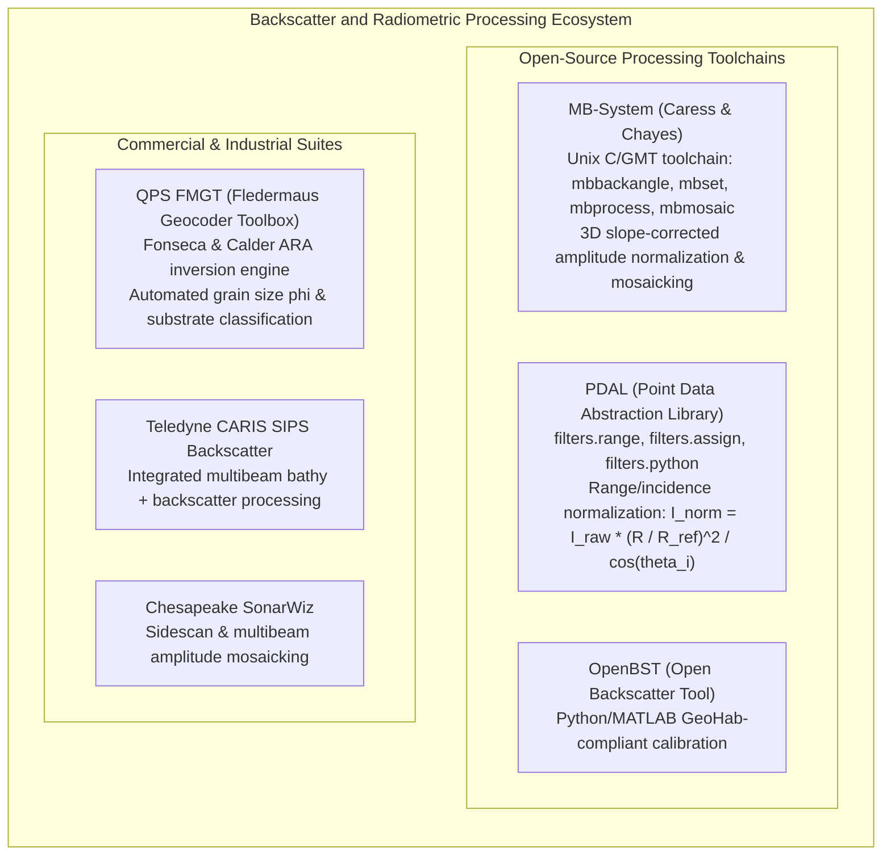

# Chapter 28: Acoustic Backscatter, LiDAR Intensity, and Substrate/Benthic Co-Products

*Why elevation and depth sensors never measure geometry alone—and how co-registered return amplitude disambiguates terrain surfaces and hazards.*

---

## 28.6 Software Ecosystem

Processing, calibrating, and inverting co-registered backscatter and radiometric intensity requires specialized software pipelines that integrate the 3D surface model directly into the radiometric signal path. This section reviews the open-source and commercial toolchains used in hydrographic acoustics and laser scanning.



---

### 28.6.1 Open-Source Processing Toolchains

#### 1. MB-System (`mbbackangle`, `mbset`, `mbprocess`, and `mbmosaic`)
Developed by David Caress and Dale Chayes, **MB-System** executes backscatter normalization in a structured four-step pipeline coupling the bathymetric DEM directly to swath radiometry:
* **`mbbackangle`:** Reads raw swath files (`-F-1 -Idatalist.mb-1`), computes true 3D local grazing angles $\theta_g$ against the bathymetric DEM (`-Q` / `-Gtopo.grd`), and generates empirical Amplitude-vs.-Grazing-Angle (`.aga`) and Sidescan-vs.-Grazing-Angle (`.sga`) correction tables.
* **`mbset` & `mbprocess`:** Registers the `.aga`/`.sga` tables inside each swath's `.par` parameter file (`AMPCORRFILE` / `SSCORRFILE`) and writes processed swath files (`datalistp.mb-1`) with flattened angular response.
* **`mbmosaic`:** Projects processed beam amplitudes (`-A3`) or snippet sidescan (`-A4`) onto a metric GeoTIFF/GMT NetCDF grid (`-E2.0/2.0/meters!`) using grazing-angle priority weighting (`-N`):

```bash
#!/usr/bin/env bash
# MB-System 4-Step Pipeline: 3D Slope-Corrected Multibeam Backscatter Mosaic
set -euo pipefail

DATALIST="datalist.mb-1"

# 1. Extract amplitude (-A1) & sidescan (-A2) vs. true 3D slope grazing angle (-Q)
mbbackangle -F-1 -I${DATALIST} -A1 -A2 -Q -Gbathymetry_2m.grd -V

# 2. Bind generated .aga/.sga angular tables into per-line .par files and batch-apply
mbset -F-1 -I${DATALIST} -PAMPCORRFILE:${DATALIST}_tot.aga -PSSCORRFILE:${DATALIST}_tot.sga -V
mbprocess -F-1 -I${DATALIST} -V

# 3. Mosaic processed sidescan/snippets (-A4) from processed datalistp.mb-1 at 2 m spacing
mbmosaic -F-1 -Idatalistp.mb-1 \
         -O calibrated_backscatter_2m \
         -R-122.50/-122.35/37.75/37.85 \
         -E2.0/2.0/meters! \
         -A4 -N -V
```

#### 2. PDAL (Point Data Abstraction Library): Radiometric Normalization
In terrestrial LiDAR, raw intensity decays with the square of slant range $R$. If an aircraft changes flight altitude from $1,000\text{ m}$ to $1,500\text{ m}$, the same asphalt road appears less than half as bright. 

**PDAL** provides pipeline filters to normalize raw intensity to a standard reference range $R_{\text{ref}}$:
$$I_{\text{normalized}} = I_{\text{raw}} \cdot \left( \frac{R}{R_{\text{ref}}} \right)^2$$

```json
{
  "pipeline": [
    "input_raw_flightline.laz",
    {
      "type": "filters.range",
      "limits": "Classification![7:7]"
    },
    {
      "type": "filters.python",
      "script": "normalize_intensity.py",
      "function": "apply_range_correction",
      "module": "pdal_radiometry"
    },
    {
      "type": "writers.las",
      "filename": "output_normalized_intensity.laz",
      "forward": "all"
    }
  ]
}
```

```python
# normalize_intensity.py (PDAL Python Filter)
import numpy as np

def apply_range_correction(ins, outs):
    """
    Normalizes LiDAR intensity using sensor trajectory slant range.
    I_norm = I_raw * (R / R_ref)^2
    """
    R_ref = 1000.0  # Reference flight altitude in meters
    
    # Extract coordinates and raw intensity
    z = ins['Z']
    raw_intensity = ins['Intensity']
    
    # Estimate slant range assuming flight ceiling at H = 1500m
    H_aircraft = 1500.0
    slant_range = H_aircraft - z
    
    # Apply square-law range normalization
    norm_factor = (slant_range / R_ref) ** 2
    corrected_intensity = raw_intensity * norm_factor
    
    # Clip to 16-bit integer range [0, 65535]
    outs['Intensity'] = np.clip(corrected_intensity, 0, 65535).astype(np.uint16)
    return True
```

#### 3. OpenBST (Open Backscatter Tool) and Python 3D DEM Grazing-Angle Normalization
Maintained by marine research consortia (IFREMER, NIWA, and the GeoHab Backscatter Working Group), **OpenBST** implements the GeoHab 2015/2018 calibration standards in Python and MATLAB. It explicitly extracts local 3D surface normals $\hat{\mathbf{n}}_{\text{DEM}}$ from a companion bathymetric DEM to compute true slope-corrected footprint areas, remove sonar-specific TVG curves, and perform Jackson scattering model inversions.

Below is a complete, self-contained Python reference implementation demonstrating how a bathymetric DEM grid and vessel trajectory are coupled to compute true 3D grazing angles $\theta_g$, harmonic footprint areas $A_{\text{footprint}}(\theta_g, R)$, and slope-corrected seafloor backscatter $BS(\theta_g)$:

```python
"""
Compute 3D DEM-derived local grazing angles, harmonic footprint areas,
and radiometrically calibrated seafloor backscatter strength BS(theta_g).
"""

import numpy as np

def calibrate_multibeam_backscatter(
    dem_z: np.ndarray,
    dx: float,
    dy: float,
    sensor_xyz: np.ndarray,
    echo_level_db: np.ndarray,
    source_level_db: float = 215.0,
    alpha_db_per_m: float = 0.068,
    c_sound: float = 1500.0,
    tau_sec: float = 2.0e-4,
    beamwidth_across_rad: float = np.deg2rad(1.0),
    beamwidth_along_rad: float = np.deg2rad(1.0),
) -> dict[str, np.ndarray]:
    """
    Calibrates multibeam backscatter using true 3D DEM surface normals.

    Args:
        dem_z: 2D array of positive-up seafloor elevation z(y, x) in meters.
        dx, dy: Grid spacing in meters along Easting (x) and Northing (y).
        sensor_xyz: 3-element array [x_s, y_s, z_s] of sonar transducer in meters.
        echo_level_db: 2D array of measured Echo Level (EL, dB re 1 uPa).
        source_level_db: Calibrated transmit Source Level (SL, dB re 1 uPa @ 1 m).
        alpha_db_per_m: Seawater absorption coefficient alpha_ac (dB/m).
        c_sound: Local sound speed at the seabed (m/s).
        tau_sec: Effective transmit pulse duration (s).
        beamwidth_across_rad: Across-track -3 dB beamwidth (rad).
        beamwidth_along_rad: Along-track -3 dB beamwidth (rad).

    Returns:
        Dictionary with slant range R, true vs. flat grazing angles, footprint
        areas, and calibrated BS_true vs. BS_flat (in dB re 1 m^2/m^2).
    """
    ny, nx = dem_z.shape
    x_grid, y_grid = np.meshgrid(np.arange(nx) * dx, np.arange(ny) * dy)

    # 1. Compute DEM partial derivatives p = dz/dx, q = dz/dy via central differences
    dz_dy, dz_dx = np.gradient(dem_z, dy, dx)
    norm_denom = np.sqrt(1.0 + dz_dx**2 + dz_dy**2)
    n_hat_x = -dz_dx / norm_denom
    n_hat_y = -dz_dy / norm_denom
    n_hat_z = 1.0 / norm_denom

    # 2. Compute 3D ray vector r = x_seafloor - x_sensor and slant range R
    rx = x_grid - sensor_xyz[0]
    ry = y_grid - sensor_xyz[1]
    rz = dem_z - sensor_xyz[2]
    slant_range = np.sqrt(rx**2 + ry**2 + rz**2)
    r_hat_x = rx / slant_range
    r_hat_y = ry / slant_range
    r_hat_z = rz / slant_range

    # 3. True local grazing angle sin(theta_g) = -r_hat . n_hat_DEM
    sin_theta_g_true = np.clip(
        -(r_hat_x * n_hat_x + r_hat_y * n_hat_y + r_hat_z * n_hat_z), 1e-3, 1.0
    )
    theta_g_true = np.arcsin(sin_theta_g_true)
    cos_theta_g_true = np.maximum(np.cos(theta_g_true), 1e-3)

    # Compare against flat-seafloor assumption n_hat_flat = [0, 0, 1]^T
    sin_theta_g_flat = np.clip(-r_hat_z, 1e-3, 1.0)
    theta_g_flat = np.arcsin(sin_theta_g_flat)
    cos_theta_g_flat = np.maximum(np.cos(theta_g_flat), 1e-3)

    # 4. Compute harmonic footprint area A_footprint (Lurton & Lamarche, 2015)
    a_beam_true = (
        (np.pi / 4.0)
        * (slant_range * beamwidth_across_rad)
        * (slant_range * beamwidth_along_rad)
        / sin_theta_g_true
    )
    a_beam_flat = (
        (np.pi / 4.0)
        * (slant_range * beamwidth_across_rad)
        * (slant_range * beamwidth_along_rad)
        / sin_theta_g_flat
    )
    a_pulse_true = (c_sound * tau_sec * slant_range * beamwidth_along_rad) / (2.0 * cos_theta_g_true)
    a_pulse_flat = (c_sound * tau_sec * slant_range * beamwidth_along_rad) / (2.0 * cos_theta_g_flat)

    a_foot_true = (a_pulse_true * a_beam_true) / np.sqrt(a_pulse_true**2 + a_beam_true**2)
    a_foot_flat = (a_pulse_flat * a_beam_flat) / np.sqrt(a_pulse_flat**2 + a_beam_flat**2)

    # 5. Invert active sonar equation for Bottom Backscattering Strength BS (dB)
    two_way_tl = 40.0 * np.log10(slant_range) + 2.0 * alpha_db_per_m * slant_range
    bs_true_db = echo_level_db - source_level_db + two_way_tl - 10.0 * np.log10(a_foot_true)
    bs_flat_db = echo_level_db - source_level_db + two_way_tl - 10.0 * np.log10(a_foot_flat)

    return {
        "slant_range_m": slant_range,
        "theta_g_true_deg": np.rad2deg(theta_g_true),
        "theta_g_flat_deg": np.rad2deg(theta_g_flat),
        "footprint_true_m2": a_foot_true,
        "bs_true_db": bs_true_db,
        "bs_flat_db": bs_flat_db,
        "slope_error_db": bs_flat_db - bs_true_db,
    }
```

#### 4. ESA SNAP, ISCE3, and Orfeo ToolBox for SAR Terrain Flattening ($\gamma_T^0$)
In spaceborne radar remote sensing, the open-source **ESA Sentinel Application Platform (SNAP)** (`Terrain-Flattening` operator), NASA/JPL **ISCE3** (`rtc` module used for OPERA and NISAR), and **GAMMA** ingest a reference DEM (such as Copernicus GLO-30) to compute the exact 3D facet-projected area $A_{\gamma,k} = A_{3\text{D},k}\cos\theta_{i,k}$ (Small, 2011) and output terrain-flattened $\gamma_T^0$ backscatter rasters co-registered with the DEM.

---

### 28.6.2 Commercial Suites: FMGT, CARIS SIPS, SonarWiz, and LiDAR Suites

#### 1. QPS FMGT (Fledermaus Geocoder Toolbox)
The benchmark commercial software for acoustic backscatter processing and sediment inversion, built upon the **Geocoder** and **Angular Range Analysis (ARA)** technology developed by Luciano Fonseca, Larry Mayer, and Brian Calder at UNH CCOM/JHC:
* Automatically extracts vessel trajectory, attitude, transmit power, pulse length, and receiver gain tables from raw vendor formats (Kongsberg `.all`/`.kmall`, Reson `.s7k`, Norbit, R2Sonic, Edgetech).
* Ingests the co-registered Bathymetric Attributed Grid (BAG) or Qimera dynamic CUBE surface to calculate the true 3D surface normal $\hat{\mathbf{n}}_{\text{DEM}}$ for every acoustic sounding and time-series snippet sample.
* Computes **Angular Range Analysis (ARA)** patches across the swath, fitting observed angular response curves $BS(\theta_g)$ to the APL-UW Jackson seafloor model to output georeferenced GeoTIFFs of **Mean Grain Size ($\phi$)**, **Acoustic Impedance ($Z_{\text{ac}}$)**, **Volume Scattering Parameter ($\sigma_v$)**, and **Benthic Substrate Classification** alongside seamless feathered backscatter mosaics.

#### 2. Teledyne CARIS HIPS and SIPS (SIPS Backscatter)
Integrated directly within the CARIS HIPS and SIPS hydrographic production workflow:
* Provides two parallel processing engines: the **SIPS Time-Series / Geocoder Engine** and the **SIPS Beam-Average Engine**, directly reading the verified HIPS bathymetric surface for 3D grazing-angle and footprint normalization.
* Links directly to **CARIS Bathy DataBASE**, enabling hydrographers inspecting candidate shoals in the 3D Subset Editor to toggle the calibrated backscatter mosaic and water-column curtain in real time before designating a sounding for an IHO S-102 or S-57 chart.

#### 3. Chesapeake Technology SonarWiz and Kongsberg SIS
* **Chesapeake SonarWiz:** Widely used across coastal engineering, marine archeology, and offshore wind site characterization for co-processing sidescan sonar, multibeam bathymetry, multibeam snippet backscatter, and sub-bottom profiles. Includes empirical Beam Angle Correction (BAC), true DEM slope correction, and seabed texture classification (Grey-Level Co-occurrence Matrix, GLCM, entropy and contrast).
* **Kongsberg Seafloor Information System (SIS) & `.kmall` Calibration:** Real-time acquisition software that logs calibrated per-sample reflectivity (`MRZ` datagrams in `.kmall`) with documented factory tank-calibration offsets and built-in absorption profile calculation from live MVP/CTD casts.

#### 4. Riegl RiPROCESS and Teledyne Optech LMS for Calibrated LiDAR Reflectance
In commercial airborne and mobile laser scanning, **Riegl RiPROCESS** exports a radiometrically calibrated **`Reflectance` ($\text{dB}$)** attribute in LAS Extra Bytes—defined as the ratio in decibels between the measured return amplitude and the amplitude expected from a diffuse white Lambertian target ($100\%$ reflectance) oriented perpendicular to the beam at the exact same range $R$. This eliminates range-squared drop-off at the firmware/post-processing stage, leaving only the local DEM incidence-angle factor $\cos\theta_i$ to be normalized in downstream terrain analysis.
