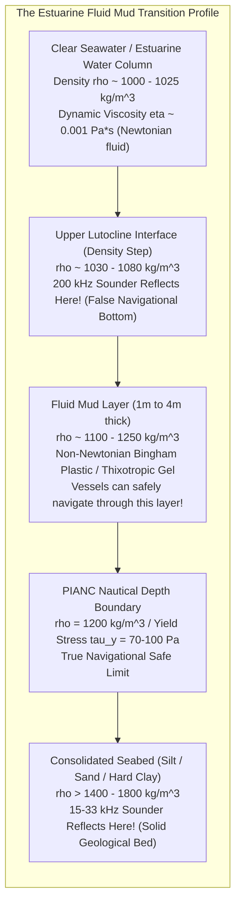
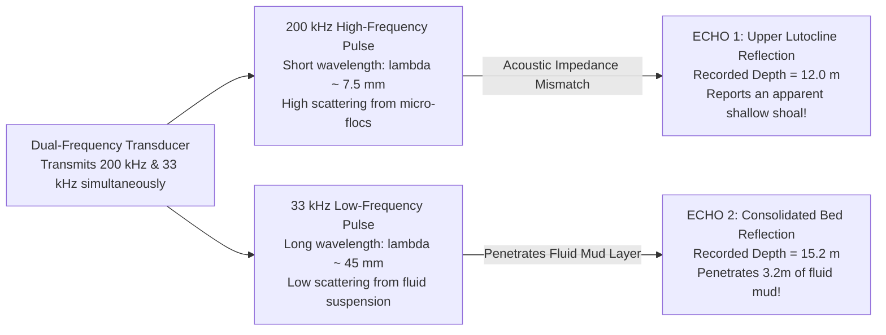

# Chapter 29: Fluid Mud, "Nautical Depth," and Multi-Horizon Subsurface DEMs

*When the seabed or ground surface is not a sharp boundary: modeling rheologic transitions, fluid mud, and stacked subsurface horizons.*

---

## 29.1 The Fluid Mud Problem and Dual-Frequency Echosounding

Almost all digital elevation models rest upon an unstated mathematical axiom: that the surface of the Earth is a discrete, two-dimensional geometric boundary separating two distinct states of matter (air above soil, or water above rock). In the real world, this axiom breaks down. Across the world's major ports, estuaries, and deltaic rivers, the boundary between water and earth is not a surface; it is a **continuous, multi-meter vertical transition zone of fluid mud**.

When a survey vessel deploys a standard single-frequency echosounder over fluid mud, the recorded elevation is an artifact of the acoustic frequency chosen by the surveyor. A high-frequency sonar reports an impassable shallow shoal, while a low-frequency sonar reports a deep, safe navigation channel. Understanding the physics of dual-frequency sounding is essential to prevent tens of millions of dollars in unnecessary maintenance dredging.

---

### 29.1.1 The Genesis of Estuarine Fluid Mud

In high-turbidity coastal environments—such as the Port of Rotterdam (Europort), the Mississippi River Southwest Pass, the Amazon mouth, the Yangtze estuary, the Scheldt, the Loire, and the Guiana coastline—fine cohesive clay minerals (illite, kaolinite, smectite) interact with saltwater electrolytes.

#### 1. Cohesive Flocculation and Estuarine Turbidity Maxima (ETM)
As freshwater river plumes carrying suspended sediment enter the saline estuary, the high ionic strength of seawater collapses the repulsive electrostatic double layer surrounding clay platelets. The platelets aggregate into porous, low-density clumps called **flocs**. 

In the Estuarine Turbidity Maximum (ETM)—where the landward-flowing saline density wedge meets the seaward river discharge—flocs settle rapidly at slack tide, accumulating in dredged harbor basins at rates exceeding $0.5\text{–}1.0\text{ meters per month}$.

#### 2. The Multi-Layer Density Profile
The resulting water column does not terminate abruptly at a solid bed; instead, it forms a continuous vertical density gradient $\rho(z)$:
1. **The Water Column ($\rho \approx 1000\text{–}1025\text{ kg/m}^3$):** Clear or moderately turbid water with standard Newtonian fluid viscosity ($\mu \approx 10^{-3}\text{ Pa}\cdot\text{s}$).
2. **The Upper Lutocline ($\rho \approx 1030\text{–}1080\text{ kg/m}^3$):** A sharp vertical gradient in suspended sediment concentration (from milligrams per liter to tens of grams per liter).
3. **Fluid Mud ($\rho \approx 1100\text{–}1300\text{ kg/m}^3$):** A concentrated suspension of flocs. At this concentration, the flocs form a continuous, space-filling structural network exhibiting **non-Newtonian, thixotropic, and Bingham plastic behavior**. Under low shear, it behaves like a weak gelatinous solid; under high shear (such as a ship's propeller or hull passage), it liquefies and flows like a viscous liquid.
4. **Consolidated Bed ($\rho > 1400\text{–}1800\text{ kg/m}^3$):** Dewatered, mechanically consolidated clay, silt, or sand possessing true geotechnical shear strength.

---

### 29.1.2 Dual-Frequency Echosounding: The Frequency-Depth Split

To map bathymetry in fluid mud ports, hydrographers historically deployed dual-frequency single-beam echosounders (typically transmitting $200\text{–}210\text{ kHz}$ and $15\text{–}33\text{ kHz}$ simultaneously through a single transducer).

#### 1. High-Frequency Acoustics ($200\text{–}210\text{ kHz}$)
* At $200\text{ kHz}$, the acoustic wavelength in water is very short:
  $$\lambda_{200} = \frac{c}{f} = \frac{1500\text{ m/s}}{200,000\text{ Hz}} = 7.5\text{ millimeters}$$
* Two physical mechanisms cause a $200\text{-kHz}$ echosounder to lock onto the upper lutocline:
  1. **Steep Lutocline Density Gradient & Rayleigh Floc Scattering ($f^4$):** Across the thin upper lutocline transition zone ($L_{\text{lut}} \approx 1\text{–}3\text{ cm}$), bulk density jumps by $\Delta\rho \approx 30\text{–}60\text{ kg/m}^3$ and suspended clay/silt macro-flocs ($d_{\text{floc}} \approx 0.2\text{–}2.0\text{ mm}$) form a dense scattering blanket. In the Rayleigh scattering regime ($d_{\text{floc}} \ll \lambda$), volume backscattering cross-section scales with the **fourth power of acoustic frequency** ($\sigma_v \propto f^4 d_{\text{floc}}^6$). Consequently, floc volume backscatter at $200\text{ kHz}$ is $(200/33)^4 \approx 1,350\times$ (**$+31.3\text{ dB}$**) stronger than at $33\text{ kHz}$!
  2. **Rapid Visco-Inertial Attenuation Inside the Mud Layer:** Any $200\text{-kHz}$ energy transmitted past the lutocline into the underlying fluid mud suffers severe visco-inertial and grain-shearing attenuation ($\alpha_{\text{mud}}(200\text{ kHz}) \approx 5\text{–}15\text{ dB/m}$). Across a $3.2\text{-meter}$ fluid mud layer ($6.4\text{ m}$ round-trip), the $200\text{-kHz}$ wave is attenuated by **$32\text{ to }96\text{ dB}$**, extinguishing any echo from the consolidated bed below.
* As a result, the $200\text{-kHz}$ sounder detects only the **top of the fluid mud (the upper lutocline)**, recording a shallow depth of, for example, **$12.0\text{ meters}$**.

#### 2. Low-Frequency Acoustics ($15\text{–}33\text{ kHz}$)
* At $33\text{ kHz}$, the acoustic wavelength is six times longer:
  $$\lambda_{33} = \frac{1500\text{ m/s}}{33,000\text{ Hz}} \approx 45.5\text{ millimeters}$$
* Because Rayleigh scattering from suspended flocs is $>31\text{ dB}$ weaker at $33\text{ kHz}$ and the plane-wave impedance contrast across the weak lutocline density step ($\rho_1 = 1020 \to \rho_2 = 1070\text{ kg/m}^3$) transmits $>99.8\%$ of acoustic power ($1 - |R_{12}|^2 \approx 0.9994$), the $33\text{-kHz}$ pulse passes through the upper lutocline with negligible loss.
* Crucially, compressional wave attenuation in fluid mud at $15\text{–}33\text{ kHz}$ is relatively low ($\alpha_{\text{mud}}(33\text{ kHz}) \approx 0.5\text{–}1.5\text{ dB/m}$, or only $3\text{–}10\text{ dB}$ two-way loss across $3.2\text{ m}$ of mud). The low-frequency pulse propagates all the way to the **consolidated seabed** ($\rho_3 > 1500\text{–}1800\text{ kg/m}^3, c_3 \approx 1600\text{–}1750\text{ m/s}$), where a large acoustic impedance step generates the dominant return at a depth of **$15.2\text{ meters}$**.

---

### 29.1.3 The Economic Dilemma: Millions Wasted in Unnecessary Dredging

The $3.2\text{-meter}$ discrepancy between the $200\text{-kHz}$ and $33\text{-kHz}$ acoustic horizons creates an immense regulatory and economic crisis:

* **The Traditional Charting Trap:** Under legacy hydrographic guidelines, if a national hydrographic office charts the $200\text{-kHz}$ return, the nautical chart indicates a depth of only $12.0\text{ meters}$. A deep-draft container ship drawing $13.5\text{ meters}$ of draft is legally barred from entering the port.
* **The Unnecessary Dredging Cost:** To restore the charted depth to $14\text{ meters}$, port authorities contract trailing suction hopper dredgers (TSHDs) to pump out millions of cubic meters of watery fluid mud at costs of $\$5\text{–}\$20\text{ per cubic meter}$. Because fluid mud contains $80\text{–}90\%$ water by volume, hopper dredgers overflow turbid plumes and haul mostly water. Within weeks of dredging, estuarine tidal currents re-deposit fluid mud back to its equilibrium thickness, creating an endless, multimillion-dollar maintenance dredging treadmill.
* **The Maritime Engineering Reality:** Extensive full-scale vessel trials in Rotterdam, Antwerp, Emden, and Zeebrugge demonstrated that **large commercial vessels can safely sail through low-density fluid mud**! Because low-density fluid mud ($\rho < 1200\text{ kg/m}^3$) has negligible shear yield strength ($\tau_y < 70\text{ Pa}$), a ship's steel hull easily shears through the mud layer with only minor, predictable changes in rudder response, internal wave drag at the water-mud interface, and propeller RPM.

This physical reality forced the international maritime community to redefine the concept of the seafloor, abandoning pure acoustic reflection in favor of **rheological "Nautical Depth"**.

---

### 29.1.4 Terrestrial and Lacustrine Analogues: Peatlands, Tailings Ponds, and Lake Gyttja

The breakdown of a single sharp "surface" boundary is not confined to marine estuaries; identical multi-horizon phase transitions govern terrestrial and freshwater elevation modeling:

1. **Boreal Peatlands, Muskeg, and Floating Bogs:**
   Across Canada, Alaska, Scandinavia, and Siberia, sphagnum moss and saturated organic peat (*acrotelm* over decomposed *catotelm*, bulk density $\rho \approx 950\text{–}1050\text{ kg/m}^3$, water content $>90\%$) overlie glacial till or crystalline bedrock by $1\text{–}8\text{ meters}$. Airborne LiDAR ($1064\text{ nm}$) and photogrammetry measure the top of the moss carpet, which rises and falls by $10\text{–}50\text{ cm}$ seasonally ("bog breathing" driven by gas ebullition and water-table changes) and possesses almost zero mechanical bearing capacity for roads, pipelines, or heavy vehicles. Ground-Penetrating Radar (GPR at $50\text{–}200\text{ MHz}$) and peat probes are required to map the true load-bearing mineral sub-base DEM beneath the organic horizon.
2. **Mine Tailings Storage Facilities (TSFs) and Oil-Sands Mature Fine Tailings (MFT):**
   In mineral processing and oil-sands reclamation ponds, fine clay tailings settle into stratified zones of clarified water, fluid fine tailings ($\rho \approx 1100\text{–}1300\text{ kg/m}^3$), and consolidated tailings. Calculating accurate tailings storage volumes and dam liquefaction risks requires multi-frequency acoustic + rheological profiling identical to estuarine fluid-mud hydrography.
3. **Eutrophic Lakes and Reservoirs (*Gyttja* and *Sapropel*):**
   In freshwater lakes and hydroelectric reservoirs, flocculated organic ooze (*gyttja*) forms a $0.5\text{–}3\text{ m}$ suspension layer above pre-impoundment soil. Using a $200\text{ kHz}$ recreational fishfinder vs. a $24\text{ kHz}$ hydrographic sounder yields starkly different reservoir water-storage capacity curves.

---

### 29.1.5 Worked Numerical Example: Dredging Volume and Cost Error from Horizon Ambiguity

Consider a port approach channel of length $L = 8,000\text{ m}$ and width $W = 250\text{ m}$ (area $A = 2.0 \times 10^6\text{ m}^2$) with a required navigable design depth of $d_{\text{design}} = 14.00\text{ m}$ below Chart Datum (MLLW):
* A $200\text{ kHz}$ multibeam survey maps the upper lutocline at a mean depth of $\bar{d}_{200} = 12.60\text{ m}$ ($\sigma_{z,200} = 0.08\text{ m}$).
* Simultaneous in-situ densitometer profiles and parametric sub-bottom soundings map the PIANC Nautical Bottom ($\rho = 1200\text{ kg/m}^3$) at $\bar{d}_{1200} = 13.85\text{ m}$ ($\sigma_{z,1200} = 0.12\text{ m}$) and the consolidated clay bed at $\bar{d}_{33} = 15.10\text{ m}$.

1. **Apparent Over-Depth Dredging Volume Using $200\text{ kHz}$ Horizon:**
   If the port authority triggers dredging based on the $200\text{ kHz}$ lutocline DEM to reach $14.00\text{ m}$:
   $$V_{\text{dredge},200} = A \cdot \big(d_{\text{design}} - \bar{d}_{200}\big) = \left(2.0 \times 10^6\text{ m}^2\right)(14.00 - 12.60\text{ m}) = 2.80 \times 10^6\text{ m}^3$$
   At a contract unit rate of $\$8.50/\text{m}^3$, this costs **$\$23.80\text{ million}$**—mostly pumping low-density watery suspension ($\rho < 1200\text{ kg/m}^3$).
2. **True Required Dredging Volume Using PIANC Nautical Depth ($\rho = 1200\text{ kg/m}^3$):**
   Relative to the legal nautical bottom $\bar{d}_{1200} = 13.85\text{ m}$, only the $0.15\text{ m}$ layer where high-density mud ($\rho \ge 1200\text{ kg/m}^3$) encroaches above $14.00\text{ m}$ requires removal (or conditioning via water-injection dredging):
   $$V_{\text{dredge},1200} = A \cdot \big(d_{\text{design}} - \bar{d}_{1200}\big) = \left(2.0 \times 10^6\text{ m}^2\right)(14.00 - 13.85\text{ m}) = 0.30 \times 10^6\text{ m}^3$$
   At $\$8.50/\text{m}^3$, the required expenditure is **$\$2.55\text{ million}$**—saving **$\$21.25\text{ million}$ ($89.3\%$)** in a single maintenance cycle while maintaining full IHO S-44 Special Order safety compliance ($\text{TVU}_{\max}(14\text{ m}) = \sqrt{0.25^2 + (0.0075 \times 14)^2} = 0.271\text{ m}$ at $95\%$).
