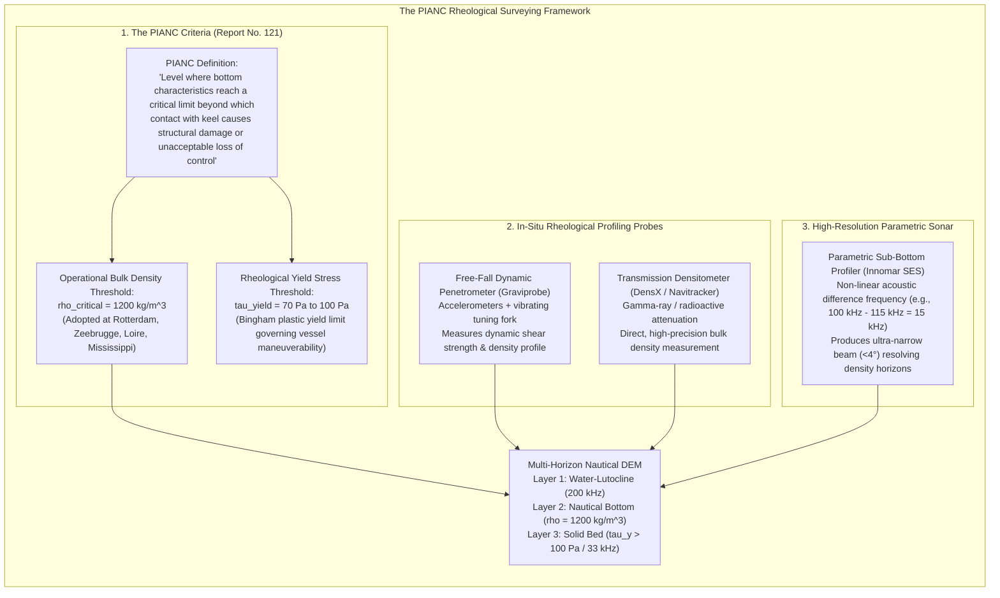

# Chapter 29: Fluid Mud, "Nautical Depth," and Multi-Horizon Subsurface DEMs

*When the seabed or ground surface is not a sharp boundary: modeling rheologic transitions, fluid mud, and stacked subsurface horizons.*

---

## 29.2 PIANC "Nautical Depth" and Rheological Surveying

Because acoustic echosounders reflect off density steps that bear no correlation to structural navigation hazards, the global maritime industry abandoned pure acoustic bathymetry in fluid mud ports. Under the auspices of the World Association for Waterborne Transport Infrastructure (PIANC), port authorities adopted the concept of **Nautical Depth**.

Nautical Depth shifts the definition of the seafloor from an acoustic reflection horizon to a **rheological property of the sediment**. Mapping this navigable boundary requires specialized in-situ penetrometers, nuclear and resonant densitometers, and non-linear parametric sub-bottom acoustic profilers.

---

### 29.2.1 The PIANC Definition and Physical Criteria

In 1997, a joint working group of PIANC and the International Association of Ports and Harbors (IAPH)—later refined in **PIANC Report No. 121 (2014)**, *Harbour Approach Channels: Design Guidelines*—formally codified the definition of **Nautical Depth**:

> *"The nautical depth is the level where physical characteristics of the bottom reach a critical limit beyond which contact with a ship's keel causes either damage or unacceptable effects on controllability and maneuverability."*

#### 1. The Bulk Density Criterion ($\rho_{\text{critical}}$)
Because measuring fluid mud viscosity from a moving survey boat was historically difficult, port authorities adopted **bulk density** ($\rho$) as an operational proxy for nautical depth:
* Extensive naval hydrodynamic tow-tank tests (conducted at Flanders Hydraulics Research and MARIN) demonstrated that when bulk density is below **$\rho = 1200\text{ kg/m}^3$** (specific gravity $1.20$), the sediment exhibits negligible yield strength.
* A ship's hull sailing through mud with $\rho \le 1200\text{ kg/m}^3$ experiences a slight increase in hydrodynamic resistance (requiring $5\text{–}10\%$ more propeller torque) and a minor squat alteration, but suffers **zero structural damage** and retains full steering maneuverability.
* Consequently, major estuarine ports (including Rotterdam, Zeebrugge, Antwerp, Dunkirk, and Bordeaux) legally defined their official nautical charts and channel maintenance boundaries at the **$\rho = 1200\text{ kg/m}^3$ isopycnic (equal-density) horizon**.

#### 2. The Rheological Yield Stress Criterion ($\tau_y$)
While density is a convenient proxy, the true physical resistance experienced by a vessel's hull is governed by sediment **rheology** (fluid mechanics and deformation):
* Fluid mud behaves as a **Bingham plastic** or **Herschel-Bulkley fluid**:
  $$\tau = \tau_y + \mu_p \left( \frac{du}{dz} \right)^n$$
  where $\tau_y$ is the **initial yield stress**, $\mu_p$ is plastic viscosity, and $\frac{du}{dz}$ is the shear strain rate induced by the moving hull.
* If shear stress applied by the hull is less than $\tau_y$, the mud behaves as a deformable solid gel. Once shear stress exceeds $\tau_y$, the gel's internal flocculated network breaks down (**thixotropy**), and it flows like a viscous liquid.
* PIANC studies established that the true operational limit of nautical navigability occurs at a **critical yield stress of $\tau_y \approx 70\text{ to }100\text{ Pascals}$** (or dynamic viscosity $\eta \approx 100\text{ Pa}\cdot\text{s}$). Below $100\text{ Pa}$, the mud provides negligible resistance to a moving ship.

#### 3. Thixotropy, Structural Kinetics, and Biological Conditioning (Toorman, 1997; Wurpts, 2005)
Why can bulk density $\rho$ alone be an imperfect proxy for yield stress $\tau_y$? Because cohesive mud is **thixotropic**—its yield stress depends on both clay mineralogy/organic content and its time-history of shear deformation!
* In **Toorman's (1997) thixotropic structural kinetic model**, the internal degree of floc-network aggregation is governed by a dimensionless structural parameter $\lambda_{\text{thix}}(t) \in [0, 1]$ ($\lambda_{\text{thix}} = 1$ for a fully gelled, undisturbed mud bed at rest; $\lambda_{\text{thix}} \to 0$ when completely liquefied by shear rate $\dot{\gamma} = |du/dz|$):
  $$\frac{d\lambda_{\text{thix}}}{dt} = a_{\text{build}}\big(1 - \lambda_{\text{thix}}\big) - b_{\text{break}}\,\lambda_{\text{thix}}\,\dot{\gamma}, \qquad \tau(\dot{\gamma}, \lambda_{\text{thix}}) = \lambda_{\text{thix}}\,\tau_{y,0} + \big(\mu_\infty + c_{\text{thix}}\,\lambda_{\text{thix}}\big)\dot{\gamma}$$
* In the **Port of Emden (Germany)**, Rewert Wurpts and Patrick Torn (2005) demonstrated that by circulating aerobic biological/microbial slime (extracellular polymeric substances, EPS) and periodically agitating the mud layer with hopper dredgers ("conditioning"), the floc structure remains in a low-yield-stress state ($\tau_y < 70\text{ Pa}$) even at bulk densities up to $\rho = 1240\text{–}1260\text{ kg/m}^3$, eliminating traditional sediment excavation altogether!

---

### 29.2.2 Rheological and Density Survey Instruments

Mapping the $\rho = 1200\text{ kg/m}^3$ isopycnic horizon or the $\tau_y = 70\text{–}100\text{ Pa}$ rheologic horizon cannot be achieved with traditional echosounders alone. It requires specialized in-situ profiling instruments paired with non-linear sub-bottom acoustics (Table 29.1):

| Instrument Class & Examples | Physical Measurement Principle | Vertical Resolution & Accuracy | Operational Mode & Coverage | Primary Output for Multi-Horizon DEM |
| :--- | :--- | :--- | :--- | :--- |
| **Free-Fall Dynamic Penetrometer** (*dotOcean Graviprobe*, *Nimrod*) | Accelerometer deceleration ($d^2z/dt^2$) + tip piezo tuning fork | $\Delta z \approx 1\text{ cm}$; $\sigma_{\tau_y} \approx \pm 5\text{ Pa}$ | Rapid underway point drops ($10\text{–}30$ drops/hour) | Direct depth of $\tau_y = 70\text{ Pa}$ and $\tau_y = 100\text{ Pa}$ rheological horizons |
| **Vibrating Tuning-Fork Probe** (*Stema RheoTune*, *MudBug*) | Resonant frequency shift ($\Delta f_0 \propto \rho$) & amplitude damping ($\propto \eta, \tau_y$) | $\Delta z \approx 2\text{ cm}$; $\sigma_\rho \approx \pm 10\text{ kg/m}^3$ | Stationary or slow-tow vertical casts | Simultaneous in-situ bulk density $\rho(d)$ and Bingham yield stress $\tau_y(d)$ |
| **Nuclear Gamma-Ray Densitometer** (*Navitracker*, *DensX*) | Beer-Lambert gamma attenuation ($^{137}\text{Cs}$ or $^{241}\text{Am}$, $I = I_0 e^{-\mu_m \rho x}$) | $\Delta z \approx 2\text{ cm}$; $\sigma_\rho \approx \pm 5\text{ kg/m}^3$ | Towed undulating sled or vertical winch profiles | Legal reference standard for $\rho = 1200\text{ kg/m}^3$ isopycnic horizon |
| **Parametric Sub-Bottom Profiler** (*Innomar SES-2000*, *Atlas Parasound*) | Non-linear difference frequency ($f_{\text{diff}} = f_2 - f_1 \approx 4\text{–}15\text{ kHz}$, beamwidth $<3.5^\circ$) | $\Delta z \approx 5\text{ cm}$ along continuous 2D tracklines | Underway vessel surveying at $4\text{–}8\text{ knots}$ | Continuous 2D acoustic impedance horizons co-kriged with probe drops |

#### 1. Dynamic Free-Fall Penetrometers (The Graviprobe)
Developed by dotOcean, the **Graviprobe** is a free-fall, streamlined probe deployed from a moving survey vessel:
* Dropped into the water column, it free-falls through clear water and plunges through the fluid mud layer under its own weight.
* Onboard accelerometers record high-frequency deceleration rates ($\frac{d^2 z}{dt^2}$).
* A vibrating piezo-electric tuning fork mounted in the tip measures the fluid's dynamic shear resistance and viscosity as it penetrates.
* By integrating the deceleration profile and tip resistance, the probe's software reconstructs the continuous vertical profiles of bulk density $\rho(z)$ and undrained shear strength $\tau_y(z)$ with centimeter resolution down to the consolidated hard bed.

#### 2. Nuclear and Optical Transmission Densitometers (DensX / Navitracker)
* **The DensX / Navitracker System:** A towed undulating or vertical-profiling probe equipped with an isotopic gamma-ray transmission source (Cesium-137 or low-activity Americium-241) and a scintillation counter detector separated by a narrow physical measurement gap ($x_{\text{gap}} = 10\text{–}20\text{ cm}$).
* **Physics:** Gamma-ray photon attenuation follows the Beer-Lambert law, which depends directly on the electron density (and therefore bulk mass density $\rho$) of the sediment slurry:
  $$I = I_0 \exp(-\mu_m \rho x_{\text{gap}}) \implies \rho = \frac{1}{\mu_m x_{\text{gap}}} \ln\left(\frac{I_0}{I}\right)$$
  where $\mu_m$ ($\text{m}^2\cdot\text{kg}^{-1}$) is the calibrated mass attenuation coefficient.
* Nuclear densitometers deliver density measurements accurate to within **$\pm 0.005\text{ g/cm}^3$** ($\pm 5\text{ kg/m}^3$), providing the metrological standard against which acoustic impedance inversions are calibrated.

#### 3. Parametric Non-Linear Sub-Bottom Profilers (Innomar SES)
While physical probe drops provide exact 1D vertical density/rheology profiles, they cannot sample every grid cell across a harbor. To bridge this gap, modern hydrography deploys **Parametric Sub-Bottom Profilers** (such as the Innomar SES-2000 series; Wunderlich, Wendt, & Müller, 2005):
* **Non-Linear Acoustic Principle:** The transducer simultaneously transmits two high acoustic primary frequencies ($f_1 \approx 100\text{ kHz}$ and $f_2 \approx 115\text{ kHz}$) at high sound pressure levels ($\text{SL} > 235\text{ dB re } 1\,\mu\text{Pa}$).
* Due to the non-linear compressibility of seawater in the virtual end-fire array column, the acoustic wave self-demodulates during propagation, generating both the primary high-frequency signals ($100\text{ kHz}$, which maps the upper lutocline) and a secondary **difference frequency ($f_{\text{diff}} = f_2 - f_1 \approx 15\text{ kHz}$, which penetrates to the consolidated bed)**.
* **The Breakthrough:** While a conventional linear $15\text{-kHz}$ transducer requires a massive array diameter ($>1.5\text{ m}$) to achieve a narrow beam, a parametric profiler inherits the **ultra-narrow beamwidth ($<3.5^\circ\text{–}4.0^\circ$)** of the $100\text{ kHz}$ primary array, with **virtually zero side-lobe energy**!
* *Result:* By co-kriging the continuous 2D parametric acoustic reflection amplitudes with sparse 1D Graviprobe/DensX profiles (e.g., in Stema *Silas* or Innomar *ISE*), hydrographers generate a continuous, uncertainty-quantified 2D surface of the $\rho = 1200\text{ kg/m}^3$ / $\tau_y = 70\text{ Pa}$ Nautical Bottom.

---

### 29.2.3 Constructing Multi-Horizon Nautical Elevation Surfaces and Worked UKC Example

In ports governed by the nautical depth standard, a single 2D raster DEM is legally and operationally inadequate. Digital bathymetric products are delivered as **Multi-Horizon Surfaces** (in positive-up elevation $z = -d$ for IHO S-102, or positive-down depth $d$):

$$\text{Horizon 1: Top of Fluid Mud (Lutocline) } \quad z_{\text{lutocline}}(x, y) = -d_{\text{lutocline}}(x, y) \quad (\text{detected by } 200\text{ kHz})$$
$$\text{Horizon 2: Legal Nautical Depth } \quad z_{\text{nautical}}(x, y) = -d_{\text{nautical}}(x, y) \quad (\text{where } \rho = 1200\text{ kg/m}^3 \text{ or } \tau_y = 70\text{ Pa})$$
$$\text{Horizon 3: Consolidated Hard Bed } \quad z_{\text{bed}}(x, y) = -d_{\text{bed}}(x, y) \quad (\text{detected by } 15\text{–}33\text{ kHz or } \tau_y > 100\text{ Pa})$$

The volume of navigable fluid mud above the nautical bottom and total fluid mud over domain $\Omega$ are:
$$V_{\text{navigable mud}} = \iint_{\Omega} \big( z_{\text{lutocline}}(x, y) - z_{\text{nautical}}(x, y) \big) \, dx \, dy = \iint_{\Omega} \big( d_{\text{nautical}}(x, y) - d_{\text{lutocline}}(x, y) \big) \, dx \, dy$$

#### Worked Numerical Verification: Vessel Under-Keel Clearance (UKC) in a Fluid-Mud Channel
Consider a post-Panamax container vessel with static draft $T_{\text{ship}} = 13.40\text{ m}$ and dynamic squat + wave allowance $\Delta z_{\text{dyn}} = 0.85\text{ m}$, requiring a minimum safety margin (net UKC) of $M_{\text{UKC}} = 0.60\text{ m}$ plus $95\%$ bathymetric uncertainty $\text{TVU}_{95\%}$:
$$d_{\text{required}} = T_{\text{ship}} + \Delta z_{\text{dyn}} + M_{\text{UKC}} + \text{TVU}_{95\%} = 13.40 + 0.85 + 0.60 + \text{TVU}_{95\%} = 14.85\text{ m} + \text{TVU}_{95\%}$$
In a harbor basin where $d_{\text{lutocline}} = 13.60\text{ m}$ ($\text{TVU}_{95\%} = 0.15\text{ m}$), $d_{\text{nautical}} = 15.20\text{ m}$ ($\text{TVU}_{95\%} = 0.25\text{ m}$, including densitometer-to-acoustic co-kriging variance), and $d_{\text{bed}} = 16.40\text{ m}$:
* **Against $200\text{ kHz}$ Lutocline:** Available safe depth is $13.60 - 0.15 = 13.45\text{ m} < 14.85\text{ m}$ (vessel is **blocked by $1.40\text{ m}$**, even though the keel is only penetrating $0.65\text{ m}$ into watery $\rho \approx 1080\text{ kg/m}^3$ suspension!).
* **Against PIANC Nautical Depth ($\rho = 1200\text{ kg/m}^3$):** Available $95\%$-safe depth is $15.20 - 0.25 = 14.95\text{ m} \ge 14.85\text{ m}$—so the vessel **transits safely** with $+1.80\text{ m}$ gross static clearance ($15.20 - 13.40$), $+0.70\text{ m}$ uncertainty-adjusted dynamic net UKC ($14.95 - 14.25 \ge 0.60\text{ m}$ required margin) above the $\rho = 1200\text{ kg/m}^3$ horizon, and $+2.15\text{ m}$ dynamic clearance ($16.40 - 14.25$) above the hard consolidated bed!
