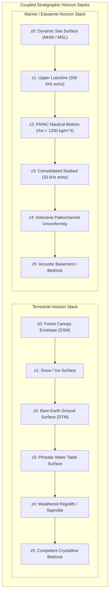
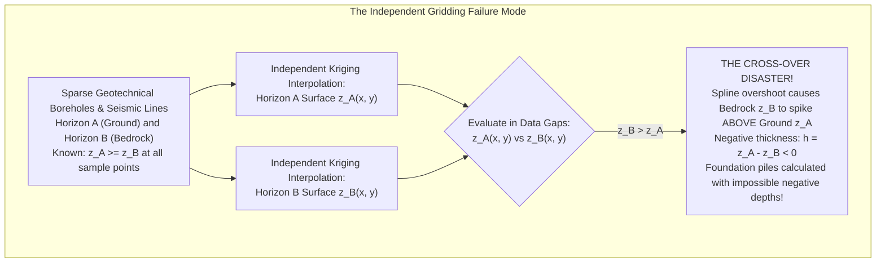

# Chapter 29: Fluid Mud, "Nautical Depth," and Multi-Horizon Subsurface DEMs

*When the seabed or ground surface is not a sharp boundary: modeling rheologic transitions, fluid mud, and stacked subsurface horizons.*

---

## 29.3 Multi-Horizon DEMs: Stacked Stratigraphic Surfaces

Geospatial software has historically treated digital elevation models as single, isolated 2.5D scalar fields $z = f(x, y)$. However, modern engineering geology, hydrogeology, coastal dredging, and offshore geotechnical engineering require modeling the Earth as a **coupled stack of continuous stratigraphic horizons**.

Whether mapping the transition from forest canopies down to bedrock on land, or from seawater down to crystalline basement offshore, elevation models must represent multi-horizon packages. Crucially, these stacked surfaces cannot be interpolated independently: they are physically bound by **non-crossing topological inequality constraints**.

---

### 29.3.1 The Physics of Stacked Stratigraphic Horizons

In physical geology and geotechnical engineering, every elevation horizon represents a specific rheological, hydrologic, or lithologic phase boundary:

#### 1. The Terrestrial Subsurface Stack
1. **Canopy Envelope ($z_0$):** Derived from first returns of airborne LiDAR or optical stereophotogrammetry. Governs solar radiation, wind friction, and microclimate modeling.
2. **Bare-Earth Ground Surface ($z_2$):** Derived from ground-classified LiDAR or bare-earth photogrammetry. Dictates surface hydrology, overland runoff, and civil site layout.
3. **Phreatic Water Table ($z_3$):** Derived from piezometric monitoring wells, electrical resistivity tomography (ERT), and unconfined groundwater models. Governs soil saturation, slope stability, and landslide liquefaction.
4. **Competent Bedrock ($z_5$):** Derived from seismic refraction, borehole core logs, and Ground-Penetrating Radar (GPR). Determines structural foundation bearing capacity and trench excavation blasting costs.

#### 2. The Marine Geotechnical Stack
1. **Upper Lutocline ($z_1$):** Boundary of cohesive flocculated suspension detected by high-frequency multibeam sonar.
2. **Nautical Depth ($z_2$):** The critical $\rho = 1200\text{ kg/m}^3$ boundary governing commercial vessel clearance.
3. **Consolidated Seabed ($z_3$):** The top of load-bearing sand or stiff clay detected by low-frequency echosounders.
4. **Pleistocene / Holocene Unconformity ($z_4$):** Buried paleochannels and gravel riverbeds mapped by chirp sub-bottom profilers, essential for routing subsea telecommunication cables and siting offshore wind turbine monopiles.

---

### 29.3.2 The "Cross-Over Blunder" in Independent Gridding

The single most disastrous malpractice in multi-horizon modeling is **independent surface gridding**: interpolating each geological horizon independently using standard unconstrained algorithms (such as Ordinary Kriging, biharmonic splines, or Inverse Distance Weighting).

#### The Mathematical Anatomy of the Blunder
Suppose a site investigation contains 50 geotechnical boreholes where both ground elevation $z_{\text{ground}}$ and depth-to-bedrock $z_{\text{bedrock}}$ are sampled. By definition of physical reality:
$$z_{\text{ground}}(\mathbf{x}_i) \ge z_{\text{bedrock}}(\mathbf{x}_i), \quad \forall i \in \{1, \dots, 50\}$$

If an analyst grids $z_{\text{ground}}$ and $z_{\text{bedrock}}$ as two independent raster surfaces:
* In large spatial gaps between boreholes, the interpolation algorithms operate with different spatial covariance structures and different minimum-curvature tension parameters.
* A spline or Kriging overshoot in the bedrock layer, combined with an interpolation sag in the ground layer, inevitably causes the surfaces to intersect:
  $$\exists \mathbf{x} \in \Omega \quad \text{such that} \quad z_{\text{bedrock}}(\mathbf{x}) > z_{\text{ground}}(\mathbf{x})$$
* **The Forensic Consequence:** The model predicts that solid granite bedrock floats in mid-air above the grass! The calculated soil thickness $h(\mathbf{x}) = z_{\text{ground}} - z_{\text{bedrock}}$ becomes **negative**. In civil engineering, feeding negative soil thicknesses into foundation piling or pipeline trenching software crashes automated structural pipelines or leads contractors to order negative steel casing lengths.

---

### 29.3.3 Enforcing Non-Crossing Topological Constraints

To maintain physical and structural validity, a multi-horizon elevation system must enforce non-crossing inequalities across all $K$ stratigraphic layers:

$$z_1(\mathbf{x}) \ge z_2(\mathbf{x}) \ge z_3(\mathbf{x}) \ge \dots \ge z_K(\mathbf{x}), \quad \forall \mathbf{x} \in \Omega$$

To guarantee this topological ordering, geospatial software utilizes three primary mathematical architectures:

#### 1. Direct Thickness (Isochore) Gridding
Instead of gridding absolute elevations for subsurface horizons, the model grids the **layer thickness (isochore)**:
1. Grid the reference surface $z_1(\mathbf{x})$ (e.g., bare-earth DTM or sea surface).
2. For each successive subsurface horizon $k \in \{2, \dots, K\}$, compute the observed thickness at sample points:
   $$\Delta h_k(\mathbf{x}_i) = z_{k-1}(\mathbf{x}_i) - z_k(\mathbf{x}_i) \ge 0$$
3. Grid the thickness field $\Delta h_k(\mathbf{x})$ using non-negative constraints (e.g., logarithmic transformation or constrained splines such that $\Delta h_k(\mathbf{x}) \ge 0$).
4. Reconstruct the elevation of horizon $k$ via downward cumulative subtraction:
   $$z_k(\mathbf{x}) = z_{k-1}(\mathbf{x}) - \Delta h_k(\mathbf{x})$$
*Advantage:* Because every layer thickness is guaranteed to be non-negative ($\Delta h_k \ge 0$), horizons can touch (zero thickness pinch-outs), but they can **never cross**.

#### 2. Inequality-Constrained Dual Kriging
In geostatistics, horizons are interpolated simultaneously within a **Constrained Quadratic Programming (QP)** framework:
$$\min_{\mathbf{w}} \frac{1}{2} \mathbf{w}^T \mathbf{C} \mathbf{w} - \mathbf{b}^T \mathbf{w} \quad \text{subject to } \mathbf{A} \mathbf{w} \le \mathbf{c}$$
where the linear constraints $\mathbf{A} \mathbf{w} \le \mathbf{c}$ explicitly enforce $z_{k+1}(\mathbf{x}_g) \le z_k(\mathbf{x}_g)$ at every node $\mathbf{x}_g$ on the output grid.

#### 3. Geological Pinch-Outs, Unconformity Rules, and Implicit Potential-Field Modeling
When a younger sedimentary layer pinches out against an older erosional unconformity (such as an incised Holocene paleochannel carving into Pleistocene clay or bedrock):
* The layer thickness drops to exactly zero: $\Delta h_k(\mathbf{x}) = 0$, and the two horizons merge smoothly: $z_{k+1}(\mathbf{x}) = z_k(\mathbf{x})$.
* In **Implicit Potential-Field Modeling** (pioneered by Lajaunie, Courrioux, & Manuel, 1997; Calcagno et al., 2008; and implemented in open-source `GemPy` by de la Varga et al., 2019), conformable stratigraphic sequences are modeled as distinct **isosurfaces** $\Phi(\mathbf{x}, z) = c_k$ ($c_1 > c_2 > \dots > c_K$) of a single continuous 3D scalar potential field $\Phi: \mathbb{R}^3 \to \mathbb{R}$. Because level sets of a single-valued scalar function for $c_k \ne c_{k+1}$ are mathematically disjoint ($\{\mathbf{p} : \Phi(\mathbf{p}) = c_k\} \cap \{\mathbf{p} : \Phi(\mathbf{p}) = c_{k+1}\} = \emptyset$), conformable layers can **never cross anywhere in 3D space**, even when jointly conditioned on both 3D interface contact points and 3D dip/strike orientation vectors ($\nabla\Phi$)!
* Where multiple geological series meet at an unconformity, a **Stratigraphic Pile Rule** governs surface interaction:
  1. **Erosional ("Erode") Rule:** A younger erosive horizon $z_{\text{erode}}(\mathbf{x})$ truncates all older underlying horizons $z_k(\mathbf{x})$, enforced via the pointwise upper-envelope projection:
     $$z_k^{\text{final}}(\mathbf{x}) = \min\big( z_k^{\text{raw}}(\mathbf{x}), \; z_{\text{erode}}(\mathbf{x}) \big)$$
  2. **Depositional ("Onlap" / "Basal") Rule:** Younger infilling strata $z_j(\mathbf{x})$ cannot penetrate below the older basement unconformity $z_{\text{base}}(\mathbf{x})$ upon which they were deposited:
     $$z_j^{\text{final}}(\mathbf{x}) = \max\big( z_j^{\text{raw}}(\mathbf{x}), \; z_{\text{base}}(\mathbf{x}) \big)$$

| Multi-Horizon Modeling Architecture | Mathematical Mechanism | Handles Layer Pinch-Outs ($\Delta h = 0$)? | Honours 3D Dip/Strike Orientations? | Primary Software Implementations |
| :--- | :--- | :--- | :--- | :--- |
| **1. Cumulative Isochore (Thickness) Gridding** | Grids non-negative thicknesses $\Delta h_k(\mathbf{x}) \ge 0$ (or $\exp(\ln \Delta h_k)$) and subtracts cumulatively from $z_1(\mathbf{x})$ | Yes (via zero-clamping $\max(0, \Delta\hat{h}_k)$) | No (2.5D scalar differences only) | GDAL/Python, QGIS, Civil 3D, SonarWiz |
| **2. Bounding-Surface Spline / Inequality QP** | Minimizes spline curvature $\sum_k \mathbf{z}_k^\top \mathbf{B}\mathbf{z}_k$ subject to linear inequalities $z_k(\mathbf{x}) \ge z_{k+1}(\mathbf{x})$ | Yes (active KKT constraint $s_k = 0$) | Partial (2.5D slope bounds) | GMT (`surface -Ll -Lu`), `scipy.optimize` |
| **3. Implicit Potential-Field Co-Kriging** | Interpolates 3D scalar potential $\Phi(x,y,z)$ via Universal Co-Kriging of contacts + $\nabla\Phi$; extracts isosurfaces | Yes (via Erode & Onlap stratigraphic pile operators) | Yes (native 3D vector + point co-kriging) | `GemPy`, BRGM `GeoModeller`, Seequent `Leapfrog`, `Petrel` |

---

### 29.3.4 Worked Numerical Example: Resolving a Subsurface Spline Cross-Over Blunder

Consider a coastal wind-farm cable landing corridor along a 1D profile $x \in [0, 300\text{ m}]$ where the bare-earth seabed $z_1(x)$ is known continuously from multibeam sonar, and consolidated bedrock $z_2(x)$ is sampled at three geotechnical boreholes at $x = 0\text{ m}, 100\text{ m}, 300\text{ m}$:
* At $x = 0\text{ m}$: $z_1(0) = -10.00\text{ m}$, $z_2(0) = -14.00\text{ m}$ ($\Delta h(0) = 4.00\text{ m}$).
* At $x = 100\text{ m}$ (edge of a bedrock high): $z_1(100) = -10.00\text{ m}$, $z_2(100) = -10.40\text{ m}$ ($\Delta h(100) = 0.40\text{ m}$).
* At $x = 200\text{ m}$ (an unsampled seabed scour trough between boreholes): $z_1(200) = -11.20\text{ m}$, no borehole.
* At $x = 300\text{ m}$: $z_1(300) = -10.00\text{ m}$, $z_2(300) = -13.00\text{ m}$ ($\Delta h(300) = 3.00\text{ m}$).

1. **Unconstrained Independent Cubic Spline Interpolation of $z_2(x)$:**
   Fitting a natural cubic spline directly through the three bedrock elevations $z_2(0) = -14.00\text{ m}$, $z_2(100) = -10.40\text{ m}$, and $z_2(300) = -13.00\text{ m}$ produces an upward spline overshoot between $x = 100\text{ m}$ and $x = 300\text{ m}$, predicting at $x = 200\text{ m}$:
   $$\hat{z}_{2,\text{indep}}(200) = -10.475\text{ m}$$
   Comparing against the true multibeam seabed $z_1(200) = -11.20\text{ m}$ reveals a **catastrophic cross-over blunder**:
   $$\Delta\hat{h}_{\text{indep}}(200) = z_1(200) - \hat{z}_{2,\text{indep}}(200) = -11.20 - (-10.475) = -0.725\text{ m} < 0$$
   The unconstrained bedrock surface protrudes **$+0.73\text{ m}$ into the water column above the seabed**!
2. **Isochore Thickness Gridding + Non-Crossing Enforcement:**
   Instead, interpolating the log-transformed sediment thickness $\ln\Delta h(x)$ linearly across the $100\text{–}300\text{ m}$ borehole span ($\Delta h(100) = 0.40\text{ m}, \Delta h(300) = 3.00\text{ m}$) yields a strictly positive thickness at the $x = 200\text{ m}$ midpoint:
   $$\Delta\hat{h}_{\text{iso}}(200) = \exp\!\left(\frac{1}{2}\ln 0.40 + \frac{1}{2}\ln 3.00\right) = \sqrt{1.20} = 1.095\text{ m} > 0$$
   Reconstructing the bedrock horizon via $z_2(x) = z_1(x) - \Delta\hat{h}_{\text{iso}}(x)$ gives:
   $$\hat{z}_{2,\text{constrained}}(200) = -11.20\text{ m} - 1.095\text{ m} \approx -12.30\text{ m} \le z_1(200)$$
   preserving topological validity ($\Delta\hat{h} = +1.10\text{ m} \ge 0$) and accurately guiding the cable-burial plow under the seabed scour trough.
