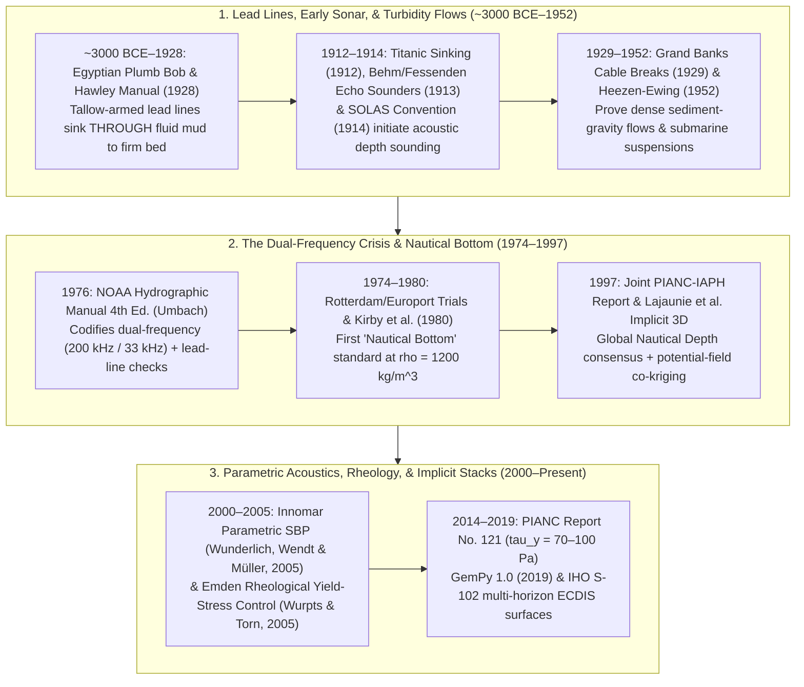

# Chapter 29: Fluid Mud, "Nautical Depth," and Multi-Horizon Subsurface DEMs

*When the seabed or ground surface is not a sharp boundary: modeling rheologic transitions, fluid mud, and stacked subsurface horizons.*

---

## 29.4 Historical Evolution: From Lead Lines and Telegraph Cables to Rheological Depth (`gis-history` Context)

Understanding how fluid mud, rheological nautical depth, and multi-horizon subsurface stratigraphy entered digital elevation modeling requires tracing the history of hydrographic sounding, submarine sediment-gravity flows, and 3D mathematical geology. Anchored to the milestones in the [`schwehr/gis-history`](https://github.com/schwehr/gis-history) repository, this section examines how oceanographers, hydrographers, and civil engineers dismantled the naive assumption of a single, solid seafloor.

---

### 29.4.1 The Lead-Line Paradox, Early Sonar, and Turbidity Physics: Antiquity to 1952

#### From Ancient Plumb Bobs and Lead Lines to the 1928 Hawley *Hydrographic Manual*
For nearly five millennia—from **ancient Egyptian plumb bobs** (~3000 BCE) through the founding of the **U.S. Survey of the Coast in 1807** (Ferdinand Hassler) and Commander J. H. Hawley's **1928 *Hydrographic Manual*** (U.S. Coast and Geodetic Survey Special Publication No. 143)—every nautical chart on Earth was measured mechanically by lowering a weighted lead line or sounding pole:
* A standard hydrographic lead weight ($4\text{–}14\text{ kg}$ of dense lead, $\rho_{\text{Pb}} = 11,340\text{ kg/m}^3$, armed with tallow in its base cavity to retrieve a physical sample of sand, shells, or stiff mud) exerted a high contact bearing pressure ($>10\text{ kPa}$).
* Consequently, when lowered into a muddy estuary, **the lead weight plunged straight through watery suspended sediment and low-density fluid mud**, coming to rest only when it struck consolidated mud or sand ($\rho > 1250\text{–}1400\text{ kg/m}^3$) capable of supporting its weight! For centuries, mariners unknowingly navigated relative to a mechanical penetration horizon rather than the water-lutocline interface.

#### 1912–1914: *RMS Titanic*, the 1913 Echo Sounder Patent, and Fuzzy Bottoms
Following the **1912 sinking of the *RMS Titanic*** and the **1914 SOLAS Convention**, **Alexander Behm (1913 German Patent 282,009)** and **Reginald Fessenden (1914)** invented acoustic echo sounding, soon commercialized by **Atlas Elektronik (founded 1902)** and **Simrad/Kongsberg (founded 1931)**:
* Early pre-WWII echo sounders operated at low acoustic frequencies ($10\text{–}30\text{ kHz}$), which penetrated fluid mud much like the traditional lead line.
* However, in the 1950s and 1960s, hydrographic agencies introduced compact, narrow-beam **high-frequency ($200\text{ kHz}$) piezoelectric transducers** to improve vertical resolution in shallow harbors. Overnight, major ports such as Rotterdam, London, Bangkok, and New Orleans appeared to "shoal" by $1\text{ to }3\text{ meters}$ on paper echograms, recording dark double traces ("fuzzy bottoms") where the $200\text{ kHz}$ pulse reflected off the upper lutocline while ships continued to sail through unhindered!

#### 1929–1952: The Grand Banks Earthquake and Turbidity Currents
Meanwhile, deep-sea geophysicists were uncovering the fluid mechanics of concentrated sediment suspensions:
* On **November 18, 1929**, a $M_w\,7.2$ earthquake on the Grand Banks continental slope south of Newfoundland snapped 12 trans-Atlantic submarine telegraph cables in an ordered downslope sequence over 13 hours and $500\text{ km}$.
* In **1952**—the same year **Marie Tharp** discovered the Mid-Atlantic Rift Valley—**Bruce C. Heezen and Maurice Ewing** published their landmark paper in the *American Journal of Science*, proving that the cables were severed by a high-velocity **turbidity current** traveling up to $70\text{–}90\text{ km/h}$. Heezen and Ewing proved that dense water-sediment mixtures behave as distinct, stratified non-Newtonian fluid layers governed by gravity and rheology.

---

### 29.4.2 The Dual-Frequency Crisis and the Birth of "Nautical Bottom": 1974 to 1980

#### 1976: Captain Melvin J. Umbach's *Hydrographic Manual* (NOAA 4th Edition)
As supertankers and deep-draft container ships pushed port channels to their limits in the 1970s, NOAA's **1976 *Hydrographic Manual* (4th Edition)** by Captain Melvin J. Umbach addressed the dual-frequency crisis on Raytheon DE-723 echosounders:
* **Dual-Trace Recording:** Hydrographers were instructed to compare the high-frequency ($200\text{ kHz}$) and low-frequency ($24\text{–}33\text{ kHz}$) traces on analog strip charts.
* **Lead-Line Ground-Truthing:** Whenever the two acoustic horizons diverged in muddy channels, Umbach mandated lowering a graduated sounding pole or brass-disk lead line to determine the "firm bottom." Yet manual pole soundings could not keep pace with automated digital hydrography.

#### 1974–1980: Rotterdam Europort Sea Trials and Kirby, Parker, & van Oostrum (1980)
In the mid-1970s, the Netherlands Rijkswaterstaat, the Port of Rotterdam, and the UK Institute of Oceanographic Sciences (IOS) launched an intensive research campaign in the Europort approach channel:
* Using towed radioactive gamma-ray backscatter/transmission probes alongside full-scale supertanker maneuvering trials (including the VLCC *Lepton*), **Robert Kirby, W. R. Parker, and W. H. A. van Oostrum (1980)** published *"Definition of the seabed in navigation routes through mud areas"* in the *International Hydrographic Review*.
* They proved that the $200\text{ kHz}$ lutocline had zero correlation with ship maneuverability, introduced the formal concept of the **"Nautical Bottom"**, and established the operational **$\rho = 1200\text{ kg/m}^3$ bulk-density horizon** in Rotterdam—instantly saving tens of millions of guilders in unnecessary dredging.

---

### 29.4.3 International PIANC Standardization and Implicit 3D Modeling: 1988 to Present

#### 1988–1997: Bounding-Surface Splines (GMT), Implicit Geology (Lajaunie), and PIANC WG 30
As multi-horizon mapping expanded across both marine dredging and terrestrial geotechnics, new mathematical tools emerged to prevent stacked surfaces from crossing:
* In **1988**, Paul Wessel and Walter H. F. Smith released **Generic Mapping Tools (GMT)**, whose `surface` spline-in-tension algorithm included explicit lower (`-Ll`) and upper (`-Lu`) bounding-surface constraints to force an interpolated horizon to remain strictly between overlying and underlying surfaces.
* In **1997**, **Christian Lajaunie, Gabriel Courrioux, and Laurent Manuel** at BRGM (France) published the mathematical foundation of **3D Potential-Field Implicit Geological Modeling** in *Mathematical Geology*, solving the multi-horizon cross-over problem by representing conformable strata as non-crossing isosurfaces of a single co-kriged scalar field $\Phi(\mathbf{x})$.
* That same year (**1997**)—coinciding with the first edition of the **NOAA Field Procedures Manual**—a joint working group of **PIANC and IAPH** published the first international consensus definition of **Nautical Depth**.

#### 2000–2019: Parametric Sub-Bottom Profilers, Rheological Conditioning, PIANC Report 121, and GemPy
* **2000–2005 (Innomar Parametric SBP):** Jens Wunderlich, Gerd Wendt, and S. Müller developed and validated the high-resolution non-linear parametric sediment echo sounder (Innomar SES, field-deployed from 2000 and documented in Wunderlich, Wendt, & Müller, 2005), enabling $<3.5^\circ$ narrow-beam penetration of fluid mud layers without side-lobe clutter.
* **2005 (Emden Rheological Control):** Rewert Wurpts and Patrick Torn published 15 years of operational results from the Port of Emden in *Terra et Aqua*, proving that direct rheological yield stress ($\tau_y = 70\text{–}100\text{ Pa}$) and biological EPS conditioning govern safe navigation in hyper-concentrated mud.
* **2014 (PIANC Report No. 121) & 2019 (`GemPy` 1.0):** PIANC Report No. 121 (*Harbour Approach Channels—Design Guidelines*) codified both the density ($\rho = 1200\text{ kg/m}^3$) and rheological yield-stress ($\tau_y = 70\text{–}100\text{ Pa}$) criteria worldwide, while Miguel de la Varga et al. released **`GemPy` 1.0 (2019)**, bringing open-source stochastic implicit multi-horizon modeling to the Python geospatial ecosystem.

---

### 29.4.4 Synthesis: Evolution of Subsurface and Multi-Horizon Standards (1988–Present)

Across the past four decades, the convergence of hydrographic charting standards, open-source scientific computing, and 3D geological data structures has transformed how multi-horizon elevation models are stored and exchanged:

1. **Self-Describing Multi-Dimensional Formats (NetCDF 1988, HDF 1990, GeoPackage 2014, Zarr 2015/2019):**
   The emergence of **NetCDF (1988)** and **HDF (1990)**—and later cloud-native **Zarr (2015)** and **IceChunk (2024)**—enabled geospatial agencies to bundle an entire stratigraphic horizon stack ($z_1(x,y), z_2(x,y), \dots, z_K(x,y)$), its per-horizon vertical uncertainty bands ($\sigma_{z,k}(x,y)$), and metadata tags (acoustic frequency $f$, density threshold $\rho_c$, or yield stress $\tau_y$) inside a single self-describing multi-dimensional file rather than scattered single-band GeoTIFFs.
2. **From IHO S-57 to IHO S-100 / S-102 and S-104 Next-Generation ECDIS:**
   While legacy **IHO S-57** Electronic Navigational Charts (ENCs) could represent only static depth contours and discrete spot soundings, the modern **IHO S-100 Universal Hydrographic Data Model** ecosystem combines **IHO S-102** (high-resolution bathymetric surface grids with uncertainty) and **IHO S-104** (time-varying water level information) with port-specific nautical bottom definitions. In ports such as Rotterdam, Antwerp, Zeebrugge, Emden, and the Amazon/Pará approaches, pilotage portable units ingest both the $200\text{ kHz}$ lutocline surface (to predict internal wave drag and cooling-water intake siltation) and the calibrated $\rho = 1200\text{ kg/m}^3$ / $\tau_y = 70\text{–}100\text{ Pa}$ Nautical Bottom surface (to manage safety-critical Under-Keel Clearance).
3. **Terrestrial Digital Twins and Subsurface Utility / Geotechnical Standards (OGC MudDI & GeoSciML):**
   Parallel to marine hydrography, civil infrastructure engineering and national geological surveys (USGS, BGS, BRGM, TNO) have adopted multi-horizon 3D voxel and surface stacks to represent urban soil layers, groundwater tables, and bedrock depths, ensuring that every surface elevation model is seamlessly coupled to the physical stratigraphy beneath it.
