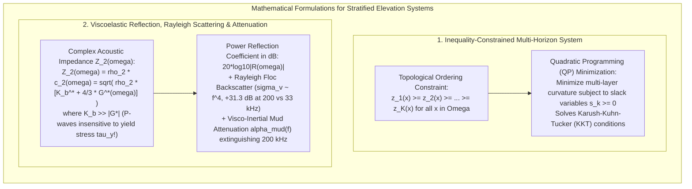

# Chapter 29: Fluid Mud, "Nautical Depth," and Multi-Horizon Subsurface DEMs

*When the seabed or ground surface is not a sharp boundary: modeling rheologic transitions, fluid mud, and stacked subsurface horizons.*

---

## 29.5 Mathematical Foundations of Multi-Horizon Systems and Viscoelastic Acoustics

Modeling complex stratified media requires two mathematical pillars:
1. **Inequality-constrained optimization** that mathematically prevents geological horizons from crossing in spatial data gaps.
2. **Viscoelastic wave propagation** that explains why acoustic reflection coefficients vary continuously across frequency as a function of sediment bulk density and dynamic shear modulus.

---

### 29.5.1 The Non-Crossing Inequality-Constrained Horizon System

Let a spatial domain $\Omega \subset \mathbb{R}^2$ contain $K$ ordered stratigraphic elevation surfaces $z_k(\mathbf{x})$, where $k \in \{1, \dots, K\}$ indexes horizons from top to bottom (e.g., $k=1$ is ground/water surface, $k=K$ is bedrock).

#### 1. The Continuous Topological Constraint
In physical geology and engineering mechanics, younger strata cannot penetrate older underlying strata. The surfaces must satisfy the continuous non-crossing inequality:

$$z_1(\mathbf{x}) \ge z_2(\mathbf{x}) \ge z_3(\mathbf{x}) \ge \dots \ge z_K(\mathbf{x}), \quad \forall \mathbf{x} \in \Omega$$

This is equivalent to requiring that all **isochore layer thicknesses** remain strictly non-negative:
$$h_k(\mathbf{x}) = z_k(\mathbf{x}) - z_{k+1}(\mathbf{x}) \ge 0, \quad \forall k \in \{1, \dots, K-1\}$$

#### 2. The Constrained Biharmonic Spline Optimization
To construct smooth, minimum-curvature surfaces that honor discrete borehole or seismic soundings while respecting the topological constraint, we formulate a multi-surface variational optimization problem.

For each horizon $k$, we minimize the biharmonic thin-plate bending energy $\mathcal{E}(z_k)$:
$$\min_{z_1, \dots, z_K} \sum_{k=1}^K \iint_\Omega \left( \left(\frac{\partial^2 z_k}{\partial x^2}\right)^2 + 2\left(\frac{\partial^2 z_k}{\partial x \partial y}\right)^2 + \left(\frac{\partial^2 z_k}{\partial y^2}\right)^2 \right) dx \, dy$$

subject to:
1. **Borehole / Sounding Data Equality Constraints:**
   $$z_k(\mathbf{x}_{k, i}) = d_{k, i}, \quad \forall i \in \{1, \dots, N_k\}$$
   where $d_{k, i}$ is the observed elevation of horizon $k$ at sample point $\mathbf{x}_{k, i}$.
2. **Continuous Inter-Horizon Non-Crossing Inequality Constraints:**
   $$z_k(\mathbf{x}) - z_{k+1}(\mathbf{x}) \ge 0, \quad \forall \mathbf{x} \in \Omega, \quad \forall k \in \{1, \dots, K-1\}$$

#### 3. Discrete Quadratic Programming (QP) and Slack Variables
On a discrete computational grid with $M$ nodes $\mathbf{x}_j$ ($j = 1, \dots, M$), let $\mathbf{z}_k \in \mathbb{R}^M$ represent the elevation vector for horizon $k$.

The biharmonic curvature operator is discretized via finite differences into a sparse symmetric matrix $\mathbf{B} \in \mathbb{R}^{M \times M}$. The global objective function becomes:
$$\min_{\mathbf{z}_1, \dots, \mathbf{z}_K} \sum_{k=1}^K \mathbf{z}_k^T \mathbf{B} \mathbf{z}_k$$

The non-crossing inequality at every node $j$ is written in matrix form:
$$\mathbf{z}_k - \mathbf{z}_{k+1} \ge \mathbf{0} \implies \mathbf{z}_{k+1} - \mathbf{z}_k \le \mathbf{0}$$

We introduce non-negative slack vectors $\mathbf{s}_k \ge \mathbf{0}$:
$$\mathbf{z}_k - \mathbf{z}_{k+1} - \mathbf{s}_k = \mathbf{0}$$

This transforms the multi-horizon interpolation into a standard **Constrained Quadratic Programming (QP)** problem:
$$\min_{\mathbf{Z}} \frac{1}{2} \mathbf{Z}^T \mathbf{H} \mathbf{Z} + \mathbf{f}^T \mathbf{Z} \quad \text{subject to } \mathbf{A}_{\text{eq}} \mathbf{Z} = \mathbf{b}_{\text{eq}} \quad \text{and} \quad \mathbf{A}_{\text{ineq}} \mathbf{Z} \le \mathbf{0}$$
where $\mathbf{Z} = [\mathbf{z}_1^T, \mathbf{z}_2^T, \dots, \mathbf{z}_K^T]^T \in \mathbb{R}^{K \cdot M}$. 

Solving this system via interior-point methods guarantees that the **Karush-Kuhn-Tucker (KKT) conditions** are satisfied. The resulting stacked surfaces bend smoothly through data gaps, pinch out where layers terminate ($\Delta h = 0$), and mathematically never cross.

---

### 29.5.2 Viscoelastic Acoustics, Rayleigh Floc Scattering, and the Dual-Frequency Split

Why does a $200\text{-kHz}$ sounder detect the upper lutocline while a $33\text{-kHz}$ sounder penetrates to the consolidated bed—and why can neither acoustic frequency directly measure the rheological yield stress $\tau_y$ without calibration? The answer requires separating **viscoelastic plane-wave impedance** ($K_b^*$ vs. $G^*$), **Rayleigh floc volume scattering** ($f^4$), and **visco-inertial compressional attenuation** ($\alpha_{\text{mud}}(f)$).

#### 1. Complex Dynamic Moduli and the Compressional vs. Shear Wave Paradox
Unlike clear water (a Newtonian fluid with zero shear modulus), concentrated fluid mud is a viscoelastic medium characterized by a complex bulk modulus $K_b^*(\omega) = K_b'(\omega) + i K_b''(\omega)$ and a frequency-dependent **complex dynamic shear modulus $G^*(\omega)$**:
$$G^*(\omega) = G'(\omega) + i G''(\omega)$$
where $G'(\omega)$ is the **shear storage modulus** (elastic energy storage in the flocculated clay skeleton), $G''(\omega)$ is the **shear loss modulus** (viscous dissipation), and $\omega = 2\pi f$ is angular acoustic frequency ($\text{rad}\cdot\text{s}^{-1}$).

In an isotropic viscoelastic continuum of bulk density $\rho_2$, the complex phase velocities of longitudinal **compressional ($\text{P}$) waves** ($c_p^*(\omega)$, used by all acoustic echosounders) and transverse **shear ($\text{S}$) waves** ($c_s^*(\omega)$) are:
$$c_p^*(\omega) = \sqrt{\frac{K_b^*(\omega) + \frac{4}{3} G^*(\omega)}{\rho_2}}, \qquad c_s^*(\omega) = \sqrt{\frac{G^*(\omega)}{\rho_2}}$$

> [!IMPORTANT]
> **Why Compressional Echosounders Cannot Directly Sense Rheological Yield Stress ($\tau_y$)**
> In estuarine fluid mud ($\rho_2 \approx 1050\text{–}1250\text{ kg/m}^3$), the bulk modulus of the water-clay suspension is governed by the pore water ($K_b' \approx 2.20\text{–}2.40 \times 10^9\text{ Pa}$, or $2.2\text{–}2.4\text{ GPa}$). By contrast, even as fluid mud gels across the PIANC nautical bottom ($\tau_y \approx 70\text{–}100\text{ Pa}$), its dynamic shear modulus $G^*(\omega)$ is on the order of $10^1\text{ to }10^5\text{ Pa}$—**four to eight orders of magnitude smaller than $K_b'$** ($|G^*(\omega)| / K_b' < 10^{-4}$)!
> * Because $K_b' \gg |G^*(\omega)|$, the compressional wave speed $c_p \approx \sqrt{K_b'/\rho_2}$ and characteristic acoustic impedance $Z_2 = \rho_2 c_p^* \approx \sqrt{\rho_2 K_b'}$ depend on **bulk density $\rho_2$ and compressibility $K_b'$**, changing by less than $0.01\%$ when the clay network gels!
> * Conversely, the shear wave velocity $c_s = \sqrt{G^*/\rho_2}$ ($1\text{–}15\text{ m/s}$) is directly controlled by $G^*(\omega)$ and $\tau_y$, **but shear waves cannot propagate through the overlying water column** ($G_{\text{water}}^* = 0$)! This fundamental physical decoupling explains why pure acoustic echosounding can only sense density/porosity steps and must be paired with in-situ rheological probes (Graviprobe, RheoTune) or site-specific $\rho\text{–}\tau_y$ calibrations.

#### 2. Specular Reflection Coefficient vs. Power Reflection Loss (Avoiding the "Target Strength" Misnomer)
For a sharp planar boundary at normal incidence ($\theta_i = 0^\circ$) between overlying estuarine water ($Z_1 = \rho_1 c_1 \approx 1.53 \times 10^6\text{ Pa}\cdot\text{s}\cdot\text{m}^{-1}$) and the fluid mud layer ($Z_2(\omega) = \rho_2 c_p^*(\omega)$), the complex **pressure reflection coefficient** $R_{12}(\omega)$ and **two-way power transmission factor** $T_{12,\text{power}}$ are:
$$R_{12}(\omega) = \frac{Z_2(\omega) - Z_1}{Z_2(\omega) + Z_1}, \qquad T_{12,\text{power}} = 1 - |R_{12}(\omega)|^2 = \frac{4\,\text{Re}(Z_1 Z_2^*)}{|Z_2(\omega) + Z_1|^2}$$
In logarithmic decibel notation, the reflected power fraction is the **Power Reflection Coefficient in dB** $\mathcal{R}_{\text{dB}}(\omega)$ (or its positive negation, **Bottom Reflection Loss** $\text{BL}(\omega)$):
$$\mathcal{R}_{\text{dB}}(\omega) = 10 \log_{10} |R_{12}(\omega)|^2 = 20 \log_{10} |R_{12}(\omega)| \le 0\text{ dB}, \qquad \text{BL}(\omega) = -20 \log_{10} |R_{12}(\omega)| \ge 0\text{ dB}$$
*(Note: $20\log_{10}|R(\omega)|$ is a dimensionless planar reflection ratio in $\text{dB}$, never to be confused with point-target **Target Strength** $\text{TS}$ in $\text{dB re } 1\text{ m}^2$, which includes finite target cross-section or Fresnel-zone geometry!)*

Across a typical upper lutocline density jump ($\rho_1 = 1020\text{ kg/m}^3 \to \rho_2 = 1080\text{ kg/m}^3$, with $c_2 \approx c_1 \approx 1490\text{ m/s}$), the step reflection coefficient is $|R_{12}| \approx \frac{1080 - 1020}{1080 + 1020} = 0.0286$ ($\mathcal{R}_{\text{dB}} = -30.9\text{ dB}$), meaning that **$99.92\%$ of incident acoustic power transmits into the fluid mud layer** at both $33\text{ kHz}$ and $200\text{ kHz}$!

#### 3. The Three Physical Mechanisms Driving the $200\text{ kHz}$ vs. $33\text{ kHz}$ Depth Split
Given that $99.9\%$ of energy crosses the lutocline interface, why does a $200\text{-kHz}$ sounder lock onto the lutocline ($d_1$) while a $33\text{-kHz}$ sounder locks onto the consolidated bed ($d_2 = d_1 + H_{\text{mud}}$)? Three frequency-dependent mechanisms act in concert:

1. **Finite-Thickness Lutocline Gradient Reflection ($R_{\text{grad}}(k L_{\text{lut}})$):**
   The upper lutocline is a continuous density transition of thickness $L_{\text{lut}} \approx 1\text{–}3\text{ cm}$ rather than a step discontinuity. For a continuous Epstein/tanh impedance profile of thickness $L_{\text{lut}}$, the effective specular reflection magnitude decays exponentially when the wavelength $\lambda$ exceeds $L_{\text{lut}}$:
   $$|R_{\text{grad}}(f)| \approx |R_{12}| \, \frac{\pi k L_{\text{lut}}}{\sinh(\pi k L_{\text{lut}})} \quad \text{or for pulse resolution } L_{\text{lut}} \text{ vs. } \lambda = \frac{c}{f}$$
2. **Rayleigh $f^4$ Volume Backscattering from Lutocline Macro-Flocs ($\sigma_v(f)$):**
   Inside the upper lutocline, aggregated clay/silt macro-flocs of diameter $d_{\text{floc}} = 2 a_{\text{floc}} \approx 0.2\text{–}1.5\text{ mm}$ ($k a_{\text{floc}} \ll 1$) scatter sound in the **Rayleigh regime**, where the volumetric backscattering cross-section per unit volume $\sigma_v(f)$ ($\text{m}^{-1}$, for number density $n_{\text{floc}}$) scales with the **fourth power of frequency** (Lurton, 2010):
   $$\sigma_v(f) = n_{\text{floc}} \, \frac{\pi^4 d_{\text{floc}}^6}{36 \lambda^4} \left| \frac{\kappa_e - \kappa_0}{\kappa_0} - \frac{3(\rho_{\text{floc}} - \rho_1)}{2\rho_{\text{floc}} + \rho_1} \right|^2 \propto f^4$$
   *(Note the minus sign between monopole compressibility contrast and $180^\circ$ dipole density contrast $\cos\pi = -1$: for stiffer, denser mineral-organic flocs where $\kappa_e < \kappa_0$ and $\rho_{\text{floc}} > \rho_1$, both terms carry the same negative sign and add constructively!)* Raising frequency from $f_{\text{low}} = 33\text{ kHz}$ to $f_{\text{high}} = 200\text{ kHz}$ amplifies floc backscatter by:
   $$\Delta S_{v,\text{Rayleigh}} = 10 \log_{10}\left(\frac{200\text{ kHz}}{33\text{ kHz}}\right)^4 = 40 \log_{10}(6.0606) = +31.30\text{ dB}$$
   At $200\text{ kHz}$, this $+31.3\text{ dB}$ boost produces a sharp, high-SNR volume/gradient echo right at the lutocline ($d_1$) that immediately triggers the high-frequency bottom detector!
3. **Differential Visco-Inertial and Grain-Shearing Attenuation ($\alpha_{\text{mud}}(f)$) Through the Mud Column:**
   As the transmitted wave propagates through the fluid mud layer of thickness $H_{\text{mud}}$, visco-inertial drag between pore water and clay platelets (Urick / Biot-Stoll theory) and inter-particle grain shearing (Buckingham, 2000; Hamilton, 1980) cause intrinsic acoustic attenuation $\alpha_{\text{mud}}(f)$ ($\text{dB/m}$) to grow as $f^n$ ($n \approx 1.0\text{–}1.8$):
   $$\alpha_{\text{mud}}(f) = -\frac{8.686\,\omega}{c_p} \text{Im}\left(\frac{1}{\sqrt{1 + i\,\delta_{\text{loss}}(\omega)}}\right) \approx \kappa_\alpha \cdot f_{\text{kHz}}^n \quad (\text{in dB}\cdot\text{m}^{-1})$$
   For a planar two-layer seabed at normal incidence (water depth $d_1$, fluid mud thickness $H_{\text{mud}}$ with attenuation $\alpha_{\text{mud}}(f)$, two-way lutocline power transmission $(1 - |R_{12}|^2)^2$, and smooth consolidated bed reflection $|R_{23}|$ at image-source distance $2(d_1 + H_{\text{mud}})$), the specular Echo Level returning from the consolidated bed $\text{EL}_{\text{bed}}(f)$ is governed by:
   $$\text{EL}_{\text{bed}}(f) = \text{SL} - 20\log_{10}\big[2(d_1 + H_{\text{mud}})\big] - 2\alpha_w(f)d_1 - 2\alpha_{\text{mud}}(f)H_{\text{mud}} + 20\log_{10}\big(1 - |R_{12}|^2\big) + 20\log_{10}|R_{23}|$$

---

### 29.5.3 Worked Numerical Comparison: $200\text{ kHz}$ vs. $33\text{ kHz}$ Echo Levels in a $3.0\text{ m}$ Fluid Mud Layer

Consider a harbor channel with water depth to lutocline $d_1 = 12.0\text{ m}$ ($\rho_1 = 1020\text{ kg/m}^3, c_1 = 1500\text{ m/s}$), a $H_{\text{mud}} = 3.0\text{ m}$ fluid mud layer ($\rho_2 = 1150\text{ kg/m}^3, c_2 = 1480\text{ m/s}$, specific attenuation $\kappa_\alpha = 0.045\text{ dB}\cdot\text{m}^{-1}\cdot\text{kHz}^{-1}$ so $\alpha_{\text{mud}}(33\text{ kHz}) = 1.485\text{ dB/m}$ and $\alpha_{\text{mud}}(200\text{ kHz}) = 9.00\text{ dB/m}$), overlying a consolidated sandy-clay bed at $d_2 = 15.0\text{ m}$ ($\rho_3 = 1750\text{ kg/m}^3, c_3 = 1680\text{ m/s}$):

1. **Impedance Reflection at the Consolidated Bed ($R_{23}$):**
   $$Z_2 = (1150)(1480) = 1.702 \times 10^6\text{ Rayl}, \qquad Z_3 = (1750)(1680) = 2.940 \times 10^6\text{ Rayl}$$
   $$|R_{23}| = \frac{2.940 - 1.702}{2.940 + 1.702} = 0.2667 \implies \mathcal{R}_{\text{dB},23} = 20\log_{10}(0.2667) = -11.48\text{ dB}$$
2. **Two-Way Mud-Layer Attenuation Loss ($2 \alpha_{\text{mud}}(f) H_{\text{mud}}$ over $2 \times 3.0\text{ m} = 6.0\text{ m}$):**
   * **At $33\text{ kHz}$:** $2 \alpha_{\text{mud}}(33\text{ kHz}) H_{\text{mud}} = 2 \times 1.485\text{ dB/m} \times 3.0\text{ m} = \mathbf{8.91\text{ dB}}$.
     The consolidated bed reflection suffers only $8.91\text{ dB}$ of mud attenuation plus $11.48\text{ dB}$ reflection loss ($-20.39\text{ dB}$ total), returning a **booming echo $>22\text{ dB}$ stronger** than the weak $-43\text{ dB}$ lutocline return at $33\text{ kHz}$. Thus, the $33\text{ kHz}$ channel locks solidly onto $d_2 = 15.0\text{ m}$.
   * **At $200\text{ kHz}$:** $2 \alpha_{\text{mud}}(200\text{ kHz}) H_{\text{mud}} = 2 \times 9.00\text{ dB/m} \times 3.0\text{ m} = \mathbf{54.00\text{ dB}}$.
     Combined with $-11.48\text{ dB}$ reflection loss, the consolidated-bed echo is suppressed by **$-65.48\text{ dB}$** (falling below the receiver noise floor), while Rayleigh floc scattering at the lutocline ($d_1 = 12.0\text{ m}$) is boosted by $+31.3\text{ dB}$ to $-18\text{ dB}$. Thus, the $200\text{ kHz}$ channel locks exclusively onto the upper lutocline at $d_1 = 12.0\text{ m}$!
