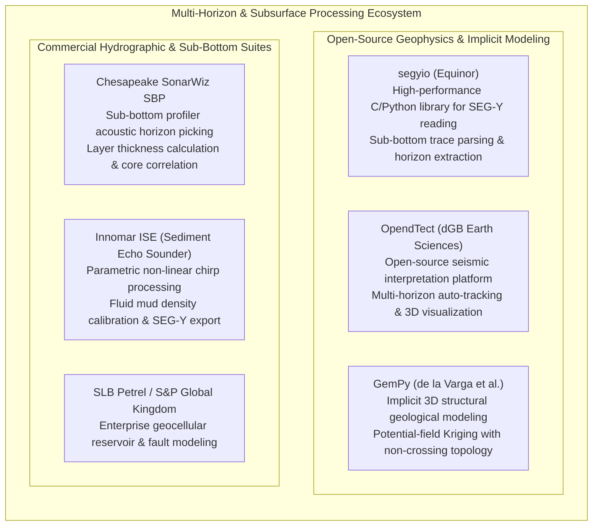

# Chapter 29: Fluid Mud, "Nautical Depth," and Multi-Horizon Subsurface DEMs

*When the seabed or ground surface is not a sharp boundary: modeling rheologic transitions, fluid mud, and stacked subsurface horizons.*

---

## 29.6 Software Ecosystem

Processing fluid mud soundings, picking sub-bottom acoustic horizons, and constructing non-crossing stratigraphic DEM stacks requires specialized tools bridging marine hydrography, reflection seismology, and structural 3D geological modeling. This section reviews the open-source libraries and enterprise software platforms used to interpret and publish multi-horizon elevation models.



---

### 29.6.1 Open-Source Seismic and Implicit Stratigraphic Tools

#### 1. `segyio`: Reading and Processing Sub-Bottom SEG-Y Data
Developed and open-sourced by Equinor, **`segyio`** is a high-performance C and Python library for interacting with SEG-Y files (the universal standard format for sub-bottom profilers and marine seismic data). It provides fast, memory-mapped access to acoustic trace headers, sample rates, and two-way travel time matrices.

```python
"""
Extract multi-horizon acoustic reflectors from a sub-bottom profiler SEG-Y file
using open-source segyio and SciPy. Demonstrates picking the upper lutocline
and consolidated bedrock horizons.
"""

import segyio
import numpy as np
from scipy.signal import hilbert

def extract_subbottom_horizons(segy_path: str) -> dict:
    """
    Parses a sub-bottom profiler SEG-Y file to extract acoustic travel times
    for the upper lutocline and consolidated bedrock.
    
    Args:
        segy_path: Path to input .sgy or .segy sub-bottom profile file.
        
    Returns:
        Dictionary containing trace coordinates, lutocline TWT, and bedrock TWT.
    """
    print(f"Opening SEG-Y profile: {segy_path}")
    with segyio.open(segy_path, ignore_geometry=True) as segy:
        n_traces = segy.tracecount
        n_samples = len(segy.samples)
        dt_us = segyio.tools.dt(segy) / 1000.0  # Sample interval in milliseconds
        
        print(f"Traces: {n_traces:,}, Samples per trace: {n_samples:,}, Sample rate: {dt_us:.3f} ms")
        
        # Read coordinates from trace headers and apply SEG-Y SourceGroupScalar (bytes 71-72:
        # negative scalar means divide; positive scalar means multiply!)
        raw_x = segy.attributes(segyio.TraceField.SourceX)[:].astype(float)
        raw_y = segy.attributes(segyio.TraceField.SourceY)[:].astype(float)
        scalars = segy.attributes(segyio.TraceField.SourceGroupScalar)[:].astype(float)
        scale_mult = np.where(scalars < 0, -1.0 / np.minimum(scalars, -1.0), np.where(scalars > 0, scalars, 1.0))
        x_coords = raw_x * scale_mult
        y_coords = raw_y * scale_mult
        
        # Pre-allocate picked two-way travel times (TWT in milliseconds)
        twt_lutocline_ms = np.zeros(n_traces)
        twt_bedrock_ms = np.zeros(n_traces)
        
        for i in range(n_traces):
            trace = segy.trace[i]
            # 1. Compute analytic signal envelope via Hilbert transform
            envelope = np.abs(hilbert(trace))
            
            # 2. Pick first major arrival (Upper Lutocline / Seabed)
            # Threshold above ambient water-column acoustic noise
            noise_floor = np.median(envelope[:100]) * 3.0
            lutocline_idx = np.where(envelope > noise_floor)[0]
            if len(lutocline_idx) > 0:
                twt_lutocline_ms[i] = segy.samples[lutocline_idx[0]]
            else:
                twt_lutocline_ms[i] = np.nan
                
            # 3. Pick deep consolidated reflector (Bedrock / Hard Sand)
            # Look beyond the lutocline for the highest amplitude peak
            search_start = lutocline_idx[0] + 50 if len(lutocline_idx) > 0 else 100
            if search_start < n_samples:
                bedrock_idx = search_start + np.argmax(envelope[search_start:])
                twt_bedrock_ms[i] = segy.samples[bedrock_idx]
            else:
                twt_bedrock_ms[i] = np.nan
                
    # Enforce non-crossing topological check in travel time: TWT_bedrock >= TWT_lutocline
    valid = ~np.isnan(twt_lutocline_ms) & ~np.isnan(twt_bedrock_ms)
    assert np.all(twt_bedrock_ms[valid] >= twt_lutocline_ms[valid]), "Topological error: Bedrock picked above Lutocline!"
    
    print(f"Successfully processed {n_traces:,} traces with verified non-crossing topology.")
    return {
        "x": x_coords,
        "y": y_coords,
        "twt_lutocline": twt_lutocline_ms,
        "twt_bedrock": twt_bedrock_ms
    }
```

#### 2. GemPy: Implicit 3D Structural Horizon Modeling
Developed by Miguel de la Varga et al. (RWTH Aachen University), **GemPy** is an open-source Python library for implicit 3D geological modeling:
* Represents complex geological volumes using **Potential-Field Universal Co-Kriging** (Lajaunie et al., 1997; Calcagno et al., 2008).
* Automatically enforces structural geological rules: conformable depositional sequences, erosional (`ERODE`) and depositional (`ONLAP`) unconformities, and finite fault displacements.
* Horizons are extracted via Marching Cubes as continuous isosurfaces of a scalar potential field $\Phi(x, y, z)$, mathematically guaranteeing that conformable stratigraphic layers **never intersect or cross in data gaps**.

#### 3. Generic Mapping Tools (GMT `surface -Ll -Lu`) and Non-Crossing QP Splines
In 2.5D raster workflows, **Generic Mapping Tools (GMT)** provides a direct command-line solution to the multi-horizon cross-over problem in `gmt surface` (Smith & Wessel, 1990) via the `-Ll<lower_grid>` and `-Lu<upper_grid>` flags:
* When gridding the PIANC Nautical Bottom ($z_{\text{nautical}}$) from sparse densitometer drops between a continuous $200\text{ kHz}$ lutocline grid (`lutocline.nc`) and a $33\text{ kHz}$ consolidated bed grid (`consolidated_bed.nc`), passing `-Llconsolidated_bed.nc -Lulutocline.nc` forces the biharmonic spline-in-tension solver to clamp the solution at every grid node so that $z_{\text{bed}}(x, y) \le z_{\text{nautical}}(x, y) \le z_{\text{lutocline}}(x, y)$:

```bash
#!/usr/bin/env bash
# GMT Multi-Horizon Non-Crossing Gridding Workflow
set -euo pipefail

REGION="-R590000/595000/5750000/5755000"
SPACING="-I2.0"

# 1. Grid the top horizon: 200 kHz Upper Lutocline (z_1)
gmt blockmedian lutocline_200khz.xyz ${REGION} ${SPACING} | \
    gmt surface ${REGION} ${SPACING} -T0.25 -Glutocline_z1.nc

# 2. Grid the bottom horizon: 33 kHz Consolidated Bed (z_3), bounded above by z_1!
gmt blockmedian consolidated_33khz.xyz ${REGION} ${SPACING} | \
    gmt surface ${REGION} ${SPACING} -T0.35 -Lulutocline_z1.nc -Gconsolidated_z3.nc

# 3. Grid the middle horizon: PIANC Nautical Bottom (rho = 1200 kg/m^3, z_2),
#    strictly bounded below by consolidated_z3.nc and above by lutocline_z1.nc!
gmt blockmedian graviprobe_1200kgm3.xyz ${REGION} ${SPACING} | \
    gmt surface ${REGION} ${SPACING} -T0.50 \
    -Llconsolidated_z3.nc -Lulutocline_z1.nc -Gnautical_depth_z2.nc

# 4. Verify non-negative navigable fluid mud thickness: h_nav = z_1 - z_2 >= 0
gmt grdmath lutocline_z1.nc nautical_depth_z2.nc SUB = navigable_mud_thickness.nc
```

For Python pipelines, the script below implements the **Inequality-Constrained Multi-Horizon Quadratic Programming (QP) Spline** derived in Section 29.5.1 using `scipy.optimize.minimize`:

```python
"""
Simultaneous non-crossing multi-horizon interpolation via Inequality-Constrained
Quadratic Programming (Section 29.5.1) using NumPy and SciPy.
"""

import numpy as np
from scipy.optimize import minimize

def solve_noncrossing_horizons_1d(
    x_grid: np.ndarray,
    obs_idx_list: list[np.ndarray],
    obs_z_list: list[np.ndarray],
    data_weight: float = 1e4,
    smooth_weight: float = 1.0,
) -> np.ndarray:
    """
    Solves for K stacked 1D elevation horizons z_1(x) >= z_2(x) >= ... >= z_K(x)
    minimizing second-derivative bending energy subject to non-crossing constraints.

    Args:
        x_grid: 1D array of M grid coordinates (m).
        obs_idx_list: List of K integer index arrays where each horizon is sampled.
        obs_z_list: List of K elevation arrays (m, positive-up) at sample locations.
        data_weight: Penalty weight alpha for honoring borehole/sonar observations.
        smooth_weight: Weight on discrete curvature ||D2 * z_k||^2.

    Returns:
        2D array Z of shape (K, M) where Z[0] >= Z[1] >= ... >= Z[K-1] everywhere.
    """
    k_horizons = len(obs_idx_list)
    m_nodes = len(x_grid)

    # Discrete second-derivative operator D2 (shape: (M-2) x M)
    d2 = np.zeros((m_nodes - 2, m_nodes))
    for i in range(m_nodes - 2):
        d2[i, i : i + 3] = [1.0, -2.0, 1.0]
    b_mat = smooth_weight * (d2.T @ d2)

    def objective_and_grad(z_flat: np.ndarray) -> tuple[float, np.ndarray]:
        z_stack = z_flat.reshape((k_horizons, m_nodes))
        loss = 0.0
        grad = np.zeros_like(z_stack)
        for k in range(k_horizons):
            zk = z_stack[k]
            loss += 0.5 * float(zk @ b_mat @ zk)
            grad[k] += b_mat @ zk
            idx = obs_idx_list[k]
            res = zk[idx] - obs_z_list[k]
            loss += 0.5 * data_weight * float(np.sum(res**2))
            grad[k, idx] += data_weight * res
        return loss, grad.ravel()

    # Non-crossing linear inequality constraints: z_k(x_j) - z_{k+1}(x_j) >= 0
    constraints = []
    for k in range(k_horizons - 1):
        def make_ineq(layer_k: int):
            return {
                "type": "ineq",
                "fun": lambda z_f: z_f.reshape((k_horizons, m_nodes))[layer_k]
                - z_f.reshape((k_horizons, m_nodes))[layer_k + 1],
            }
        constraints.append(make_ineq(k))

    # Initialize with linear interpolation of each horizon
    z0 = np.zeros((k_horizons, m_nodes))
    for k in range(k_horizons):
        z0[k] = np.interp(x_grid, x_grid[obs_idx_list[k]], obs_z_list[k])

    res = minimize(
        objective_and_grad,
        z0.ravel(),
        method="SLSQP",
        jac=True,
        constraints=constraints,
        options={"maxiter": 500, "ftol": 1e-9},
    )
    z_opt = res.x.reshape((k_horizons, m_nodes))
    # Verify non-crossing within numerical precision
    assert np.all(np.diff(z_opt, axis=0) <= 1e-6), "Constraint violation!"
    return z_opt
```

#### 4. OpendTect (dGB Earth Sciences)
A free and open-source seismic interpretation system:
* Ingests 2D sub-bottom profiles and 3D seismic cubes in SEG-Y format.
* Provides automated **Horizon Auto-Tracking** based on phase correlation, instantaneous amplitude tracking, and dip steering.
* Exports picked horizons as georeferenced raster grids or triangulated surface meshes with depth-converted velocity models.

---

### 29.6.2 Commercial Sub-Bottom, Rheological, and Geological Modeling Suites

#### 1. Chesapeake SonarWiz Sub-Bottom Profiler (SBP)
The leading commercial post-processing software used by hydrographic surveyors and coastal dredging engineers:
* Seamlessly integrates sub-bottom seismic profiles (chirp, boomer, sparker, parametric) with sidescan sonar and multibeam bathymetric swaths.
* Features specialized **Acoustic Sediment Classification (ASC)** and multi-reflector digitizing tools that correlate sub-bottom acoustic reflector amplitudes with geotechnical vibracore logs, enforcing layer-order consistency and computing isopach/isochore dredge volumes between any pair of picked reflectors.
* Exports multi-horizon ASCII, BAG, and GeoTIFF surfaces (`top_of_mud.tif`, `nautical_bottom.tif`, `consolidated_bed.tif`) directly into hydrographic GIS databases.

#### 2. Innomar SESWIN and ISE (Innomar Sediment Echo Sounder) & Stema Silas
* **Innomar SESWIN & ISE:** The specialized acquisition and post-processing suite designed for Innomar parametric sub-bottom profilers. Corrects both the high-frequency ($100\text{ kHz}$) and difference-frequency ($4\text{–}15\text{ kHz}$) channels for vessel heave, pitch, roll, and tide/ERS separation in real time, applies multi-layer sound-velocity conversion across stratified mud layers, and computes dredging payment volumes under PIANC Report 121 rules.
* **Stema Systems Silas & RheoTune:** Commercial seismic-rheological inversion software used in European ports (Rotterdam, Antwerp, Emden) that calibrates continuous acoustic sub-bottom impedance profiles against in-situ **RheoTune** tuning-fork yield-stress ($\tau_y$) and density ($\rho$) casts to map the legal nautical bottom automatically.

#### 3. SLB Petrel, S&P Global Kingdom Suite, and Seequent Leapfrog
The enterprise standards for 3D seismic interpretation, offshore wind geotechnical foundation modeling, and geocellular reservoir characterization:
* Manage thousands of intersecting 2D sub-bottom/seismic lines, CPT (Cone Penetration Test) logs, and boreholes.
* Utilize implicit radial basis function (RBF) and **Structural Framework** algorithms to construct watertight, fault-bounded, non-crossing horizon grids across complex coastal and offshore geological basins.
