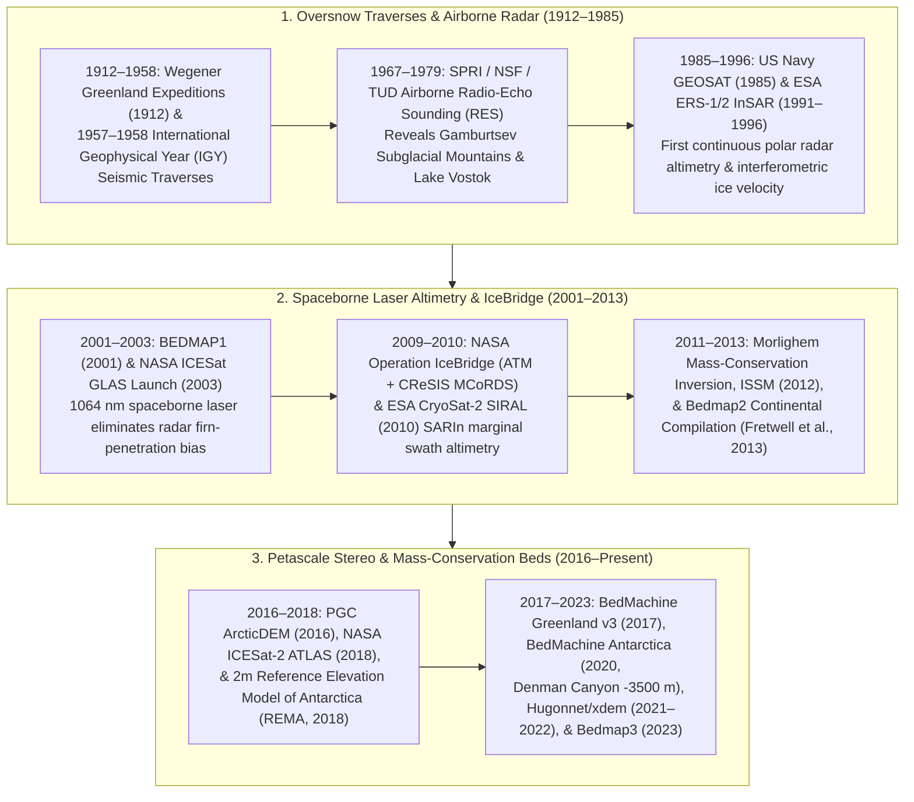

# Chapter 30: Cryospheric and Subglacial / Sub-Ice-Shelf Bed Topography

*Mapping the shifting ice surfaces of the poles and mountain glaciers—and the hidden bedrock continents beneath kilometers of ice.*

---

## 30.3 Historical Evolution: From IGY Traverses to BedMachine (`gis-history` Context)

Mapping polar ice sheets and subglacial continents is a journey spanning early barometric sled traverses, Cold War seismic and radio-echo sounding flights, orbital radar and laser altimeters, petascale optical stereophotogrammetry, and physics-informed mass-conservation inversions. Anchored to the chronological milestones in the [`schwehr/gis-history`](https://github.com/schwehr/gis-history) repository, this section traces how glaciologists transformed Antarctica and Greenland from blank white voids on the map into high-resolution, dynamically monitored 3D elevation models.

---

### 30.3.1 Early Traverses, the 1957 IGY, and the Airborne Radar Revolution: 1912 to 1979

#### 1912–1931: Alfred Wegener's Greenland Traverses and Early Seismic Sounding
In **1912**—the same year he published his theory of continental drift—German geophysicist and meteorologist **Alfred Wegener** crossed the Greenland Ice Sheet with J. P. Koch, using barometric altimetry and trigonometric leveling to profile the ice dome. During his fatal **1930–1931 Greenland Expedition** (Station Eismitte), Wegener's team executed the first successful explosion seismic reflection soundings on a continental ice sheet, proving that central Greenland's ice exceeded $2,500\text{ m}$ in thickness.

#### 1957–1958: The International Geophysical Year (IGY)
During the landmark **1957–1958 International Geophysical Year** (which also witnessed the launch of **Sputnik 1** and the release of **Fortran**), twelve nations established scientific stations across Antarctica:
* Oversnow traverses led by American (Charles Bentley, Albert Crary), Soviet, British (Vivian Fuchs' Commonwealth Trans-Antarctic Expedition), French, and Australian teams navigated tracked Sno-Cats across thousands of kilometers of uncharted crevasse fields.
* **Seismic and Gravimetric Sounding:** By detonating dynamite charges every $30\text{–}50\text{ kilometers}$ (using the **1866 dynamite** invention paired with multi-channel oscillographs and Worden gravimeters), IGY teams proved that Antarctica was not a thin ice cap over scattered islands, but a massive continental ice sheet up to $4\text{ kilometers}$ thick, with vast areas of West Antarctica grounded in marine basins more than $1\text{–}2\text{ kilometers}$ below sea level.

#### 1967–1979: The Airborne Radio-Echo Sounding (RES) Revolution
Following early observations that VHF aircraft radar altimeters accidentally received echoes through polar ice, **Stan Evans** and **Gordon de Q. Robin** at the **Scott Polar Research Institute (SPRI)** in Cambridge, UK, partnered with the US National Science Foundation (NSF) and the Technical University of Denmark (TUD) in **1967** to mount $35\text{ MHz}$ and $60\text{ MHz}$ pulsed radar systems aboard long-range US Navy LC-130 Hercules aircraft:
* Rather than stopping for hours to drill shot holes and detonate explosives, aircraft flew thousands of line-kilometers across Antarctica at $300\text{ km/h}$, recording continuous 35-mm film profiles of both the ice surface and the subglacial bedrock.
* Between **1967 and 1979**, SPRI-NSF-TUD flights mapped the **Gamburtsev Subglacial Mountains** (an Alpine-scale mountain range buried beneath $3\text{ km}$ of East Antarctic ice), identified giant subglacial **Lake Vostok** (formally confirmed with ERS-1 altimetry in 1996), and culminated in David Drewry's **1983 *Antarctica: Glaciological and Geophysical Folio***.

---

### 30.3.2 The Satellite Altimetry, InSAR, and IceBridge Era: 1985 to 2013

#### 1985–1997: US Navy GEOSAT, ESA ERS-1/2 Tandem InSAR, and Radarsat-1
* **1985 (`GEOSAT`) & 1991 (`ERS-1`):** Launched in March 1985, the US Navy's **GEOSAT** Ku-band radar altimeter provided the first dense satellite elevation grids over southern Greenland and coastal Antarctica up to $\pm 72^\circ$ latitude. In **1991**, the European Space Agency launched **ERS-1** (and **ERS-2** in 1995), extending radar altimetry to $\pm 81.5^\circ$ latitude and revealing rapid dynamic ice thinning in West Antarctica's Amundsen Sea sector.
* **1992–1997 (InSAR Ice Velocity & Grounding Lines):** Following the **1992 TOPEX/Poseidon** launch, Richard Goldstein, Eric Rignot, and Ian Joughin demonstrated that repeat-pass Synthetic Aperture Radar interferometry (InSAR) from ERS-1/2 tandem orbits (and the **1997 Radarsat-1 Antarctic Mapping Mission**) could map horizontal ice-sheet flow velocities $\bar{\mathbf{v}}(x,y)$ to millimeter-per-day precision and pinpoint tidal flexure across sub-ice-shelf grounding zones.
* **2001 (`BEDMAP1`):** Paul Lythe, David Vaughan, and the international BEDMAP consortium released the first digital gridded bedrock elevation model of Antarctica (`BEDMAP1`), compiled using geostatistical interpolation of historical seismic and RES tracks.

#### 2003–2013: NASA ICESat (GLAS), Operation IceBridge, CryoSat-2, and Bedmap2
* **2003 (`ICESat`):** In January 2003, NASA launched **ICESat** carrying the Geoscience Laser Altimeter System (GLAS, $1064\text{ nm}$ infrared laser). GLAS eliminated the multi-meter firn-penetration biases of Ku-band radar altimeters, measuring polar elevation change ($\partial z/\partial t$) with $\pm 5\text{–}15\text{ cm}$ accuracy across $70\text{ m}$ footprints.
* **2009 (`Operation IceBridge`) & 2010 (`CryoSat-2`):** When ICESat's last laser failed in 2009, NASA launched the decadal airborne **Operation IceBridge** campaign ($2009\text{–}2019$), pairing the Airborne Topographic Mapper (ATM) scanning LiDAR with the University of Kansas **CReSIS MCoRDS** multi-channel radar array. In **2010**, ESA launched **CryoSat-2**, whose SIRAL Ku-band radar altimeter introduced across-track **SAR Interferometric (SARIn)** mode to accurately locate echoes on steep, crevassed ice-sheet margins.
* **2013 (`Bedmap2`):** Peter Fretwell et al. published **Bedmap2** in *The Cryosphere*, integrating 25 million data points at $1\text{ km}$ grid spacing across Antarctica, though outlet glacier troughs between flight lines remained limited by geometric gridding.

---

### 30.3.3 The Modern Era: ArcticDEM, REMA, ICESat-2, and BedMachine (2011–Present)

#### 2011–2020: Mass-Conservation Inversion, ISSM, and BedMachine
To overcome the artificial bedrock dams created when Kriging bridges $10\text{–}20\text{ km}$ gaps between radar flight lines, **Mathieu Morlighem, Eric Rignot, Helene Seroussi, and Eric Larour** at UC Irvine and NASA JPL developed the **Mass-Conservation (MC) Bed Inversion** method (2011) within the open-source **Ice-sheet and Sea-level System Model (`ISSM`, 2012)**:
* **2017 (`BedMachine Greenland v3`):** Combined CReSIS airborne radar thicknesses, multibeam fjord bathymetry, and complete satellite InSAR surface velocities to map Greenland's subglacial bed at $150\text{ m}$ resolution, proving that scores of marine-terminating glaciers sit in deep submarine canyons open to warm subsurface Atlantic water.
* **2020 (`BedMachine Antarctica`) & 2023 (`Bedmap3`):** Synthesized 1.5 million line-kilometers of radar soundings with satellite velocities across Antarctica, discovering that the subglacial trough beneath **Denman Glacier** in East Antarctica plunges to **$3,500\text{ meters}$ below sea level**—the deepest continental canyon on Earth!

#### 2016–2022: PGC ArcticDEM, REMA, NASA ICESat-2, and Global Glacier Mass Balance (`xdem`)
* **2016 (`ArcticDEM`) & 2018 (`REMA`):** Led by Ian Howat, Claire Porter, Myoung-Jong Noh, and Paul Morin at the **Polar Geospatial Center (PGC)** using WorldView-1/2/3 optical stereopairs (and **WorldView Legion** from 2024) processed with the **SETSM** algorithm on petascale supercomputers, **ArcticDEM (2016)** and the **Reference Elevation Model of Antarctica (`REMA`, 2018)** delivered the first continent-wide $2\text{-meter}$ timestamped elevation strips and mosaics of both polar regions.
* **2018 (`ICESat-2`) & 2021–2022 (`xdem`):** Launched in September 2018, NASA's **ICESat-2** ($532\text{ nm}$ six-beam photon-counting ATLAS LiDAR) achieved $<3\text{ cm}$ vertical precision over ice sheets. In **2021–2022**, Romain Hugonnet, Amaury Dehecq, Robert McNabb, Etienne Berthier, and the GlacioHack consortium processed half a million historical ASTER and ArcticDEM stereopairs using the open-source **`xdem`** framework (Nuth & Kääb 3D co-registration + heteroscedastic Gaussian process time series) to quantify the accelerating mass loss of all $\sim 220,000$ mountain glaciers on Earth.

---

### 30.3.4 Synthesis: Sub-Ice-Shelf Exploration and Cloud-Native Polar Geomatics (2019–Present)

In the 2020s, two frontier developments have further transformed cryospheric elevation mapping:

1. **Autonomous Underwater Vehicle (AUV) Swath Mapping of Sub-Ice-Shelf Cavities:**
   During the International Thwaites Glacier Collaboration (ITGC, 2019–2024), the autonomous underwater vehicle ***Ran*** (operated by the University of Gothenburg) and the UK's ***Autosub Long Range*** dove beneath the floating Dotson and Thwaites ice shelves in West Antarctica. Equipped with upward- and downward-looking multibeam echosounders and Bathymetric-Aided Navigation (BAN), *Ran* mapped both the sub-ice seafloor and the inverted topography of the floating ice-shelf base at sub-meter resolution—revealing terraced basal melt channels, teardrop-shaped turbulent melt structures, and relict grounding-zone wedges that could never be resolved from airborne radar or satellite gravity alone.
2. **Cloud-Optimized Polar Elevation Archives (STAC, Zarr, COPC, and SlideRule):**
   Following the adoption of **Zarr (2015/2019)**, **STAC 1.0/1.1 (2021/2024)**, **Cloud-Optimized Point Clouds (`COPC`, 2021)**, and **IceChunk (2024)**, multi-petabyte polar datasets—including all individual timestamped 2-m ArcticDEM and REMA strips on AWS/Google Cloud and NASA's ICESat-2 ATL03/ATL06 photon archives accessed via **SlideRule**—can now be queried, co-registered, and differenced on demand in the cloud without downloading raw files.
