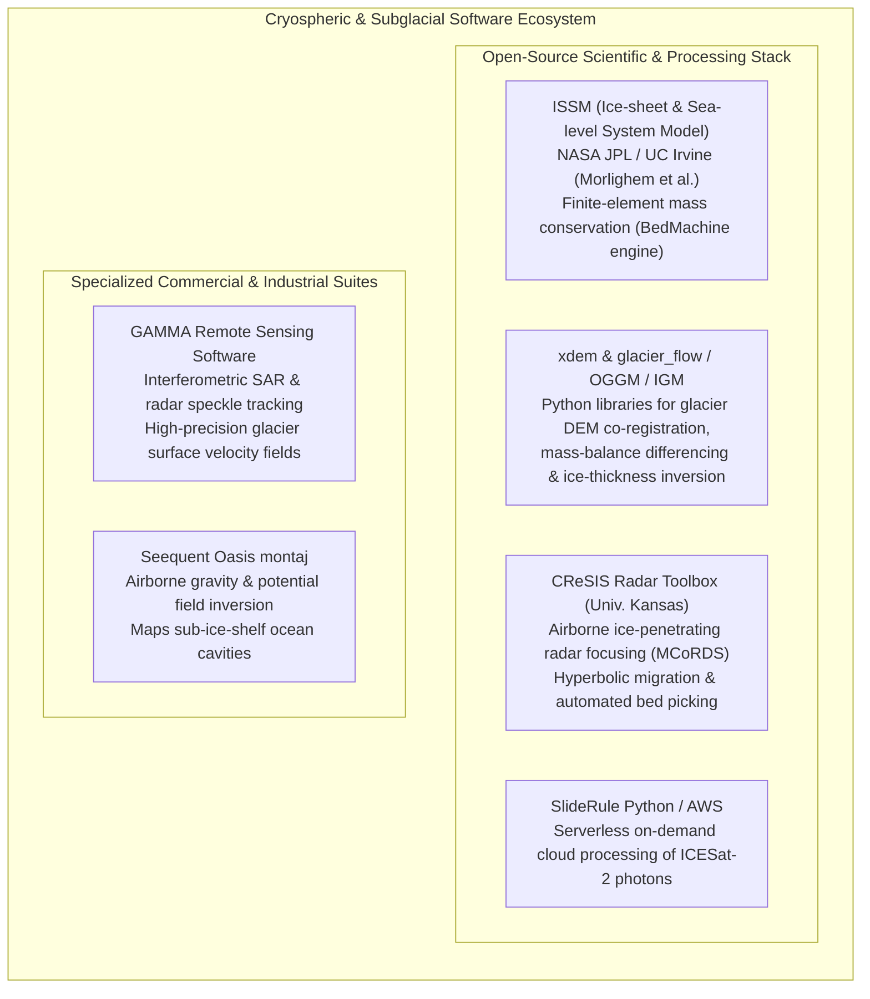

# Chapter 30: Cryospheric and Subglacial / Sub-Ice-Shelf Bed Topography

*Mapping the shifting ice surfaces of the poles and mountain glaciers—and the hidden bedrock continents beneath kilometers of ice.*

---

## 30.5 Software Ecosystem

Processing cryospheric elevation models, inverting subglacial bedrock topography, and analyzing multi-temporal glacier thinning requires software capable of handling petabyte-scale orbital altimetry, specialized radar signal processing, and non-linear finite element continuum mechanics. This section reviews the primary open-source scientific tools and specialized commercial platforms in polar geomatics.



---

### 30.5.1 Open-Source Cryospheric and Geodetic Software

#### 1. ISSM (Ice-sheet and Sea-level System Model): The BedMachine Engine
Developed collaboratively by NASA's Jet Propulsion Laboratory (JPL) and the University of California, Irvine, **ISSM** is a massively parallelized, multi-physics finite element framework:
* **The Mass-Conservation (MC) Module:** Houses the official open-source implementation of the BedMachine algorithm.
* Solves the anisotropic 2D mass conservation PDE on adaptive triangular meshes, optimizing ice thickness against satellite InSAR velocities and airborne radar tracks.
* Coupled to higher-order Stokes ice-flow engines, grounding-line migration modules, and subglacial hydrology solvers.

#### 2. `xdem`: Modern Glaciological DEM Differencing and Co-Registration
Maintained by the GlacioHack open-source community (Amaury Dehecq, Romain Hugonnet, et al.), **`xdem`** is a specialized Python library built on top of `geoutils` and `rasterio`:
* Implements the **Nuth and Kääb (2011)** 3D analytical co-registration algorithm, iteratively solving for horizontal sub-pixel shifts and vertical biases by correlating elevation differences ($\Delta z$) against slope and aspect strictly over **stable, non-glaciated bedrock terrain**.
* Automatically masks out dynamic glacier ice, snowfields, and waterbodies to prevent glacier thinning from corrupting geodetic alignment.
* Computes spatial variograms to model spatial autocorrelation in DEM errors, propagating correlated uncertainties into defensible glacier-wide volumetric mass loss estimates ($\text{Gt/year}$).

```python
"""
Co-register two multi-temporal glacier DEMs and calculate ice elevation change
using open-source xdem and geoutils.
"""

import xdem
import geoutils as gu
import numpy as np

def compute_glacier_thinning(ref_dem_path: str, t2_dem_path: str, glacier_mask_path: str, delta_t_years: float):
    """
    Co-registers two DEMs over stable terrain and computes annual ice thinning rate.
    
    Args:
        ref_dem_path: Baseline DEM GeoTIFF (e.g., ArcticDEM strip from 2012).
        t2_dem_path: Later DEM GeoTIFF (e.g., ArcticDEM strip from 2022).
        glacier_mask_path: Vector shapefile/GeoPackage of glacier outlines (RGI).
        delta_t_years: Elapsed time in decimal years (e.g., 10.0).
    """
    print("Loading multi-temporal elevation rasters...")
    ref_dem = xdem.DEM(ref_dem_path)
    t2_dem = xdem.DEM(t2_dem_path)
    glaciers = gu.Vector(glacier_mask_path)
    
    # Reproject t2_dem to match reference DEM grid exactly
    t2_aligned = t2_dem.reproject(ref_dem)
    
    # Create mask of stable terrain (True where NOT a glacier)
    glacier_mask = glaciers.create_mask(ref_dem)
    stable_mask = ~glacier_mask
    
    print(f"Executing Nuth & Kääb (2011) 3D co-registration over stable terrain...")
    # Nuth & Kääb coregistration solves for horizontal (dx, dy) and vertical (dz) shifts
    nuth_kaab = xdem.coreg.NuthKaab()
    nuth_kaab.fit(ref_dem, t2_aligned, inlier_mask=stable_mask)
    
    shifts = nuth_kaab.meta["outputs"]["affine"]
    print(f"Estimated geodetic shifts: dx={shifts['shift_x']:.2f}m, "
          f"dy={shifts['shift_y']:.2f}m, dz={shifts['shift_z']:.2f}m")
    
    # Apply transformation to align the second DEM
    t2_coreg = nuth_kaab.apply(t2_aligned)
    
    # Calculate elevation change: dZ = Later - Earlier
    dz = t2_coreg - ref_dem
    
    # Compute annual thinning rate (m/year) strictly across valid glacier pixels
    glacier_dh = dz.data[glacier_mask.data].compressed()
    glacier_thinning_rate = glacier_dh / delta_t_years
    
    mean_thinning = np.nanmean(glacier_thinning_rate)
    max_thinning = np.nanmin(glacier_thinning_rate) # Minimum dZ represents greatest thinning
    
    print(f"--- Glacier Mass Balance Results ---")
    print(f"Mean Thinning Rate: {mean_thinning:.2f} m/year")
    print(f"Maximum Terminus Drawdown: {max_thinning:.2f} m/year")
    
    return dz
```

#### 3. CReSIS Radar Toolbox
Developed by the Center for Remote Sensing and Integrated Systems at the University of Kansas:
* Parses raw high-bandwidth radio-echo sounding chirps from the **MCoRDS** (Multi-Channel Coherent Radar Depth Sounder) system.
* Executes frequency-wavenumber ($f\text{-}k$) and Synthetic Aperture Radar (SAR) time-domain backprojection to collapse hyperbolic clutter.
* Implements automated Viterbi and level-set algorithms to trace the continuous subglacial bedrock echo beneath deep ice.

#### 4. SlideRule
An open-source serverless platform developed by the University of Washington and NASA:
* Executes high-throughput Python queries directly against NASA's cloud-hosted ICESat-2 **ATL03 (geolocated photons)** and **ATL06 (land ice elevations)** repositories on AWS.
* Enables researchers to extract millions of photon-counting surface profiles across polar ice streams in seconds without downloading multi-gigabyte HDF5 archives.

#### 5. `glacier_flow`, OGGM (Open Global Glacier Model), and IGM (Instructed Glacier Model)
For mountain glaciers and ice caps outside the polar ice sheets, specialized open-source Python frameworks invert surface DEMs and satellite velocity fields for subglacial bed topography:
* **`glacier_flow` and OGGM (Maussion et al., 2019):** Automated flowline and 2D shallow-ice / mass-conservation toolchains that ingest Randolph Glacier Inventory (RGI) outlines and Copernicus GLO-30 / NASADEM / ArcticDEM surface elevations, compute catchment-wide flowlines, and invert Glen's flow law and mass conservation ($\nabla\cdot(H\bar{\mathbf{v}}) = \dot{b} - \partial H/\partial t$) to generate global consensus ice-thickness and subglacial bed DEMs.
* **IGM (Instructed Glacier Model, Jouvet et al.):** A GPU-accelerated TensorFlow/PyTorch higher-order ice-flow and data-assimilation engine that jointly optimizes subglacial bed elevation $z_{\text{bed}}(x,y)$, basal sliding coefficients, and ice thickness from multi-temporal DEMs (`xdem`), ICESat-2 altimetry, and Sentinel-1/2 velocity fields.

Below is a complete, standalone Python implementation of the **1D/Streamline Mass-Conservation Bed Inversion, Shreve Subglacial Hydraulic Potential, and Hydrostatic Grounding-Line Detector**:

```python
"""
Physics-informed subglacial bed inversion along an outlet glacier streamline
using Mass Conservation (Morlighem et al., 2017), Shreve (1972) subglacial
hydraulic potential, and hydrostatic grounding-line detection.
"""

import numpy as np
from scipy.integrate import cumulative_trapezoid

def invert_glacier_bed_and_grounding_line(
    x_m: np.ndarray,
    z_surf_m: np.ndarray,
    width_m: np.ndarray,
    v_surf_m_yr: np.ndarray,
    smb_m_yr: np.ndarray,
    dh_dt_m_yr: np.ndarray,
    h0_radar_m: float,
    h_air_m: float = 12.0,
    rho_ice: float = 917.0,
    rho_water: float = 1028.0,
    rho_fw: float = 1000.0,
) -> dict[str, np.ndarray | float]:
    """
    Solves div(W * H * v) = W * (smb - dh/dt) along a glacier trough,
    identifies the hydrostatic grounding line, and computes Shreve potential.
    """
    net_mass_rate = smb_m_yr - dh_dt_m_yr  # M(x) = b_dot - dH/dt (m/yr)

    # 1. Integrate total ice volume flux Q(x) = Q(0) + integral_0^x W(x') * M(x') dx'
    q0 = width_m[0] * h0_radar_m * v_surf_m_yr[0]
    cumulative_source = cumulative_trapezoid(
        width_m * net_mass_rate, x_m, initial=0.0
    )
    q_flux = q0 + cumulative_source

    # 2. Mass-conservation ice thickness H_mc(x) and grounded bed z_bed(x)
    h_mc = q_flux / (width_m * np.maximum(v_surf_m_yr, 1.0))
    z_bed_mc = z_surf_m - h_mc

    # 3. Check Archimedes hydrostatic flotation thickness H_float(x) from surface h_f = z_surf
    h_float = (rho_water / (rho_water - rho_ice)) * (z_surf_m - h_air_m) + h_air_m
    is_floating = h_mc > h_float  # Ice shelves float where grounded thickness exceeds flotation
    h_final = np.where(is_floating, h_float, h_mc)
    z_base_ice = z_surf_m - h_final

    # Locate grounding line x_gl (first transition from grounded to floating)
    gl_indices = np.where(is_floating)[0]
    x_grounding_line = float(x_m[gl_indices[0]]) if len(gl_indices) > 0 else float(np.nan)

    # 4. Compute Shreve (1972) subglacial hydraulic potential Phi_hyd (kPa) on grounded bed
    g = 9.81
    phi_hyd_kpa = 1e-3 * (
        rho_ice * g * z_surf_m + (rho_fw - rho_ice) * g * z_bed_mc
    )

    return {
        "thickness_m": h_final,
        "z_bed_grounded_m": z_bed_mc,
        "z_ice_base_m": z_base_ice,
        "is_floating": is_floating,
        "x_grounding_line_m": x_grounding_line,
        "phi_hyd_kpa": phi_hyd_kpa,
    }
```

---

### 30.5.2 Commercial Remote Sensing Suites

#### 1. GAMMA Remote Sensing Software
The global benchmark for commercial and space-agency radar interferometry and offset tracking:
* **Differential InSAR (DInSAR) & Multi-Aperture Interferometry (MAI):** Maps millimeter-scale vertical tidal flexing across floating ice-shelf grounding zones and slow interior ice flow.
* **Intensity Speckle and Offset Tracking Module:** Cross-correlates multi-temporal SAR amplitude/intensity patches (from Sentinel-1, TerraSAR-X, RADARSAT Constellation, or ALOS-2 PALSAR-2) to calculate precise horizontal ice displacement vectors ($\bar{\mathbf{v}}$) across rapidly shearing outlet glaciers ($>1\text{–}10\text{ km/yr}$) where phase coherence decorrelates between passes.
* Generates the $100\%$-complete surface velocity fields and grounding-line masks ingested by BedMachine mass-conservation inversions.

#### 2. Seequent Oasis montaj and GM-SYS
The standard commercial geophysical software suite for processing airborne potential-field surveys over the poles:
* Used by NASA Operation IceBridge, the British Antarctic Survey, and Alfred Wegener Institute to process airborne strapdown and stabilized gravimeter data (e.g., Sander Geophysics AIRGrav) alongside aeromagnetics over floating ice shelves.
* Solves 2D and 3D Parker-Oldenburg and Talwani Bouguer gravity inversions—constrained by radar ice thickness at grounding lines and seismic tie points—to infer the bathymetric seafloor elevation $z_{\text{bed}}(x,y)$ and water-cavity thickness ($H_{\text{cavity}}$) beneath floating ice shelves where radio-echo sounding cannot penetrate conductive seawater.

#### 3. Polar Geospatial Center (PGC) SETSM, NASA ASP, and Quantarctica
* **SETSM (Surface Extraction with TIN-based Search-space Minimization) & NASA Ames Stereo Pipeline (`ASP`):** The open-source photogrammetric engines used to generate ArcticDEM, REMA, and High Mountain Asia (HMA) DEMs from sub-meter Maxar WorldView-1/2/3/Legion, GeoEye-1, and Pléiades optical stereo imagery. Both engines incorporate Rational Polynomial Coefficient (RPC) bundle adjustment, radiometric gain balancing for sunlit snow, and automatic co-registration to ICESat-2 ATL06 reference tracks.
* **Quantarctica (Norwegian Polar Institute / QGIS) & QGreenland:** Curated open-source QGIS geospatial data and cartographic packages that bundle BedMachine Antarctica/Greenland subglacial bed grids, REMA/ArcticDEM surface mosaics, MEaSUREs InSAR velocity vectors, and grounding-line shapefiles in standardized polar stereographic projections (`EPSG:3031` Antarctic Polar Stereographic and `EPSG:3413` NSIDC Sea Ice Polar Stereographic North) for immediate desktop and field expedition use.
