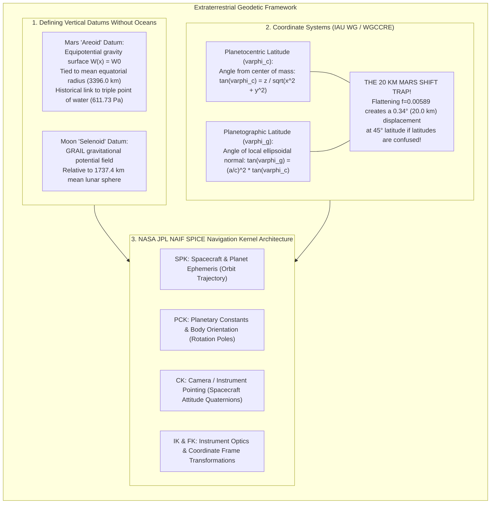
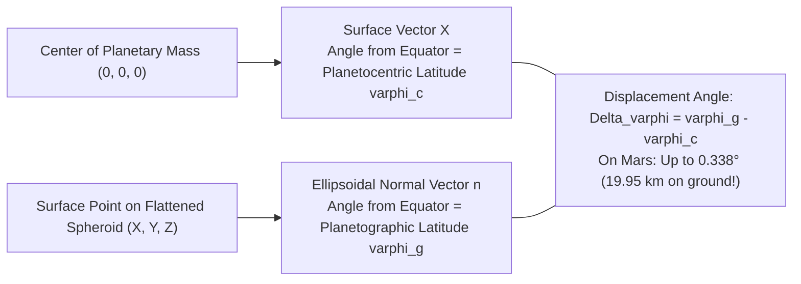
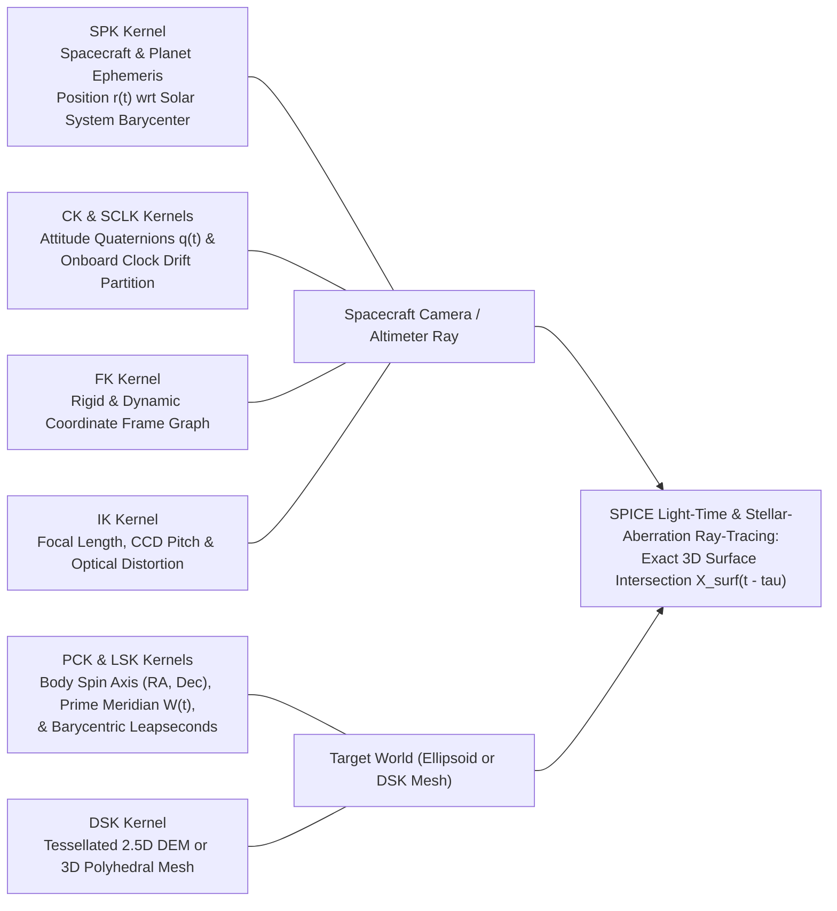

# Chapter 31: Planetary and Extraterrestrial DEMs (Moon, Mars, Asteroids, and Ocean Worlds)

*How mapping worlds without oceans, without GNSS, and sometimes without spherical symmetry forged modern photogrammetry and laser altimetry.*

---

## 31.1 Planetary Geodesy and Vertical Datums Without Oceans

On Earth, all vertical elevations are anchored to an intuitive physical concept: Mean Sea Level. Earth's geoid ($W(\mathbf{x}) = W_0$) is the gravitational equipotential surface that coincides with the undisturbed global ocean surface. 

When mapping the Moon, Mars, Venus, or outer solar system moons, this oceanic baseline disappears. There are no global liquid water oceans to define a zero elevation. Furthermore, extraterrestrial exploration proceeds without Global Navigation Satellite Systems (GNSS): spacecraft have no GPS receivers to fix orbital trajectories, and ground control points (GCPs) cannot be occupied by human surveyors with tripods and prism poles.

Planetary elevation models must be built from first principles of orbital mechanics, Doppler spacecraft radio tracking, spherical harmonic gravitational fields, and the NASA/JPL SPICE navigation kernel architecture.

---

### 31.1.1 Defining Vertical Datums Without Oceans: The Areoid and Selenoid

To define elevation $h$ on an extraterrestrial body, planetary geodesists must define both a geometric reference figure (sphere or triaxial ellipsoid) and a physical equipotential gravity surface.

#### 1. The Mars "Areoid"
On Mars, elevation is referenced to the **Areoid** (analogous to Earth's geoid):
* **Historical Datum (Atmospheric Pressure):** Prior to the 1990s, the zero-elevation level on Mars was arbitrarily defined as the elevation where average atmospheric pressure equaled the **triple point of water ($6.1173\text{ mbar}$ / $611.73\text{ Pa}$)**—the minimum pressure required for liquid water to exist in thermodynamic equilibrium.
* **Modern Geodetic Datum (MOLA Areoid):** Spacecraft Doppler tracking from Mars Global Surveyor (MGS) revealed that Martian atmospheric pressure fluctuates by up to $30\%$ seasonally as carbon dioxide freezes out at the polar ice caps, making an atmospheric datum unusable.
* The modern Martian vertical datum—established by David E. Smith and the MOLA Science Team (Smith et al., 2001) and refined via least-squares Somigliana–Pizzetti optimization by Ardalan et al. (2010)—is an **equipotential surface of the Martian gravity potential ($W(\mathbf{X}) = W_0$)**:
  $$W_0 = 12,654,875 \pm 69\text{ m}^2\cdot\text{s}^{-2}$$
  This geopotential value (summing the Newtonian monopole $\frac{GM_{\text{Mars}}}{a} \approx 12,611,416\text{ m}^2\cdot\text{s}^{-2}$, the $J_2$ oblateness harmonic $+\frac{1}{2}J_2\frac{GM_{\text{Mars}}}{a} \approx +12,331\text{ m}^2\cdot\text{s}^{-2}$, and the equatorial rotational potential $+\frac{1}{2}\omega_{\text{Mars}}^2 a^2 \approx +28,973\text{ m}^2\cdot\text{s}^{-2}$, plus higher-order zonal harmonics) is chosen so that the mean equatorial radius of the equipotential surface equals the IAU reference equatorial radius of Mars:
  $$R_{\text{equator}} = 3,396.0\text{ km}$$
  At any planetocentric latitude $\varphi_c$ and East longitude $\lambda$, the global spherical harmonic expansion of Mars's gravity potential $W(r, \varphi_c, \lambda)$ (evaluated from models such as MRO120D or GMM-3 up to degree and order $N_{\max} = 120$) is inverted iteratively to find the local areoid radius $r_{\text{areoid}}(\varphi_c, \lambda)$ satisfying $W\big(r_{\text{areoid}}, \varphi_c, \lambda\big) = W_0$:
  $$W(r, \varphi_c, \lambda) = \frac{GM_{\text{Mars}}}{r} \left[ 1 + \sum_{n=2}^{N_{\max}} \sum_{m=0}^n \left(\frac{R_{\text{ref}}}{r}\right)^n \bar{P}_{nm}(\sin\varphi_c)\big(\bar{C}_{nm}\cos m\lambda + \bar{S}_{nm}\sin m\lambda\big) \right] + \frac{1}{2}\omega_{\text{Mars}}^2 r^2 \cos^2\varphi_c$$
  Because Mars lacks a ductile plate-tectonic asthenosphere capable of complete isostatic compensation, the uncompensated mass of the Tharsis volcanic plateau warps the Martian areoid upward by $+1.8\text{ km}$ relative to the best-fitting triaxial ellipsoid! Elevations on Mars are reported either as **areocentric radius** ($r$, in meters from the center of mass) or as **areoid orthometric elevation** ($H = r - r_{\text{areoid}}(\varphi_c, \lambda)$, positive upward). Olympus Mons rises to $+21,229\text{ m}$ above the MOLA areoid, while the floor of the Hellas impact basin plunges to $-8,200\text{ m}$ below the areoid.

#### 2. The Lunar Reference Frame: The "Selenoid"
The Moon rotates synchronously with its $27.32\text{-day}$ orbital period, yielding minimal rotational and tidal flattening ($f \approx 0.0012$).
* **The Lunar Geometric Sphere:** For routine cartographic products (including LOLA global gridded data records, LDEM), the International Astronomical Union (IAU) and Lunar Reconnaissance Orbiter project standardize elevations $z = r - R_{\text{Moon}}$ relative to a reference sphere of fixed radius:
  $$R_{\text{Moon}} = 1,737.4\text{ km}$$
* **The Selenoid:** Using dual-spacecraft Ka-band range-rate tracking ($\sim 0.05\,\mu\text{m}\cdot\text{s}^{-1}$ precision) from NASA's **GRAIL (Gravity Recovery and Interior Laboratory)** mission (Zuber et al., 2013), geodesists mapped the Moon's gravity field to spherical harmonic degree and order $1,200$. The **Selenoid** is the resulting equipotential surface ($W_{\text{Moon}}(\mathbf{X}) = W_{0,\text{Moon}}$). Because dense basaltic mare lavas and mantle plugs fill ancient impact basins ("mascons" such as Mare Imbrium and Mare Crisium), the Selenoid undulates from roughly $-270\text{ m}$ to $+450\text{ m}$ relative to the $1,737.4\text{ km}$ reference sphere—critical when modeling magma hydrostatic head or low-altitude perilune orbits.

---

### 31.1.2 Planetary Coordinate Conventions: The 20-Kilometer Latitude Trap

Terrestrial geodesists take latitude and longitude conventions for granted because WGS84 and ITRF universally mandate geodetic latitude and East-positive longitude $[-180^\circ, +180^\circ]$. In planetary mapping, coordinate definitions are governed by the **IAU Working Group on Cartographic Coordinates and Rotational Elements (WGCCRE)** (Archinal et al., 2018), which distinguishes strictly between **planetocentric** and **planetographic** coordinates.

#### 1. Planetocentric vs. Planetographic Latitude
* **Planetocentric Latitude ($\varphi_c$):** The angle between the planetary equatorial plane and the geocentric position vector $\mathbf{X} = [X, Y, Z]^\top$ drawn from the planetary center of mass to the surface point:
  $$\tan\varphi_c = \frac{Z}{\sqrt{X^2 + Y^2}}$$
* **Planetographic Latitude ($\varphi_g$):** The angle between the equatorial plane and the **local outward normal vector** to the reference oblate spheroid of equatorial radius $a$ and polar radius $c = a(1 - f)$:
  $$\tan\varphi_g = \left( \frac{a}{c} \right)^2 \tan\varphi_c = \frac{1}{(1 - f)^2} \tan\varphi_c$$
  where $f = (a - c)/a$ is polar flattening (corresponding precisely to terrestrial geodetic latitude $\varphi$ in `notation-and-symbols.md`).

#### 2. Worked Numerical Example: The 20-Kilometer Mars Shift and Jezero Crater Landing Check
On Mars, the IAU 2000/2015 reference oblate spheroid has equatorial radius $a = 3,396.19\text{ km}$ and north-south mean polar radius $c = 3,376.20\text{ km}$, giving flattening $f = \frac{3396.19 - 3376.20}{3396.19} = 0.0058860$:
$$\tan\varphi_g = \frac{1}{(1 - 0.0058860)^2} \tan\varphi_c = 1.011877\,\tan\varphi_c$$

1. **Mid-Latitude Worst Case ($\varphi_c = 45.0000^\circ\text{ N}$):**
   Evaluating $\varphi_g = \arctan(1.011877 \times 1.000000) = 45.3382^\circ\text{ N}$ yields an angular discrepancy $\Delta\varphi = \varphi_g - \varphi_c = 0.3382^\circ = 0.005903\text{ rad}$ ($20.29'$). Over the local Martian mean radius $R_m \approx 3,386.2\text{ km}$, the meridional ground offset is:
   $$\Delta s_{45^\circ} \approx R_m\,\Delta\varphi = 3,386.2\text{ km} \times 0.005903\text{ rad} = \mathbf{19.99\text{ km}}$$
2. **Mars 2020 *Perseverance* Landing Site at Jezero Crater ($\varphi_c = 18.3800^\circ\text{ N}, \lambda = 77.5800^\circ\text{ E}$):**
   At Octavia E. Butler Landing, $\tan(18.3800^\circ) = 0.332268$, so $\varphi_g = \arctan(1.011877 \times 0.332268) = 18.5834^\circ\text{ N}$. Even at low subtropical latitudes, feeding a planetocentric HiRISE Terrain-Relative Navigation (TRN) DEM into an Entry, Descent, and Landing (EDL) guidance filter expecting planetographic coordinates ($\Delta\varphi = 0.2034^\circ = 0.003551\text{ rad}$) shifts the targeted landing ellipse by:
   $$\Delta s_{\text{Jezero}} \approx 3,394.2\text{ km} \times 0.003551\text{ rad} = \mathbf{12.05\text{ km}}$$
   —placing the rover directly onto the steep western delta scarp or rugged Nili Planum boulder fields outside the certified $7.7\text{ km} \times 6.6\text{ km}$ landing zone!

#### 3. Longitude Conventions: East vs. West Positive
Under IAU WGCCRE rules, modern planetary digital cartography uses **planetocentric latitude with East-positive longitude ($\lambda \in [0^\circ, 360^\circ)\text{ E}$ or $[-180^\circ, +180^\circ]\text{ E}$)**. However, traditional planetographic map series follow earthbound telescopic rotation rules: bodies with prograde rotation other than Earth, the Moon, and the Sun (such as Mars and Mercury in Viking/Mariner USGS series) historically used **West-positive longitude ($0^\circ\text{–}360^\circ\text{ W}$)**, whereas retrograde rotators (Venus, Uranus, Pluto/Charon in legacy series) used East-positive planetographic longitude. Ingesting legacy PDS3 or Viking datasets without checking `PositiveLongitudeDirection` mirrors the DEM east-to-west across the prime meridian (defined on Mars by the center of the small crater **Airy-0** in Sinus Meridiani).

---

### 31.1.3 The NASA JPL SPICE Observation Geometry Architecture

Planetary elevation modeling cannot rely on post-processed kinematic GNSS trajectories. Every photogrammetric ray, laser altimeter bounce, and radar echo must be reconstructed in four-dimensional spacetime using NASA's **SPICE** system, maintained by JPL's Navigation and Ancillary Information Facility (NAIF) (Acton, 1996):

* **SPK (Spacecraft and Planet Ephemeris):** Chebyshev polynomial trajectories giving 3D state vectors $[\mathbf{r}(t), \mathbf{v}(t)]^\top$ of spacecraft, planets, satellites, and barycenters in the International Celestial Reference Frame (`J2000` / ICRF).
* **PCK (Planetary Constants Kernel):** Defines triaxial reference radii $(a, b, c)$ and time-dependent body orientation—spin-pole Right Ascension $\alpha_0(T)$, Declination $\delta_0(T)$, and prime meridian rotation angle $W(d)$ (including high-precision lunar physical libration series `moon_pa_de440`).
* **CK (C-matrix Kernel):** Time-tagged rotation matrices $\mathbf{R}_{\text{J2000}}^{\text{sc}}(t)$ (stored as unit quaternions) derived from star trackers and gyroscopes, specifying spacecraft bus and gimbaled scan-platform attitude.
* **IK (Instrument Kernel) & FK (Frame Kernel):** `IK` stores interior orientation parameters (calibrated focal length $f_{\text{cam}}$, detector array layout, radial/tangential optical distortion polynomials); `FK` encodes the directed acyclic frame transformation graph $\mathbf{R}_{\text{inst}}^{\text{sc}} \to \mathbf{R}_{\text{sc}}^{\text{J2000}} \to \mathbf{R}_{\text{J2000}}^{\text{body}}$.
* **LSK (Leapseconds Kernel) & SCLK (Spacecraft Clock Kernel):** Convert raw hardware spacecraft clock ticks (`SCLK`, subject to quartz oscillator thermal drift and power-reset partitions) into continuous Barycentric Dynamical Time (`TDB` / Ephemeris Time `ET`, seconds past `2000-01-01T12:00:00 TDB`) and `UTC`.
* **DSK (Digital Shape Kernel):** Binary spatial-index containers (plate-model tessellated 3D triangular meshes for asteroids or gridded elevation tiles for planets) enabling SPICE itself to ray-trace true topographic occlusion, cast shadows, and off-nadir altimeter footprints directly against high-resolution terrain.

Because interplanetary ranges span $10^2\text{–}10^6\text{ km}$ at orbital velocities of $2\text{–}40\text{ km}\cdot\text{s}^{-1}$, SPICE ray-tracing solves iteratively for one-way photon flight time $\tau = \|\mathbf{X}_{\text{surf}}(t_{\text{rx}} - \tau) - \mathbf{X}_{\text{sc}}(t_{\text{rx}})\| / c_0$ (`LT+S` aberration mode, accounting for finite light travel time and special-relativistic stellar aberration of the incoming ray). Querying SPICE via C (`CSPICE`) or Python (`SpiceyPy`) allows planetary toolchains (USGS ISIS3, ALE, and NASA Ames Stereo Pipeline) to reconstruct sub-meter 3D coordinates without a single terrestrial ground control point.
