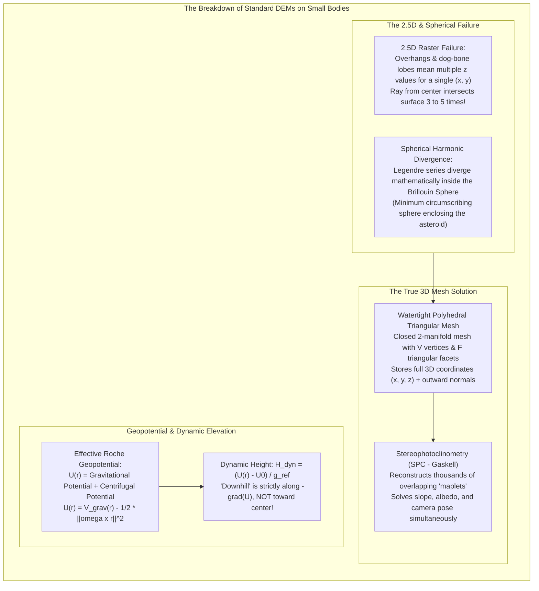
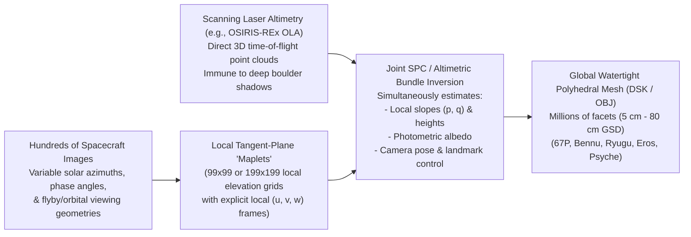

# Chapter 31: Planetary and Extraterrestrial DEMs (Moon, Mars, Asteroids, and Ocean Worlds)

*How mapping worlds without oceans, without GNSS, and sometimes without spherical symmetry forged modern photogrammetry and laser altimetry.*

---

## 31.3 Non-Spherical Small Bodies: Asteroids and Comets

On planets and large moons (Earth, Mars, the Moon), gravity is strong enough to force the body into hydrostatic equilibrium, creating a near-spherical oblate spheroid. On small solar system bodies—asteroids, comets, and small moons—self-gravity is too weak to overcome material shear strength. 

Bodies like comet **67P/Churyumov-Gerasimenko**, elongated stony asteroid **433 Eros**, contact-binary **25143 Itokawa**, carbonaceous rubble-piles **101955 Bennu** and **162173 Ryugu**, and metallic world **16 Psyche** exhibit bifurcated lobes, deep craters, vast overhangs, and extreme irregular geometry. In these environments, **all standard terrestrial 2.5D GIS conventions collapse**: lat-lon raster grids cannot represent multi-valued overhanging surfaces, exterior spherical harmonic series diverge mathematically inside the circumscribing Brillouin sphere, and physical "downhill" is governed by a coupled gravitational-centrifugal Roche geopotential where boulders roll outward toward the equator away from the center of mass.

---

### 31.3.1 The Breakdown of 2.5D Grids and the Brillouin Sphere

Attempting to represent a small body (such as asteroid 433 Eros or comet 67P) using a standard digital elevation raster $z = f(x, y)$ or a spherical coordinate radius grid $r = f(\lambda, \varphi_c)$ fails due to fundamental geometry:

#### 1. Multi-Valued Surfaces and Overhangs
On a contact binary or "dog-bone" body (e.g., Comet 67P with its two distinct lobes connected by a narrow neck):
* A single radial vector originating from the center of mass $(0, 0, 0)$ can penetrate through the "head," exit into empty space, enter the "neck," exit again, and enter the "body."
* The surface radius $r(\lambda, \varphi_c)$ has multiple values along the same line of sight. A standard 2.5D raster grid cannot store more than one height per coordinate, completely erasing undercuts, caves, and overhangs.

#### 2. The Brillouin Sphere Divergence
In global planetary geodesy, near-spherical shapes and external gravity fields are modeled using **fully normalized spherical harmonic expansions** in colatitude $\theta = \frac{\pi}{2} - \varphi_c$ and East longitude $\lambda$:
$$V_{\text{SH}}(r, \theta, \lambda) = -\frac{GM}{r} \sum_{n=0}^\infty \sum_{m=0}^n \left( \frac{R_{\text{ref}}}{r} \right)^n \bar{P}_{nm}(\cos\theta) \big( \bar{C}_{nm}\cos m\lambda + \bar{S}_{nm}\sin m\lambda \big)$$

* **The Mathematical Catastrophe:** By Laplace potential theory, an exterior solid-harmonic expansion in powers of $(R_{\text{ref}} / r)^{n+1}$ converges uniformly **if and only if** the evaluation radius $r$ lies strictly outside the **Brillouin Sphere** ($r > R_{\text{Brillouin}}$), defined as the minimum sphere centered at the body's center of mass that encloses every mass element of the body.
* For elongated S-type asteroid **433 Eros** (dimensions $34.4\text{ km} \times 11.2\text{ km} \times 11.2\text{ km}$, mapped by NEAR Shoemaker), the Brillouin sphere has radius $R_{\text{Brillouin}} \approx 17.2\text{ km}$, whereas the saddle depressions *Himeros* and *Shoemaker Regio* along its equatorial waist sit at $r \approx 5.5\text{ km}$—yielding an amplification ratio $(R_{\text{Brillouin}} / r) \approx 3.13$! At harmonic degree $n = 16$, $(3.13)^{16} \approx 8.4 \times 10^7$, amplifying minuscule coefficient truncation errors by eight orders of magnitude and causing the series to diverge violently on the surface. Even on metal-rich **16 Psyche** ($278\text{ km} \times 238\text{ km} \times 171\text{ km}$), polar impact basins sit nearly $50\text{ km}$ inside its Brillouin sphere ($R_{\text{Brillouin}} \approx 139\text{ km}$), rendering spherical harmonics unusable for surface slope or landing dynamics.

---

### 31.3.2 3D Polyhedral Models, Stereophotoclinometry (SPC), and Scanning Altimetry

To map irregular asteroids and comets without coordinate singularities or overhangs loss, planetary cartographers represent the surface as an explicit **Watertight Polyhedral Triangular Mesh** (stored in Wavefront `.obj`, Gaskell Implicitly Connected Quadrilateral `.icq`, or NAIF Type-2 `DSK` plate-model formats):
* A closed, oriented topological 2-manifold surface ($\chi = V - E + F = 2 - 2g$, with $g = 0$ for a genus-zero asteroid) composed of $V$ vertices $\mathbf{v}_i \in \mathbb{R}^3$ in body-fixed Cartesian kilometers and $F$ planar triangular facets $f_j = (v_{j, 1}, v_{j, 2}, v_{j, 3})$ ordered counterclockwise when viewed from outside.
* Every facet carries an explicit outward unit normal $\hat{\mathbf{n}}_j = \frac{(\mathbf{v}_{j,2}-\mathbf{v}_{j,1}) \times (\mathbf{v}_{j,3}-\mathbf{v}_{j,1})}{\|(\mathbf{v}_{j,2}-\mathbf{v}_{j,1}) \times (\mathbf{v}_{j,3}-\mathbf{v}_{j,1})\|}$, facet centroid $\mathbf{c}_j$, surface area $A_j$, and propagated 3D vertex covariance $\mathbf{\Sigma}_{\mathbf{v}_i}$.

#### 1. Stereophotoclinometry (SPC — Robert Gaskell)
The workhorse optical reconstruction method for small-body missions—deployed on NEAR at Eros, Hayabusa at Itokawa, Dawn at Vesta and Ceres, Rosetta at 67P (alongside multi-view stereo), Hayabusa2 at Ryugu, and OSIRIS-REx at Bennu—is **Stereophotoclinometry (SPC)** (Gaskell et al., 2008; Barnouin et al., 2019):
1. **Control Network & Maplet Tiling:** Thousands of overlapping local digital terrain patches called **maplets** (typically $99\times 99$ or $199\times 199$ grid nodes defined in each landmark's local tangent frame $[\hat{\mathbf{u}}, \hat{\mathbf{v}}, \hat{\mathbf{w}}]$) are distributed across the 3D surface, including vertical cliff walls and inverted overhangs on neck regions like 67P's *Hapi* valley.
2. **Coupled Stereo + Photometric Least-Squares Inversion:** Rather than treating geometric stereo disparity and shading separately, SPC models observed image radiance across $K$ multi-azimuth, multi-emission views using a Lunar-Lambertian or Hapke bidirectional reflectance function. It simultaneously solves for the two surface partial derivatives $(p, q)$ and relative optical albedo at every maplet pixel, integrates slopes via least-squares Poisson integration anchored by geometric stereo tie-points, and updates spacecraft camera poses (`CK`/`SPK`) in an iterative global bundle adjustment.
3. **Global Polyhedral Tessellation:** Overlapping maplets are conditioned and stitched—either via cubed-sphere / Implicitly Connected Quadrilateral (`ICQ`) indexing for star-shaped bodies or general 3D Poisson/Delaunay re-meshing for non-star-shaped bilobate nuclei—into hierarchical global shape models ranging from $49,152$ facets ($\sim 6\text{ m}$ facet spacing on Bennu) up to $>3.1\text{ million}$ facets ($5\text{–}20\text{ cm}$ ground sample distance at candidate touch-and-go sample sites).

#### 2. Cross-Validating SPC Against Scanning Laser Altimetry (OSIRIS-REx OLA)
Optical SPC relies on smooth reflectance assumptions that can under-predict the depth of narrow, shadowed inter-boulder cavities or confuse dark carbonaceous clasts with topographic depressions. At asteroid Bennu, the Canadian Space Agency's **OSIRIS-REx Laser Altimeter (OLA)**—a dual-laser scanning lidar firing at $10\text{ kHz}$ from $700\text{ m}$ orbital altitude—collected over $3\text{ billion}$ direct range returns to construct an independent $5\text{ cm}$ 3D polyhedral model without illumination bias. Differencing the OLA lidar mesh against the optical SPC mesh revealed that while global radii agreed within $\pm 15\text{ cm}$, SPC systematically smoothed high-aspect-ratio boulder edges and underestimated void depths inside shadows by $10\text{–}40\text{ cm}$—a critical forensic insight when certifying clearance for OSIRIS-REx's $3.4\text{ m}$ solar-array span inside the boulder-ringed *Nightingale* crater!

---

### 31.3.3 Dynamic Elevation and the Effective Roche Geopotential

On Earth, water flows downhill, and "elevation" corresponds closely to geometric height above a sphere because Earth rotates slowly ($\omega \approx 7.29 \times 10^{-5}\text{ rad/s}$) and gravity is strong ($g \approx 9.81\text{ m/s}^2$).

On small, rapidly rotating asteroids (such as Bennu, rotating every $4.3\text{ hours}$, or Ryugu, rotating every $7.6\text{ hours}$):
* Gravity is miniscule ($g \approx 10^{-5}\text{ to }10^{-4}\text{ m/s}^2$).
* Centrifugal acceleration $\mathbf{a}_{\text{cent}} = \boldsymbol{\omega} \times (\boldsymbol{\omega} \times \mathbf{r})$ is comparable in magnitude to gravitational attraction.
* **The Perceptual Paradox:** The geometric summit of an asteroid (the point with the greatest distance $r$ from the center of mass) is frequently a **gravitational depression**! Loose gravel and boulders roll *away* from the center of mass toward the equator.

#### 1. The Effective Roche Potential
In a body-fixed rotating coordinate frame, the total acceleration acting on a particle on the surface is the gradient of the **Effective Geopotential $U(\mathbf{r})$**:

$$U(\mathbf{r}) = V_{\text{grav}}(\mathbf{r}) + \Phi_{\text{centrifugal}}(\mathbf{r})$$

$$U(\mathbf{r}) = -G \iiint_{\mathcal{B}} \frac{\rho(\mathbf{r}')}{\|\mathbf{r} - \mathbf{r}'\|} \, dV' - \frac{1}{2} \|\boldsymbol{\omega} \times \mathbf{r}\|^2$$
where:
* $G$: Universal gravitational constant ($6.6743 \times 10^{-11}\text{ m}^3\text{kg}^{-1}\text{s}^{-2}$).
* $\rho(\mathbf{r}')$: Bulk density distribution inside the asteroid volume $\mathcal{B}$.
* $\boldsymbol{\omega}$: Planetary angular rotation vector ($\text{rad/s}$).

The effective gravity vector (the direction of a plumb line on the asteroid) is:
$$\mathbf{g}_{\text{eff}}(\mathbf{r}) = -\nabla U(\mathbf{r})$$

#### 2. Defining "Dynamic Height" (Geopotential Elevation)
On an asteroid, **geometrical distance from the center of mass is irrelevant to physics**. A boulder rolls, dust migrates, and a landing spacecraft settles strictly according to the **Effective Geopotential**:

Let $U_0$ be a reference geopotential level (e.g., the potential of the minimum-energy point or mean equatorial surface), and let $g_{\text{ref}}$ be a nominal reference surface gravity. The **Dynamic Elevation (Dynamic Height)** is defined as:

$$H_{\text{dynamic}}(\mathbf{r}) = \frac{U(\mathbf{r}) - U_0}{g_{\text{ref}}}$$

* **Physical Behavior:**
  * Water, dust, and boulders always flow strictly from **high dynamic elevation to low dynamic elevation** ($-\nabla U$).
  * On "top-shaped" rubble-pile asteroids like Bennu and Ryugu, centrifugal acceleration at the equator counteracts gravity so strongly that the elevated equatorial ridge represents the **lowest geopotential energy state**. Boulders roll "uphill" geometrically from the mid-latitudes toward the equator!
  * Mapping an asteroid for spacecraft landing (such as OSIRIS-REx's *Nightingale* sample collection site) requires rendering the surface not in meters of radius, but in **geopotential slope angle $\theta_{\text{slope}} = \arccos\left( \frac{-\mathbf{g}_{\text{eff}} \cdot \hat{\mathbf{n}}}{\|\mathbf{g}_{\text{eff}}\|} \right)$** and **dynamic elevation**, ensuring the lander does not touch down on a slope that causes it to slide into space.
