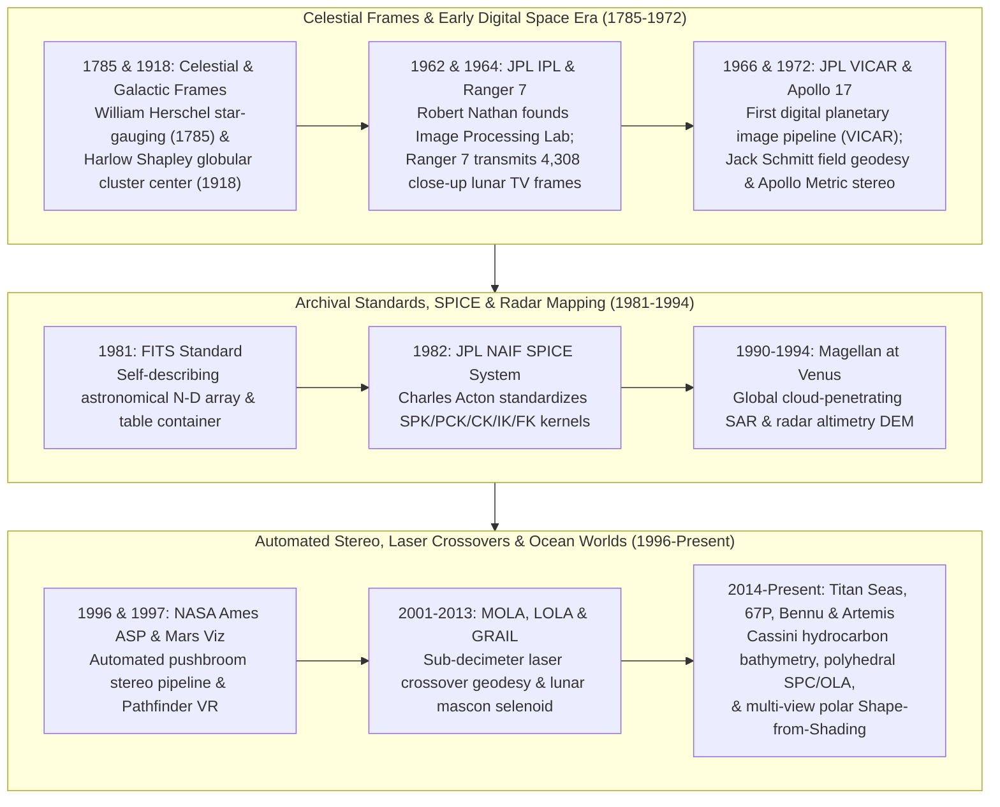

# Chapter 31: Planetary and Extraterrestrial DEMs (Moon, Mars, Asteroids, and Ocean Worlds)

*How mapping worlds without oceans, without GNSS, and sometimes without spherical symmetry forged modern photogrammetry and laser altimetry.*

---

## 31.4 Historical Evolution: From Ranger 7 to the Ames Stereo Pipeline

The methods used to process planetary digital elevation models did not originate in civilian commercial GIS; they were forged inside NASA, the Jet Propulsion Laboratory (JPL), and the US Geological Survey Astrogeology Science Center during the early space race. The milestones below, anchored in the `schwehr/gis-history` repository, trace the technical evolution of extraterrestrial elevation modeling from 1960s analog vidicon tubes to petascale automated stereopipelines.

---

### 31.4.1 Celestial Coordinate Precursors and the Lunar Space Race: 1785 to 1972

#### 1785 and 1918: Galactic Coordinate Systems (Herschel and Shapley)
Long before spacecraft left Earth, astronomers had to construct three-dimensional non-terrestrial coordinate frames without physical horizons. In **1785**, William Herschel introduced systematic quantitative "star-gauging" cross-sections defining an early **Galactic coordinate system** aligned with the plane of the Milky Way (`gis-history`). In **1918**, **Harlow Shapley** measured distances to RR Lyrae variable stars inside halo globular clusters, proving that the Solar System lies tens of thousands of light-years off-center from the true gravitational nucleus of the Milky Way in Sagittarius—directly inspiring the modern IAU Galactic coordinate frame and the barycentric inertial reference frames (`J2000` / ICRF) that anchor all deep-space trajectories today.

#### 1962: Foundation of the JPL Image Processing Laboratory (IPL)
In 1962, Dr. Robert Nathan at the Jet Propulsion Laboratory proposed and founded the **Image Processing Laboratory (IPL)** (`gis-history`). Tasked with reconstructing telemetry from the Ranger, Surveyor, and Mariner spacecraft, Nathan recognized that analog vidicon television scans transmitted across interplanetary distances suffered from geometric barrel/pincushion distortion (requiring physical focal-plane *réseau* grid calibration), non-linear radiometric response, and coherent RF interference. By writing digital deconvolution, geometric rubber-sheeting, and photometric flat-field routines, IPL invented the computational building blocks of modern remote sensing and Fred Billingsley's **1965** coinage of the word *"pixel"*.

#### 1964: Ranger 7 Lunar Impact
On July 31, 1964, **Ranger 7** transmitted $4,308$ progressively higher-resolution vidicon photographs during the final $17\text{ minutes}$ before impacting *Mare Cognitum*. Resolving micro-craters down to $\sim 0.5\text{ m}$ diameter via shadow-length and early photoclinometric slope estimates, Ranger 7 proved that lunar regolith possessed sufficient bearing strength to support the Apollo Lunar Module rather than swallowing landers in deep electrostatic dust.

#### 1966: The JPL VICAR Processing System
In 1966, JPL formalized **VICAR (Video Image Communication and Retrieval)** on IBM System/360 mainframes (`gis-history`):
* VICAR introduced modular command-line pipelines where self-describing ASCII metadata labels—storing camera focal lengths, calibrated *réseau* mark image coordinates, exposure durations, and planetary projection parameters—traveled permanently alongside the binary raster array.
* During the Mariner 9 (1971–1972, which mapped Mars globally after a planet-encircling dust storm cleared to reveal Olympus Mons and Valles Marineris) and Viking Orbiter (1976–1980) missions, VICAR and the USGS Flagstaff astrogeology team pioneered digital orthorectification and airbrush-shaded planetary quadrangles, directly inspiring USGS **ISIS** (Integrated Software for Imagers and Spectrometers).

#### 1972: Apollo 17 and Field Geodesy at Taurus-Littrow
In December 1972, **Apollo 17** landed in the *Taurus-Littrow* graben (`gis-history`). Lunar Module Pilot **Dr. Harrison "Jack" Schmitt**—the first and only professional geologist to walk on the Moon—executed systematic traverse station photogrammetry using calibrated tripod gnomons (providing local vertical plumb-line vectors and colorimetric reflectance standards) while Command Module Pilot Ronald Evans operated the **Apollo Metric Camera** ($76\text{ mm}$ focal length with stellar attitude camera and ruby laser altimeter) in lunar orbit. Those orbital metric film frames, reduced via analytical bundle adjustment by Defense Mapping Agency and USGS photogrammetrists, remained the most accurate regional lunar elevation control until the 21st century.

---

### 31.4.2 Archival Standards, SPICE Geometry, and Planetary Radar: 1981 to 1994

#### 1981: The FITS Format Standard
In 1981, astronomers formally adopted the **Flexible Image Transport System (FITS)** (`gis-history`), designed by Don Wells, Eric Greisen, and Ronald Harten. By pairing human-readable 80-character ASCII `KEYWORD = VALUE` header cards (including World Coordinate System `WCS` astrometric projections) with machine-independent IEEE big-endian binary $N$-dimensional arrays and tabular extensions, FITS became the model for multi-decade scientific archive longevity in NASA's Planetary Data System (PDS).

#### 1982: The JPL NAIF SPICE System
As Voyager 1 and 2 toured the outer giant-planet systems, reconstructing observation geometry from mission-specific tape formats grew intractable. Beginning in **1982**, NASA's **Navigation and Ancillary Information Facility (NAIF)** at JPL, led by Charles H. Acton, architected the **SPICE** (Spacecraft, Planet, Instrument, C-matrix, Events) information system (`gis-history`; Acton, 1996). Separating ephemerides (`SPK`), planetary constants (`PCK`), attitude quaternions (`CK`), optical models (`IK`), frames (`FK`), and clocks (`SCLK`/`LSK`) into standardized kernels transformed planetary mapping into a reproducible, open geodetic discipline.

#### 1990–1994: Magellan Radar Altimetry and Stereo SAR at Venus
Shrouded beneath a $92\text{ bar}$ sulfuric-acid cloud deck opaque to optical cameras and lasers, Venus could only be mapped via microwave radar. Between 1990 and 1994, NASA's **Magellan** spacecraft mapped $98\%$ of Venus using $2.385\text{ GHz}$ S-band Synthetic Aperture Radar ($100\text{ m}$ resolution) and nadir radar altimetry, followed by opposite-side/same-side radargrammetric stereo DEM extraction—forging spaceborne radar elevation processing workflows directly prior to Earth's 2000 Shuttle Radar Topography Mission (SRTM).

---

### 31.4.3 Automated Stereo Pipelines, Laser Crossovers, and Small-Body Worlds: 1996 to Present

#### 1996–1997: The NASA Ames Stereo Pipeline (ASP) and Mars Pathfinder Viz
In **1996**, researchers in the Intelligent Mechanisms / Intelligent Robotics Group at NASA Ames Research Center began developing the **Ames Stereo Pipeline (ASP)** (`gis-history`; Beyer et al., 2018), followed in **1997** by **NASA Ames Viz** (`gis-history`). When *Mars Pathfinder* landed in Ares Vallis on July 4, 1997, Ames automated stereo correlation converted panoramic pairs from the Imager for Mars Pathfinder (IMP) into metric 3D meshes within hours of downlink, enabling mission planners wearing VR headsets or using SGI workstations to measure rock heights and plan *Sojourner* rover waypoints interactively—a paradigm subsequently scaled to Spirit, Opportunity, Curiosity, Perseverance, and orbital pushbroom mapping across the Solar System (`parallel_stereo`, `jitter_solve`, `sfs`).

#### 2001–2013: MOLA, LOLA, and GRAIL Global Geodetic Frameworks
In **2001**, Smith et al. and Neumann et al. published the global $463\text{ m/pixel}$ **MOLA** laser altimeter topography of Mars ($>600\text{ million}$ shots, sub-meter crossover accuracy), permanently retiring atmospheric-pressure vertical datums in favor of the equipotential MOLA areoid. Launched in **2009**, LRO's five-spot **LOLA** laser altimeter collected nearly $7\text{ billion}$ lunar elevation points (Smith et al., 2010; Mazarico et al., 2012), which—paired with **GRAIL**'s degree-1200 gravity selenoid (Zuber et al., 2013)—established decimeter-level lunar geodetic control.

#### 2014–Present: Hydrocarbon Bathymetry, Polyhedral Asteroids, and Lunar Polar SfS
In **2014**, Cassini RADAR achieved the first extraterrestrial seafloor bathymetry through Titan's liquid methane seas (Mastrogiuseppe et al., 2014), while ESA's *Rosetta* mapped bilobate comet **67P/Churyumov-Gerasimenko** in full 3D. Between **2018 and 2020**, JAXA's *Hayabusa2* at Ryugu and NASA's *OSIRIS-REx* at Bennu (combining Gaskell SPC with CSA's scanning OLA lidar; Barnouin et al., 2019) operationalized centimeter-scale polyhedral Roche-geopotential meshes for autonomous Touch-And-Go sampling, while multi-view Shape-from-Shading (`sfs`; Alexandrov & Beyer, 2018) and Mars 2020 onboard Terrain-Relative Navigation (Lander Vision System) brought real-time sub-meter DEM hazard avoidance to operational fruition.

---

### 31.4.4 Bidirectional Technology Transfer Back to Terrestrial Elevation Science

Planetary elevation mapping has repeatedly exported breakthrough algorithms back into Earth observation and marine geophysics (`gis-history`):
* **Declassified Cold-War Reconnaissance & Commercial Pushbroom Stereo:** Because NASA Ames Stereo Pipeline (ASP, 1996) was engineered from inception to solve rigorous linescan and panoramic camera models without GNSS or dense GCPs, terrestrial glaciologists and tectonic geomorphologists adopted ASP to process declassified 1960s **CORONA KH-4B** panoramic spy-satellite film (1959–1972) as well as commercial WorldView, Pléiades, and Planet SkySat stereo pairs (`xdem` / ASP workflows).
* **Altimeter Crossover Geodesy:** Orbit crossover minimization algorithms pioneered for MOLA and LOLA directly informed cryospheric elevation-change inversions on Earth's ICESat, CryoSat-2, and ICESat-2 polar missions—and inspired autonomous underwater vehicle (AUV) bathymetric swath self-consistency SLAM in GNSS-denied deep-ocean and sub-ice-shelf environments.
* **OGC / PROJ Planetary Coordinate Standardization:** Following the **2018 PROJ RFC 1** and **2019 GDAL RFC 73 (WKT2)** modernization (`gis-history`), the Open Geospatial Consortium and IAU integrated official `IAU_2015` authority codes (e.g., `IAU_2015:49900` for Mars planetocentric, `IAU_2015:30100` for Moon) directly into `proj.db`, allowing standard terrestrial GIS tools (GDAL, QGIS, PostGIS) to transform extraterrestrial DEMs without ad-hoc spherical hacks.
